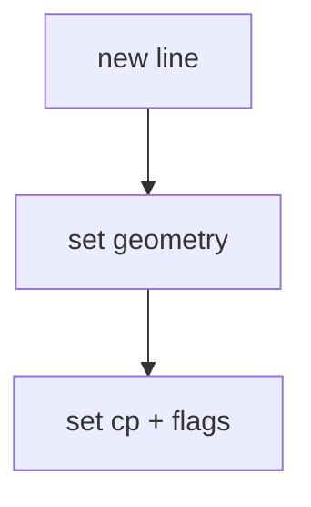

# 02_function_typo_line — TypoTextLine 结构：run 几何 + flags

| 项 | 值 |
|----|----|
| feature | wr-01-typo-cache |
| order | 2 |
| crate | `libs/word-core/Cargo.toml` |
| 入口 | TypoTextLine 构造 / setY / setHeight / setCpRange / setFlags / getPara |
| 独立性 | 可单独测；插入页在 01 |
| 测试状态 | pass |

## 1. 功能说明

### 1.1 一句话

一行文本的几何与 cp：y/height/ascent/descent、graph 下标、FIRST/LAST para、LAST page 等 flags。Java 类名 TypoTextLine。

### 1.2 输入

| 入口 | 输入 | Java 路径 |
|------|------|-----------|
| 构造 | y,h,asc,desc,startCp,endCp,flags | TypoTextLine.java |

### 1.3 输出

| 字段/副作用 | 含义 |
|-------------|------|
| 几何 | twip |
| flags | bitset 子集 |
| graphIndexStart/End | run 下标 |

### 1.4 上游

01 提供页容器（测试可只测行对象）。

### 1.5 下游

03 Snapshot；wr-04 写入真实几何。

### 1.6 关键不变量（钉死）

1. 行 cp 半开；与 TypoRangeBase 规则相同。
2. FLAG_LASTLINEOFPAGE 只表示本行是页最后一行，不自动改 Snapshot 页数。
3. graph_end >= graph_start。

### 1.7 依赖与实现状态（必写，着重）

| 依赖 | 归属 | 本 function 需要的接口 | 已实现 | 暂缓（保留 Java 注释+签名） | 禁止本 function 去改 |
|------|------|------------------------|--------|-----------------------------|----------------------|
| TypoTextLine.java flags | cache | BoolBitSet 子集 | 本轮 must-write 子集 | SHD/Border/Highlight 槽 | 不改 LineLayouter |
| TypoPara | cache | getPara id | 用 i32 id stub | graph 数组本体 | 不新建 TypoPara 全文件 |

## 2. 核心代码与流程

Java：`koffice/writer/core/cn/wps/moffice/writer/cache/TypoTextLine.java`
Rust：`libs/word-core/src/cn/wps/moffice/writer/cache/TypoTextLine.rs`（loop 新建或改写）



## 3. 测试方案

### 3.1 代码审计与测试面

| symbol | Java/Rust 路径 | 输入/状态 | 输出/副作用 | 关键分支/错误 |
|--------|----------------|-----------|-------------|---------------|
| setYPos/getYPos | TypoTextLine.java:182-187 | y twip | roundtrip | 槽 22 |
| setTextRectHeight/getTextRectHeight | :100-110 | h twip | roundtrip | 槽 9 |
| setAscDesPos / getAscentPos/getDescentPos | :104-122 | asc/des | roundtrip | 槽 10/11 |
| getStartCP/getEndCP/contains | :451-477 | Java 经 TypoPara；MVP 存绝对半开 cp | contains iff start<=cp<end | para=0 时 Java 返回 -1 |
| setLastLineOfPage / isLastLineOfPage | :343-344, :439 | FLAG bit 7 | bool | 不改 Snapshot |
| setFirstLineOfPara / isFirstLineOfPara | :331-333, :427 | FLAG bit 0 | bool | |
| graph index | :154-176 | start/end | end>=start 由调用方保证 | |

### 3.2 覆盖矩阵

| coverage_id | 接口/代码路径 | 场景类别 | 必测? | test_id / 未覆盖理由 |
|-------------|---------------|----------|-------|----------------------|
| TL-GEO | y/h/asc/desc | 主路径 | 是 | TL1 |
| TL-CP | 半开 cp | 边界 | 是 | TL2 |
| TL-FLAG | last page / first para | 分支 | 是 | TL3 |
| TL-GRAPH | index 区间 | 主路径 | 是 | TL4 |

### 3.3 可测试性

不开完整 docx 管线。用内存构造结构体 / 假上游输出。坐标单位 twip。

### 3.4 用例表

| id | 覆盖项 | 前置状态 | 输入摘要 | 期望输出/副作用 | 失败语义 |
|----|--------|----------|----------|-----------------|----------|
| TL1 | TL-GEO | — | y=1440 h=240 | getters | 几何丢 |
| TL2 | TL-CP | 0,5 | contains 0/4/5 | T/T/F | 半开错 |
| TL3 | TL-FLAG | — | set last-of-page | true | flag 丢 |
| TL4 | TL-GRAPH | — | 0,3 | end>=start | 下标错 |

### 3.5 测试代码位置

crate: `libs/word-core/Cargo.toml`
src:   `libs/word-core/src/cn/wps/moffice/writer/cache/TypoTextLine.rs`
test:  `libs/word-core/tests/cn/wps/moffice/writer/cache/TypoTextLine.rs`

### 3.6 测试运行脚本

```bash
cargo test --manifest-path libs/word-core/Cargo.toml --test 02_function_typo_line

bash .cursor/skills/feature-function/scripts/function-coverage.sh \
  --crate libs/word-core --test 02_function_typo_line \
  --src src/cn/wps/moffice/writer/cache/TypoTextLine.rs \
  --report libs/word-core/layout/features/wr-01-typo-cache/functions/02_function_typo_line/FUNCTION.md
```

### 3.7 覆盖率报告

<!-- coverage-report:begin -->
tool: cargo-llvm-cov (`cargo llvm-cov --test 02_function_typo_line --json`)
date: 2026-08-22 01:40

| src | lines covered | line % | regions covered | region % |
|-----|---------------|--------|-----------------|----------|
| `src/cn/wps/moffice/writer/cache/TypoTextLine.rs` | 61/304 | 20.1% | 72/315 | 22.9% |
| **function total** | **61/304** | **20.1%** |  |  |
<!-- coverage-report:end -->

### 3.8 模板布局校验（必跑，PASS 才能标 pass）

```bash
node .cursor/skills/function-java2rust/scripts/check-template-layout.mjs \
  --rs libs/word-core/src/cn/wps/moffice/writer/cache/TypoTextLine.rs \
  --java koffice/writer/core/cn/wps/moffice/writer/cache/TypoTextLine.java
```

**本轮结果：** TypoTextLine.rs PASS。
