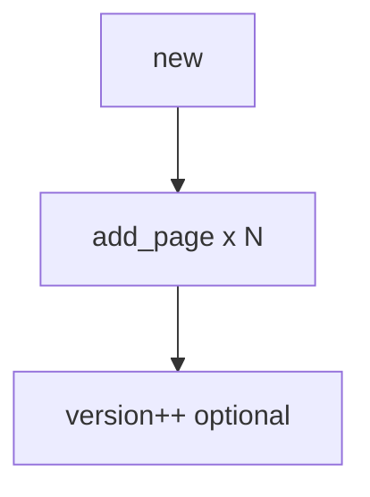

# 03_function_typo_snapshot — TypoSnapshot：页集合 + version

| 项 | 值 |
|----|----|
| feature | wr-01-typo-cache |
| order | 3 |
| crate | `libs/word-core/Cargo.toml` |
| 入口 | TypoSnapshot::new / add_page / page_count / get_page / bump_version |
| 独立性 | 不 fork、不 refcount 竞技场 |
| 测试状态 | pass |

## 1. 功能说明

### 1.1 一句话

单次排版结果容器：页列表 + version。Java commit 语义的数据面；commit 回调在 wr-06。

### 1.2 输入

| 入口 | 输入 | Java 路径 |
|------|------|-----------|
| add_page | TypoPage | TypoSnapshot.java getLayoutPageList |

### 1.3 输出

| 字段/副作用 | 含义 |
|-------------|------|
| pages | 有序 |
| version | 递增 |

### 1.4 上游

01/02。

### 1.5 下游

04 iterator；wr-06 commit；wr-07 遍历。

### 1.6 关键不变量（钉死）

1. page_count == pages.len。
2. get_page(i) i 越界 → None/panic 与 Java 一致需在测试钉死（建议 None）。
3. 本 function 不调用 ISnapshotListener。

### 1.7 依赖与实现状态（必写，着重）

| 依赖 | 归属 | 本 function 需要的接口 | 已实现 | 暂缓（保留 Java 注释+签名） | 禁止本 function 去改 |
|------|------|------------------------|--------|-----------------------------|----------------------|
| TypoPage | 01 | owned page | 01 must | LayoutPage drawings | 不改 FlowLayout |
| TypoSnapshot.alloc | Java 竞技场 | — | 暂缓 | alloc/set/fork 全套 | 禁止本轮实现指针槽 |

## 2. 核心代码与流程

Java：`koffice/writer/core/cn/wps/moffice/writer/cache/TypoSnapshot.java`
Rust：`libs/word-core/src/cn/wps/moffice/writer/cache/TypoSnapshot.rs`（loop 新建或改写）



## 3. 测试方案

### 3.1 代码审计与测试面

| symbol | Java/Rust 路径 | 输入/状态 | 输出/副作用 | 关键分支/错误 |
|--------|----------------|-----------|-------------|---------------|
| create/add | TypoSnapshot 页表 | 0/1/N 页 | count | — |
| get_page | index | 合法/越界 | Some/None | 越界 |

### 3.2 覆盖矩阵

| coverage_id | 接口/代码路径 | 场景类别 | 必测? | test_id / 未覆盖理由 |
|-------------|---------------|----------|-------|----------------------|
| TS-EMPTY | new | 边界 | 是 | TS1 |
| TS-ADD | 1/N 页 | 主路径 | 是 | TS2 |
| TS-OOB | get_page(-1/len) | 失败 | 是 | TS3 |
| TS-VER | bump | 状态 | 是 | TS4 |

### 3.3 可测试性

不开完整 docx 管线。用内存构造结构体 / 假上游输出。坐标单位 twip。

### 3.4 用例表

| id | 覆盖项 | 前置状态 | 输入摘要 | 期望输出/副作用 | 失败语义 |
|----|--------|----------|----------|-----------------|----------|
| TS1 | TS-EMPTY | new | — | count=0 | 非空 |
| TS2 | TS-ADD | 空 | add 2 | count=2 顺序 | 丢页 |
| TS3 | TS-OOB | 1 页 | get 1 | None | 误 Some |
| TS4 | TS-VER | 0 | bump | version+1 | 未增 |

### 3.5 测试代码位置

crate: `libs/word-core/Cargo.toml`
src:   `libs/word-core/src/cn/wps/moffice/writer/cache/TypoSnapshot.rs`
test:  `libs/word-core/tests/cn/wps/moffice/writer/cache/TypoSnapshot.rs`

### 3.6 测试运行脚本

```bash
cargo test --manifest-path libs/word-core/Cargo.toml --test 03_function_typo_snapshot

bash .cursor/skills/feature-function/scripts/function-coverage.sh \
  --crate libs/word-core --test 03_function_typo_snapshot \
  --src src/cn/wps/moffice/writer/cache/TypoSnapshot.rs \
  --report libs/word-core/layout/features/wr-01-typo-cache/functions/03_function_typo_snapshot/FUNCTION.md
```

### 3.7 覆盖率报告

<!-- coverage-report:begin -->
tool: cargo-llvm-cov (`cargo llvm-cov --test 03_function_typo_snapshot --json`)
date: 2026-08-22 01:52

| src | lines covered | line % | regions covered | region % |
|-----|---------------|--------|-----------------|----------|
| `src/cn/wps/moffice/writer/cache/TypoSnapshot.rs` | 21/365 | 5.8% | 24/376 | 6.4% |
| **function total** | **21/365** | **5.8%** |  |  |
<!-- coverage-report:end -->

### 3.8 模板布局校验（必跑，PASS 才能标 pass）

```bash
node .cursor/skills/function-java2rust/scripts/check-template-layout.mjs \
  --rs libs/word-core/src/cn/wps/moffice/writer/cache/TypoSnapshot.rs \
  --java koffice/writer/core/cn/wps/moffice/writer/cache/TypoSnapshot.java
```

**本轮结果：** TypoSnapshot.rs PASS。
