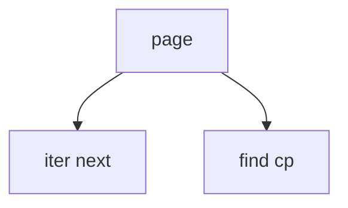

# 04_function_typo_iterator — TypoPageLinesIterator + cp 命中

| 项 | 值 |
|----|----|
| feature | wr-01-typo-cache |
| order | 4 |
| crate | `libs/word-core/Cargo.toml` |
| 入口 | TypoPageLinesIterator / page.line_at / find_line_containing(cp) |
| 独立性 | 只读遍历 |
| 测试状态 | pass |

## 1. 功能说明

### 1.1 一句话

按插入序遍历页内行；用行 cp 半开区间做点命中。

### 1.2 输入

| 入口 | 输入 | Java 路径 |
|------|------|-----------|
| iterator | TypoPage 已有 0/1/N 行 | TypoPageLinesIterator.java |

### 1.3 输出

| 字段/副作用 | 含义 |
|-------------|------|
| next 序列 | 与 insert 序相同 |
| find_line_containing | Option 行 |

### 1.4 上游

03。

### 1.5 下游

命中测试完整版在 LayoutService（defer）。

### 1.6 关键不变量（钉死）

1. 空页 iterator 立即结束。
2. cp 落在行 [start,end) 则命中该行；一行只命中一次。
3. 不修改页。

### 1.7 依赖与实现状态（必写，着重）

| 依赖 | 归属 | 本 function 需要的接口 | 已实现 | 暂缓（保留 Java 注释+签名） | 禁止本 function 去改 |
|------|------|------------------------|--------|-----------------------------|----------------------|
| TypoPageLinesIterator.java | cache | next/hasNext | 本轮 must-write forward | insert-middle | 不改 LocateTool |

## 2. 核心代码与流程

Java：`koffice/writer/core/cn/wps/moffice/writer/cache/TypoPageLinesIterator.java`
Rust：`libs/word-core/src/cn/wps/moffice/writer/cache/TypoPageLinesIterator.rs`（loop 新建或改写）



## 3. 测试方案

### 3.1 代码审计与测试面

| symbol | Java/Rust 路径 | 输入/状态 | 输出/副作用 | 关键分支/错误 |
|--------|----------------|-----------|-------------|---------------|
| next | Iterator.java | 0/1/N | 序列 | — |
| find cp | 行 contains | 命中/间隙/越界 | Option | 间隙 |

### 3.2 覆盖矩阵

| coverage_id | 接口/代码路径 | 场景类别 | 必测? | test_id / 未覆盖理由 |
|-------------|---------------|----------|-------|----------------------|
| IT-EMPTY | 空页 | 边界 | 是 | IT1 |
| IT-N | N 行序 | 主路径 | 是 | IT2 |
| IT-HIT | cp 命中 | 主路径 | 是 | IT3 |
| IT-MISS | 间隙/页外 | 边界 | 是 | IT4 |

### 3.3 可测试性

不开完整 docx 管线。用内存构造结构体 / 假上游输出。坐标单位 twip。

### 3.4 用例表

| id | 覆盖项 | 前置状态 | 输入摘要 | 期望输出/副作用 | 失败语义 |
|----|--------|----------|----------|-----------------|----------|
| IT1 | IT-EMPTY | 0 行 | iter | 无 next | 误产 |
| IT2 | IT-N | 3 行 | iter | 序=插入序 | 乱序 |
| IT3 | IT-HIT | 行 [10,20) | cp=10 | 命中 | 未中 |
| IT4 | IT-MISS | 同上 | cp=20 | None | 误中 |

### 3.5 测试代码位置

crate: `libs/word-core/Cargo.toml`
src:   `libs/word-core/src/cn/wps/moffice/writer/cache/TypoPageLinesIterator.rs`
test:  `libs/word-core/tests/cn/wps/moffice/writer/cache/TypoPageLinesIterator.rs`

### 3.6 测试运行脚本

```bash
cargo test --manifest-path libs/word-core/Cargo.toml --test 04_function_typo_iterator

bash .cursor/skills/feature-function/scripts/function-coverage.sh \
  --crate libs/word-core --test 04_function_typo_iterator \
  --src src/cn/wps/moffice/writer/cache/TypoPageLinesIterator.rs \
  --report libs/word-core/layout/features/wr-01-typo-cache/functions/04_function_typo_iterator/FUNCTION.md
```

### 3.7 覆盖率报告

<!-- coverage-report:begin -->
tool: cargo-llvm-cov (`cargo llvm-cov --test 04_function_typo_iterator --json`)
date: 2026-08-22 01:56

| src | lines covered | line % | regions covered | region % |
|-----|---------------|--------|-----------------|----------|
| `src/cn/wps/moffice/writer/cache/TypoPageLinesIterator.rs` | 35/102 | 34.3% | 35/106 | 33.0% |
| **function total** | **35/102** | **34.3%** |  |  |
<!-- coverage-report:end -->

### 3.8 模板布局校验（必跑，PASS 才能标 pass）

```bash
node .cursor/skills/function-java2rust/scripts/check-template-layout.mjs \
  --rs libs/word-core/src/cn/wps/moffice/writer/cache/TypoPageLinesIterator.rs \
  --java koffice/writer/core/cn/wps/moffice/writer/cache/TypoPageLinesIterator.java
```

校验：`// java` 行数不降。**本轮结果：** TypoPageLinesIterator.rs PASS。
