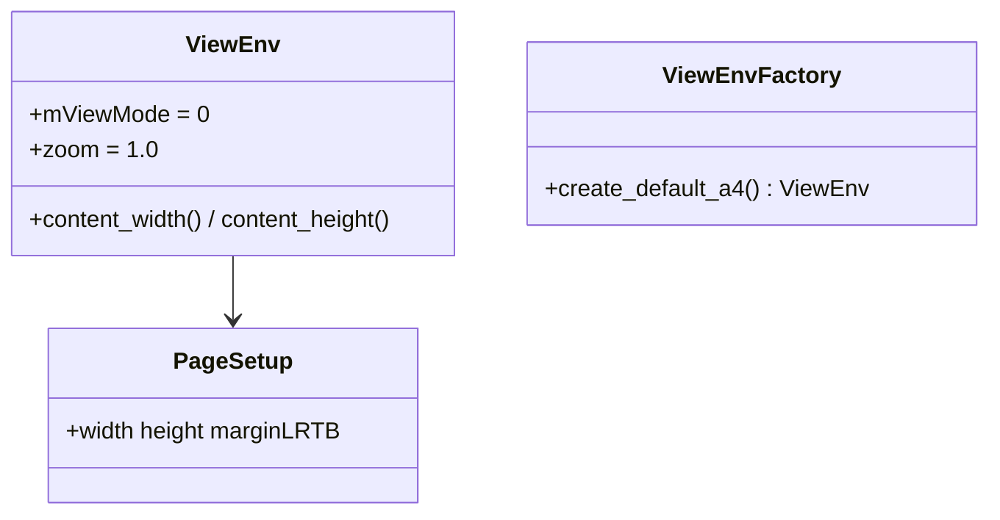

# wr-02-viewenv — ViewEnv + 默认页几何

> 输入：节 PageSetup 或常量；输出：内容区宽高、MODE_PAGE、zoom=1。  
> Java：`layout/base/env/ViewEnv.java`（828）+ `data/value/PageSetup.java` + `ViewEnvFactory`.  
> Rust：PageSetup **已存在**；ViewEnv **无**。

## 0. 目标

MVP 固定打印页模式，切断 `IViewSettings` / `ITextView` Android 依赖。

## 1. 类图

Java ViewEnv 大量气球/修订/PhoneView 字段：**stub 默认值**，must-write 仅 mode/尺寸/内容区。

**内容区（钉死）：**
`content_width = page.width - marginLeft - marginRight`  
`content_height = page.height - marginTop - marginBottom`  
默认 `PageSetup(11906, 16838, 1800, 1800, 1440, 1440)` → 内容宽 11906-1800-1800=8306；高 16838-1440-1440=13958。

## 2. must / stub / defer

must：PageSetup 常量接入 ViewEnv；content 尺寸；MODE_PAGE=0。  
stub：气球、修订、Web/Phone margin、tabWidth 等字段默认。  
defer：ViewEnvFactory 从 IViewSettings 全量映射、ITextView.getWidth。

## 3. Java ↔ Rust

| Java | Rust | 本轮 |
|------|------|------|
| PageSetup.java | data/value/PageSetup.rs | **已实现** call-only |
| ViewEnv.java | layout/base/env/ViewEnv.rs | must-write 子集 |
| ViewEnvFactory.java | 同目录 | must：`create_default_a4` |
| IViewSettings.java | — | stub trait 可选；MVP 不实现 |
