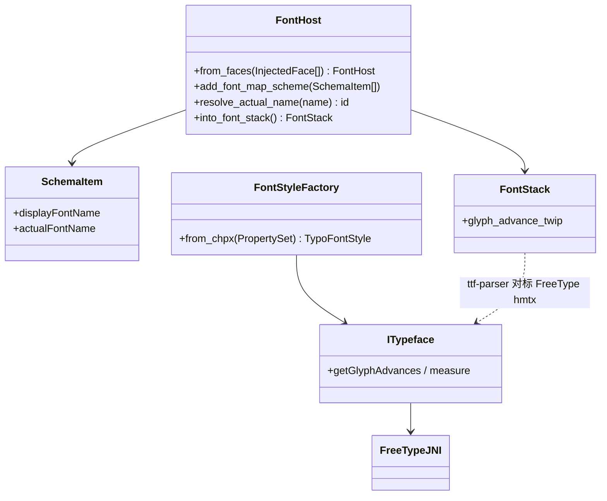

# wr-03-measure-shape — 文本度量桥

> 正文路径：FontStyleFactory → ITypeface → FreeTypeJNI。**不**走 RichTextLayout。  
> Java：`layout/base/env/FontStyleFactory.java` + `font/impl/AndroidTypeface.java` + `FreeTypeJNI.java`  
> Rust：`core_libs_font` **可编译**；word-core 未接线。

## 0. 目标

给定 run 文本 + 字号/粗体，输出宽度（twip）与默认行 ascent/descent。单字体栈。

## 1. 类图

宿主注入 `FontBlob` 对标 Java `Platform.getAllFontsDirectory` 扫到的文件，见 [FONT_HOST_DEV_PLAN.md](../../FONT_HOST_DEV_PLAN.md)。

## 2. must / stub / defer

must：字号 pt→twip；`getWriterLayoutAdavances*`（100px 标定 + sticky）；ascent/descent 走 TTFHeader；**缺字 fallback 链（打包 TTF，禁止静默 width=size）**；与 Java 100px advance 黄金表相等。  
stub：kerning 精细。  
defer：RichTextLayout、WordArt、bidi、复杂脚本。  
**禁止：** 链 `android.graphics.Paint`；把 Paint 回退删掉却不提供等价宽度预言机（会导致换行连锁，产品不可接受）。详见 [MEASURE_DRAW_INSTRUCTION.md](../../MEASURE_DRAW_INSTRUCTION.md) §4。

## 3. 单位

Java 内部混用 px/twip。MVP：**measure 返回 twip**，与页几何同一坐标系。`twip = pt * 20`（1pt=20twip）。

## 4. Java ↔ Rust

| Java | Rust | 本轮 |
|------|------|------|
| FreeTypeJNI | libs/core-libs/thirdparty/font | **已实现** call-only |
| AndroidTypeface | 同 crate ITypeface | 封装；**禁止 Android Paint**；**必须** FT + 打包 fallback（角色=Paint） |
| FontHost / FontTool.addFontMapScheme | word-core `layout/text/FontHost.rs` | **04_function_font_host**：注入表 + SchemaItem；不扫盘 |
| FontStyleFactory | word-core layout/env | must-write 最小（size/bold/color） |
| RichTextLayout | wpslayout 壳 | **禁止本 feature 去修整 crate 编译**（可另开审计任务） |
