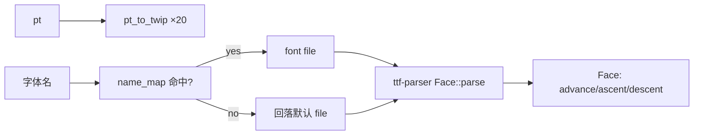

# 01_function_font_stack — 字体栈与 pt 换算（ttf-parser 后端）

| 项 | 值 |
|----|----|
| feature | wr-03-measure-shape |
| order | 1 |
| crate | `libs/word-core/Cargo.toml` |
| 入口 | `FontStack::default()` / `FontStack::from_font_file(path)` / `pt_to_twip(pt)` / `font_id(name) -> Face 句柄` |
| 独立性 | 纯 Rust 度量后端（ttf-parser），零平台 .so；不测 RichTextLayout |
| 测试状态 | 后端测试 7/7（2026-10-04）；Java 字体来源与同名门面仍未验收 |

## 1. 功能说明

### 1.1 一句话
把「字体名/字号」解析成可度量的 `ttf-parser::Face`：`pt↔twip` 换算（1pt=20twip）、字体名→文件→Face 的加载与回落。**不含 shaping**（连字/挤压由后续 wr-03/04 + rustybuzz 承接）。

### 1.2 输入

| 入口 | 输入 | Java 对标 |
|------|------|-----------|
| `default()` | 平台默认字体（探测 `/system/fonts`、`/System/Library/Fonts`、`/usr/share/fonts`） | AndroidTypeface.java（系统默认） |
| `from_font_file(path)` | 字体文件路径（TTF/OTF/TTC） | FreeTypeJNI.newTypeface（缺 so，未用） |
| `pt_to_twip(pt)` | 字号（pt） | Paint/pt 语义 |
| `font_id(name)` | 字体名（docDefaults rPr 字体名） | 字体别名解析 |

### 1.3 输出

| 字段/副作用 | 含义 |
|------|------|
| `Face<'a>` | ttf-parser 度量句柄（advance/ascent/descent 由此取） |
| `pt_to_twip(10.5)` | 210（四舍五入到 i32） |
| 失败路径 | `Result<_, FontError>`（坏文件/不支持表） |

### 1.4 上游

- `ttf-parser 0.24`（**已加入 word-core Cargo.toml**；MIT，纯 Rust，无 unsafe）。
- `core_libs_font` 编译面可用但其 `FreeTypeJNI` 为壳（无 freetype-jni .so）→ **不作为度量后端**（保留为 Backend B 占位）。

### 1.5 下游

02 `run_metrics`（逐字符 advance）→ wr-04 LineMetrics → wr-07 指令坐标。

### 1.6 关键不变量（钉死）

1. `pt_to_twip(n) = round(n × 20)`（钉死：10.5 → 210）。
2. **度量后端不得依赖平台 .so**（MVP 门闩）：热路径走 ttf-parser。
3. 未知名回落默认字体（不 panic）；坏路径 → `Err`。
4. 字符 advance 语义 = hmtx 表 advance（与 Java FreeType 同源）；黄金样本对照差 >0.5twip 判失败。

### 1.7 依赖与实现状态（必写，着重）

| 依赖 | 归属 | 本 function 需要的接口 | 已实现 | 暂缓 | 禁止本 function 去改 |
|------|------|------|------|------|------|
| `ttf-parser 0.24` | crates.io | `Face::parse(&[u8], index)`、`glyph_index`、`glyph_hor_advance`、`ascender/descender`、`units_per_em` | **已实现**（FontStack.rs） | TTC 子字体索引由调用方传入（测试只用 0） | — |
| `core_libs_font/FreeTypeJNI` | thirdparty/font | newTypeface（度量） | 壳（无 so） | Backend B：保留链接语义占位 | 不改 JNI 壳 |
| 字体文件 | 资源/系统路径 | fixture + 平台目录探测 | fixture：`tests/fixtures/01_function_font_stack/TestFont.ttf`（fontTools 生成，upem=1000，含 A/H/e/l/o） | 复杂字体族匹配 | — |
| KStyles.rPrDefault | wc-02 | 缺省字体名/字号（prop 3/10） | 已实现 | — | — |

### 1.8 平台 so 缺失的解决方案（钉死）

Java 度量依赖 `libfreetype-jni.so`（Android）；Rust 构建没有。**方案 = 双后端，MVP 默认纯 Rust**：

```rust
enum MeasureBackend {
    TtfParser(ttf_parser::Face<'static>),  // Backend A（MVP 默认，本 function 落地）
    FreetypeJni(…),                         // Backend B（延后，.so 就绪后 FFI 接入）
}
struct FontStack {
    backend: MeasureBackend,
    pt_twip: i32,            // ×20 常量
    name_map: HashMap<String, PathBuf>,  // 字体名→文件（缺省回落）
}
```
- Backend A 与 FreeType 同读 hmtx → advance 一致；Stage2 ±0.01px 容差覆盖舍入。
- Flutter 分工不变：度量在 Rust（确定性），字形绘制在 Flutter TextPainter。
- 对比门闩：同一 TTF 下 ttf-parser advance vs Java FreeType advance，差 >0.5twip 判失败。

### 1.9 MVP 实现库：钉死为 `ttf-parser`（禁止自研字体引擎）

**决策（2026-08-22）**：`01_function_font_stack` 的度量后端一律走开源库 **`ttf-parser 0.24`**（RazrFalcon，crates.io，MIT，纯 Rust、无 unsafe、无 so）。**不手写 cmap/hmtx/hhea 解析**——本 function 只负责业务胶水：字体名→文件映射、文件→`Face`、字号单位换算。

| 库 | 版本 | 用途 | 状态 |
|----|------|------|------|
| **`ttf-parser`** | **0.24**（已入 word-core Cargo.toml） | **MVP 唯一度量库**：Face/字符 advance/ascender/descender | ✅ 必须 |
| `rustybuzz` | 未引入 | shaping（连字/标点挤压/复杂脚本） | 后续 wr-04 开标点挤压时再加 |
| `freetype`（FFI 绑系统库） | 未引入 | Android 无公开系统 FreeType → 不可用 | ❌ 不引入 |
| `ab_glyph`/`fontdue`/`allsorts` | 未引入 | 偏高层/重/维护慢 | ❌ 不引入 |

**ttf-parser API 契约（实现时直接用，钉死）**：
```rust
use ttf_parser::{Face, GlyphId};
let face = Face::parse(font_bytes, index /*TTC 子字体*/)?;
let gid: Option<GlyphId> = face.glyph_index('A');              // cmap 查找
let advance_units: u16 = face.glyph_hor_advance(gid).unwrap_or(0); // hmtx
let asc = face.ascender();  // hhea（字体单位）
let desc = face.descender();
let upem = face.units_per_em();   // 换算基准
// 换算契约：advance_twip = round(advance_units * pt * 20 / upem)
```
- 多字体集合（.ttc）用 `Face::parse(data, index_in_collection, 0)`（MVP 最小集：index 由调用方给，测试只测单字体）。
- 可变字体（gvar）不启用（不设 `variable-fonts` feature）；`glyph_hor_advance` 在非可变路径即 hmtx 静态值，与 FreeType 默认一致。

**边界声明**：
1. 本 function 手写代码 = name_map + pt/twip 换算 + Face 封装 ≤ 300 行；**字体表解析零手写**。
2. 若 ttf-parser 数值与 Java FreeType 黄金样本偏离 >0.5twip：先排查换算/字体文件，再考虑 Backend B；禁止为对齐而手写解析表。

## 2. 核心代码与流程

Java 对标：`koffice/core-libs/thirdparty/font/src/cn/wps/font/impl/AndroidTypeface.java`（默认字体）+ FreeTypeJNI.java（缺 so，不接入）
Rust：`libs/word-core/src/cn/wps/moffice/writer/layout/text/FontStack.rs`（loop 新建）



## 3. 测试方案

### 3.1 代码审计与测试面

| symbol | Java/Rust 路径 | 输入/状态 | 输出/副作用 | 关键分支/错误 |
|------|------|------|------|------|
| pt_to_twip | 约定 | 10.5/奇数 | 210/四舍五入 | 取整边界 |
| Face::parse | ttf-parser | 有效/无效字节 | Ok/Err | 坏文件 |
| name_map | FontStack | 未知/已知名 | 回落/命中 | 缺表 |
| advance | hmtx | 'A' 12pt | 黄金值 | 数值偏离 |

### 3.2 覆盖矩阵

| coverage_id | 接口/代码路径 | 场景类别 | 必测? | test_id / 未覆盖理由 |
|------|------|------|------|------|
| FS-PT | pt_to_twip | 主路径 | 是 | FS1 |
| FS-LOAD | fixture→Face | 主路径 | 是 | FS2 |
| FS-FAIL | 坏路径 | 失败 | 是 | FS3 |
| FS-ADVANCE | hmtx advance 黄金值 | 主路径 | 是 | FS4 |
| FS-FALLBACK | 未知字体名回落 | 分支 | 是 | FS5 |
| FS-NAME-MAP | 字体名→文件 | 分支 | 是 | FS6 |
| FS-FALLBACK-ORDER | 多个后备字体、重注册、显式首选 | 顺序/状态 | 是 | FS7 |

### 3.3 可测试性

**零平台依赖**：捆绑最小 TTF fixture 到 `libs/word-core/tests/fixtures/01_function_font_stack/`（如 DejaVuSans 子集或 Noto 子集）；advance 黄金值 = ttf-parser 直读 hmtx，与 Java 双跑样本记录在用例注释。无 docx、无 so、无系统字体依赖。

### 3.4 用例表

| id | 覆盖项 | 前置状态 | 输入摘要 | 期望输出/副作用 | 失败语义 |
|------|------|------|------|------|------|
| FS1 | FS-PT | — | 10.5 | 210 | 换算错 |
| FS2 | FS-LOAD | fixture 存在 | `from_font_file(fixture)` | Ok（Face 可解析，glyph_count>0） | 加载失败 |
| FS3 | FS-FAIL | — | `/no/such.ttf` | Err | 误 Ok |
| FS4 | FS-ADVANCE | FS2 的 Face | 'A' 12pt advance | >0 且 ==hmtx 黄金值 | advance 错 |
| FS5 | FS-FALLBACK | 缺名映射 | "不存在的字体" | 回落默认 Face（Ok） | 误 panic |
| FS6 | FS-NAME-MAP | name_map 含 "TestFont" | "TestFont" | 命中对应文件 | 映射错 |
| FS7 | FS-FALLBACK-ORDER | 同字形的两个后备字体 | 先注册 first、后注册 second、再覆盖 first | 未显式指定时稳定选择 first；显式指定 second 时选择 second | 依赖 HashMap 随机迭代，排版不可复现 |

### 3.5 测试代码位置

crate: `libs/word-core/Cargo.toml`
src:   `libs/word-core/src/cn/wps/moffice/writer/layout/text/FontStack.rs`
test:  `libs/word-core/tests/cn/wps/moffice/writer/layout/text/FontStack.rs`
fixture: `libs/word-core/tests/fixtures/01_function_font_stack/*.ttf`

### 3.6 测试运行脚本

```bash
cargo test --manifest-path libs/word-core/Cargo.toml --test 01_function_font_stack

bash .codex/skills/feature-function/scripts/function-coverage.sh \
  --crate libs/word-core --test 01_function_font_stack \
  --src src/cn/wps/moffice/writer/layout/text/FontStack.rs \
  --report libs/word-core/layout/features/wr-03-measure-shape/functions/01_function_font_stack/FUNCTION.md
```

### 3.7 覆盖率报告

<!-- coverage-report:begin -->
tool: cargo-llvm-cov (`cargo llvm-cov --test 01_function_font_stack --json`)
date: 2026-10-04 20:10

| src | lines covered | line % | regions covered | region % |
|-----|---------------|--------|-----------------|----------|
| `src/cn/wps/moffice/writer/layout/text/FontStack.rs` | 131/299 | 43.8% | 184/489 | 37.6% |
| **function total** | **131/299** | **43.8%** |  |  |
<!-- coverage-report:end -->

### 3.8 模板布局校验（必跑，PASS 才能标 pass）

```bash
# FontStack 是 Rust 胶水（无 Java 同名类）。不要把 AndroidTypeface.java
# 与 FontStack.rs 配成一对（basename 不同时 1+1 仍会配对，coverage 必红）。
node .cursor/skills/function-java2rust/scripts/check-template-layout.mjs \
  --rs libs/word-core/src/cn/wps/moffice/writer/layout/text/FontStack.rs
```

2026-08-22 的旧记录仅检查 Rust 胶水，且**没有 `--java`，不符合当前 Java 注释完整性门禁**。`FontStack.rs` 是字体文件适配器，没有 Java 同名类；不能用它冒充 `AndroidTypeface.java ↔ AndroidTypeface.rs` 门面通过。M3-09e 字体逻辑与门面维持未完成。

### 3.9 Java ↔ Rust 门面

| Java 类/方法 | Rust 位置 | 本次范围与状态 |
|---|---|---|
| `AndroidTypeface.getWriterLayoutAdavancesEM` | `TypefaceTool.rs::WriterTypeface` 调用 `FontStack.rs::covering_blob` | 产品可达，但文件/类门面和 Paint 回落逻辑未完成；**FAIL**。 |
| Android 系统字体回落表 | `FontStack.rs::register_name* / covering_blob / face_id_for_char` | 本次仅使注入顺序稳定；它是宿主适配层，无 Java 同名文件可配；不能代替上一行。 |

### 3.10 同输入管线对齐

| 输入 → 阶段 | Java | Rust | 结果 |
|---|---|---|---|
| `sample2.docx` → 字体源与逐字 advance | 真机 `FontFamilyImpl → AndroidTypeface → Paint`；19 个字符观测 | `FontStyleFactory → WriterTypeface → FontStack`；当前产品使用 macOS `Arial Unicode.ttf` | 真机候选 `SysSans-Hans-Regular.ttf` hmtx 18/19 同值，当前宿主 Arial Unicode 0/19；**字体源 FAIL**。 |
| 同文档 → Stage2 | 8 页/226 行 | 8 页/226 行 | CP 220/226，首差异第 70 行；**严格 parity FAIL**。 |

### 3.11 阶段结论

2026-10-04：本 function 增加字体注册顺序的确定性，真实 `FontStack` 被 `WriterTypeface` 产品链消费。`cargo test --test 01_function_font_stack` 7/7；覆盖率见 §3.7。Java Paint 对缺字和特殊控制字符的回落仍未接入同名 Rust `AndroidTypeface`；最终字体、断行和门面验收仍失败，交接至 M3-09f。
