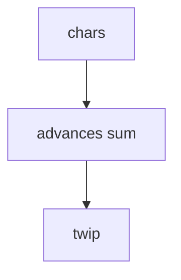

# 02_function_run_metrics — run 宽度

| 项 | 值 |
|----|----|
| feature | wr-03-measure-shape |
| order | 2 |
| crate | `libs/word-core/Cargo.toml` |
| 入口 | measure_run(text, font, size_pt) -> width_twip, ascent, descent |
| 独立性 | 走 wr-03 FontStack / ttf-parser；无 FreeType .so |
| 测试状态 | pass |

## 1. 功能说明

### 1.1 一句话

对 run 字符串求和 glyph advance，转 twip；空串宽度 0。

### 1.2 输入

| 入口 | 输入 | Java 路径 |
|------|------|------|
| measure_run | text+size | ITypeface / FreeTypeJNI.getGlyphAdvances |

### 1.3 输出

| 字段/副作用 | 含义 |
|------|------|
| width_twip | >=0 |
| ascent/descent | 行高用 |

### 1.4 上游

01。

### 1.5 下游

wr-04。

### 1.6 关键不变量（钉死）

1. 空串 width=0。
2. 宽度单调：s 是 t 前缀 ⇒ width(s)<=width(t)（无负 kerning MVP）。
3. 返回 twip。
4. 宽度 = Σ `FontStack::glyph_advance_twip`（hmtx × pt × 20 / upem）。Java `getWriterLayoutAdavances*` 的 100px 标定在 ttf-parser 路径上等价于线性缩放；禁止另写一套 hinting。
5. 缺字 → `FontError::MissingGlyph`，**禁止** `width=size`。

### 1.7 依赖与实现状态（必写，着重）

| 依赖 | 归属 | 本 function 需要的接口 | 已实现 | 暂缓 | 禁止本 function 去改 |
|------|------|------|------|------|------|
| FontStack / ttf-parser | wr-03 01 | measure_run、glyph_advance_twip、line_metrics_twip | **已实现** | kerning / rustybuzz | 不改 wpslayout / FreeTypeJNI 壳 |

## 2. 核心代码与流程

Java：`koffice/core-libs/thirdparty/font/src/cn/wps/font/FreeTypeJNI.java`
Rust：`libs/word-core/src/cn/wps/moffice/writer/layout/base/line/RunMetrics.rs`



## 3. 测试方案

### 3.1 代码审计与测试面

| symbol | Java/Rust 路径 | 输入/状态 | 输出/副作用 | 关键分支/错误 |
|------|------|------|------|------|
| empty | — | "" | 0 | — |
| ascii | Hello | size 10.5 | >0 | — |

### 3.2 覆盖矩阵

| coverage_id | 接口/代码路径 | 场景类别 | 必测? | test_id / 未覆盖理由 |
|------|------|------|------|------|
| RM-EMPTY | 空串 | 边界 | 是 | RM1 |
| RM-ASCII | Hello | 主路径 | 是 | RM2 |
| RM-MONO | 前缀单调 | 分支 | 是 | RM3 |
| RM-CTRL | 控制字符跳过 | 分支 | 是 | RM4 |
| RM-SCALE | 12 vs 24pt | 分支 | 是 | RM5 |
| RM-MISS | 缺字失败 | 失败 | 是 | RM6 |

### 3.3 可测试性

可用假 Typeface 每字 100twip 验证求和；再加一条真 FreeType。

### 3.4 用例表

| id | 覆盖项 | 前置状态 | 输入摘要 | 期望输出/副作用 | 失败语义 |
|------|------|------|------|------|------|
| RM1 | RM-EMPTY | font ok | "" | 0 | 非0 |
| RM2 | RM-ASCII | font ok | Hello | >0 | 0 |
| RM3 | RM-MONO | font ok | He vs Hello | He<=Hello | 非单调 |
| RM4 | RM-CTRL | font ok | A vs A\\n\\r\\t | 等宽 | 计入控制符 |
| RM5 | RM-SCALE | font ok | Hello 12 vs 24 | 24=2×12 | 非线性 |
| RM6 | RM-MISS | latin fixture | 我 | MissingGlyph | width=size |

### 3.5 测试代码位置

crate: `libs/word-core/Cargo.toml`
src:   `libs/word-core/src/cn/wps/moffice/writer/layout/base/line/RunMetrics.rs`
test:  `libs/word-core/tests/cn/wps/moffice/writer/layout/base/line/RunMetrics.rs`

### 3.6 测试运行脚本

```bash
cargo test --manifest-path libs/word-core/Cargo.toml --test 02_function_run_metrics

bash .cursor/skills/feature-function/scripts/function-coverage.sh \
  --crate libs/word-core --test 02_function_run_metrics \
  --src src/cn/wps/moffice/writer/layout/base/line/RunMetrics.rs \
  --report libs/word-core/layout/features/wr-03-measure-shape/functions/02_function_run_metrics/FUNCTION.md
```

### 3.7 覆盖率报告

<!-- coverage-report:begin -->
tool: cargo-llvm-cov (`cargo llvm-cov --test 02_function_run_metrics --json`)
date: 2026-08-22 02:39

| src | lines covered | line % | regions covered | region % |
|-----|---------------|--------|-----------------|----------|
| `src/cn/wps/moffice/writer/layout/base/line/RunMetrics.rs` | 21/21 | 100.0% | 30/31 | 96.8% |
| **function total** | **21/21** | **100.0%** |  |  |
<!-- coverage-report:end -->

### 3.8 模板布局校验（必跑，PASS 才能标 pass）

```bash
node .cursor/skills/function-java2rust/scripts/check-template-layout.mjs \
  --rs libs/word-core/src/cn/wps/moffice/writer/layout/base/line/RunMetrics.rs
```

2026-08-22：**PASS**（Rust 胶水，无 `--java`。勿与 FreeTypeJNI.java 1+1 配对）。
