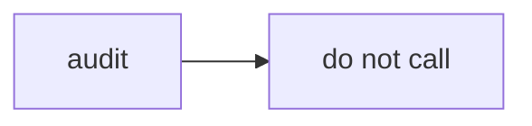

# 03_function_rich_text_layout — RichTextLayout 不接入

| 项 | 值 |
|----|----|
| feature | wr-03-measure-shape |
| order | 3 |
| crate | `libs/word-core/Cargo.toml` |
| 入口 | 审计测试 RTL1/RTL2；`LineMetrics` 契约 |
| 独立性 | 不编译 wpslayout；不调用 shape 排版引擎 |
| 测试状态 | pass（审计 + LineMetrics；wpslayout 全量转写仍 defer） |

## 1. 功能说明

### 1.1 一句话

确认正文 MVP 不调用 wpslayout 的 shape 排版引擎；钉死 `LineMetrics` 契约。wpslayout 全量转写仍 defer。

### 1.2 输入

| 入口 | 输入 | Java 路径 |
|------|------|------|
| 审计 | wpslayout RichTextLayout.rs | RichTextLayout.java |

### 1.3 输出

| 字段/副作用 | 含义 |
|------|------|
| 审计结论 | COMPILATION FAIL + 壳 |

### 1.4 上游

无。

### 1.5 下游

形状文本后续 feature；**行几何契约（Layout API）** → wr-04 的 LineMetrics 输出 / wr-07 渲染消费。

### 1.6 关键不变量（钉死）

1. word-core `layout/` 热路径源码不得出现标识符 `RichTextLayout`（RTL1）。
2. 本 function **不**修 wpslayout 编译红；shape 引擎全量转写仍 defer。
3. **源码级结论（2026-08-22，读 RichTextLayout.java ~1000 行后）**：
   - RichTextLayout = **文本框/shape 内文字的段排版引擎**（autofit 缩放、竖排、bullets、ellipsis、wordart、命中），**正文页排版不走它**（正文走 TextLayouter/LineLayouter）→ MVP 直接 DEFER 全量转写。
   - **值得吸收的唯一契约**：`TypoLayoutGen → Layout` 的行几何 API——`getLineCount/getLineWidth/getLineTop/getLineBottom/getLineBaseline/getLineStart/getLineEnd/getWidth/getHeight`。定义为 wr-04 输出统一 `LineMetrics` 契约（`start_cp/end_cp/x_off/top/bottom/baseline/width`），wr-07 与未来文本框共用。
   - 度量原语语义对标：`PaintFontHelper.getCharWidth`（SpanInfo 的 fontSize/ascent）＝ wr-03 `RunMetrics`；SpanInfo＝ Rust run 样式。
   - 跨端边界：**度量/坐标在 Rust（Stage2 确定性），字形绘制在 Flutter**（TextPainter/Skia）；渲染本身不参与 JSON 对比。

### 1.7 依赖与实现状态（必写，着重）

| 依赖 | 归属 | 本 function 需要的接口 | 已实现 | 暂缓 | 禁止本 function 去改 |
|------|------|------|------|------|------|
| RichTextLayout | wpslayout | 无 | 壳且 cargo 红 | 全文件（autofit/竖排/bullets/ellipsis/wordart） | 禁止本 function 为过编译改 stubs 政策 |
| `Layout`/`TypoLayoutGen`（wpslayout） | wpslayout | 行几何 API 语义 | 壳 | 行几何 **契约提取**：在 wr-03/04 侧定义 `LineMetrics` struct（字段见 1.6.3），不等 wpslayout 修复 | — |

## 2. 核心代码与流程

Java：`koffice/core-libs/wpslayout/src/cn/wps/text/layout/typo/RichTextLayout.java`
Rust：`libs/core-libs/wpslayout/src/cn/wps/text/layout/typo/RichTextLayout.rs`



## 3. 测试方案

### 3.1 代码审计与测试面

| symbol | Java/Rust 路径 | 输入/状态 | 输出/副作用 | 关键分支/错误 |
|------|------|------|------|------|
| no-import | word-core layout | grep | 0 hits | 误接入 |

### 3.2 覆盖矩阵

| coverage_id | 接口/代码路径 | 场景类别 | 必测? | test_id / 未覆盖理由 |
|------|------|------|------|------|
| RTL-AUDIT | layout 树无该标识符 | 资源 | 是 | RTL1 |
| RTL-CONTRACT | LineMetrics 字段 | 主路径 | 是 | RTL2 |

### 3.3 可测试性

grep 门闩 + `LineMetrics` 构造；**无** `#[ignore]`。

### 3.4 用例表

| id | 覆盖项 | 前置状态 | 输入摘要 | 期望输出/副作用 | 失败语义 |
|------|------|------|------|------|------|
| RTL1 | RTL-AUDIT | — | walk `src/.../layout/**/*.rs` | 0 hits | 误依赖 |
| RTL2 | RTL-CONTRACT | — | LineMetrics 样例 | height=bottom-top | 字段错 |

### 3.5 测试代码位置

crate: `libs/word-core/Cargo.toml`
src:   `libs/word-core/src/cn/wps/moffice/writer/layout/text/BaseTextLayout.rs`
test:  `libs/word-core/tests/cn/wps/moffice/writer/layout/audit/RichTextLayoutAudit.rs`

### 3.6 测试运行脚本

```bash
cargo test --manifest-path libs/word-core/Cargo.toml --test 03_function_rich_text_layout

bash .cursor/skills/feature-function/scripts/function-coverage.sh \
  --crate libs/word-core --test 03_function_rich_text_layout \
  --src src/cn/wps/moffice/writer/layout/text/BaseTextLayout.rs \
  --report libs/word-core/layout/features/wr-03-measure-shape/functions/03_function_rich_text_layout/FUNCTION.md
```

### 3.7 覆盖率报告

<!-- coverage-report:begin -->
tool: cargo-llvm-cov (`cargo llvm-cov --test 03_function_rich_text_layout --json`)
date: 2026-08-22 02:39

| src | lines covered | line % | regions covered | region % |
|-----|---------------|--------|-----------------|----------|
| `src/cn/wps/moffice/writer/layout/text/BaseTextLayout.rs` | 3/3 | 100.0% | 5/5 | 100.0% |
| **function total** | **3/3** | **100.0%** |  |  |
<!-- coverage-report:end -->

### 3.8 模板布局校验（必跑，PASS 才能标 pass）

```bash
node .cursor/skills/function-java2rust/scripts/check-template-layout.mjs \
  --rs libs/word-core/src/cn/wps/moffice/writer/layout/text/BaseTextLayout.rs
```

2026-08-22：**PASS**（契约 struct，无 Java 同名文件。不改 wpslayout `RichTextLayout.rs`）。
