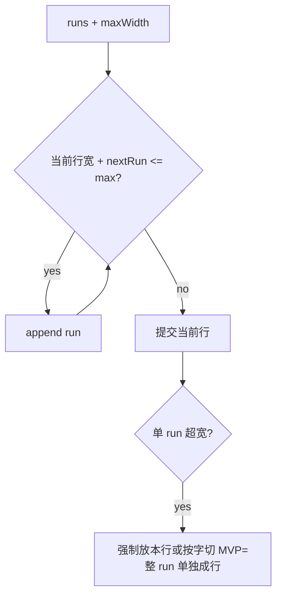

# wr-04-line-break — 断行（LineLayouter 最小）

Java：`layout/base/line/LineLayouter.java`（1029）。  
输入：run 序列 + 行最大宽（ViewEnv.content_width）。输出：TypoTextLine 列表（几何由 wr-03 度量）。

## 流程

must：空格优先断行；0 run / 1 run / N run；超宽单 run 单独成行（不 panic）。  
stub：两端对齐、CJK 标点挤压、tab、bidi。  
defer：text wrap around drawings。
