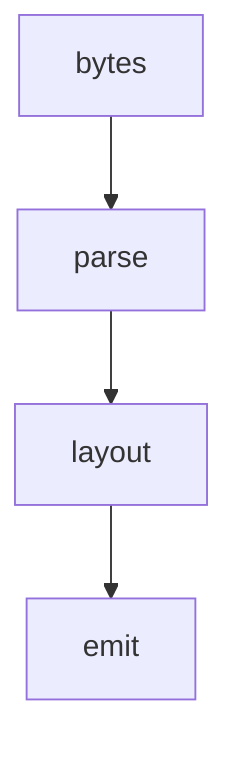

# 01_function_uniffi_export — render_docx 单入口

| 项 | 值 |
|----|----|
| feature | wr-08-ffi-flutter |
| order | 1 |
| crate | `libs/word-core/Cargo.toml` |
| 入口 | render_docx(bytes) -> Result<Vec<RenderCommand>> |
| 独立性 | 编排 parse+layout+emit |
| 测试状态 | pass |

## 1. 功能说明

### 1.1 一句话

最小 docx 字节 → commands。失败：坏 zip 与空文档分开断言。

### 1.2 输入

| 入口 | 输入 | Java 路径 |
|------|------|------|
| render_docx | fixture docx | DocxReader.read + layout + emit |

### 1.3 输出

| 字段/副作用 | 含义 |
|------|------|
| commands | 含 DrawText |

### 1.4 上游

wc-05；wr-07。

### 1.5 下游

02 painter。

### 1.6 关键不变量（钉死）

1. 纯文本 fixture 至少 1 DrawText。
2. 非法字节 → Err 非 panic。

### 1.7 依赖与实现状态（必写，着重）

| 依赖 | 归属 | 本 function 需要的接口 | 已实现 | 暂缓 | 禁止本 function 去改 |
|------|------|------|------|------|------|
| DocxReader | wc-05 | read | **pass** | styles 链 | 不改 importer |
| layout_document | wr-06 | snapshot | 须先绿或 skip e2e | — | — |

## 2. 核心代码与流程

Java：`koffice/writer/core/cn/wps/moffice/writer/io/reader/docxReader/DocxReader.java`
Rust：`libs/word-core/src/cn/wps/moffice/writer/api/RenderDocx.rs`



## 3. 测试方案

### 3.1 代码审计与测试面

| symbol | Java/Rust 路径 | 输入/状态 | 输出/副作用 | 关键分支/错误 |
|------|------|------|------|------|
| hello.docx | fixture | 最小 | DrawText>0 | 0 |

### 3.2 覆盖矩阵

| coverage_id | 接口/代码路径 | 场景类别 | 必测? | test_id / 未覆盖理由 |
|------|------|------|------|------|
| EX-OK | 合法 docx | 主路径 | 是 | EX1 |
| EX-BAD | 坏字节 | 失败 | 是 | EX2 |

### 3.3 可测试性

tests/fixtures/plain-one-para.docx。

### 3.4 用例表

| id | 覆盖项 | 前置状态 | 输入摘要 | 期望输出/副作用 | 失败语义 |
|------|------|------|------|------|------|
| EX1 | EX-OK | plain-one-para | render | >=1 DrawText | 空 |
| EX2 | EX-BAD | not zip | render | Err | panic |

### 3.5 测试代码位置

crate: `libs/word-core/Cargo.toml`
src:   `libs/word-core/src/cn/wps/moffice/writer/api/RenderDocx.rs`
test:  `libs/word-core/tests/cn/wps/moffice/writer/api/RenderDocx.rs`

### 3.6 测试运行脚本

```bash
cargo test --manifest-path libs/word-core/Cargo.toml --test 01_function_uniffi_export

bash .cursor/skills/feature-function/scripts/function-coverage.sh \
  --crate libs/word-core --test 01_function_uniffi_export \
  --src src/cn/wps/moffice/writer/api/RenderDocx.rs \
  --report libs/word-core/layout/features/wr-08-ffi-flutter/functions/01_function_uniffi_export/FUNCTION.md
```

### 3.7 覆盖率报告

<!-- coverage-report:begin -->
tool: cargo-llvm-cov (`cargo llvm-cov --test 01_function_uniffi_export --json`)
date: 2026-08-22 10:00

| src | lines covered | line % | regions covered | region % |
|-----|---------------|--------|-----------------|----------|
| `src/cn/wps/moffice/writer/api/RenderDocx.rs` | 57/72 | 79.2% | 73/86 | 84.9% |
| **function total** | **57/72** | **79.2%** |  |  |
<!-- coverage-report:end -->

### 3.8 模板布局校验（必跑，PASS 才能标 pass）

```bash
node .cursor/skills/function-java2rust/scripts/check-template-layout.mjs \
  --rs libs/word-core/src/cn/wps/moffice/writer/api/RenderDocx.rs \
  --java koffice/writer/core/cn/wps/moffice/writer/io/reader/docxReader/DocxReader.java
```

校验：`// java` 行数不降；活成员与签名相邻。列表外方法 `todo!("DEFERRED_NON_FUNCTION")` 停车。禁止 dummy `let X = ()`。无 Rust 语句：`// rust: no-stmt`。
