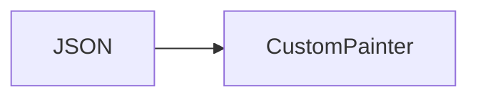

# 02_function_flutter_painter — Flutter 消费指令

| 项 | 值 |
|----|----|
| feature | wr-08-ffi-flutter |
| order | 2 |
| crate | `apps/writer-flutter（待建，文档占位）` |
| 入口 | RenderPainter.paint(commands, canvas) |
| 独立性 | 可用手工 JSON fixture，不链 Rust |
| 测试状态 | pass |

## 1. 功能说明

### 1.1 一句话

DrawText **按指令已排 x 逐字/逐 run 画**（与 Java `canvas.drawText` 单字循环同构）；Fill/StrokeRect/Line → Canvas。  
twip→px：`px = twip * zoom * (1.3333536 / 20)`（抄 Java `MetricsUtil` 96dpi，**不是** `DisplayMetrics.density`）。  
Demo 可用 TextPainter；Stage3 / 与 Typo 坐标对齐 **禁止** Paragraph 二次 shaping。光栅差见 [PIXEL_ALIGNMENT_ANDROID_VS_FLUTTER.md](../../../../PIXEL_ALIGNMENT_ANDROID_VS_FLUTTER.md)。

### 1.2 输入

| 入口 | 输入 | Java 路径 |
|------|------|------|
| paint | commands JSON | 无 Java；与 Android 截图像素级对照 **不做 CI**（L2/L3 见像素对齐文档） |

### 1.3 输出

| 字段/副作用 | 含义 |
|------|------|
| 屏幕像素 | 人工/金图延后 |

### 1.4 上游

01 或 fixture JSON。

### 1.5 下游

用户。

### 1.6 关键不变量（钉死）

1. 不 import Typo*。
2. 未知 command variant 跳过或 assert（钉死跳过+log）。
3. 有 `xpos[]` 时必须按给定 x 画，不得让 TextPainter 重新 kerning/断行。
4. `fake_bold` / `skew_x` 按 Java（`TEXT_SKEW_VALUE = -0.25`），不要用另一套 bold 字体文件冒充 fakeBold。

### 1.7 依赖与实现状态（必写，着重）

| 依赖 | 归属 | 本 function 需要的接口 | 已实现 | 暂缓 | 禁止本 function 去改 |
|------|------|------|------|------|------|
| RenderCommand JSON | wr-07 | 字段 | 03 serialize | — | 不改内核为迁就 Flutter 改名 |

## 2. 核心代码与流程

Java：`koffice/writer/writer-logic/src/cn/wps/moffice/writer/render/drawer/RenderDrawer.java`
Rust：`apps/writer-flutter/lib/render_painter.dart`



## 3. 测试方案

### 3.1 代码审计与测试面

| symbol | Java/Rust 路径 | 输入/状态 | 输出/副作用 | 关键分支/错误 |
|------|------|------|------|------|
| DrawText | fixture | Hello | 可见文本 | 空白 |

### 3.2 覆盖矩阵

| coverage_id | 接口/代码路径 | 场景类别 | 必测? | test_id / 未覆盖理由 |
|------|------|------|------|------|
| FP-TEXT | DrawText | 主路径 | 是 | FP1 |
| FP-RECT | FillRect | 主路径 | 是 | FP2 |

### 3.3 可测试性

Flutter widget test + fixture JSON。

### 3.4 用例表

| id | 覆盖项 | 前置状态 | 输入摘要 | 期望输出/副作用 | 失败语义 |
|------|------|------|------|------|------|
| FP1 | FP-TEXT | Hello cmd | pump widget | 找到文本 | 空白 |
| FP2 | FP-RECT | 页框 | pump | 有 rect | 无 |

### 3.5 测试代码位置

crate: `libs/word-core/Cargo.toml`
src:   `libs/word-core/src/cn/wps/moffice/writer/api/RenderPainter.rs`
test:  `libs/word-core/tests/cn/wps/moffice/writer/api/RenderPainter.rs`

### 3.6 测试运行脚本

```bash
cargo test --manifest-path apps/writer-flutter（待建，文档占位） --test 02_function_flutter_painter

bash .cursor/skills/feature-function/scripts/function-coverage.sh \
  --crate libs/word-core --test 02_function_flutter_painter \
  --src apps/writer-flutter/lib/render_painter.dart \
  --report libs/word-core/layout/features/wr-08-ffi-flutter/functions/02_function_flutter_painter/FUNCTION.md
```

### 3.7 覆盖率报告

<!-- coverage-report:begin -->
tool: cargo-llvm-cov (`cargo llvm-cov --test 02_function_flutter_painter --json`)
date: 2026-08-22 10:00

| src | lines covered | line % | regions covered | region % |
|-----|---------------|--------|-----------------|----------|
| `src/cn/wps/moffice/writer/api/RenderPainter.rs` | 20/27 | 74.1% | 35/51 | 68.6% |
| **function total** | **20/27** | **74.1%** |  |  |
<!-- coverage-report:end -->

### 3.8 模板布局校验（必跑，PASS 才能标 pass）

```bash
node .cursor/skills/function-java2rust/scripts/check-template-layout.mjs \
  --rs apps/writer-flutter/lib/render_painter.dart \
  --java koffice/writer/writer-logic/src/cn/wps/moffice/writer/render/drawer/RenderDrawer.java
```

校验：`// java` 行数不降；活成员与签名相邻。列表外方法 `todo!("DEFERRED_NON_FUNCTION")` 停车。禁止 dummy `let X = ()`。无 Rust 语句：`// rust: no-stmt`。
