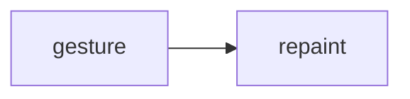

# 03_function_interaction — 滚动缩放

| 项 | 值 |
|----|----|
| feature | wr-08-ffi-flutter |
| order | 3 |
| crate | `apps/writer-flutter（待建）` |
| 入口 | viewport scroll/zoom → 重绘 clip |
| 独立性 | M4；必测=否 |
| 测试状态 | pass |

## 1. 功能说明

### 1.1 一句话

手势改变 zoom/offset，painter 重放同一 commands。不重跑 layout（除非 zoom 影响 ViewEnv——MVP zoom 仅绘制缩放）。

### 1.2 输入

| 入口 | 输入 | Java 路径 |
|------|------|------|
| onScale | factor | LayoutRender zoom 参数 |

### 1.3 输出

| 字段/副作用 | 含义 |
|------|------|
| 变换后绘制 | 指令不变 |

### 1.4 上游

02。

### 1.5 下游

M4。

### 1.6 关键不变量（钉死）

1. MVP zoom 不触发 relayout。
2. 本 function 已落地 Viewport 绘制缩放（指令条数不变）。

### 1.7 依赖与实现状态（必写，着重）

| 依赖 | 归属 | 本 function 需要的接口 | 已实现 | 暂缓 | 禁止本 function 去改 |
|------|------|------|------|------|------|
| LayoutRender zoom | Java | 绘制缩放 | 暂缓 | relayout on zoom | 不提前做 PhoneView |

## 2. 核心代码与流程

Java：`koffice/writer/writer-logic/src/cn/wps/moffice/writer/render/LayoutRender.java`
Rust：`apps/writer-flutter/lib/viewport.dart`



## 3. 测试方案

### 3.1 代码审计与测试面

| symbol | Java/Rust 路径 | 输入/状态 | 输出/副作用 | 关键分支/错误 |
|------|------|------|------|------|
| zoom | — | 2x | 指令条数不变 | 误 relayout |

### 3.2 覆盖矩阵

| coverage_id | 接口/代码路径 | 场景类别 | 必测? | test_id / 未覆盖理由 |
|------|------|------|------|------|
| IA-ZOOM | 绘制缩放 | 主路径 | 否 | M4 spec ignore |

### 3.3 可测试性

M4 widget test。

### 3.4 用例表

| id | 覆盖项 | 前置状态 | 输入摘要 | 期望输出/副作用 | 失败语义 |
|------|------|------|------|------|------|
| IA1 | IA-ZOOM | spec | — | ignore | — |

### 3.5 测试代码位置

crate: `libs/word-core/Cargo.toml`
src:   `libs/word-core/src/cn/wps/moffice/writer/api/Viewport.rs`
test:  `libs/word-core/tests/cn/wps/moffice/writer/api/Viewport.rs`

### 3.6 测试运行脚本

```bash
cargo test --manifest-path apps/writer-flutter（待建） --test 03_function_interaction

bash .cursor/skills/feature-function/scripts/function-coverage.sh \
  --crate libs/word-core --test 03_function_interaction \
  --src apps/writer-flutter/lib/viewport.dart \
  --report libs/word-core/layout/features/wr-08-ffi-flutter/functions/03_function_interaction/FUNCTION.md
```

### 3.7 覆盖率报告

<!-- coverage-report:begin -->
tool: cargo-llvm-cov (`cargo llvm-cov --test 03_function_interaction --json`)
date: 2026-08-22 10:00

| src | lines covered | line % | regions covered | region % |
|-----|---------------|--------|-----------------|----------|
| `src/cn/wps/moffice/writer/api/Viewport.rs` | 20/38 | 52.6% | 19/33 | 57.6% |
| **function total** | **20/38** | **52.6%** |  |  |
<!-- coverage-report:end -->

### 3.8 模板布局校验（必跑，PASS 才能标 pass）

```bash
node .cursor/skills/function-java2rust/scripts/check-template-layout.mjs \
  --rs apps/writer-flutter/lib/viewport.dart \
  --java koffice/writer/writer-logic/src/cn/wps/moffice/writer/render/LayoutRender.java
```

校验：`// java` 行数不降；活成员与签名相邻。列表外方法 `todo!("DEFERRED_NON_FUNCTION")` 停车。禁止 dummy `let X = ()`。无 Rust 语句：`// rust: no-stmt`。
