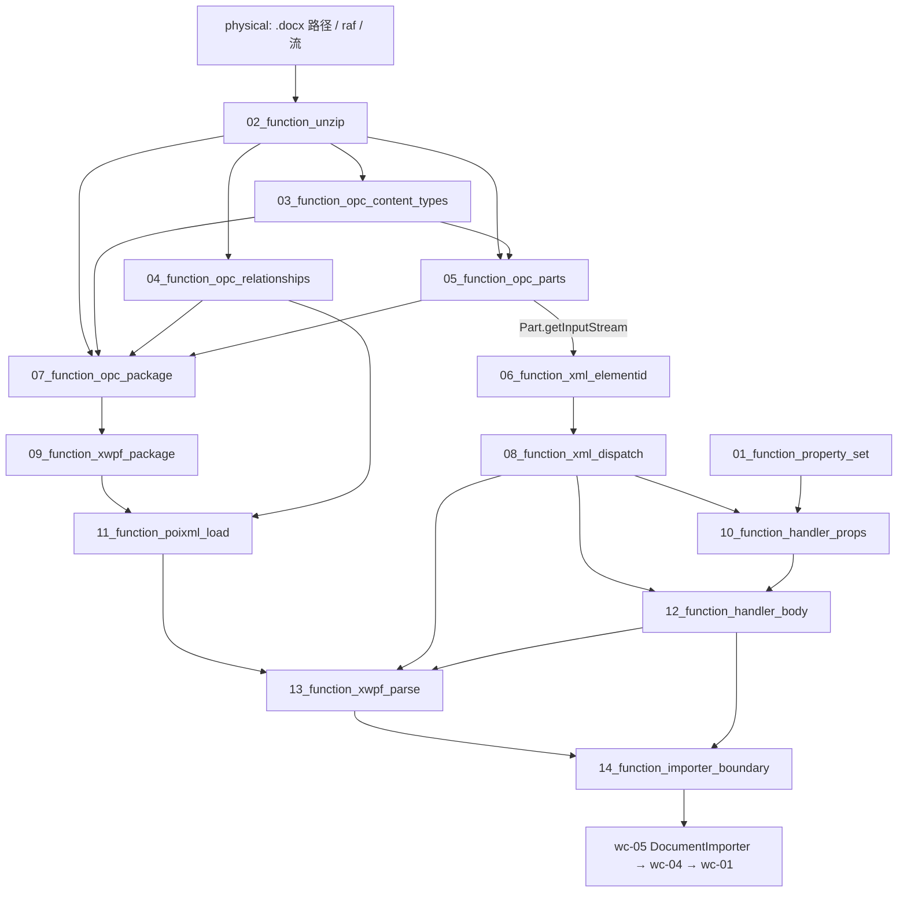

# wave0-ooxml-standards — Function 组合图

> 分析日期：2026-08-17
> 输入端点：`.docx` 文件路径 / `RandomAccessFile` / `InputStream`
> 对外输出：对 `IDocumentImporter` 的有序回调（styles → numbering/settings → 正文段落/run）
> 切分依据：I/O 边界（zip entries → Content Types → rels → Parts → XML 事件 → 属性桶 → importer）
> 类级蓝皮书：[STRUCTURE_ANALYSIS.md](./STRUCTURE_ANALYSIS.md) · 深读索引：[docs/README.md](./docs/README.md)

本文件只讲 **function 之间如何串联**。每个 function 的字段表、类图、**测试方案**在
`functions/<function_id>/FUNCTION.md`。可执行测试与 `src` 隔离，镜像落在对应 crate 的
`tests/<relpath>/<Type>.rs`（见 §3）。

---

## 0. 一句话管线

目录名 `{NN}_function_*` 的 `NN` 是依赖拓扑序号（就绪即编号）。两条并行根：属性桶（01）与解压（02）。

```text
01_function_property_set                   属性桶（无 zip 依赖）
02_function_unzip                          zip entries
03_function_opc_content_types              MIME 表
04_function_opc_relationships              Type → Target
05_function_opc_parts                      PackagePart 表
06_function_xml_elementid                  XML → elementId 事件   ← 只依赖 05
07_function_opc_package                    编排 02–05 → OPCPackage
08_function_xml_dispatch                   事件 → handler 栈      ← 依赖 06
09_function_xwpf_package                   Word 薄封装            ← 依赖 07
10_function_handler_props                  pPr/rPr → 属性桶       ← 依赖 01+08
11_function_poixml_load                    rel 对象图             ← 依赖 04+09
12_function_handler_body                   段/run 回调            ← 依赖 08+10
13_function_xwpf_parse                     Part 顺序开火          ← 依赖 08+11+12
14_function_importer_boundary              IDocumentImporter 契约 ← 依赖 12+13
15_function_styles_handler_chain           styles.xml → 样式回调族 ← 依赖 08+10（补 wc-05 缺口 C
```

**本层不写 TextRope / CHPX / PAPX。** 落库是 `wc-01`；路由是 `wc-05`。
wave0 验的是「包能打开、XML 能变成回调」，不是「文档模型已写入」。

---

## 1. Function 清单

| order | function_id | 一句话 | 输入 | 输出 | 上游 | 下游 |
|------|-------------|--------|------|------|------|------|
| 1 | [01_function_property_set](./functions/01_function_property_set/FUNCTION.md) | 如何读写并 freeze 属性桶 | propId + 值 | `PropertySet` | （无包依赖） | 10; feature-output（wc-*） |
| 2 | [02_function_unzip](./functions/02_function_unzip/FUNCTION.md) | 如何从 docx 解压得到 entries | 路径 / raf / 流 | `ZipEntrySource` | physical | 03; 04; 05; 07 |
| 3 | [03_function_opc_content_types](./functions/03_function_opc_content_types/FUNCTION.md) | 如何解析 `[Content_Types].xml` | 该 entry 的 XML 字节 | `ContentTypeManager` | 02 | 05; 07 |
| 4 | [04_function_opc_relationships](./functions/04_function_opc_relationships/FUNCTION.md) | 如何解析 `_rels/.rels` 与 `*.rels` | rels XML + 源 URI | `PackageRelationshipCollection` | 02 | 07; 11; 13 |
| 5 | [05_function_opc_parts](./functions/05_function_opc_parts/FUNCTION.md) | 如何把 zip entry + 类型变成 Part | entries + Content Types | `PackagePartCollection` | 02; 03 | 06; 07 |
| 6 | [06_function_xml_elementid](./functions/06_function_xml_elementid/FUNCTION.md) | 如何把 XML 字节变成 elementId 事件 | Part `InputStream` | start/end/characters | 05 | 08 |
| 7 | [07_function_opc_package](./functions/07_function_opc_package/FUNCTION.md) | 如何把 02–05 编排成打开的包 | 同 unzip 的三种入口 | `OPCPackage` | 02; 03; 04; 05 | 09 |
| 8 | [08_function_xml_dispatch](./functions/08_function_xml_dispatch/FUNCTION.md) | 如何把事件分发给 handler 栈 | 事件流 + 根 handler | 栈顶 onStart/onEnd | 06 | 10; 12; 13 |
| 9 | [09_function_xwpf_package](./functions/09_function_xwpf_package/FUNCTION.md) | 如何在 OPC 上挂 Word 三件套 | 打开中的 OPC | `XWPFPackage` | 07 | 11 |
| 10 | [10_function_handler_props](./functions/10_function_handler_props/FUNCTION.md) | 如何把 pPr/rPr 写成属性桶 | pPr/rPr 子事件 | `MutablePropertySet` | 01; 08 | 12 |
| 11 | [11_function_poixml_load](./functions/11_function_poixml_load/FUNCTION.md) | 如何按 rel 递归建成 Part 对象图 | XWPFPackage + Factory | `XWPFDocument` 子 Part 图 | 04; 09 | 13 |
| 12 | [12_function_handler_body](./functions/12_function_handler_body/FUNCTION.md) | 如何把 document.xml 变成段/run 回调 | 主文档事件 | importer 段/run 调用序列 | 08; 10 | 13; 14 |
| 13 | [13_function_xwpf_parse](./functions/13_function_xwpf_parse/FUNCTION.md) | 如何按 Part 顺序驱动 parse | 已 load 的 XWPFDocument + importer | 有序回调风暴 | 08; 11; 12 | 14 |
| 14 | [14_function_importer_boundary](./functions/14_function_importer_boundary/FUNCTION.md) | wave0 对外契约是什么 | 回调方法集合 | `IDocumentImporter` trait | 12; 13 | feature-output（wc-05） |
| 15 | [15_function_styles_handler_chain](./functions/15_function_styles_handler_chain/FUNCTION.md) | 如何把 styles.xml 事件树变成样式回调族 | styles.xml 事件（docDefaults/style/tblStylePr） | onImportStyleDocDefaults/Start/Child/End/StylesEnd/TblStylePrEnd | 08; 10 | 13; wc-05 02/07（**补缺口 C**） |

---

## 2. 数据流



**串接规则：**

1. **解压是唯一物理入口。** 后面所有 XML 都来自 entry 流，不再碰文件系统（流打开路径除外）。
2. **Content Types 先于 Parts。** 没有类型表就不能给 entry 发身份证（OPC `getPartsImpl` 两步扫描）。
3. **Relationships 是导航，不是路径拼装。** 找主文档 / styles 用 Type URI，不用写死 `word/styles.xml`。
4. **`07_function_opc_package` 是编排。** 测 03–05 用 XML fixture；测 07 用 02–05 的 golden 输出接线。
5. **XML 事件与属性桶解耦。** `01_function_property_set` 可先于任何 docx 测绿。
6. **parse 顺序是契约。** styles/settings 回调必须出现在正文 `onImportParagraph*` 之前（见 xwpf-handler 深读）。
7. **失败停在本级。** 坏 zip 不应表现为「importer 没被调用」；应在 unzip/opc_package 红。

---

## 3. 依赖与编译面

| 层级 | function | crate | 单独测 |
|------|----------|-------|--------|
| 叶子 | unzip, content_types, relationships, parts, xml_elementid, property_set | `libs/core-libs/io/wps-io` 或 `libs/core-libs/util/util` | 是：内存 zip / 短 XML / 直接 setInt |
| 叶子 | xml_dispatch, handler_props, handler_body | wps-io | 是：录制事件列表，不打开包 |
| 编排 | opc_package, xwpf_package, poixml_load, xwpf_parse | wps-io | 是：但 fixture 必须是上游已测输出 |
| 契约 | importer_boundary | wps-io 定义 / word-core 实现 | mock importer 记调用；实现完整性归 wc-05 |

每个 function 一条 `[[test]]`，`name` = `function_id`，`path` = `tests/` 下与 `src` 同相对路径的入口类型文件。

```bash
# 单 function（loop 用这条）
cargo test --manifest-path libs/core-libs/util/util/Cargo.toml --test 01_function_property_set
cargo test --manifest-path libs/core-libs/io/wps-io/Cargo.toml --test 02_function_unzip
# … 03–15 同 crate、--test <function_id>

# 不要用 --lib 当 function 验收：src 内禁止 #[cfg(test)]
```

当前若干类型仍是壳（如 `ZipEntrySource::getEntries → Vec<i32>`）。crate `tests/`
标 `status=spec`，用 `#[ignore]` 钉住契约，**不**用空测试假装 pass，也**不**把 ignore 标成 csv `pass`。

启动改写-测试-回归：对 agent 说 `loop 01_function_property_set` 或「开始 loop」（skill：`feature-function`）。每个 function 的 `FUNCTION.md` §3.6 / §3.7 含 `cargo test` 脚本与 `cargo-llvm-cov` 覆盖率报告。

---

## 4. Function 如何串联（逐步）

1. 调用方给出文件/raf/流。`02_function_unzip` 产出可枚举 entries；校验 PK 魔数、拒绝 `../`。
2. 从 entries 取出 `[Content_Types].xml`，`03_function_opc_content_types` 建成 Default/Override 表。
3. 取出 `/_rels/.rels`（以及稍后的 `word/_rels/document.xml.rels`），`04_function_opc_relationships` 建成 Id/Type/Target 表。
4. 其余 entry 用类型表变成 `ZipPackagePart`，`05_function_opc_parts` 放入 `partList`。
5. `07_function_opc_package` 按 Java `getPartsImpl` 两步扫描把 2–4 装进 `OPCPackage`，懒加载包级 rels。
6. `09_function_xwpf_package` 注册 core/app/custom properties unmarshaller，打开即扫描 parts。
7. `11_function_poixml_load` 用 officeDocument 关系找到主 Part，`load(XWPFFactory)` 递归子 Part。
8. 任一 XML Part 的流进入 `06_function_xml_elementid`（opt 词法或 SAX），得到 int 身份的事件。
9. `08_function_xml_dispatch` 把事件压到 handler 栈顶。
10. 属性子树走 `10_function_handler_props`（内部用 `01_function_property_set`）；正文走 `12_function_handler_body`。
11. `13_function_xwpf_parse` 规定 Part 开火顺序，把 8–10 编成一次 `parse()`。
12. 所有回调形状由 `14_function_importer_boundary` 钉死，供 wc-05 实现。

---

## 5. 验收顺序

```text
01_function_property_set          （最快、无 I/O）
02_function_unzip                 （最小合法 zip / 坏魔数 / 路径穿越）
03_function_opc_content_types
04_function_opc_relationships
05_function_opc_parts
06_function_xml_elementid         （一段 <w:t> 文本；parts 就绪即可）
07_function_opc_package           （最小 docx fixture 打开）
08_function_xml_dispatch
09_function_xwpf_package
10_function_handler_props
11_function_poixml_load
12_function_handler_body
13_function_xwpf_parse            （顺序：styles 回调早于段落）
14_function_importer_boundary     （方法集合与 mode/SubDocType 对照表）
15_function_styles_handler_chain  （styles.xml → 样式回调族；补 wc-05 缺口 C）
```

---

## 6. 与类级分析的对照

| function | STRUCTURE_ANALYSIS 枢纽 | 深读 |
|----------|-------------------------|------|
| unzip, opc_* | §1.2 包打开 | [opc-package.md](./docs/opc-package.md)、[opc-deep-dive.md](./docs/opc-deep-dive.md) |
| xwpf_package, poixml_load, xwpf_parse | §1.4 XWPFDocument | [xwpf-handler-deep-dive.md](./docs/xwpf-handler-deep-dive.md) |
| xml_elementid, xml_dispatch | §1.3 XML→elementId | [xml-elementid-deep-dive.md](./docs/xml-elementid-deep-dive.md) |
| property_set, handler_props | §1.1 属性桶 | [property-deep-dive.md](./docs/property-deep-dive.md) |
| handler_body, importer_boundary | §1.4–1.5 回调/正文 | [wordprocessingml.md](./docs/wordprocessingml.md) |

类图仍以 `STRUCTURE_ANALYSIS.md` 为准；function 文档不重复 971 行 ElementIds。
