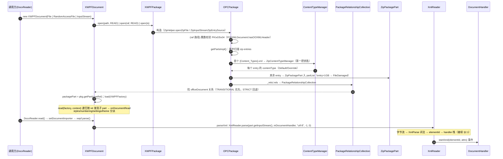
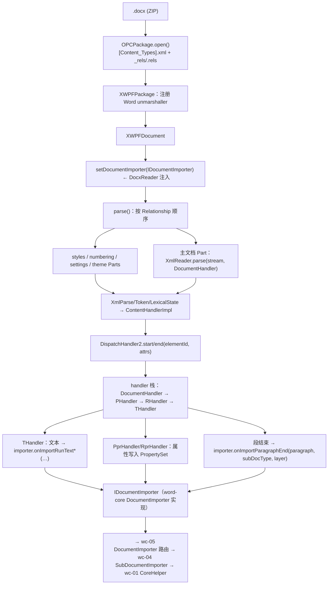
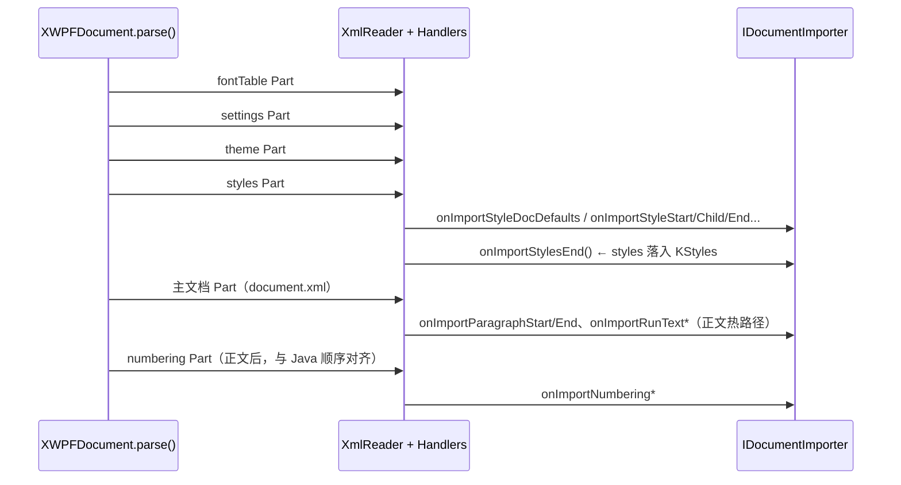

# wave0-ooxml-standards — 标准词汇 + OPC/XWPF 桥（类图/流程/依赖/最小改写范围）

> feature_id: `wave0-ooxml-standards`，实现批次 `parse-wave0`（4 行）+ `parse-wave0-xwpf`（135 行）
> 分析日期：2026-08-12
> 分析依据：`docs/`（opc-package / wordprocessingml / mapping-to-kernel / wave0-xwpf-java-rust 等）、
> `seeds.csv` / `dep_topo.csv` / `rewriting_queue.csv`（本目录，本次补齐）、主 CSV
> `libs/word-core/parser/rewriting_files_parse_mvp.csv`、Rust 现状 `libs/core-libs/**`。

---

## 0. Feature 目标与管线位置

**本 feature 是两层合体**：

1. **词汇层（docs/）**：ISO/IEC 29500（OOXML）+ OPC + WordprocessingML 术语与
   本内核（CP/CHPX/PAPX/PLC）的对照。无代码，不进改写。
2. **实现桥（parse-wave0 + parse-wave0-xwpf，~139 类）**：把「ZIP 包 + XML」变成对
   `IDocumentImporter` 的业务回调，**不写** TextRope/CHPX。

**管线位置**（最上游）：

```text
wave0-ooxml-standards（本层：词汇 + OPC/XWPF 回调）
  → wc-01-storage-write（CoreHelper 落库）
  → wc-02-document-model（TextDocument/Styles）
  → wc-03-property-convert（OOXML → PropertySet）
  → wc-04-paragraph-import（段落状态机）
  → wc-05-orchestration（DocumentImporter 接通本层回调）
```

**一句话**：本层回答了「`.docx` 文件如何变成一次次的 importer 回调」；
下游全部 feature 的输入都来自 `XWPFDocument.parse()` 事件风暴。

**当前进度**：两个批次**全部 done**（主 CSV 139 行 state=done）；本目录
`dep_topo.csv` 42 行、`rewriting_queue.csv` 42 行全部 done。

---

## 1. 类图（5 个枢纽）

> ★ = 下游联调的关键边界。种子 16 个；依赖闭包 26 个（此处列枢纽，完整清单见
> dep_topo.csv）。

### 1.1 属性桶（parse-wave0，util，wc-* 全部依赖）

| 类 | 类型 | 关键成员 |
|----|------|----------|
| `PropertySet` | 不可变桶 | `getInt/getFloat/getString/getBoolean/getValue(id)/contains`、`freeze()`；`PROPERTYSET_BITS=18`（`getPropertySetId = (registryId<<18)+data`） |
| `MutablePropertySet` | 可变门面 | `setInt/setValue/setBoolean/setFloat/setString/remove`、`freeze()→PropertySet`、`PropertySet.empty` 兜底 |
| `PropertyMap` / `MutablePropertyMap` | map 后端 | mvp-should，被上面两者依赖（闭包拉入） |

### 1.2 包打开（opc）

| 类 | 逻辑摘要 |
|----|----------|
| ★ `OPCPackage` | `open()`：读 ZIP → `ContentTypeManager`（`[Content_Types].xml`）→ 收集 `PackagePart`；解析 `_rels/.rels` → `PackageRelationshipCollection` |
| `XWPFPackage` | Word 薄封装：在通用 OPC 上注册 Word unmarshaller（`PackagePropertiesUnmarshaller` 等） |

依赖闭包：`ContentTypeManager`/`ZipContentTypeManager`、`PackagePart`/`ZipPackagePart`、
`PartUnmarshaller`/`PackagePropertiesUnmarshaller`、`PackagePartCollection`、
`PackageRelationshipCollection`、`RelationshipSource`、`POIXMLDocumentPart`/
`POIXMLDocument`/`POIXMLFactory`。

### 1.3 XML → elementId（opt + simple）

| 类 | 逻辑摘要 |
|----|----------|
| ★ `ElementIds` | **OOXML 本地名 → 整型 id 常量表**（971 行）；elementId 的唯一事实源（下游 wc-03 converter switch 依赖同一哈希） |
| `XmlName2Id` | 运行时名字 → id 映射 |
| `ElementHandlerSimple` | 所有 XWPF handler 的基类契约 |
| `DispatchHandler2` | `start/end(elementId, attrs)` → 当前 handler 栈顶处理 |
| ★ `XmlReader` | 字节流 → `XmlParse`/`Token`/`LexicalState`（自研词法）→ `ContentHandlerImpl` → 业务回调 |

### 1.4 跨 crate 回调边界（xwpf）

| 类 | 逻辑摘要 |
|----|----------|
| `IImporterBase` | `mode()`：0=DOCX、1=Xml07、2=GVml、3=Xml03 |
| ★ `IDocumentImporter` | ~80 方法回调 trait：`onImportParagraphStart/End`、`onImportRun*`、`onImportStyle*`、`onImportNumbering*`、`onImportSettings*`…；word-core 侧由 `DocumentImporter`（wc-05）实现 |
| `ISubDocumentImporter` | 子文档 importer 接口（当前空 trait；wc-04 需要补 `: IImporterBase`） |
| ★ `XWPFDocument` | `setDocumentImporter(importer)` + `parse()` 事件风暴：按 Relationship 依次 parse styles/numbering/settings/theme/主文档 |

### 1.5 正文/属性 handler（element_handler）

| 类 | 逻辑摘要 |
|----|----------|
| `ParagraphSimple` | 累积当前段 paraProp/runProp/endMark（`getEndMark/getParaProp/getRunProp` — wc-04 直接消费；Rust 侧返回 `Option<&dyn Any>` 需 downcast） |
| `DocumentHandler` | `w:document` 根 → body → 段落/run 子 handler |
| `PprHandler` | `w:pPr` 子元素 → 经 prop 框架写入 PropertySet（语义转换在 wc-03 converters） |
| `XmlSimpleNodeElementHandler` / `PropHandler` / `PprHandlerHelper` / `IPropHandler` / `IPropHandlerHelper` | handler 基座与 prop 框架（依赖闭包） |

> 📖 **深读索引**（类图 / 流程图 / 关键方法 / 设计意图，按家族，与 wc-01 同模板）：
> - [docs/property-deep-dive.md](./docs/property-deep-dive.md) — 属性桶家族
>   （PropertySet / MutablePropertySet / PropertyMap / MutablePropertyMap）
> - [docs/opc-deep-dive.md](./docs/opc-deep-dive.md) — 包打开家族
>   （OPCPackage / XWPFPackage / PackagePart / ContentTypeManager / Relationships / POIXML*）
> - [docs/xml-elementid-deep-dive.md](./docs/xml-elementid-deep-dive.md) — XML → elementId 家族
>   （XmlReader / XmlParse / DispatchHandler2 / ElementIds / ElementHandlerSimple）
> - [docs/xwpf-handler-deep-dive.md](./docs/xwpf-handler-deep-dive.md) — XWPF 编排 + 正文 handler 家族
>   （XWPFDocument / IDocumentImporter / DocumentHandler / P-R-T / Ppr/RprHandler / ParagraphSimple）

---

## 2. 流程图

### 2.0 输入链路：docx 包 → OPC 解包 → part 输入流 → 解析入口

> **一切从"输入一个 docx 包"开始**：一个 `.docx` 文件（或 `RandomAccessFile` /
> `InputStream`）经 OPC 解包变成一个个 part，part 再经 `XmlReader.parse` 进入
> 解析。Java 侧三个输入端点见 `XWPFPackage.open(InputStream|String|RandomAccessFile)`
> 三重重载；Rust 侧对应 `XWPFPackage.rs` 的 `open_stream/open_path/open_raf`。



> **输入链路三要素**：① **输入端点** = `XWPFPackage.open` 三重重载（文件/随机访问/
> 流）；② **解包** = `[Content_Types].xml`（身份）+ `_rels`（导航）+ zip entry 扫描；
> ③ **解析入口** = `part.getInputStream() → XmlReader.parse`。

### 2.1 端到端：part 流 → elementId → importer 回调



### 2.2 parse 顺序（styles 先于正文 — wc-05 依赖）



> 关键不变量：**styles.xml 的 `onImportStylesEnd` 必须先于主文档段落回调**，
> 否则段落消费 styleId 时 `StyleId2Sti` 尚未填好（见 wc-05 STRUCTURE_ANALYSIS §2.3）。

---

## 3. 依赖关系

### 3.1 枢纽依赖链（dep_topo.csv 42 行全量）

| 枢纽 | 直接依赖（depends 列） |
|------|------------------------|
| MutablePropertySet | PropertySet |
| DispatchHandler2 | ElementHandlerSimple; XmlName2Id |
| XmlReader | XmlParse; ContentHandlerImpl |
| OPCPackage | PackagePartCollection; ZipPackagePart; ZipContentTypeManager; PackageRelationshipCollection |
| XWPFPackage | OPCPackage; PackagePropertiesUnmarshaller |
| IDocumentImporter | IImporterBase; SubDocType |
| XWPFDocument | POIXMLDocument; XWPFPackage; XWPFFactory; XWPFStyles; XWPFNumbering; XWPFSettings; DocumentHandler; IDocumentImporter |
| DocumentHandler | XmlSimpleNodeElementHandler |
| PprHandler | NormalPropBaseHandler; PprHandlerHelper; IDocumentImporter |

### 3.2 外部/跨 crate 边界

| 边界 | 说明 |
|------|------|
| `IDocumentImporter`（wps-io）→ word-core 实现 | trait 已生成；参数 type-erased（`&dyn Any`）且方法为 `&self` → wc-05 实现需 `Rc<RefCell<...>>` 内可变性 |
| `ISubDocumentImporter`（wps-io）→ wc-04 实现 | 当前空 trait，缺 `: IImporterBase` supertrait |
| `ParagraphSimple`/`PprHandler` → wc-04 | `getParaProp/getRunProp` 返回 `Option<&dyn Any>`；`PprHandler.getRunProp/getSectProp` 现返回 None（上游未填值，验收「粗体 run」需先补） |
| `SubDocType`（util）→ 所有下游 | ordinal = `createSubDocument` 编号（MAIN=0…HEADERTEXTBOX=6） |

### 3.3 改写状态表（dep_topo.csv 摘要）

| 分段 | 行数 | rewrite_status | is_seed | mvp_state |
|------|------|----------------|---------|-----------|
| 1–9 | 9 | done | yes（全部 16 种子中的前 9） | done |
| 10–21 | 12 | 已生成 | no（依赖闭包） | （空） |
| 22–42 | 21 | done（种子 16 行）/ 已生成 | 混 | done |

- `rs_exists=yes` 全部；`in_cycle=no` 全部；`missing_rs=0`。
- `rewriting_queue.csv`：42/42 `done`，`next_pending=null`。

---

## 4. 最小 feature-critical 改写范围

### 4.1 已完成的 Must-write（16 个种子 = 本 feature 的最小范围）

| 层 | 种子 |
|----|------|
| 属性桶 | PropertySet、MutablePropertySet |
| 包打开 | OPCPackage、XWPFPackage |
| XML/elementId | ElementIds、ElementHandlerSimple、DispatchHandler2、XmlReader、SubDocType |
| 回调边界 | IImporterBase、IDocumentImporter、ISubDocumentImporter、XWPFDocument |
| 正文 handler | DocumentHandler、ParagraphSimple、PprHandler |

**依赖闭包**（非种子但必须存在）：ContentTypeManager/ZipContentTypeManager、
PackagePart/ZipPackagePart、PartUnmarshaller/PackagePropertiesUnmarshaller、
PackagePartCollection、PackageRelationshipCollection、RelationshipSource、
POIXMLDocumentPart/POIXMLDocument/POIXMLFactory、XmlName2Id、XmlParse、
ContentHandler/ContentHandlerImpl、XmlSimpleNodeElementHandler、
PropHandler/PprHandlerHelper/IPropHandler/IPropHandlerHelper/IPropBaseHandlerHelper、
XWPFFactory、XWPFStyles/XWPFNumbering/XWPFSettings（26 个，全部 已生成）。

### 4.2 可延后（本 feature 内）

| 项 | 理由 |
|----|------|
| 完整 OPC 元数据（core/app properties 深读） | DocxReader 只需 `ExtendedProperties.getNumberCharacters()`（guessLength），wc-05 边界 |
| DrawingML/VML/AlternateContent handler 族 | MVP 回调 stub；正文热路径不经过 |
| `XWPFDocument.parse()` 的完整事件风暴实现 | 已标 done 但 Rust 侧未接线（`TODO: call importer.*`）；联调期手工旁路验证，属 wc-05 的跨 crate 收尾项 |
| `Token`/`LexicalState`/`XmlStringBuilder` 优化细节 | 自研 XML 词法已 done；性能细节不阻塞语义 |

### 4.3 关键不变量（下游改写必须对齐）

1. **elementId = OOXML 本地名 Java `String.hashCode()`**（`ElementIds` 常量表；
   w14 重映射 14–21、math `jc`→43）—— wc-03 converter switch 的前提。
2. **`SubDocType` ordinal = 子文档编号**（0–6）—— 所有下游路由 switch 的依据。
3. **`IDocumentImporter` 回调签名与顺序**（styles → 正文 → numbering）——
   wc-05 `DocumentImporter` 实现必须与 trait 一致，否则 XWPF 回调对不上。
4. **`mode=0`（DOCX）**：DocxReader 构造 `DocumentImporter(...,0,null,null)`，
   `ImporterBase.isDocx() = 0==mode`。
5. **`ParagraphSimple` 的 endMark 语义**：有 sectPr → `\f`(0x0C)，否则 `\r`(0x0D)。

### 4.4 当前进度与已知问题

- **进度**：主 CSV 139 行（parse-wave0 4 + parse-wave0-xwpf 135）全部 done；本目录
  队列 42 行全部 done。**但"done"= 模板/骨架级 done，语义链路多处未通**（见下，
  行级核对见各 deep-dive §5）。
- **已知缺口**（不影响 wave0 完成度，但阻塞端到端联调）：
  1. `XWPFDocument.parse()` 未实现 + element_handler 内 `TODO: call importer.*`
     未接线（事件风暴断链；wc-05 §4.4 详述）。正文 PHandler/RHandler/THandler
     为空桩：无 `onImportParagraphStart/End`、无 `onCharacters → onImportRun`。
  2. **`MutablePropertySet` primitive setter 丢值 stub**：`setInt/setFloat/
     setBoolean/setString` 均 `setValue(nProp, None)` 丢弃值（property-deep-dive
     §5）——word-core 调用点（SubDocument/KRevisionChange 等）会**静默丢属性**，
     是所有属性写入的隐性炸弹，优先修。
  3. `ISubDocumentImporter` 空 trait 缺 `: IImporterBase`。
  4. `ParagraphSimple/PprHandler` 的 getParaProp/getRunProp 返回 type-erased
     `Option<&dyn Any>`，且 PprHandler 现返回 None（wc-04 需 downcast + 上游填值）。
  5. `opt/XmlReader.rs` 尚有 14 处 `TODO_RUST_CODE`（队列标记 review）——
     XML 词法/分发主体已移植，残留为待填装配点。
  6. `XWPFStyles/XWPFNumbering/XWPFSettings.parse()` 已接通 XmlReader，但
     `setDocumentImporter` 丢弃 importer → 样式/编号/设置回调链仍断。

---

## 5. 验收口径

1. **打开**：真实 `.docx` → `OPCPackage.open()` → `XWPFPackage` 得到
   document/styles/numbering/settings Parts（与 Java 对照）。
2. **elementId**：`ElementIds` 常量与 Java 逐条一致；同名元素映射同一 id。
3. **回调序**：styles Part 先于主文档 Part；numbering 在正文后；与 Java
   `XWPFDocument.parse()` 顺序一致（目前走手工调用旁路验证）。
4. **接口面**：`IDocumentImporter`/`IImporterBase`/`ISubDocumentImporter`
   trait 与 Java 方法名/签名一致（wc-05/wc-04 实现的前提）。
5. **一致性**：`rewriting_queue.csv` 全部 done；`// Java:` 注释基线保留；
   `cargo check`（core-libs 各 crate）无本 feature 文件错误。

---

## 6. 功能完整性审计（Rust 转写完备性）

> 审计日期：2026-08-12 · 依据 docs：`docs/` 4 份 deep-dive（property/opc/
> xml-elementid/xwpf-handler）+ `wave0-xwpf-java-rust.md` · 方法：reference.md §7
> 结论先给：**缺口-critical** —— 队列 42/42 `done` 是模板级；核心类与依赖多处
> 存在 stub/壳，**不可作为下游依赖直接调用**。

### 6.1 Rust 端类图（全量待改写类 + 依赖）

> 节点 = dep_topo.csv `rust_path`（42 行：16 种子 + 26 依赖闭包），按 crate 分组。
> 本 feature 队列全 `done`，故"本轮改写"为空；标注 `✗` = 审计发现 stub/壳。

```mermaid
classDiagram
    direction TB
    class util_prop["core-libs/util 属性桶"]
    class wpsio["core-libs/io/wps-io"]

    namespace core-libs/util {
        class PropertySet["PropertySet.rs ✓"]
        class MutablePropertySet["MutablePropertySet.rs ✗ 丢值 setter×8"]
        class PropertyMap["PropertyMap.rs ~ equals 仅比 len"]
        class SubDocType["SubDocType.rs ✓ enum 0-6"]
    }
    namespace core-libs/io/wps-io {
        class OPCPackage["OPCPackage.rs ✓"]
        class PackagePart["PackagePart.rs ✓"]
        class ContentTypeManager["ContentTypeManager.rs ✓"]
        class PackageRelCol["PackageRelationshipCollection.rs ✓"]
        class POIXMLDocument["POIXMLDocument.rs ✓ load()"]
        class XWPFDocument["XWPFDocument.rs ✗ 无 parse()/setDocumentImporter<br/>mImporter=Box~dyn Any~ 擦除"]
        class XWPFStyles["XWPFStyles.rs ✗ parse()✓ 但丢弃 importer"]
        class XWPFNumbering["XWPFNumbering.rs ✗ 同上"]
        class XWPFSettings["XWPFSettings.rs ✗ 同上"]
        class IDocumentImporter["IDocumentImporter.rs ✓ trait ~80 方法"]
        class ISubDocImporter["ISubDocumentImporter.rs ✗ 缺 : IImporterBase"]
        class XmlReader["XmlReader.rs ✗ TODO_RUST_CODE×14"]
        class XmlParse["XmlParse.rs ✓"]
        class DispatchHandler2["DispatchHandler2.rs ✓ 栈机制"]
        class ElementIds["ElementIds.rs ✓ 常量表"]
        class ContentHandlerImpl["ContentHandlerImpl.rs ✓ 栈机制"]
        class DocumentHandler["DocumentHandler.rs ✗ new 丢弃 importer"]
        class ParagraphSimple["ParagraphSimple.rs ✓ getEndMark/getParaProp/getRunProp"]
        class PprHandler["PprHandler.rs ✗ onEnd 空/getRunProp→None"]
        class THandler["THandler.rs ✗ 空桩 _private: ()"]
        class PHandler["PHandler.rs ✗ 只有 new()"]
        class RHandler["RHandler.rs ✗ 空桩"]
        class XmlSimpleNodeElementHandler["XmlSimpleNodeElementHandler.rs ✓ mDocImporter=Box~dyn IDocumentImporter~<br/>✗ 但 trait 方法未覆写"]
    }

    OPCPackage --> PackagePart
    OPCPackage --> ContentTypeManager
    OPCPackage --> PackageRelCol
    XWPFDocument --> OPCPackage : pkg
    XWPFDocument --> POIXMLDocument : base
    XWPFDocument --> XWPFStyles
    XWPFDocument --> XWPFNumbering
    XWPFDocument --> XWPFSettings
    XWPFDocument --> IDocumentImporter : mImporter ✗ 擦除
    XWPFDocument --> DocumentHandler : mDocumentHandler ✗
    IDocumentImporter <|-- ISubDocImporter : ✗ 缺 supertrait
    XmlReader --> XmlParse
    XmlReader --> ContentHandlerImpl
    ContentHandlerImpl --> DispatchHandler2
    DispatchHandler2 --> ElementIds
    DocumentHandler --> XmlSimpleNodeElementHandler
    PHandler --> XmlSimpleNodeElementHandler
    THandler --> XmlSimpleNodeElementHandler
    MutablePropertySet --> PropertyMap
    MutablePropertySet ..> SubDocType : 无（示意属性桶独立）
```

> 读图要点：`✓` 类（OPCPackage/XmlParse/DispatchHandler2/ElementIds/ParagraphSimple/
> SubDocType/PropertySet）可作依赖；`✗` 类是事件风暴链（XWPFDocument → handler →
> importer）的断点，与 §6.3 一一对应。mermaid 图中 `~` 替代 `<>`（如
> `Box~dyn Any~` = `Box<dyn Any>`）。

### 6.2 Rust 端流程图（输入链路 + 事件风暴接线状态）

> 从**输入一个 docx 包**画到 importer 回调；每个节点标注 Rust 接线状态
> （`✓` 已接线 / `✗` stub / `✗` 缺失）。注意 **`XmlReader::parse` 是 TODO 空壳**——
> 输入链在"part 流 → 解析"这一步入 Rust 即断，比 handler 空桩更靠前。

```mermaid
flowchart LR
    IN["docx 输入<br/>File / RandomAccessFile / InputStream"] -->|"✓ XWPFPackage.rs 有 open_stream / open_path / open_raf（骨架）"| OP["OPCPackage 解包<br/>ContentTypes / Relationships / zip 扫描"]
    OP -->|"✓ 大部分已移植（ZIP 扫描 / DOM 体有注释占位，见 opc-deep-dive §5）"| ST["ZipPackagePart.getInputStreamImpl"]
    ST -->|"✓ 返回 Box~dyn Read~"| XR["XmlReader.parse(stream, handler, encoding)"]
    XR -->|"✗ TODO_RUST_CODE 空壳（L26–46）<br/>★ 输入链首个硬断点"| DH["DocumentHandler"]
    XR -.->|"✓ 词法 XmlParse / DispatchHandler2 栈机制已移植"| D2["DispatchHandler2 → elementId"]
    D2 -->|"✓ 栈 push/pop 完整"| H2["handler 栈"]
    XW["XWPFDocument.parse()"] -->|"✗ 方法不存在"| DH
    XW -->|"✗ mImporter=Box~dyn Any~ 擦除"| IMP["IDocumentImporter 回调"]
    DH -->|"✗ new 丢弃 importer"| P["PHandler"]
    P -->|"✗ 只有 new()"| PR["PprHandler"]
    PR -->|"✗ onEnd 空 / getRunProp→None"| PS["ParagraphSimple ✓ getEndMark/getParaProp/getRunProp"]
    PS -->|"✓ 属性三件套可用"| T["THandler"]
    T -->|"✗ 空桩，无 onCharacters→onImportRun"| IMP
    IMP -->|"✗ 事件风暴断链"| W5["wc-05 DocumentImporter"]
    XW -.->|"✓ XWPFStyles.parse() 接通 XmlReader"| XR
    XR -.->|"✗ setDocumentImporter 丢弃 importer"| K["onImportStyle* 回调"]
    K -.->|"✗ 样式回调链断"| W5

    style XR fill:#fdd,stroke:#900
    style XW fill:#fdd,stroke:#900
    style DH fill:#fdd,stroke:#900
    style P fill:#fdd,stroke:#900
    style PR fill:#fdd,stroke:#900
    style T fill:#fdd,stroke:#900
    style IMP fill:#fdd,stroke:#900
    style K fill:#fdd,stroke:#900
```



> **断链结论（自输入端起）**：① 输入/解包/part 流已通（`open_*` → 解包 →
> `getInputStreamImpl`）；② **`XmlReader.parse` 空壳** → 字节流进不了 handler；
> ③ 即使补上 parse，handler 空桩（P/R/T）+ `XWPFDocument.parse()` 缺失仍断；
> ④ importer 被 `Box<dyn Any>` 擦除，回调无处落地。样式回调链在
> `XWPFStyles.parse` 接通后仍因丢弃 importer 而断。
> 目前唯一可用锚点是 `ParagraphSimple` 的 getEndMark/getParaProp/getRunProp
> 与 `XmlParse`/`DispatchHandler2` 词法层（`XmlReader::parse` 需先补空壳）。

### 6.3 核心类 + 依赖审计表（核心类 seeds 16 + 关键依赖，逐行审计）

| 类 | critical? | rust_path | dep_topo 状态 | stub 类型（§7.2 #N） | 影响 | 修复建议 |
|----|-----------|-----------|--------------|----------------------|------|-----------|
| PropertySet | 是（种子） | util/.../PropertySet.rs | done | 无（PASS） | — | — |
| MutablePropertySet | 是（种子） | util/.../MutablePropertySet.rs | done | **丢值 #2**（setInt/setFloat/setBoolean/setString → `setValue(nProp, None)`，L150–186） | 属性写入静默丢失；SubDocument.rs:967 等已踩中 | property crate 内做 i32/bool/f32/String 装箱走 `_setValue`（Java L140–168） |
| SubDocType | 是（种子） | util/.../SubDocType.rs | done | 无（PASS；enum 0–6 顺序一致） | — | — |
| OPCPackage | 是（种子） | wps-io/opc/OPCPackage.rs | done | 无（PASS；懒加载/魔数/反穿越已移植） | — | — |
| XWPFPackage | 是（种子） | wps-io/xwpf/XWPFPackage.rs | done | 无（PASS） | — | — |
| ElementIds | 是（种子） | wps-io/simple/ElementIds.rs | done | 无（PASS；哈希/重映射复刻） | — | — |
| ElementHandlerSimple | 是（种子） | wps-io/simple/ElementHandlerSimple.rs | done | 无（PASS） | — | — |
| DispatchHandler2 | 是（种子） | wps-io/simple/DispatchHandler2.rs | done | 无（PASS；栈机制完整） | — | — |
| XmlReader | 是（种子） | wps-io/opt/XmlReader.rs | done | **宏残留 #1**（TODO_RUST_CODE×14；**`parse()` 入口即空壳 L26–46**） | **输入链在"part 流 → 解析"处断裂**（比 handler 空桩更靠前）；词法/分发无法被驱动 | 补 `parse`/`parse4HwMemo` 空壳 + 装配 XmlParse/ContentHandlerImpl（xml-elementid-deep-dive §5） |
| IImporterBase | 是（种子） | wps-io/xwpf/IImporterBase.rs | done | 无（PASS；`fn mode()`） | — | — |
| IDocumentImporter | 是（种子） | wps-io/xwpf/IDocumentImporter.rs | done | 无（PASS；trait ~80 方法 + `: IImporterBase`） | — | — |
| ISubDocumentImporter | 是（种子） | wps-io/xwpf/ISubDocumentImporter.rs | done | **缺 supertrait #8**（空 trait 无 `: IImporterBase`） | `mode()` 从 ISubDocumentImporter 侧不可达 | 补 `: IImporterBase`（wc-04 前置） |
| XWPFDocument | 是（种子） | wps-io/xwpf/usermodel/XWPFDocument.rs | done | **缺方法 #8 + 类型擦除 #5**（无 parse()/setDocumentImporter；mImporter/mDocumentHandler=`Box<dyn Any>`） | 事件风暴无入口；importer 不广播 | 实现 parse()（Part 顺序+utf-16 回退）+ set_document_importer（建 DocumentHandler、广播子 Part） |
| ParagraphSimple | 是（种子） | wps-io/.../ParagraphSimple.rs | done | 无（PASS；getEndMark/getParaProp/getRunProp 与 Java 一致）；⚠ parseNumbering 只读 isParse 不触发 | wc-04 段属性来源可用 | parseNumbering 需真正调 XWPFNumbering.parse() |
| DocumentHandler | 是（种子） | wps-io/.../DocumentHandler.rs | done | **类型擦除 #5 + 空壳 #3**（new 丢弃 importer；onStart 空） | handler 链起点断 | 构造走 `XmlSimpleNodeElementHandler::new_from_doc(Box~dyn IDocumentImporter~)` |
| PprHandler | 是（种子） | wps-io/.../PprHandler.rs | done | **空壳 #3**（onEnd 空；getRunProp/getSectProp→None） | 段/run 属性不进 ParagraphSimple | 补 onEnd→correctProps、getRunProp/getSectProp（wc-04 上游填值） |
| ContentTypeManager | 依赖（critical） | wps-io/opc/internal/ContentTypeManager.rs | 已生成 | 无（PASS；Default/Override 判定已移植） | — | — |
| PackagePart | 依赖（critical） | wps-io/opc/PackagePart.rs | 已生成 | 无（PASS） | — | — |
| PackageRelationshipCollection | 依赖（critical） | wps-io/opc/PackageRelationshipCollection.rs | 已生成 | 无（PASS） | — | — |
| POIXMLDocument | 依赖（critical） | wps-io/opc/model/POIXMLDocument.rs | 已生成 | 无（PASS；load()→onDocumentRead） | — | — |
| XmlParse | 依赖（critical） | wps-io/opt/XmlParse.rs | 已生成 | 无（PASS） | — | — |
| ContentHandlerImpl | 依赖（critical） | wps-io/opt/ContentHandlerImpl.rs | 已生成 | 无（PASS；栈机制完整） | — | — |
| XmlSimpleNodeElementHandler | 依赖（critical） | wps-io/.../XmlSimpleNodeElementHandler.rs | 已生成 | **空壳 #3**（trait 方法 onStart/onEnd/onCharacters 全默认 Ok(())/None 未覆写） | 分发链走不通（基类字段/通道正确） | 子类逐方法覆写（PHandler/THandler 等） |
| PHandler / RHandler / THandler | 依赖（critical） | wps-io/.../{P,R,T}Handler.rs | 已生成 | **空壳 #3**（P: 只有 new()；R/T: `_private: ()`） | 无 `onImportParagraphStart/End`、无 `onCharacters→onImportRun` | 按 xwpf-handler-deep-dive §5 补齐正文三件套 |
| XWPFStyles / XWPFNumbering / XWPFSettings | 依赖（critical） | wps-io/.../usermodel/*.rs | 已生成 | **类型擦除 #5**（parse()✓ 但 setDocumentImporter 丢弃 importer） | styles/numbering/settings 回调链断 | setDocumentImporter 保存 importer 并传给 handler（onImportStyle* 等） |
| PropertyMap / MutablePropertyMap | 依赖 | util/.../*.rs | done | ⚠ PropertyMap.equals 仅比 len（近似） | 双端对比需值级等价 | 补键级比较 |
| KPropertySetRegistry | 依赖 | word-core data/internal/ | done | ⚠ 指针身份 soft key | 去重语义近似 | 补按值 hash/eq |

### 6.4 结论

- **链路核对（输入链路 + 事件风暴）**：**断链** —— 输入/解包/part 流已通
  （`open_*` → 解包 → `getInputStreamImpl`），但 **`XmlReader::parse` 空壳**使
  字节流进不了 handler；`XWPFDocument.parse()` 缺失 + handler 空桩（P/R/T）+
  importer 被 `Box<dyn Any>` 擦除，事件风暴整体无出口；样式回调链同断
  （XWPFStyles 丢弃 importer）。
- **总体结论：缺口-critical（阻塞下游）** —— wave0 队列 `done` 为模板级；
  修复优先级（自输入端起）：① MutablePropertySet 丢值 setter（wc-03 硬前置）→
  ② **XmlReader.parse 空壳 + 词法装配**（输入链入口）→
  ③ XWPFDocument.parse()/set_document_importer + handler 接线（wc-05 联调前置）→
  ④ ISubDocumentImporter 补 supertrait（wc-04 前置）。
- **可作下游依赖的部分**：PropertySet/SubDocType/OPCPackage/ElementIds/
  DispatchHandler2/XmlParse/ContentHandlerImpl/ParagraphSimple（getEndMark 族）。
