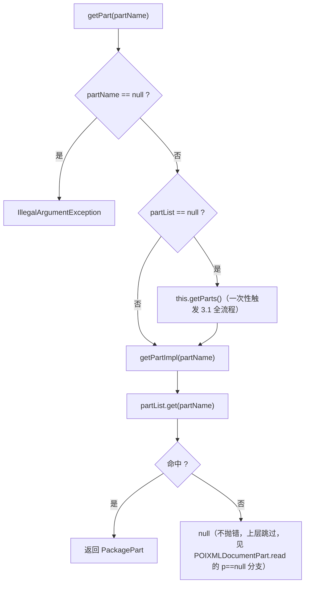
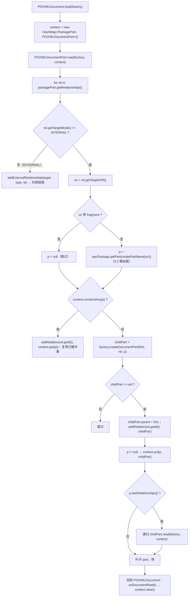

# OPC 包打开深读（设计意图 · 类图 · 流程图 · 关键方法）

> 归属：`wave0-ooxml-standards` · 状态：实现已 done（Java ↔ Rust 结构对齐）
> 回答的问题：**.docx 怎么打开**（ZIP 里先读什么、Part 怎么被发现）、
> Content Types 与 Relationships 怎么驱动 Part 发现（类型表 vs 关系图）、
> XWPFPackage 与通用 OPC 的差别（薄封装到底"薄"在哪）。
> 概览与心智模型：[opc-package.md](./opc-package.md) §1-§4 · [STRUCTURE_ANALYSIS.md](../STRUCTURE_ANALYSIS.md) §0
> Java 源码：`koffice/core-libs/io/wps-io/src/cn/wps/io/opc/OPCPackage.java`（609 行）、
> `PackagePart.java`（270 行）、`PackagePartCollection.java`、`PackageRelationshipCollection.java`（250 行）、
> `internal/ContentTypeManager.java`（233 行）、`internal/ZipContentTypeManager.java`、
> `internal/unmarshallers/PackagePropertiesUnmarshaller.java`、`model/POIXMLDocument.java`（44 行）、
> `model/POIXMLDocumentPart.java`、`model/POIXMLFactory.java`、`../xwpf/XWPFPackage.java`

---

## 0. 家族全景：一句话定位 + 装配图

**一句话定位**：打开一个 .docx = "ZIP 容器 → `[Content_Types].xml` 建类型表 → 逐个 entry
建 Part（懒）→ `.rels` 关系解析 → POIXML 对象图递归"；`XWPFPackage` 只是在这个通用
OPC 管道上叠加了 docx 特有的三件套属性与 customXml 收集。

```text
ZipEntrySource（ZipFileZipEntrySource / ZipInputStreamZipEntrySource）   ← 物理 ZIP 抽象
   ▲
OPCPackage（抽象基类，implements RelationshipSource）                     ← 包容器
   │  ├─ partList / rawPartList : PackagePartCollection     partName → PackagePart
   │  ├─ relationships : PackageRelationshipCollection       包级 .rels（懒）
   │  ├─ contentTypeManager : ZipContentTypeManager         [Content_Types].xml
   │  ├─ partUnmarshallers : Hashtable<ContentType, PartUnmarshaller>   打开期替换器
   │  ├─ partMarshallers + defaultPartMarshaller                          保存期写出器
   │  └─ zipArchive : ZipEntrySource / mZOS / tmpPackageFile              读写通道
   │
   ├── XWPFPackage（final 子类）→ +packageProperties/extendedPackageProperties/
   │        customPackageProperties + customXmlInfos；注册 3 个 unmarshaller
   │
   ├── PackagePart（抽象，implements RelationshipSource）
   │      └── ZipPackagePart（一个 zip entry 的封装：_zipEntry + getInputStreamImpl）
   │
   ├── ContentTypeManager（抽象）←─ ZipContentTypeManager（[Content_Types].xml 落盘）
   ├── PackageRelationshipCollection → PackageRelationship（Id/Type/Target/TargetMode）
   │
   └── model 层：POIXMLDocument ← POIXMLDocumentPart（对象图）↔ POIXMLFactory
             POIXMLDocumentPart 持有 packagePart + packageRel + parent + relations
```

---

## 1. 类图（继承 / 字段 / 关键方法）

### 1.1 `OPCPackage implements RelationshipSource`（抽象基类，opc/OPCPackage.java）

```java
public abstract class OPCPackage implements RelationshipSource {
   protected PackagePartCollection partList;           // partName → PackagePart（主表）
   protected PackagePartCollection rawPartList;        // XWPF 打开前的原始 part 快照
   protected PackageRelationshipCollection relationships; // 包级关系（懒加载）
   protected Hashtable<ContentType, PartMarshaller> partMarshallers;    // init() 建
   protected PartMarshaller defaultPartMarshaller;     // = new DefaultMarshaller()
   protected Hashtable<ContentType, PartUnmarshaller> partUnmarshallers;
   protected ContentTypeManager contentTypeManager;    // 打开时由 ZipContentTypeManager 填充
   protected ZipEntrySource zipArchive;                // 物理 ZIP 句柄
}
// 常量：DOCUMENT_CREATOR="WPS Office"；MAX_SIZE_ENTRY=1073741824（1GB）
//       INVALID_NAME="../"（入口名黑名单子串）
```

| 方法 | 逻辑 | 热路径 |
|------|------|--------|
| `open` 相关构造 `(String path,…)` / `(RandomAccessFile,…)` | `ZipHelper.openZipFile` → `zipArchive = new ZipFileZipEntrySource(zipFile)`；null → `ZipError` | ★ 入口 |
| `checkEntryNameLegal(entryName)` | 含 `"../"` → `FileDamagedException`（反路径穿越） | ★ 每个 entry |
| `getPartsImpl()` | **两步扫描**：① 遍历 zip entries，首个 `[Content_Types].xml` → `new ZipContentTypeManager(in, this)`；entry size > 1GB → `FileDamagedException`；② 其余 entry 逐一出 contentType 后两轮 `ZipPackagePart` 入表 | ★ 打开核心 |
| `getPart(partName)` | `partList == null → getParts()`（一次性）；`getPartImpl` = `partList.get` | ★ 查询 |
| `getPartsByRelationshipType` | 关系类型 → `getPart(rel)` 逐个解析（rel → target） | ★ |
| `getPart(PackageRelationship partRel)` | `ensureRelationships()` 后按 **type 相等** 取第一个 rel 的 target 建 part | ★ |
| `createPart(partName, ct, loadRel)` | 只读拒绝；`partList` 已含且未删 → `InvalidOperationException` [M1.12]；`createPartImpl` → `MemoryPackagePart`；`contentTypeManager.addContentType`；`partList.put`；`isDirty=true` | 写路径 |
| `addRelationship` / `addExternalRelationship` | `isRelationshipPartURI(target)` → [M1.25] 抛错；`ensureRelationships()` → `relationships.addRelationship(…, relID)` | 写路径 |
| `ensureRelationships()` | `relationships == null` → `new PackageRelationshipCollection(this)`（解析 `/_rels/.rels`） | ★ 懒加载 |
| `getRelationships(Helper)` | `ensureRelationships()` → `relationships.getRelationships(filter)` | ★ |
| `addMarshaller/addUnmarshaller/remove…` | 按 `ContentType` 注册 Hashtable | 装配 |
| `saveImpl(OutputStream)` | 只读拒绝 → 先 `ZipPartMarshaller.marshallRelationshipPart(getRelationships(), "/_rels/.rels", zos)` → `contentTypeManager.save(zos)` → 逐 part 用 marshaller 写出 | 写路径 |
| `configurePackage()` | 新包：`contentTypeManager = new ZipContentTypeManager(null, this)` + 预注册 relationships ct 与 `"/default.xml"→application/xml` | create |
| `close()` | READ：`contentTypeManager.clearAll()` + 池清空 + `zipArchive.close()`；否则 writeLock 下 `closeImpl()`（tmp 文件 save+rename）或直接 save | 生命周期 |
| `flush()` / `getPackageAccess()` | 只读拒绝后走 `flushImpl()` | — |

### 1.2 `XWPFPackage extends OPCPackage`（final，xwpf/XWPFPackage.java）

```java
public final class XWPFPackage extends OPCPackage {
   protected PackagePropertiesPart packageProperties;            // docProps/core.xml
   protected ExtendedPackagePropertiesPart extendedPackageProperties; // docProps/app.xml
   protected CustomPackagePropertiesPart customPackageProperties;     // docProps/custom.xml
   protected ArrayList<CustomXmlInfo> customXmlInfos;            // /customXml/item*.xml
}
```

| 方法 | 逻辑 | 热路径 |
|------|------|--------|
| `static open(InputStream)` | `new XWPFPackage(in, READ)`（`zipArchive = ZipInputStreamZipEntrySource`）；`partList == null → getParts()` | ★ 入口 |
| `static open(String path, access)` | 只读/读写都可；`access != WRITE → getParts()`；记 `originalPackagePath` | ★ 入口 |
| `static create(File/OutputStream)` | WRITE 包：`tmpPackageFile`/`mZOS`/`output` + `configurePackage()` | 写路径 |
| `getParts()`（覆盖） | `rawPartList = partList; partList = new`；逐 part：重名 → [M1.12]；`/customXml/item*` → `collectCustomXmlInfo`；core-properties 只取首个；**有注册的 unmarshaller → `unmarshall` 替换 part**，且按 instance 落到三件套字段；否则原样入表 | ★ docx 特化 |
| `addRelationship` / `createPart`（覆盖） | core-properties 已存在时再增 → [M4.1] 抛错 | 约束 |
| `getPackageProperties()` 等 | **懒建**：null → `new PackagePropertiesPart(this, CORE_PROPERTIES_PART_NAME)` | ★ |
| `saveImpl(ZipOutputStream)` | 三件套未写入过 → marshall + `relationships.addRelationship` + `contentTypeManager.addContentType`（逐一补齐） | 写路径 |
| `init()`（覆盖） | `super.init()`；`customXmlInfos = new ArrayList`；注册 3 个 unmarshaller + `ZipPackagePropertiesMarshaller` | 装配 |
| `configurePackage()`（覆盖） | `super.configurePackage()`；`packageProperties` 建好并写死 creator="WPS Office"、created=now | create |
| `collectCustomXmlInfo` | 把 item 落 temp 文件；读其 rels，取第一个关系 target（itemProps）也落盘 → `CustomXmlInfo(itemPath, itemPropPath)` | 打开期 |

### 1.3 `PackagePart implements RelationshipSource` + `ZipPackagePart`（opc/PackagePart.java）

```java
public abstract class PackagePart implements RelationshipSource {
   protected OPCPackage _container;
   protected PackagePartName _partName;
   protected ContentType _contentType;
   private boolean _isRelationshipPart;    // 由 _partName.isRelationshipPartURI() 判定
   private boolean _isDeleted;
   private PackageRelationshipCollection _relationships;  // 懒
}
```

| 方法 | 逻辑 | 热路径 |
|------|------|--------|
| 构造 `(pack, partName, ct, loadRelationships)` | `_isRelationshipPart = _partName.isRelationshipPartURI()`；`loadRelationships` 为 true → `new PackageRelationshipCollection(this)`（**构造即解析本 part 的 .rels**） | ★ |
| `addRelationship`（两种重载） | 只读拒绝；`_isRelationshipPart || target 是关系 part` → [M1.25] 抛错 | 写路径 |
| `getRelationships()` → `getRelationshipsCore(filter)` | `_relationships == null` → `throwExceptionIfRelationship()` + 懒建；返回 `new PackageRelationshipCollection(_relationships, filter)` 副本 | ★ |
| `hasRelationships()` | `!_isRelationshipPart && _relationships != null && size > 0` | ★ 递归下钻开关 |
| `getInputStream(isOriginInput)` | 空流 → `IOException("Can't obtain the input stream from " + name)`；实际走抽象 `getInputStreamImpl` | ★ |
| `getPartName/getContentType/setContentType` | `setContentType` 仅 `_container == null` 时允许 | — |
| 抽象 | `getInputStreamImpl(boolean)`、`getOutputStreamImpl()`、`save/load/close/flush` | 子类 |

**`ZipPackagePart extends PackagePart`**：字段 `ZipEntry zipEntry`；`getInputStreamImpl` →
`getPackage().getZipArchive().getInputStream(zipEntry, isOriginInput)`；`save` → `ZipPartMarshaller().marshall`；
`load/close/flush` → `InvalidOperationException("Method not implemented !")`（**只读 part，读写能力在 MemoryPackagePart**）。

### 1.4 `PackagePartCollection extends HashMap<PackagePartName, PackagePart>`

```java
public final class PackagePartCollection extends HashMap<PackagePartName, PackagePart> {
   private HashSet<String> registerPartNameStr;   // 声明但未使用（合规预留）
   // 仅覆盖 put / remove / clone
}
```

**为什么是裸 HashMap 子类**：Part 名（`/word/document.xml`）是包内主键；OPC [M1.12]
要求"等效 part 名不得重复"——唯一性检查在 `XWPFPackage.getParts()` / `OPCPackage.createPart`
显式做，集合本身只负责 O(1) 存取。

### 1.5 `ContentTypeManager`（抽象，internal/ContentTypeManager.java）+ `ZipContentTypeManager`

```java
public abstract class ContentTypeManager {
   public static final String CONTENT_TYPES_PART_NAME = "[Content_Types].xml";
   public static final String TYPES_NAMESPACE_URI = "http://schemas.openxmlformats.org/package/2006/content-types";
   protected OPCPackage container;
   private HashMap<String, String> defaultContentType;         // extension(小写) → ct
   private HashMap<PackagePartName, String> overrideContentType; // partName → ct
}
```

| 方法 | 逻辑 | 热路径 |
|------|------|--------|
| 构造 `(InputStream in, pkg)` | `in != null → parseContentTypesFile(in)`（打开期）；`null` 用于新包（configurePackage） | ★ |
| `addContentType(partName, ct)` | 扩展名非空 且（该扩展名无 default **或** default 已等于该 ct）→ 走 `addDefaultContentType`；否则走 `addOverrideContentType` | ★ 查/写 |
| `getContentType(partName)` | **Override 优先** → 无则 `defaultContentType.get(扩展名小写)`；都无且容器含此 part → `OpenXML4JRuntimeException` [M2.4] | ★ |
| `parseContentTypesFile(in)` | SAXReader → root `<Types>`；循环 `<Default Extension ContentType>` → default 表；循环 `<Override PartName ContentType>` → override 表 | ★ 打开期 |
| `save(outStream)` | 重建 DOM：`Types`（命名空间 TYPES_NAMESPACE_URI）下按 Default→Override 顺序写回 | 写路径 |
| `clearAll` / `removeContentType` | `removeContentType` 额外校验 [M2.4]：删 default 前确认无其它 part 用同扩展名 | 写路径 |
| `abstract saveImpl(Document, OutputStream)` | 子类决定落盘方式 | — |

**`ZipContentTypeManager extends ContentTypeManager`**：唯一职责——`saveImpl` 把内容写成
名为 `"[Content_Types].xml"` 的 zip entry（`putNextEntry → StreamHelper.saveXmlInStream → closeEntry`）。

### 1.6 `PackageRelationshipCollection implements Iterable<PackageRelationship>`

```java
public final class PackageRelationshipCollection implements Iterable<PackageRelationship> {
   private ArrayList<String> reservedRelationIDs;      // rId 避让表
   private HashMap<String, PackageRelationship> relationshipsByID;
   private PackagePart relationshipPart;               // 关系 part（如 _rels/.rels）
   private PackagePart sourcePart;                     // 源 part（null=包根）
   private PackagePartName relationshipPartName;
   private OPCPackage container;
}
```

| 方法 | 逻辑 | 热路径 |
|------|------|--------|
| `(OPCPackage container, PackagePart part)` | part==null → 根 `PACKAGE_ROOT_PART_NAME`；`relationshipPartName = getRelationshipPartName(part)`；**`relationshipPart = container.getPart(relationshipPartName)`（触发 partList 扫描）**；存在则 `parseRelationshipsPart` | ★ 关系解析 |
| `(coll, filter)` | 按 `rel.getRelationshipType().equals(filter)` 拷贝 | ★ |
| `addRelationship(targetUri, targetMode, type, id)` | `id==null` 或已被占 → 生成 `"rIdN"`（N 自 size 递增，避让已存在+reserved）；`new PackageRelationship(container, sourcePart, …)` | ★ 写 |
| `parseRelationshipsPart(relPart)` | SAXReader → root `<Relationships>`；每条 `<Relationship>`：`Id`/`Type`；core-properties 重复 → [M4.1] 抛错；`TargetMode` 缺省 INTERNAL；`Target` 反斜杠→斜杠、含 `'` → `new URI("#"+value)` | ★ 打开期 |
| `getRelationships(filter)` / `iterator()` | 过滤/全量迭代 | ★ |

### 1.7 `PackageRelationship` + `PackagePropertiesUnmarshaller implements PartUnmarshaller`

```java
public final class PackageRelationship {
   private String id;                 // "rIdN"
   private String relationshipType;   // "http://schemas.openxmlformats.org/.../officeDocument" 等
   private PackagePart source;        // null = 包根
   private TargetMode targetMode;     // INTERNAL | EXTERNAL
   private URI targetUri;             // 相对或绝对
}
```

- `getSourceURI()`：source==null → `PACKAGE_ROOT_URI`，否则 `source._partName.getURI()`。
- `getTargetURI()`：**EXTERNAL → 原样返回**；INTERNAL 且不以 `/` 开头 → `resolvePartUri(getSourceURI(), targetUri)`（**相对 target 相对 source part 解析**）。

**`PackagePropertiesUnmarshaller`**：`unmarshall(context, in)` → `new PackagePropertiesPart(pkg, partName)`；
SAX 解析 core.xml 根元素 → 16 个 `loadX(root)`（`root.element(name, 命名空间URI)`）→ 16 个
setter 填满 `Nullable` 字段；`in==null` 时从 context 取 zipEntry（含 `"../"` → `IOException("Unsafe zip file.")`）。
`checkElementForOPCCompliance`：M4.2（禁 Markup Compatibility 命名空间）、M4.3（dcterms 只许
`created`/`modified`）、M4.4（禁 `xml:lang`）、dcterms 必须带 `xsi:type="dcterms:W3CDTF"`。
16 键 = category/contentStatus/contentType/created/creator/description/identifier/keywords/
language/lastModifiedBy/lastPrinted/modified/revision/subject/title/version，命名空间映射：
`dc`=purl.org/dc/elements/1.1，`cp`=package/2006/metadata/core-properties，`dcterms`=purl.org/dc/terms。

### 1.8 POIXML 对象图（model 包）

- **`POIXMLDocumentPart`**：字段 `packagePart: PackagePart`、`packageRel: PackageRelationship`、
  `parent`、`relations: Map<String, POIXMLDocumentPart>`（LinkedHashMap）、`mDumpCache`。
  职责：`createRelationship(descriptor, factory, idx, noRelation, relId)` 建新 part
  （`createPart(descriptor.getFileName(idx), descriptor.getContentType())` + `addRelationship(…,
  INTERNAL, descriptor.getRelation(), relId)` + `factory.newDocumentPart(descriptor)`）；
  `read(factory, context)` **递归**按 rel 发现子 part。
- **`POIXMLDocument extends POIXMLDocumentPart`**：字段 `pkg: OPCPackage`；`getPackage()`；
  `hasOOXMLHeader(raf)` = 文件头 4 字节 `PK\x03\x04`（`OOXML_FILE_HEADER={80,75,3,4}`）；
  `load(factory)` = `read(factory, context) → onDocumentRead() → context.clear()`。
- **`POIXMLFactory`**（抽象）：`createDocumentPart(parent, rel, part)`（读侧实例化）+
  `newDocumentPart(descriptor)`（写侧实例化）。**两者由 XWPF 具体子类实现**，把 PackagePart
  装扮成 XWPFDocument/XWPFHeader 等。

### 1.9 类层次总图（mermaid）

```mermaid
classDiagram
    class RelationshipSource {
        <<interface>>
        +addRelationship(PackagePartName, TargetMode, String)
        +addExternalRelationship(String, String)
        +getRelationships() PackageRelationshipCollection
        +getRelationship(String) PackageRelationship
        +hasRelationships() boolean
    }
    class OPCPackage {
        #PackagePartCollection partList
        #PackagePartCollection rawPartList
        #PackageRelationshipCollection relationships
        #ContentTypeManager contentTypeManager
        #ZipEntrySource zipArchive
        #boolean isDirty
        +getPart(PackagePartName) PackagePart
        +getPart(PackageRelationship) PackagePart
        +getPartsByRelationshipType(String) ArrayList~PackagePart~
        +ensureRelationships()
        +createPart(PackagePartName, String) PackagePart
        +saveImpl(OutputStream)
        +configurePackage()
        +close()
        #getPartsImpl() PackagePart[]
        #getPartImpl(PackagePartName) PackagePart
    }
    class XWPFPackage {
        -PackagePropertiesPart packageProperties
        -ExtendedPackagePropertiesPart extendedPackageProperties
        -CustomPackagePropertiesPart customPackageProperties
        -ArrayList~CustomXmlInfo~ customXmlInfos
        +open(InputStream) XWPFPackage
        +open(String, PackageAccess) XWPFPackage
        +getParts() ArrayList~PackagePart~
        +getPackageProperties() PackageProperties
        +init()
        +configurePackage()
        +saveImpl(ZipOutputStream)
    }
    class PackagePart {
        #OPCPackage _container
        #PackagePartName _partName
        #ContentType _contentType
        -boolean _isRelationshipPart
        -boolean _isDeleted
        -PackageRelationshipCollection _relationships
        +getRelationships() PackageRelationshipCollection
        +hasRelationships() boolean
        +getInputStream(boolean) InputStream
        +getPartName() PackagePartName
        #loadRelationships()
        #getInputStreamImpl(boolean) InputStream *
        #getOutputStreamImpl() OutputStream *
    }
    class ZipPackagePart {
        -ZipEntry zipEntry
        #getInputStreamImpl(boolean) InputStream
        +save(OutputStream) boolean
        +load(InputStream) boolean
    }
    class PackagePartCollection {
        -HashSet~String~ registerPartNameStr
        +put(PackagePartName, PackagePart) PackagePart
        +remove(Object) PackagePart
    }
    class ContentTypeManager {
        <<abstract>>
        #OPCPackage container
        -HashMap~String, String~ defaultContentType
        -HashMap~PackagePartName, String~ overrideContentType
        +addContentType(PackagePartName, String)
        +getContentType(PackagePartName) String
        #parseContentTypesFile(InputStream)
        +save(OutputStream) boolean
        +saveImpl(Document, OutputStream) boolean *
    }
    class ZipContentTypeManager {
        +saveImpl(Document, OutputStream) boolean
    }
    class PackageRelationshipCollection {
        -ArrayList~String~ reservedRelationIDs
        -HashMap~String, PackageRelationship~ relationshipsByID
        -PackagePart relationshipPart
        -PackagePart sourcePart
        +addRelationship(URI, TargetMode, String, String) PackageRelationship
        #parseRelationshipsPart(PackagePart)
        +getRelationshipByID(String) PackageRelationship
    }
    class PackageRelationship {
        -String id
        -String relationshipType
        -PackagePart source
        -TargetMode targetMode
        -URI targetUri
        +getTargetURI() URI
        +getSourceURI() URI
    }
    class PartUnmarshaller {
        <<interface>>
        +unmarshall(UnmarshallContext, InputStream) PackagePart
    }
    class PackagePropertiesUnmarshaller {
        +unmarshall(UnmarshallContext, InputStream) PackagePart
        +checkElementForOPCCompliance(Element)
    }
    class POIXMLDocumentPart {
        #PackagePart packagePart
        #PackageRelationship packageRel
        -POIXMLDocumentPart parent
        -Map~String, POIXMLDocumentPart~ relations
        +read(POIXMLFactory, Map~PackagePart, POIXMLDocumentPart~)
        +createRelationship(POIXMLRelation, POIXMLFactory, int, boolean, String)
        +getRelations() List~POIXMLDocumentPart~
    }
    class POIXMLDocument {
        #OPCPackage pkg
        +getPackage() OPCPackage
        +hasOOXMLHeader(RandomAccessFile) boolean
        +load(POIXMLFactory)
    }
    class POIXMLFactory {
        <<abstract>>
        +createDocumentPart(POIXMLDocumentPart, PackageRelationship, PackagePart) POIXMLDocumentPart *
        +newDocumentPart(POIXMLRelation) POIXMLDocumentPart *
    }

    RelationshipSource <|.. OPCPackage
    OPCPackage <|-- XWPFPackage
    RelationshipSource <|.. PackagePart
    PackagePart <|-- ZipPackagePart
    OPCPackage *-- PackagePartCollection : partList
    OPCPackage *-- ContentTypeManager
    ContentTypeManager <|-- ZipContentTypeManager
    OPCPackage *-- PackageRelationshipCollection : relationships
    PackagePart *-- PackageRelationshipCollection : _relationships
    PackageRelationshipCollection *-- PackageRelationship
    PartUnmarshaller <|.. PackagePropertiesUnmarshaller
    OPCPackage o-- PartUnmarshaller : partUnmarshallers
    POIXMLDocumentPart <|-- POIXMLDocument
    POIXMLDocumentPart *-- PackagePart : packagePart
    POIXMLDocumentPart *-- PackageRelationship : packageRel
    POIXMLDocumentPart o-- POIXMLFactory : read/createRelationship
```



---

## 2. 设计意图（为什么）

### 2.1 为什么 ContentTypeManager 单独一层

`[Content_Types].xml` 是**打开任何包的第一把钥匙**：没有它，entry 就只是一堆没有身份的
字节流。把它独立成层（`ContentTypeManager` 抽象 + `ZipContentTypeManager` 实现）有三个原因：
① 打开期与保存期共用同一张表（`parseContentTypesFile` ↔ `save`）；② 查询是高频热路径
（`getPartsImpl` 里**每个 entry** 都要 `getContentType`）；③ 物理载体可插拔——文件实现写 zip
entry，内存包可以有自己的实现，业务代码只看 `defaultContentType`/`overrideContentType` 两张表。

### 2.2 为什么 "Part 与 关系" 分离、Part 不拼路径

OPC 规范（M1.25）禁止关系 part 挂关系，Part 只描述"我是一个资源 + 我是什么类型"；
"谁连到谁"全在 `*.rels` 里。好处：**发现是图遍历而不是路径拼接**——`POIXMLDocumentPart.read`
只需遍历 `packagePart.getRelationships()` 就能拿到全部子部件，docx 生产端即使改变布局
（比如 image 放别的目录），消费端代码一行不用改。这也是 `.docx` 与旧 `.doc` 二进制格式的
根本区别。

### 2.3 为什么 XWPFPackage 是薄封装

通用 `OPCPackage` 不做任何业务判断——它只回答"ZIP 里有这些 part，类型是什么"。
`XWPFPackage` 只追加了 4 件事：① `init()` 注册 3 个 properties unmarshaller；② `getParts()`
里对 core-properties 去重、收集 `/customXml/item*`；③ 三件套的懒建 getter；④ 保存期补写
三件套关系与类型。**`getPartsImpl` 的 ZIP 扫描完全复用基类**，子类只在主表填充时做业务过滤
（`rawPartList = partList` 保存原始快照正是为了给 `collectCustomXmlInfo` 查 itemProps 用）。

### 2.4 懒加载时机（打开一个 docx 到底触发了多少解析）

`XWPFPackage.open(path)` **只**做了：建包 + 打开 zip。真正的解析全部被推到第一次访问：

| 触发点 | 首次访问 | 干什么 |
|--------|----------|--------|
| partList | `getPart` / `getParts` / `getPartsImpl` | 扫 zip、读 `[Content_Types].xml`、建所有 part |
| 包级关系 | `ensureRelationships` / `getRelationships*` | 解析 `/_rels/.rels` |
| part 级关系 | `PackagePart` 构造（loadRelationships=true）或 `getRelationships` | 解析该 part 的 `.rels` |
| 三件套 | `getPackageProperties()` 等 | `new PackagePropertiesPart(...)` |
| 子部件对象图 | `POIXMLDocument.load → read` | 只有 `p.hasRelationships()` 才下钻递归 |

所以"打开"本身很轻，正文/样式/图片按需才进内存——这是 `POIXMLDocumentPart` 树能支撑
大文档的关键。

### 2.5 为什么 getPartsImpl 要"先类型表、后建 part"两遍扫

part 的 contentType 决定它怎么被后续处理（marshaller/unmarshaller/直接入表），而类型
只存在于 `[Content_Types].xml` 一个入口里。所以第一遍必须先把该 entry 找出来解析成
`contentTypeManager`，**且 `[Content_Types].xml` 自己不进 partList**（`buildPartName` 直接
返回 null）。第二遍才是为每个 entry 查类型（override→default→`guessContentTypeByExtension`
兜底）并两轮构造 `ZipPackagePart`：第一轮先把 relationships 类型的 part 入表，第二轮再入
普通 part——保证后续任何"找关系 part"的操作都基于完整表。

### 2.6 为什么 Target 要"相对源解析"

`*.rels` 里 `Target="styles.xml"` 是**相对源 part** 的（`/word/document.xml` 的 rels 里
写 `styles.xml` 指 `/word/styles.xml`）。`PackageRelationship.getTargetURI` 里 INTERNAL 且
target 不以 `/` 开头 → `resolvePartUri(sourceUri, targetUri)`；以 `/` 开头（如
`/customXml/item1.xml`）则是包根绝对路径，原样返回。EXTERNAL 永远原样（是外部链接不是 part）。

### 2.7 为什么类型表要分 Default 与 Override 两张

`Default` 按扩展名聚合（`xml → application/xml` 一条管全包），`Override` 按 partName 精确
覆盖。`addContentType` 的判定是：扩展名非空 **且**（无该扩展 default 或 default 已等于目标
ct）→ 复用 Default；否则必须 Override。查询先查 Override（更精确）再查 Default（更通用）。
这套"聚合 + 特例"模型让 `[Content_Types].xml` 保持小体积，同时任何 part 都能精确表态。

### 2.8 为什么 read() 要带 context 表 + hasRelationships 下钻

`POIXMLDocumentPart.read(factory, context)` 的 `context: Map<PackagePart, POIXMLDocumentPart>`
是**已实例化对象表**：① 防环——多个 rel 指向同一 part 时只建一次（`context.containsKey(p)`
则复用并 `addRelation`）；② 防爆——只有 `p.hasRelationships()` 才递归，叶子 part 不再下钻。
`onDocumentCreate/onDocumentRead` 钩子留给子类做各自的反序列化（如 XWPFDocument 建
paragraph/table），factory 则负责"PackagePart → 具体 POIXML 类"的多态映射。

---

## 3. 流程图（mermaid）

### 3.1 `XWPFPackage.open` 全流程（ZIP → `[Content_Types].xml` → 关系 → part 收集）

```mermaid
flowchart TD
    A["XWPFPackage.open(path, READ)"] --> B["OPCPackage(path, READ) 构造"]
    B --> B1["ZipHelper.openZipFile(path) → zipArchive = ZipFileZipEntrySource"]
    B1 --> C{"partList == null 且 access != WRITE ?"}
    C -- 是 --> D["XWPFPackage.getParts()"]
    C -- 否（WRITE）--> Z["结束：仅建壳，等待 createPart"]
    D --> E["OPCPackage.getPartsImpl()"]
    E --> E1["partList == null → new PackagePartCollection()"]
    E1 --> E2["遍历 zip entries"]
    E2 --> E3{"entry.size > 1GB(MAX_SIZE_ENTRY) ?"}
    E3 -- 是 --> E4["FileDamagedException"]
    E3 -- 否 --> E5["checkEntryNameLegal：entry 名含 ../ → FileDamagedException"]
    E5 --> E6{"entry 是 [Content_Types].xml ?"}
    E6 -- 是 且首次 --> E7["contentTypeManager = new ZipContentTypeManager(entry 流, this)"]
    E6 -- 否 --> E8["存入 exceptContentType 待办表"]
    E7 --> E8
    E8 --> F["第二遍：逐 entry 建 Part"]
    F --> F1["buildPartName(entry) → createPartName"]
    F1 --> F2["contentType = contentTypeManager.getContentType(partName)"]
    F2 --> F3{"null ?"}
    F3 -- 是 --> F4["兜底：ContentTypes.guessContentTypeByExtension(扩展名小写)"]
    F3 -- 否 --> F5{"contentType == relationships+xml ?"}
    F4 --> F5
    F5 -- 是 --> F6["partList.put(partName, new ZipPackagePart(this, entry, …))"]
    F5 -- 否 --> F7["暂存 partName+contentType"]
    F7 --> F8["第二小轮：统一 new ZipPackagePart 入表"]
    F6 --> G["返回 partList.values() 到 XWPFPackage.getParts()"]
    F8 --> G
    G --> H["XWPFPackage.getParts() 业务层"]
    H --> H1["rawPartList = partList；partList = new PackagePartCollection()"]
    H1 --> H2["逐 part：重名 → M1.12；/customXml/item* → collectCustomXmlInfo"]
    H2 --> H3{"core-properties ct ?"}
    H3 -- 是 --> H4["只保留首个（hasCorePropertiesPart），重复的跳过"]
    H3 -- 否 --> H5{"partUnmarshallers 命中 ?"}
    H4 --> H5
    H5 -- 是 --> H6["unmarshall(context, part.getInputStream()) → 替换 part"]
    H6 --> H7["PackagePropertiesPart → packageProperties 等三件套"]
    H5 -- 否 --> H8["原样 partList.put"]
    H7 --> I["打开完成：document.xml 等 part 可被 getPart 命中"]
    H8 --> I
```



### 3.2 `getPart` 查询（懒加载链）



### 3.3 关系解析（包级 / part 级 → `parseRelationshipsPart`）

```mermaid
flowchart TD
    A["new PackageRelationshipCollection(container, part)"] --> B{"part == null ?"}
    B -- 是 --> C["relationshipPartName = PACKAGE_ROOT_PART_NAME → /_rels/.rels"]
    B -- 否 --> D["relationshipPartName = PackagingURIHelper.getRelationshipPartName(part.getPartName())"]
    C --> E["relationshipPart = container.getPart(relationshipPartName)"]
    D --> E
    E --> F{"relationshipPart == null ?"}
    F -- 是 --> Z["空关系集（该 part 无 .rels）"]
    F -- 否 --> G["parseRelationshipsPart(relationshipPart)"]
    G --> H["SAXReader 读 part 流 → root &lt;Relationships&gt;"]
    H --> I["逐条 &lt;Relationship&gt;"]
    I --> I1["id = @Id；type = @Type"]
    I1 --> I2{"type == core-properties ?"}
    I2 -- 是 --> I3{"已有一条 ?"}
    I3 -- 是 --> I4["InvalidFormatException [M4.1]"]
    I3 -- 否 --> I5["置 fCorePropertiesRelationship = true"]
    I2 -- 否 --> I6["继续"]
    I5 --> I6
    I6 --> I7["TargetMode：无 @TargetMode → INTERNAL；否则 internal/external"]
    I7 --> I8["Target：\\ → /；含 ' → new URI(\"#\" + value)；否则 new URI(value)"]
    I8 --> I9["addRelationship(targetUri, targetMode, type, id) 入 relationshipsByID"]
    I9 --> J["getRelationships(filter) → 过滤副本（rel.getRelationshipType().equals(filter)）"]
```

### 3.4 对象图递归发现（`POIXMLDocumentPart.read`）



---

## 4. 关键不变量（改写 / 测试锚点）

| # | 不变量 | 来源 |
|---|--------|------|
| 1 | `[Content_Types].xml` 是**第一个**被解析的 entry，且**自己不进 partList**（`buildPartName` 返回 null）；解析完成后才建任何 part | `OPCPackage.getPartsImpl` / `buildPartName` |
| 2 | 打开期合规：entry size > `MAX_SIZE_ENTRY`(1073741824) → `FileDamagedException`；entry 名含 `"../"` → `FileDamagedException` | `OPCPackage.getPartsImpl` / `checkEntryNameLegal` |
| 3 | Part 名是包内主键：`partList` 中重名 → `InvalidFormatException` [M1.12]；`createPart` 对已存在未删 part 抛 `InvalidOperationException` [M1.12] | `XWPFPackage.getParts` / `OPCPackage.createPart` |
| 4 | 每个 part 必有 content type：`getContentType` = override 优先 → default(扩展名小写) → null；若容器含该 part 却无类型 → `OpenXML4JRuntimeException` [M2.4] | `ContentTypeManager.getContentType` |
| 5 | 类型登记策略：扩展名非空且（无 default 或 default 已等于 ct）→ Default；否则 Override | `ContentTypeManager.addContentType` |
| 6 | 懒加载：`partList` 首次 getPart/getParts 才建；`relationships` 首次 `ensureRelationships` 才建；三件套首次 getter 才建；`read` 只在 `p.hasRelationships()` 下钻 | `OPCPackage.getPart`/`ensureRelationships` / `XWPFPackage.getPackageProperties` / `POIXMLDocumentPart.read` |
| 7 | 关系语义：`getRelationshipPartName(null)=/_rels/.rels`；`getTargetURI`：EXTERNAL 原样，INTERNAL 非 `/` 开头 → `resolvePartUri(sourceURI, targetUri)`；Target 反斜杠统一为 `/`，含 `'` → `#fragment` | `PackageRelationshipCollection` / `PackageRelationship.getTargetURI` / `parseRelationshipsPart` |
| 8 | 关系合规：core-properties 关系全包只能一条（`fCorePropertiesRelationship`，重复 → [M4.1]）；关系 part 自身不许再挂关系（M1.25）；rId 生成 `rIdN`（自 size 递增，避让 reserved） | `parseRelationshipsPart` / `PackagePart.addRelationship` / `PackageRelationshipCollection.addRelationship` |
| 9 | 只读保护：`packageAccess == READ` 时 `createPart/save/flush/closeImpl` 全部抛 `InvalidOperationException` | `OPCPackage.throwExceptionIfReadOnly` |
| 10 | core.xml 16 字段命名空间映射：dc（creator/description/…）、cp（keywords/revision/…）、dcterms（**仅** created/modified，且必须带 `xsi:type="dcterms:W3CDTF"`）；违者 `checkElementForOPCCompliance` 抛 M4.2/M4.3/M4.4 | `PackagePropertiesUnmarshaller` |
| 11 | docx 头魔数：`hasOOXMLHeader` = 前 4 字节 `PK\x03\x04`（{80,75,3,4}） | `POIXMLDocument.hasOOXMLHeader` |
| 12 | `XWPFPackage.getParts` 用 `rawPartList` 保留扫描快照；`collectCustomXmlInfo` 靠 rawPartList 反查 itemProps | `XWPFPackage.getParts` / `collectCustomXmlInfo` |

---

## 5. 与 Rust 现状对照

| Java | Rust | 状态 |
|------|------|------|
| OPCPackage | `opc/OPCPackage.rs` | done（13 个字段全保留；`getPart/ensureRelationships/addRelationship/M1.25/只读保护` 对齐；`getPartsImpl` 的 ZIP 扫描体以 `// Java:` 注释占位，`getPart` 暂返回壳 None） |
| XWPFPackage | `xwpf/XWPFPackage.rs` | done（`open_stream/open_path/open_raf/create_*` 齐全；`getParts` 当前只确保 partList 存在并返回空 Vec——unmarshaller 分发/M1.12/customXml 逻辑以注释保留；`getPackageProperties` 懒建已实现） |
| PackagePart | `opc/PackagePart.rs` | done（`new/new_with_load` + `loadRelationships` 钩子 + M1.25 检查 + `_isRelationshipPart` 判定对齐） |
| ZipPackagePart | `opc/ZipPackagePart.rs` | done（`getInputStreamImpl` panic 占位；`save/load/close/flush` 按 Java 语义 `panic!("Method not implemented !")`——只读 part 正确） |
| PackagePartCollection | `opc/PackagePartCollection.rs` | done（HashMap 封装 + `registerPartNameStr` 字段保留） |
| ContentTypeManager | `opc/internal/ContentTypeManager.rs` | done（`addContentType/getContentType/toLowercase/isContentTypeRegister` 逻辑对齐；`parseContentTypesFile` 的 Default/Override 两段循环体待 DOM 层就绪） |
| ZipContentTypeManager | `opc/internal/ZipContentTypeManager.rs` | done（`new` + `saveImpl` 的 `[Content_Types].xml` entry 写入占位） |
| PackageRelationshipCollection | `opc/PackageRelationshipCollection.rs` | done（`new_with_container_and_part` 触发链路 + rId 生成 + 过滤构造已实现；`parseRelationshipsPart` XML 体占位） |
| PackageRelationship | `opc/PackageRelationship.rs` | done（`getTargetURI` 的 INTERNAL 相对解析/EXTERNAL 原样语义保留） |
| PackagePropertiesUnmarshaller | `opc/internal/unmarshallers/PackagePropertiesUnmarshaller.rs` | done（16 个 `KEYWORD_*` 常量 + `unmarshall → Result<PackagePropertiesPart, String>` + `checkElementForOPCCompliance` 签名齐全） |
| POIXMLDocument | `opc/model/POIXMLDocument.rs` | done（`hasOOXMLHeader` 用 `[80,75,3,4]` **已真正实现**；`load → base.read + onDocumentRead + context.clear` 链保留） |
| POIXMLDocumentPart | `opc/model/POIXMLDocumentPart.rs` | done（`read` 递归 + context 去重 + `createRelationship_full` 对齐；`relations` 用 `HashMap<String, POIXMLDocumentPart>`） |
| POIXMLFactory | `opc/model/POIXMLFactory.rs` | done（trait 化：`createDocumentPart` / `newDocumentPart` 两个抽象方法） |

**残留 / 改写注意**：
- **打开链路的"最后一公里"是 ZIP 扫描**：`OPCPackage.getPartsImpl` 与
  `PackageRelationshipCollection.parseRelationshipsPart` 的 XML/zip 体在 Rust 侧仍是占位
  （`// Java:` 注释逐行保留）。后续接上 zip 读 entry + DOM 后，方法体照注释填即可，签名与
  两遍扫描顺序不要改。
- `ContentTypeManager.parseContentTypesFile` 依赖 SAXReader/DOM：等 `io/dom` 就绪后填
  Default/Override 两段循环；`save` 里 `appendDefaultType/appendSpecificTypes` 同理。
- **懒加载语义必须保留**：`partList/relationships/三件套` 不能改成急切构造。
- **ownership 胶水**：`Box<dyn Any>` 与 `getPart` 返回壳 None 是当前脚手架约束，替换为真实
  类型后方法体不动。
- 常量对齐：`CONTENT_TYPES_PART_NAME="[Content_Types].xml"`、`TYPES_NAMESPACE_URI`、
  `MAX_SIZE_ENTRY=1073741824`、`PK\x03\x04`、16 个 `KEYWORD_*`、core-properties 关系 URI
  （M4.1 判重用）——改写时不得改动这些字符串。
