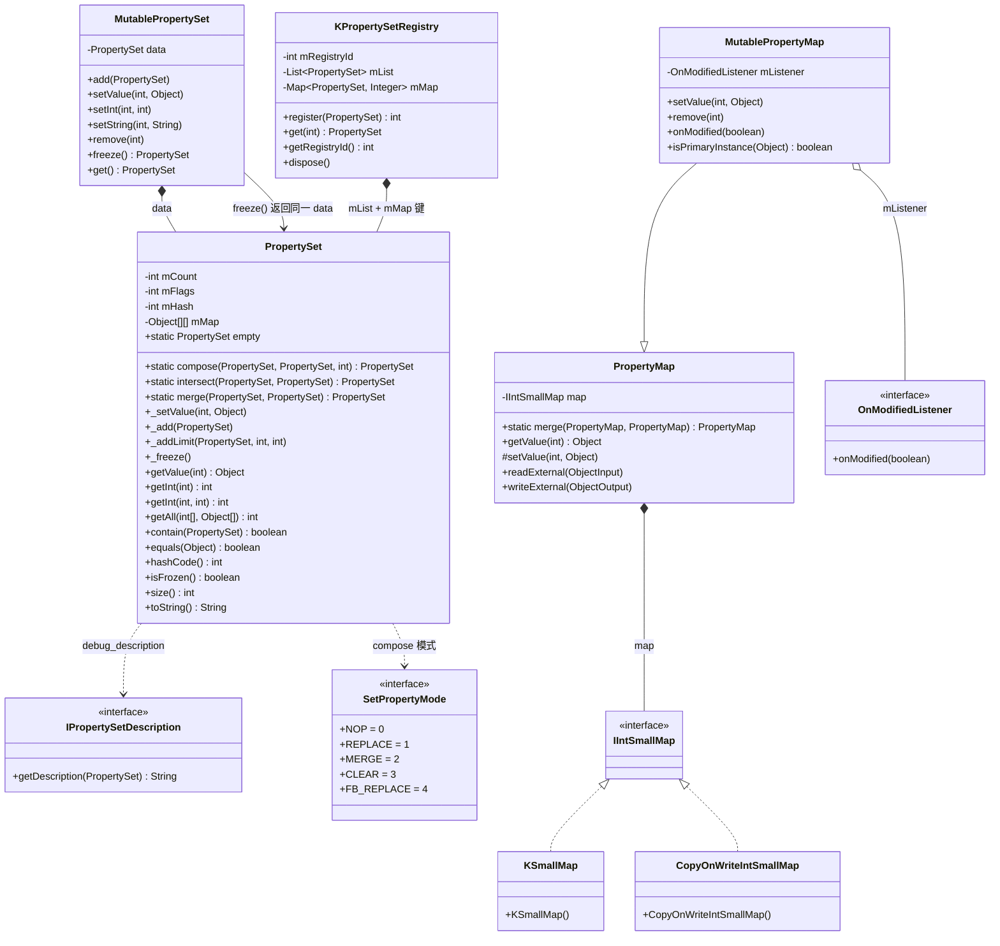
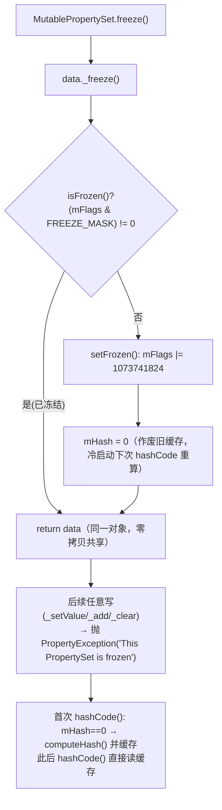
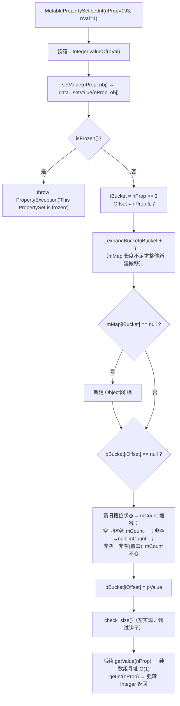
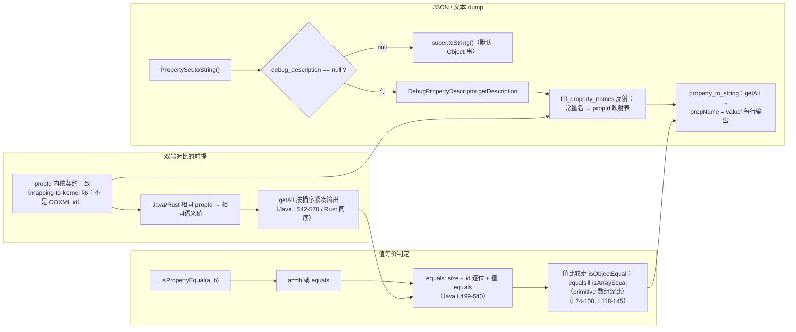

# PropertySet / MutablePropertySet 深读（设计意图 · 类图 · 流程图 · 关键方法）

> 归属：wave0-ooxml-standards · 状态：实现已 done
> 回答的问题：属性桶为什么不可变+可变双面、为什么 setInt/setValue 双接口、freeze 语义
> 概览与心智模型：[mapping-to-kernel.md](./mapping-to-kernel.md) §6 · [STRUCTURE_ANALYSIS.md](../STRUCTURE_ANALYSIS.md)
> Java 源码：`koffice/core-libs/util/util/src/cn/wps/moffice/property/{PropertySet,MutablePropertySet,PropertyMap,MutablePropertyMap}.java`；Rust：`libs/core-libs/util/util/src/cn/wps/moffice/property/`
> 关联类：`KPropertySetRegistry`（`koffice/writer/core/cn/wps/moffice/writer/data/internal/KPropertySetRegistry.java`，Rust 在 word-core）

---

## 0. 家族全景：一句话定位 + 装配图

| 角色 | 类 | 一句话 |
|------|----|--------|
| **不可变属性桶** | `PropertySet` | 以 `propId → Object` 为契约的**扁平只读桶**；`Object[][]` 桶式数组存储，`freeze()` 后不可变、hash 可缓存 |
| **可变构建器** | `MutablePropertySet` | 持有 `PropertySet data`，所有写操作走 `_setValue`；`freeze()` 后交出同一份 `data` 供共享 |
| **可变稀疏属性图** | `PropertyMap` | 以 `IIntSmallMap`（`KSmallMap`/`CopyOnWriteIntSmallMap`）为后端的**稀疏 int→Object** 映射；`setValue` 是 protected |
| **带变更通知的可变图** | `MutablePropertyMap` | `extends PropertyMap`；`setValue` 只在**真正变化**时 `put` 并触发 `OnModifiedListener` |
| **属性桶注册中心** | `KPropertySetRegistry` | `List<PropertySet>` + `HashMap<PropertySet,Integer>` 做**按值去重的注册**；index 0 恒为 `PropertySet.empty` |

```text
                      cn.wps.moffice.property（core-libs/util）
┌────────────────────────────────────────────────────────────────────┐
│  MutablePropertySet ──data──► PropertySet（不可变桶）                 │
│       │ setInt/setValue           mMap: Object[bucket][8]           │
│       └──── freeze() ───────────► 返回同一份 data（共享/哈希缓存）      │
│                                                                    │
│  MutablePropertyMap ──base──► PropertyMap                          │
│       │ +OnModifiedListener         map: IIntSmallMap              │
│       │                             ├── KSmallMap（默认，数组+线性）   │
│       └─ setValue 去重后 put ─────► └── CopyOnWriteIntSmallMap      │
└────────────────────────────────────────────────────────────────────┘
                      │ 实例按值去重 / 越界兜底
                      ▼
      KPropertySetRegistry（writer/data/internal，Rust 在 word-core）
        mList: List<PropertySet> + mMap: HashMap<PropertySet,Integer>
```

**下游关系**：CHPX/PAPX/样式/编号等一切"属性"都以 **propId 整数 → 值** 形式落进 `MutablePropertySet`，`freeze()` 后挂进 ChpxTable/PapxTable/KStyle；`PropertySet.empty` 是所有"无属性"位置的兜底实例。`PropertyMap` 家族服务 doc 属性（`SummaryBase.mProperty` 是 `MutablePropertyMap`）、表格/数学等另一路属性。**propId 是内核契约，不是 OOXML 编号**（`mapping-to-kernel.md` §6）。

---

## 1. 类图（继承 / 字段 / 关键方法）

### 1.1 `PropertySet implements Cloneable`（不可变桶本体）

```java
public class PropertySet implements Cloneable {
   static final int BUCKET_SIZE_SHIFT = 3;      // 桶大小 2^3 = 8
   static final int BUCKET_SIZE = 8;            // L4-5
   public static IPropertySetDescription debug_description = null;  // toString 钩子 L9
   public static final PropertySet empty = createEmpty();          // L10
   static final int FREEZE_BIT = 30;  static final int FREEZE_MASK = 1073741824;  // L6-7
   private int mCount;      // 桶内非空槽总数 = size()
   private int mFlags;      // bit30 为 FREEZE 位
   private int mHash;       // frozen 后的缓存 hash
   private Object[][] mMap; // 桶数组：mMap[bucket][offset]，bucket=propId>>3，offset=propId&7
}
```

| 方法 | 逻辑（1 行） | 备注 |
|------|-------------|------|
| `static createEmpty()` (L46-49) | `new PropertySet()` + `_freeze()` | `empty` 是**已冻结**的空桶 |
| `static compose(old,new,mode)` (L18-44) | mode 0→old / 1→new / 2→merge 后 freeze / 3→old 再 remove 掉 new 的 key 后 freeze | 与 `SetPropertyMode`(NOP/REPLACE/MERGE/CLEAR/FB_REPLACE) 配套 |
| `static intersect(p1,p2)` (L52-72) | 逐桶逐槽 `v1.equals(v2)` 才收；任一 mMap==null → `empty` | 返回 frozen |
| `static merge(a,b)` (L110-116) | `MutablePropertySet` add 两份再 freeze | 后写覆盖先写 |
| `static valueOf(id,val)` (L147-152) | `new PropertySet(id,pValue)`（**deprecated**，构造即冻结） | 与 deprecated 构造器等价 |
| `_setValue(nProp,val)` (L377-400) | frozen 抛异常 → `bucket=nProp>>3; offset=nProp&7` → 扩桶 → 落值，维护 mCount | ★ 所有写的唯一入口 |
| `_add(props)` (L196-222) | frozen 抛异常 → 扩桶至 props 大小 → 逐槽覆盖拷贝，新槽 `mCount++` | merge/compose 的数据源 |
| `_addLimit(props,b,e)` (L224-252) | 只拷 `[beginId,endId)` 的槽 | 区间裁剪添加 |
| `_differenceSet(p2)` (L278-300) | 删掉与 p2 值相等的槽 | 差集 |
| `_intersect(p2)` (L326-374) | 只保留 p2 中有且值相等的槽 | 交集 |
| `_clear()` (L256-275) | frozen 抛异常 → 全桶清空，mCount=0 | |
| `_freeze()` (L316-323) | `!isFrozen` → `setFrozen()` + `mHash=0` | ★ freeze 核心 |
| `clone()` (L405-420) | 桶级深拷贝（值共享引用） | |
| `getValue(nProp)` (L666-670) | 纯数组寻址，越界/空桶返回 null | 无锁读 |
| `getInt/getBoolean/getFloat/getString/getObject` (L573-664) | 无默认版：缺失抛 `PropertyException("No such property: N")`；带默认版：缺失返回默认值 | ★ 双形态 getter |
| `getAll(ids,values)` (L542-570) | 按桶序紧凑输出 (id,value) 对，返回个数 | 枚举/对比依赖此顺序 |
| `contain(prop)` (L443-470) | prop 每项在本桶中都存在且值 equals；`prop==null` → 按 `empty` 处理 | 包含判定 |
| `equals(r)` (L499-540) | `r==null` → 按 `empty` 比；size 不同 false；id 数组逐位相同；值逐个 `equals` | |
| `hashCode()` (L672-683) | frozen → 首次 `computeHash()` 后缓存进 mHash；否则每次重算 | ★ 缓存依赖 freeze |
| `isFrozen()/setFrozen()` (L688-692) | 读写 mFlags bit30 | |
| `toString()` (L700-702) | `debug_description==null ? super : getDescription(this)` | JSON/dump 钩子 |

### 1.2 `MutablePropertySet implements Cloneable`（构建器）

```java
public class MutablePropertySet implements Cloneable {
   PropertySet data;    // L7 —— 唯一状态，全部操作委托
}
```

| 方法 | 逻辑 | 备注 |
|------|------|------|
| 构造器 x3 (L9-23) | 空；从 `MutablePropertySet`/`PropertySet` 拷贝（= `add`） | 拷贝即 add 合并 |
| `freeze()` (L67-70) | `this.data._freeze(); return this.data;` | **返回同一对象**，不是拷贝 |
| `get()` (L72-73) | 直接返回内部 data | 只读访问 |
| `setValue(nProp,Object)` (L151-152) | `data._setValue(nProp, pValue)` | ★ 通用落桶 |
| `setInt(int,int)/setFloat(int,float)` (L140-145) | 基本类型自动装箱后走 `setValue` | ★ setInt/setValue 双接口的汇合点 |
| `setBoolean/setFloat/setInt(Integer 装箱版)` (L156-168) | 先 `Assert.assertNotNull` 再 `_setValue` | 显式装箱重载拒绝 null |
| `setString(nProp,str)` (L147-149) | 直通 `_setValue` | |
| `remove(nProp)` (L137-138) | `setValue(nProp, null)` | **删除 = 写 null 槽** |
| `add/addLimit/clear/intersect/differenceSet` (L30-64) | 全部委托 `data._*` 就地变更 | 与静态工厂互补 |

> 关键点：**没有 `remove` 的桶收缩**——清槽只是槽位写 null，`mMap` 数组长度只增不减（`_expandBucket` 单向）。这是"稀疏属性"模型的取舍。

### 1.3 `PropertyMap implements Cloneable, PropBaseSerializable`（稀疏图）

```java
public class PropertyMap implements Cloneable, PropBaseSerializable {
   public static boolean sUseSmallMap = true;               // L11 全局开关
   IIntSmallMap map = null;                                 // L13 后端
}
```

| 方法 | 逻辑 | 备注 |
|------|------|------|
| 构造器 (L22-30) | `sUseSmallMap ? new KSmallMap : new CopyOnWriteIntSmallMap` | 后端可全局切换 |
| `static merge(a,b)` (L15-20) | `MutablePropertyMap` 连 add 两份 | 与 PropertySet.merge 对称 |
| `getValue(nProp)` (L159-162) | `map.get(nProp)` | 稀疏哈希，无桶概念 |
| `protected setValue(nProp,val)` (L169-170) | `map.put(nProp, pValue)` | **protected**——只有子类可写 |
| 类型化 getter (L62-157) | 同 PropertySet：无默认版抛 / 有默认版返回 | 同一套约定 |
| `equals` (L45-50) | `map.equals` | |
| `readExternal/writeExternal` (L172-177) | 委托 map | PropBaseSerializable = Externalizable |

### 1.4 `MutablePropertyMap extends PropertyMap implements Cloneable`（带通知）

```java
public class MutablePropertyMap extends PropertyMap implements Cloneable {
   OnModifiedListener mListener;   // L7
   public interface OnModifiedListener { void onModified(boolean var1); }  // L86-88
}
```

| 方法 | 逻辑 | 备注 |
|------|------|------|
| `setValue(nProp,val)` (L47-57) | **先取 oldValue 去重**：primary（Integer/Boolean/String/Float）按 `equals` 比；非 primary 按**引用**比；只有不同才 `put` + `onModified(true)` | ★ 去重 + 变更通知 |
| `isPrimaryInstance(val)` (L59-61) | `instanceof Integer||Boolean||String||Float` | 值语义 vs 引用语义的分界 |
| `remove(nProp)` (L26-34) | `contains` 才 `map.remove` + `onModified(true)` | |
| `setInt/setFloat/setBoolean/setString` (L36-45) | 装箱后走 `setValue` | 与 PropertySet 家族同一模式 |
| `setListener/getListener/onModified` (L74-84) | 通知 `mListener.onModified(flag)` | 单监听器 |

### 1.5 关联类

| 类 | 位置 | 关系 |
|----|------|------|
| `IPropertySetDescription` | core-libs/util/property | `PropertySet.debug_description` 的类型；`getDescription(PropertySet)` 供 `toString` |
| `DebugPropertyDescriptor` | writer/data | 实现 IPropertySetDescription；`fill_property_names` 用反射把常量名→propId 填 HashMap（dump 可读化的根） |
| `SetPropertyMode` | core-libs/util/property | `NOP=0/REPLACE=1/MERGE=2/CLEAR=3/FB_REPLACE=4`；`PropertySet.compose` 的模式常量 |
| `KPropertySetRegistry` | writer/data/internal | `register/get/dispose`；index 0 恒为 `empty`（构造时注册 L12-16）；`get` 越界返回 `empty`（L33-35） |
| `IIntSmallMap` / `KSmallMap` / `CopyOnWriteIntSmallMap` | core-libs/util | PropertyMap 的后端接口与两种实现 |

### 1.6 类层次总图（mermaid）



---

## 2. 设计意图（为什么）

### 2.1 为什么「不可变 + 可变」双面（freeze 语义）

属性桶一生分两阶段：**构建期可变**（`MutablePropertySet` 反复 setInt/setValue），**发布期不可变**（`freeze()` 后共享）。freeze 给了三层收益：
1. **共享零拷贝**：`freeze()` 返回**同一份** data（`MutablePropertySet.java` L67-70），CHPX/PAPX/样式节点可以无限引用同一个桶而不怕被改（`PropertySet.empty` 单例复用即此）。
2. **hash 可缓存**：`hashCode()` 只在 frozen 状态缓存 `mHash`（`PropertySet.java` L672-683）——桶不变，hash 永不失效，`KPropertySetRegistry` 才能拿桶当 HashMap 键做按值去重。
3. **无锁读**：写路径全部被 freeze 挡死（`_setValue/_add/_clear` 第一行都 `isFrozen` 抛 `PropertyException`，L378/L197/L258），读者线程不需要锁。

### 2.2 为什么 propId 是内核契约、整数连续编号

OOXML 属性是**树形、字符串 id**（`w:b`、`w:sz`）；内核把它拍平为 **int propId → Object**。编号体系直接服务存储结构：`bucket = id>>3`、`offset = id&7`（`PropertySet.java` L379-380）——id 本身就是桶数组下标，`getValue` 是**纯数组寻址 O(1)**（L666-670）。代价是 propId 必须**人为约定且全局唯一**（`RunPropsConverterSimple` 里字号=10、字体名=19、对齐=193……），跨语言双端对比必须以同一套编号为契约（`mapping-to-kernel.md` L96："propId 是内核契约，不是 OOXML 标准编号"）。

### 2.3 为什么 setInt / setValue 双接口

底层只有一个入口 `_setValue(int, Object)`（L377-400）；`setInt(nProp, int)` 只是**装箱后转发**（`MutablePropertySet.java` L144-146），`setString` 直通，另有装箱版重载 `setInt(nProp, Integer)` 用 `assertNotNull` 拒绝 null（L165-168）。双接口的意义：
- **调用方类型安全**：parse 代码写 `setInt(599, ...)` 不用自己装箱；
- **统一落桶**：所有写最终都收敛到 `_setValue` 一个计数/扩桶/落值逻辑，语义不分裂；
- **Rust 侧同样双形态**：`setInt_primitive` / `setValue(Option<PropertyValue>)`（见 §5，Rust 的 primitive 版目前是 stub）。

### 2.4 为什么「空桶 / 缺省值」语义这么绕

- **无属性 = null 槽**：桶里槽位为 null 即"没有这个属性"，`contains(nProp) = getValue(nProp) != null`（L473-475），**没有单独的 default 结构**。
- **删除 = 写 null**：`remove(nProp)` 就是 `setValue(nProp, null)`（`MutablePropertySet.java` L137-138）——同一个槽位两种含义（未写过 / 被删）。
- **双形态 getter**：`getInt(nProp)` 缺省直接抛 `PropertyException`（防"隐性默认值"掩盖 bug），`getInt(nProp, def)` 缺省返回显式默认值（L607-629）。读属性必须二选一，不可能漏掉默认值语义。
- **empty 兜底三连**：`equals(null)` 按 `empty` 比（L501-504）、`contain(null)` 按 `empty` 比（L445-447）、`KPropertySetRegistry.get` 越界返回 `empty`（L33-35）。"没有"永远是一个合法可比较的桶。

### 2.5 为什么桶式数组而不是哈希表

`BUCKET_SIZE=8`，`2^3`（L4-5）。`getValue` 只有一次移位、一次掩码、两级数组下钻，**无哈希、无扩容震荡、无 equals 开销**；`computeHash`/`equals` 仍能按桶序确定性遍历（`getAll` L542-570 的紧凑顺序就是桶序）。代价是：id 不能太稀疏（id 很大时桶数组空桶多，`_expandBucket` L302-314 只扩不缩）、id 必须小范围连续。与 `PropertyMap`（`KSmallMap` 稀疏哈希）形成互补：**频繁随机增删用 Map 家族，固定编号密集访问用 Set 家族**。

### 2.6 为什么 hashCode 只在 frozen 后缓存

`hashCode()`：frozen → `mHash==0` 才 `computeHash()` 并缓存；未 frozen → 每次现算（L672-683）。原因：未 frozen 的桶可能被改，缓存会失效；frozen 后**值不可变 → hash 不可变**，缓存安全。这正是 `KPropertySetRegistry` 用 `HashMap<PropertySet,Integer>` 当键的前提——键的 hash 必须稳定。

### 2.7 为什么 PropertyMap 家族带变更通知、PropertySet 家族不带

`MutablePropertyMap.setOnModifiedListener`（L74-78）服务**编辑期常驻对象**（`SummaryBase.mProperty`、表格属性）——文档属性变化要通知宿主存盘/失效缓存。而 `PropertySet` 一经 freeze 就不可变，变更只会发生在构建期的 `MutablePropertySet`（本地栈对象），**没有"驻留对象被改"的问题**，所以不需要通知机制。两个家族的边界 = **"会长期被编辑的对象" vs "一次构建即发布"**。

### 2.8 为什么 MutablePropertyMap.setValue 要「去重」

`setValue` 先取 `oldValue`：primary 值类型（Integer/Boolean/String/Float）用 `equals` 比，非 primary（自定义对象）用**引用**比（`isPrimaryInstance` L59-61）；只有真正不同才 `put` + `onModified(true)`（L47-57）。这是**语义合并**：样式继承/表格属性叠加时，相同赋值不产生"假变更"，避免监听器被空转触发、避免无谓的哈希写。

---

## 3. 流程图（mermaid）

### 3.1 freeze 流程（可变 → 不可变 → 哈希缓存）



> Java 行级依据：`MutablePropertySet.java` L67-70；`PropertySet.java` `_freeze` L316-323、`isFrozen/setFrozen` L688-692、`hashCode` L672-683、写路径抛异常 L378/L197/L258。

### 3.2 setInt → PropertyValue 落桶流程（含计数/扩桶）



> Java 行级依据：`MutablePropertySet.java` L144-146、L151-152；`PropertySet.java` `_setValue` L377-400、`_expandBucket` L302-314、`getValue` L666-670、`getInt` L618-628。
> Rust 侧对应：`MutablePropertySet::setInt_primitive` → `setValue` → `data._setValue`（但目前 stub 丢值，见 §5）。

### 3.3 双端对比 / JSON dump 依赖链



> 要点：**对比依赖的三样东西**——(1) propId 编号两侧必须逐位一致；(2) `getAll` 的枚举顺序（桶序）决定 dump 的稳定输出；(3) `equals`/`hashCode` 对 frozen 桶的确定性（含数组值深比 `isArrayEqual`，L74-100、L118-145——否则 `int[]` 值会被 `equals` 的引用语义误判）。可读化输出完全依赖 `debug_description` 注入的 `DebugPropertyDescriptor`（`writer/data/DebugPropertyDescriptor.java`），它用反射把 `Properties` 常量名填进 `propId→name` 表。

---

## 4. 关键不变量（改写/测试锚点）

| # | 不变量 | 来源 |
|---|--------|------|
| 1 | propId 编码：`bucket = id>>3`、`offset = id&7`、每桶 8 槽；`id = (bucket<<3)+offset` | `PropertySet.java` L4-5、L379-380、L666-670 |
| 2 | `mCount` ≡ 桶内非空槽总数；新槽写值 `mCount++`、槽清 null `mCount--`、覆盖不变 | `_setValue` L388-396 |
| 3 | freeze 后一切写操作抛 `PropertyException("This PropertySet is frozen")`（`_setValue/_add/_clear`） | L378-380、L197-199、L258-260 |
| 4 | 覆盖语义：后写覆盖先写；`remove(id) == setValue(id, null)`，清槽不缩桶（`mMap` 只扩不缩） | `MutablePropertySet.java` L137-138；`_expandBucket` L302-314 |
| 5 | 空桶 `PropertySet.empty` 全局单例且已冻结；`equals(null)`、`contain(null)` 均按 empty 处理 | L10、L46-49、L501-504、L445-447 |
| 6 | `hashCode` 仅在 frozen 后缓存（`mHash`）；未 frozen 每次现算 | L672-683 |
| 7 | `equals` 要求：size 相同 → id 数组逐位相同 → 每值 `equals`；两个空桶相等 | L499-540 |
| 8 | 数组属性值用 `isObjectEqual`（`equals` ∨ `isArrayEqual`），primitive 数组按组件类型深比（8 种基本类型齐全） | L74-100、L118-145 |
| 9 | 无默认 getter 缺省即抛 `PropertyException("No such property: N")`；带默认 getter 返回默认值 | L607-629 等 |
| 10 | `MutablePropertyMap.setValue` 只在实际变化时 `put` + `onModified(true)`：primary 按 equals、其余按引用 | `MutablePropertyMap.java` L47-57、L59-61 |
| 11 | `KPropertySetRegistry`：index 0 ≡ `PropertySet.empty`（构造即注册）；`get(id>=size)` 返回 empty；`register(null)` 返回 0 | `KPropertySetRegistry.java` L12-16、L18-31、L33-35 |
| 12 | `compose` 模式常量来自 `SetPropertyMode`：0 NOP/1 REPLACE/2 MERGE/3 CLEAR/4 FB_REPLACE | `SetPropertyMode.java` L3-7 |
| 13 | `PropertyMap` 后端可由 `sUseSmallMap` 全局切换（KSmallMap ↔ CopyOnWriteIntSmallMap），语义不变 | `PropertyMap.java` L11、L22-30 |

---

## 5. 与 Rust 现状对照

Rust 路径：`libs/core-libs/util/util/src/cn/wps/moffice/property/`（crate `core_libs_util`，`cargo check` 通过，exit 0，**无 `todo!()`/`unimplemented!()` 残留**）。CSV 状态：`rewriting_files_parse_mvp.csv` 中 4 个类均 `done`（parse-wave0 批次，`wave0;external;mvp-must/should`）。

| Java | Rust | 状态 |
|------|------|------|
| `PropertySet`（703 行） | `PropertySet.rs`（1296 行） | done：字段/方法全对齐；`empty` 用 `LazyLock`；`PropertyValue = Arc<dyn Object + Send + Sync>`；`FREEZE_BIT=30/FREEZE_MASK=1073741824` 保留；`isFrozen/hashCode 缓存` 语义一致；无 getter 缺失路径用 `panic!(PropertyException)` 对应 Java 抛异常 |
| `MutablePropertySet`（174 行） | `MutablePropertySet.rs`（189 行） | ⚠️ 结构 done，**primitive setter 是 stub**：`setInt_primitive/setFloat_primitive/setBoolean/setString` 均 `self.setValue(nProp, None)` **丢弃值**（L150-186，注释"装箱需具体 Object 实现"）。Java 的 `setInt(193,1)`（`MutablePropertySet.java` L144-146）实际落桶；Rust 调用点 `SubDocument.rs:967 papxPropSet.setInt(193,1)`、`KRevisionChange.rs:291/385/386`、`KTableRevision.rs:88` 会**静默丢属性**。另 `freeze()` 返回 `self.data.clone()`（Rust 所有权下的拷贝），Java 返回同一对象 |
| `PropertyMap`（171 行） | `PropertyMap.rs`（327 行） | ⚠️ 后端换型：Java 用 `IIntSmallMap`（`KSmallMap`/`CopyOnWriteIntSmallMap`，L11/L22-30），Rust 用 `HashMap<i32, Element>`；`equals` 只比 `map.len()`（近似，未逐键比）；`readExternal/writeExternal` 空实现 |
| `MutablePropertyMap`（90 行） | `MutablePropertyMap.rs`（282 行） | done：`setValue` 去重（`elements_equal` primary / `elements_ref_equal` 引用）+ `onModified` 已实现；`isPrimaryInstance` 对齐；`mListener` 用 `Vec<Box<dyn OnModifiedListenerTrait>>`（单监听器语义）；`SummaryBase/PIDSI` 调用点（`setInt/setString`）走的是本类真装箱，不受 MutablePropertySet stub 影响 |
| `KPropertySetRegistry`（writer/data/internal） | `KPropertySetRegistry.rs`（word-core） | ⚠️ 结构对齐（register/get/dispose/越界→empty），但 `mMap: HashMap<i32,i32>` 用**指针身份**作 soft key（`x as *const PropertySet as usize as i32`），Java 用 `HashMap<PropertySet,Integer>` **按值 equals/hashCode** 去重；注释承认"full PropertySet Hash deferred" |
| `IPropertySetDescription` | `IPropertySetDescription.rs` | done（trait 已定义）；`debug_description` 用 `LazyLock<Option<Box<dyn IPropertySetDescription>>>` |
| `SetPropertyMode` | `SetPropertyMode.rs` | done（常量保留） |

**改写注意**：
- **必修（语义缺口）**：`MutablePropertySet` 的 `setInt/setFloat/setBoolean/setString` stub 丢值——word-core 的 `SubDocument`/`KRevisionChange`/`KTableRevision` 已踩中，会导致生成桶缺 propId；需在 property crate 内做 i32/bool/f32/String 的装箱（`Arc`）后走 `_setValue`（对应 `MutablePropertySet.java` L140-168）。
- `PropertyMap.equals` 的 len 比较与 `KPropertySetRegistry` 的指针 key 都是"对比语义"的近似，双端对比（§3.3）要拿到值级等价必须补键级比较。
- `freeze()` 返回 clone 是 Rust 所有权下的必然，但语义上"冻结后的实例不再变"仍成立；调用方应把返回值当发布实例，别再回头用原 `MutablePropertySet`。
- 关键常量：`BUCKET_SIZE_SHIFT=3`、`BUCKET_SIZE=8`、`FREEZE_BIT=30`、`FREEZE_MASK=1073741824`、`SetPropertyMode.NOP/REPLACE/MERGE/CLEAR/FB_REPLACE=0..4`。
