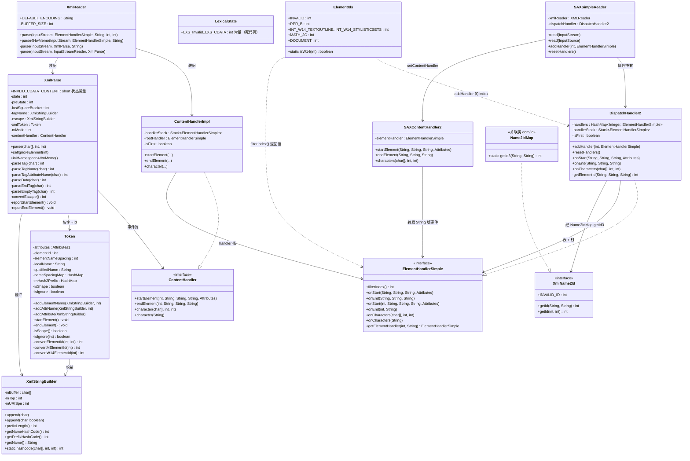
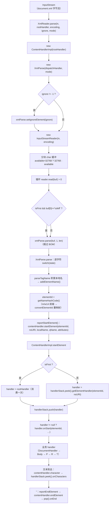
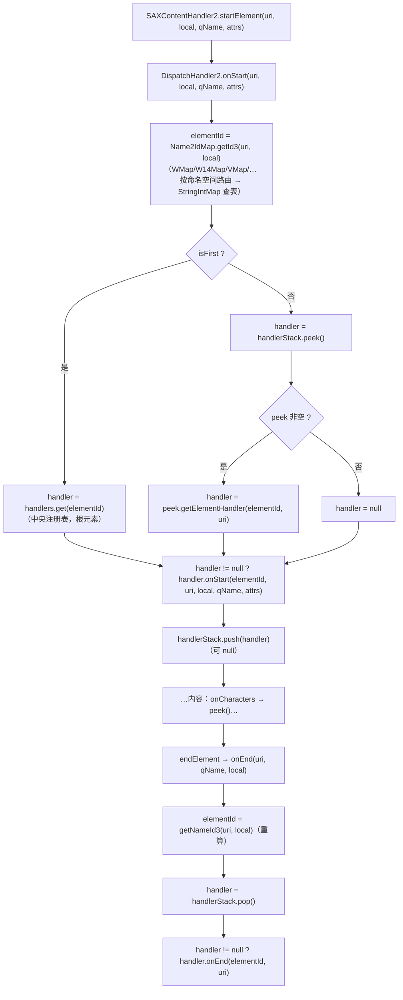
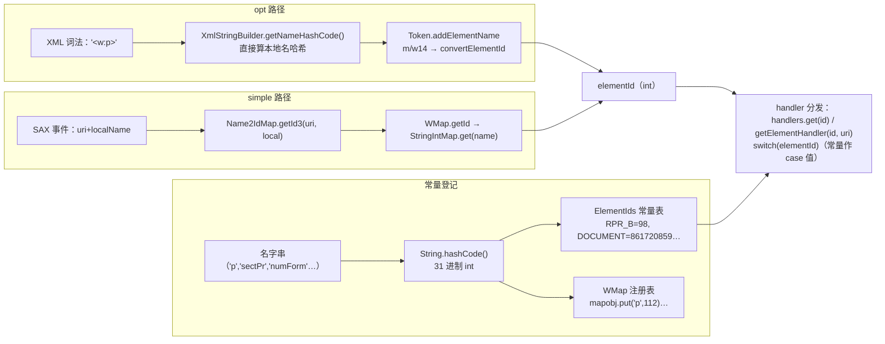

# XML → elementId 深读（设计意图 · 类图 · 流程图 · 关键方法）

> 归属：`wave0-ooxml-standards` · 状态：实现已 done（opt/simple 两模块 21 个文件已入列；XmlReader 尚在 review 队列且有残留桩，见 §5）
> 回答的问题：**自研 XML 解析器怎么工作**、元素名为什么哈希成 int（elementId）、
> DispatchHandler2 如何把事件分发给 handler 栈、ElementIds 常量表与两种解析路径如何对账。
> 概览与心智模型：[wave0-xwpf-java-rust.md](./wave0-xwpf-java-rust.md) §1.3 / §1.4 ·
> [wordprocessingml.md](./wordprocessingml.md) · [mapping-to-kernel.md](./mapping-to-kernel.md) §3
> Java 源码：`koffice/core-libs/io/wps-io/src/cn/wps/io/opt/`（XmlReader、XmlParse、
> ContentHandler、ContentHandlerImpl、Token、LexicalState、XmlStringBuilder）与
> `cn/wps/io/simple/`（ElementIds、XmlName2Id、ElementHandlerSimple、DispatchHandler2、
> SAXSimpleReader、SAXContentHandler2）

---

## 0. 家族全景：一个"把 XML 名字哈希成 int 再分发"的双路径事件引擎

```text
                                    ┌──────────────────────────────────────────────┐
  opt 路径（自研，零依赖）           │  simple 路径（JDK SAX 兼容）                   │
                                    │                                              │
  InputStream                       │  InputStream                                  │
    → XmlReader                     │    → SAXSimpleReader（包装 SAXHelper 的       │
      → InputStreamReader(utf-8)    │         JDK XMLReader）                       │
      → XmlParse 逐字符状态机       │      → SAXContentHandler2（DefaultHandler）   │
        → Token.addElementName()    │        → DispatchHandler2.onStart/onEnd       │
          elementId = hash(本地名)  │          elementId = Name2IdMap.getId3(       │
          convertMElementId/        │              namespaceURI, localName)         │
          convertW14ElementId       │          → handlers[elementId] / 父 handler   │
      → ContentHandlerImpl          │            .getElementHandler(id, uri)        │
        handlerStack 分发            │          handlerStack 分发                    │
                                    └──────────────────────────────────────────────┘
  ElementHandlerSimple（双 flavor 接口：String 版 + int 版）
    → 业务 handler（DocumentHandler / PHandler / RHandler …，switch(elementId) 分发给子 handler）
```

**一句话定位**：本家族是 DOCX 解析的**入口管道**——把 `word/document.xml` 的字节流变成
`IDocumentImporter` 能吃的"元素事件流"，而事件里携带的**元素身份不是字符串而是 int**
（`elementId` = 元素本地名的 Java `String.hashCode`，31 进制滚动哈希）。全家族围绕
"名字→int→分发"三个动作展开，并提供了**两条可互换的解析路径**：`opt/` 是自研
手写状态机（WPS 为省内存/快，不用 JDK SAX），`simple/` 是 JDK SAX 之上的轻量分发器。
两条路径最终把事件都灌进**同一个 `ElementHandlerSimple` 接口 + handler 栈**，
所以业务 handler 一次编写、两条路径通用。

**ElementIds 的角色**：971 行纯常量表，把"常见元素本地名"的哈希值**固化成名号常量**
（`RPR_B=98` 就是 `"b".hashCode()`）。业务 handler 的分发表 `switch (elementId)`、
`filterIndex()`、`addHandler(index, …)` 的 index，全部引用这些常量——**常量名是文档，
值才是被比对的东西**。m/w14 命名空间则单独走"哈希→紧凑 id"重映射（见 §2.4）。

---

## 1. 类图（继承 / 字段 / 关键方法）

### 1.1 `XmlReader`（opt，65 行）——入口与分块读取

```java
public class XmlReader {
   public static final String DEFAULT_ENCODING = "utf-8";   // L9
   private static final int BUFFER_SIZE = 32768;            // L10
}
```

| 方法 | 逻辑 | 关键点 |
|------|------|--------|
| `parse(in, rootHandler, encoding, ignore, mode)` | `new ContentHandlerImpl(rootHandler)` → `new XmlParse(dispatchHandler, mode)` → `-1 != ignore` 时 `setIgnoreElement(ignore)` → 委托私有 parse | 装配点：**每次 parse 新建一套 分发器+词法器** |
| `parse4HwMemo(in, rootHandler, encoding)` | mode=0 + `xmlParse.initNamespace4HwMemo()`（预置 `"w"→WMap.MAIN_NAMESPACING`） | HW 便签专用：无 xmlns 声明也能拿到命名空间 URI |
| 私有 `parse`（3 参） | `new InputStreamReader(in, encoding)` → 委托（4 参）→ close | 编码处理在 JDK 侧 |
| 私有 `parse`（4 参） | `availableSize>32768?32768:availableSize` 定缓冲 → 循环 `read` → **首块若 `readBuffer[0]=='\ufeff'` 则从下标 1 起喂给 XmlParse** | UTF-8 BOM 剥离（L52-58）；按 `available()` 自适应缓冲大小 |

### 1.2 `XmlParse`（opt，489 行）——逐字符手写状态机（本家族的心脏）

```java
public class XmlParse {
   public static final short INVLID = -1;      // L7
   public static final short EMPTY_TAG = 6;    // L8  ← 初始状态
   public static final short NORMAL_START = 2; // 见到 '<'（未定类型）
   public static final short OPEN_TAG = 3;     // 未使用
   public static final short CLOSE_TAG = 4;    // 未使用
   public static final short END_TAG = 5;      // '</'
   public static final short TAG_NAME = 7;
   public static final short TAG_ATRNAME = 8;
   public static final short TAG_ATRVAL_START = 9;
   public static final short TAG_DOUBLE_QUOTES_ATRVAL = 10;
   public static final short DATA = 11;
   public static final short Escape = 12;
   public static final short TAG_SINGLE_QUOTES_ATRVAL = 13;
   public static final short EXCLAMATION = 14;
   public static final short CDATA_START = 15;
   public static final short CDATA_CONTENT = 16;
   private static final String CDATA_START_VAL = "[CDATA[";   // L21
}
```

字段：`lastSquareBracket`、`state`（初值 6=EMPTY_TAG）、`preState`（实体返回栈）、
`tagName`/`escape`（XmlStringBuilder）、`xmlToken`（Token）、`mMode`、`contentHandler`。

| 方法 | 逻辑 | 备注 |
|------|------|------|
| `parse(char[], start, len)` | 主循环：对每个字符 `switch(state)` 调对应 `parseXxx(ch)` 并把返回值写回 `state` | L51-107，**无缓冲回溯，一字符一状态迁移** |
| `parseEmptyTag(ch)` | `&`→escape(12, preState=11)；`<`→2；`>`→6；默认：`isPreserveSpace()`? 进 DATA : `!isSpace(ch)`? 进 DATA : 原地 | **空白被吞**（L109-129） |
| `parseTag(ch)` | `!`→14；`/`→5；`<`→clearTag+8；`>`→6；`?`→-1；空白→原地；**其它→clearTag+append+7** | 每次开标签先 `clearTag()`（L232-256） |
| `parseTagName(ch)` | 空白→`addElementName()`+8；`! / ?`→addElementName+start+end+6（自闭合）；`:`→`append(ch,true)`（记前缀位）；`<`→2；`>`→`addElementName()`+`reportStartElement()`+6 | **`:` 触发 `append(ch,true)`**（L274-305） |
| `parseTagAttributeName(ch)` | 空白→原地；`! / ?`→start+end+6；`:`→append spec；`<`→2；`=`→`addAttrName()`+9；`>`→start+6 | L307-333 |
| `parseTagAttributeValueStart` | `"`→10；`'`→13；`>`→start+6 | L335-349 |
| `parseDoubleQuotesTagAttrVal` | `"`→`addAttribute()`+8；`&`→escape(preState=10)；`>`→start+6 | L351-366 |
| `parseSingleQuotesTagAttrVal` | 同双引号版，终止符 `'` | L368-383 |
| `parseData(ch)` | `&`→escape(preState=11)；`<`→`addText()`+2；`>`→6（**裸 `>` 被吞**）；默认 append | 文本内容缓冲（L201-217） |
| `parseEndTag(ch)` | `:`→append spec；`>`→`addElementName()`+`reportEndElement()`+6 | L142-154 |
| `parseExclamation(ch)` | `[`→append+15；**否则 -1（非法）** | 只认 CDATA（L257-263） |
| `parseCDATAStart` | 累积 `[CDATA[` 比对，命中→16，否则 clear+-1 | L156-170 |
| `parseCDataContent` | `]` 计数，`]`×2+`>`→`addText()`+6 | L172-191 |
| `convertEscape()` | `amp/lt/gt/quot/apos`；`#xA/#x0A`→`\n`；`#xD/#x0D`→`\r`；`#x..`→16 进制；`#..`→10 进制；否则 `IllegalStateException` | L386-428 |
| `reportStartElement()` | `xmlToken.startElement()` → `contentHandler.startElement(elementId, getElementNameSpacing(), localName, qualifiedName, attributes)` | **事件出点**（L465-470） |
| `reportEndElement()` | `xmlToken.endElement()` → `contentHandler.endElement(...)` | L472-475 |
| `isSpace(ch)` | tab/lf/cr→true；`' '`→**`3 != mMode`**（mode 3 下空格不是分隔符） | L477-486 |

> 注：`LexicalState` 声明的 17 个 `LXS_*` 常量（0..17）在 Java 中**没有任何引用点**
> （全仓库仅自引用），真正的状态编号是上面这些内联常量——`LexicalState` 是遗留死代码。

### 1.3 `Token`（opt）——元素/属性名 → elementId 的转换器

字段：`attributes`（Attributes1）、`attrNameSpacingId`、`nameSpacingMap`/`mHash2Prefix`
（`HashMap<Integer,String>`，前缀哈希→URI/前缀串）、`localName`、`qualifiedName`、
`elementId`（初值 -1）、`elementNameSpacing`、`attrName`、`isNameSpacing`、`shapeLevel`、
`isShape`、`isIgnore`、`ignoreLevel`、`ignoreElementId`、`isIgnoreAttr`。

| 方法 | 逻辑 | 备注 |
|------|------|------|
| `addElementName(tagName, mode)` | `elementId = tagName.getNameHashCode()`；`!isIgnore(elementId)` 时：前缀>0 → `elementNameSpacing = getPrefixHashCode()`、`elementId = convertElementId(spacing, elementId)`；`isShape = isShape()`；shape→记 qualified+local；`mode==1`→只记 qualified；`mode==3`→记两者；`tagName.clear()` | **elementId 只算本地名**（L42-71） |
| `addAttrName(tagName, mode)` | `isIgnoreAttr = isIgnoreElementAttribute(elementId) || isIgnore(elementId)`；否则前缀是 `xmlns` → `isNameSpacing=true`、记前缀哈希（mode==1 还记 `mHash2Prefix`），其它→`attributes.addAttriteName` | xmlns 声明在此截获（L73-91） |
| `addAttribute(tagName)` | `isNameSpacing` → `nameSpacingMap.put(attrNameSpacingId, 值)`；否则 `addAttriteValue` | 属性名/值配对（L97-108） |
| `isShape()` | `shapeLevel>0` 或 elementId ∈ {**-1332194002(background), -1023368385(object), 3440682(pict), 1590178495(AlternateContent), 1913009182(drawing)**} 或 `isW14(elementNameSpacing)` | VML/形状子树标记（L114-129） |
| `isIgnore(elementId)` | `ignoreLevel>0`→true；`elementId==-1`→返回旧 `isIgnore`；`==ignoreElementId`→true；否则 false | 整棵子树跳过（L132-144） |
| `convertElementId(spacing, id)` | `spacing==109("m")`→`convertMElementId`；`spacing==115930("w14")`→`convertW14ElementId`；否则原样 | **前缀哈希判别**（L156-168） |
| `convertMElementId` | `3385("jc")→43`（=ElementIds.MATH_JC）、`112148("rPr")→44`（=MATH_RPR） | L170-179 |
| `convertW14ElementId` | `-2001340054("numForm")→19`、`-1946182059("textOutline")→14`、`-1004056496("textFill")→15`、`-520163875("numSpacing")→20`、`-309119999("props3D")→17`、`486258120("ligatures")→18`、`1002557153("stylisticSets")→21`、`1914645533("scene3D")→16` | 对应 `INT_W14_* = 14..21`（L181-202） |
| `getElementNameSpacing()` | `elementNameSpacing==-1`→null；否则 `nameSpacingMap.get(spacing)`（前缀哈希→URI） | 事件里的 namespaceURI（L205-213） |
| `startElement()/endElement()` | isShape→`shapeLevel±1`；isIgnore→`ignoreLevel±1` | 层级游标（L215-229） |
| `addNamespace(prefix, ns)` | `nameSpacingMap.put(prefix.hashCode(), ns)` | `parse4HwMemo` 用（L231-237） |

### 1.4 `XmlStringBuilder`（opt）——无 GC 的 char 缓冲 + 31 进制哈希机

字段：`mBuffer`（char[]）、`mSize`/`mTop`、`mURISpe`（前缀分隔位）、
`mPersistPath`/`mPersistOs`（超 50MB 溢出落临时文件，`MEMORY_LIMIT = 52428800`）。

| 方法 | 逻辑 |
|------|------|
| `append(ch)` | `mBuffer[mTop++] = ch`，满则倍增；`newSize >= 52428800` 转写临时文件 |
| `append(ch, isSpec)` | **`mURISpe = mTop` 后再 append**——`parseTagName` 遇 `:` 时调用，标记前缀边界 |
| `getNameHashCode()` | `start = mURISpe==0 ? 0 : mURISpe+1`；对 `[start, mTop)` 做 `h = 31*h + c` | **本地名哈希，跳过前缀**（L146-162） |
| `getPrefixHashCode()` | 对 `[0, mURISpe)` 做同式哈希 | L139-145 |
| `prefixLength()` | 返回 `mURISpe` | |
| `hashcode(char[], start, end)` | 静态工具，与 Java `String.hashCode` 逐位一致 | L282-291 |
| `toBoolean()` | 按哈希值 48/102/109935/97196323 → false（`"0"/"f"/"false"/"off"`），其余 true | L382-391 |

### 1.5 `ContentHandler`（opt 接口）+ `ContentHandlerImpl`

```java
public interface ContentHandler {                                   // L6-13
   void startElement(int elementId, String namespaceURI, String localName,
                     String qualifiedName, Attributes attributes) throws IOException;
   void endElement(int elementId, String namespaceURI, String localName, String qualifiedName);
   void character(char[] value, int start, int len);
   void character(String persistPath);
}
```

`ContentHandlerImpl`：字段 `handlerStack: Stack<ElementHandlerSimple>`、`rootHandler`、`isFirst`。

| 方法 | 逻辑 | 备注 |
|------|------|------|
| `startElement(...)` | `isFirst`→`handler=rootHandler`（消费一次）；否则 `handler = handlerStack.peek().getElementHandler(elementId, namespaceURI)`；**`push` 后** `handler.onStart(...)` | 父 handler 决定子 handler（L24-49）；`ForceQuitException`/`ReadingLimitException` 包装上传 |
| `endElement(...)` | `pop()` → `onEnd(elementId, namespaceURI)` | L51-60 |
| `character` | `peek()` → `onCharacters(...)` | 文本给**栈顶**（当前最内层元素）（L63-82） |

### 1.6 `ElementIds`（simple，971 行）——元素 id 常量表

纯 `public static final int` 常量文件（L4-963）+ 一个 `isW14(int)`（L969-971）。

- 每行 = **一个元素的本地名 → 它的 Java `String.hashCode()`**，常量名前缀只是上下文注释
  （`RPR_`/`SECTPR_`/`TBLPR_` 等）。逐位核对样本（全部 OK）：
  `RPR_B=98("b")`、`RPR_I=105("i")`、`T=116("t")`、`R=114("r")`、`P=112("p")`、
  `PR_SHD=113839("shd")`、`ZOOM=3744723("zoom")`、`GLOW=3175821("glow")`、
  `SECTPR_POS=111188("pos")`、`DOCUMENT=861720859("document")`、`BODY=3029410("body")`、
  `DRAWING=1913009182("drawing")`、`COMMENTS=-602415628("comments")`、
  `ALTERNATE_CONTENT=1590178495("AlternateContent")`、`FALLBACK=825887490("Fallback")`、
  `CHOICE=2017610177("Choice")`、`NUMFORM=-2001340054("numForm")`、
  `TEXTOUTLINE=-1946182059("textOutline")`。
- 区间/序号常量：`_RPRW14_BEGIN=10`、`INT_W14_TEXTOUTLINE=14 … INT_W14_STYLISTICSETS=21`、
  `_RPRW14_END=22`、`SECTPR_FOOTNOTEPR_POS=23 …`——这些**紧凑 id** 正是
  `Token.convertW14ElementId` 重映射的目标（14..21），`isW14(e)` = `e>=10 && e<=22`。
- 例外：`MATH_JC=43`、`MATH_RPR=44`、`INT_W14_*=14..21` 是**旧序号**（`m:jc` 哈希实际是
  3385，需 `convertMElementId` 映射回 43）；`DOCFIELDSTART=928980672`、
  `DOCFIELDEND=876929721` 两个常量值无法回溯到当前 WML 本地名（疑为遗留名），
  但被 `ChoiceHandler` 等分发表以裸字面量引用（`case 928980672 → DocFieldStartHandler`）。

### 1.7 `XmlName2Id`（simple 接口）+ `ElementHandlerSimple`（simple 接口）

```java
public interface XmlName2Id {                    // L4-13
   int INVALID_ID = -1;
   @Deprecated int getId(String name1, String name2);
   int getId(int prefix, int name);
}
public interface ElementHandlerSimple {          // L8-20
   int filterIndex();                            // 本 handler 注册时的 elementId
   void onStart(String namespaceURI, String localName, String qualifiedName, Attributes attrs);
   void onEnd(String namespaceURI, String localName, String qualifiedName);
   void onStart(int elementId, String namespaceURI, String localName,
                String qualifiedName, Attributes attrs);   // int 版（opt flavor）
   void onEnd(int elementId, String namespaceURI);          // int 版
   void onCharacters(char[] ch, int start, int end);
   void onCharacters(String persistPath);
   ElementHandlerSimple getElementHandler(int elementId, String namespaceURI); // 子分发
}
```

`ElementHandlerSimple` 是**双 flavor 事件接口**：String 版被 JDK SAX 路径调用，
int 版被 opt 路径调用；`getElementHandler` 是"父→子 handler"的递归分发点
（业务 handler 如 `DocumentHandler` 用 `switch(elementId)` 实现，`filterIndex()`
返回自己注册时的 elementId，如 `DocumentHandler.filterIndex()=861720859`）。

### 1.8 `DispatchHandler2`（simple，90 行）——SAX 路径的中心分发器

```java
class DispatchHandler2 implements ElementHandlerSimple {   // L10
   private HashMap<Integer, ElementHandlerSimple> handlers;      // elementId → 根级 handler
   private Stack<ElementHandlerSimple> handlerStack;
   private boolean isFirst = true;
}
```

| 方法 | 逻辑 | 备注 |
|------|------|------|
| `addHandler(index, handler)` | `handlers.put(index, handler)` | index 一般是 `ElementIds` 常量（L19-21） |
| `getElementId(uri, qName, local)` | `return Name2IdMap.getId3(namespaceURI, localName)` | 静态、按 namespace URI 路由（L28-31） |
| `onStart(uri, local, qName, attrs)` | 算 elementId；`isFirst`→`handlers.get(elementId)`；否则 `handlerStack.peek().getElementHandler(elementId, uri)`；`handler!=null`→`handler.onStart(int版)`；**最后 push**（可 null） | 只"根"元素查中央表，其余走父 handler（L33-50） |
| `onEnd(uri, local, qName)` | 重算 elementId → `pop()` → `onEnd(int版)` | L52-59 |
| `onCharacters` | `peek()` → `onCharacters` | L61-67 |
| int 版 `onStart/onEnd/getElementHandler` | **空实现**（自身是 wrapper） | L76-90 |

### 1.9 `SAXSimpleReader` + `SAXContentHandler2`（simple）——JDK SAX 桥

- `SAXSimpleReader`：持有 `XMLReader`（`SAXHelper.createXMLReader`）、`DispatchHandler2`；
  `read(InputStream/InputSource)` 时 `reader.setContentHandler(new SAXContentHandler2(dispatchHandler))`
  → `reader.parse(in)`（L38-68）；`addHandler(index, handler)` 转发到
  `getDispatchHandler().addHandler(...)`（惰性建，L71-73）；`resetHandlers()`。
- `SAXContentHandler2 extends DefaultHandler`：`startElement(uri, local, qName, attrs)`
  → `elementHandler.onStart(uri, local, qName, attrs)`（String 版）；
  `endElement` → `onEnd`；`characters` → `onCharacters`（L10-31）。

### 1.10 类层次总图（mermaid）



---

## 2. 设计意图（为什么）

### 2.1 为什么自研 XML 解析器（opt）而不是直接用 JDK SAX

`XmlParse` 是**一个字符一个状态迁移**的手写状态机：整棵 `switch(state)` 循环没有任何
正则、没有 DOM、不建 AST，`tagName` 复用同一个 `XmlStringBuilder` 缓冲（append/clear
循环用，不产生中间 String，除非持久化）。目标是**极低分配 + 极低延迟**解析几十 MB 的
document.xml。而 `simple/` 路径保留 JDK SAX 是为了兼容其它调用方（如 theme/rels 等
非热路径 part）。**两条路径并行存在 = 热路径用手写机，冷路径复用 JDK。**

### 2.2 为什么 elementId 用 Java hashCode（31 进制 int）

元素名是 String，直接比对慢、存 String 占内存。方案：`h = 31*h + c` 滚成 int——
`XmlStringBuilder.getNameHashCode()` 与 Java `String.hashCode()` **逐位一致**（已对
`p/r/t/b/i/shd/zoom/glow/pos/document/body/…` 共 22+ 个常量做 python 复算核对，全中）。
于是：
- **解析期零查表**：opt 路径见到 `<w:p>` 直接算出 `112`，不必查 HashMap；
- **可静态固化**：`ElementIds` 把常见名字的哈希值写成编译期常量，业务代码
  `switch (elementId) { case RPR_B: … }`；
- int 比较在 handler 分发（`HashMap<Integer, …>` / `switch`）里是 O(1)。
代价是**哈希碰撞与不可读性**（-906275931 是什么？查 `ElementIds` 才知道是 `sectPr`）——
这就是常量表存在的原因：**常量名 = 可读性，常量值 = 性能**。

### 2.3 为什么 elementId 只对"本地名"求哈希，前缀另算

`append(ch, true)` 在遇到 `:` 时把 `mURISpe` 钉在分隔位，`getNameHashCode()` 从
`mURISpe+1` 起算。所以 `w:p`、`w14:p`、无前缀 `p` 的 elementId **都是 112**。
前缀哈希（`getPrefixHashCode`）单独存成 `elementNameSpacing`，经
`nameSpacingMap`（前缀哈希→URI）还原成事件的 namespaceURI。这样业务 handler 用
"本地名 id" 写分发表、用 "namespaceURI" 做消歧，两边互不污染；只有 m/w14 两个
前缀会被进一步特判（见 2.4）。

### 2.4 为什么 m/w14 需要 convertMElementId / convertW14ElementId 重映射

`m:jc` 本地名 `jc` 哈希是 3385，但内核代码从旧时代起就用 `ElementIds.MATH_JC = 43`、
`MATH_RPR = 44` 这类**紧凑序号**；w14 的 8 个 run 属性同理（`numForm` 哈希
-2001340054 → `INT_W14_NUMFORM = 19`）。为让新旧常量继续有效，`Token` 在解析期按
**前缀哈希**（`"m".hashCode()=109`、`"w14".hashCode()=115930`）把命中元素重映射回
紧凑 id。重映射后 id 全部落入 `[10,22]`，于是 `ElementIds.isW14(e)`（`10<=e<=22`）
一条判断即可识别整个 w14 族。注意这是**前缀**判别而非命名空间 URI 判别——`<m:jc>`
不管把 `m` 绑定到哪个 URI 都按数学处理，这是 opt 解析器"前缀即真相"的取舍。

### 2.5 为什么 handler 栈 push/pop、父 handler 递归分发

事件是流式的（没有树），但业务处理需要"当前上下文"（`<w:r>` 里的 `w:t` 属于哪个
run）。解法是**栈 + 父 handler**：`startElement` 时从栈顶（父）`getElementHandler(id, uri)`
问出子 handler 再 push；`endElement` 时 pop 配对。于是"树"被还原成"栈"，
`character` 永远喂给最内层 handler。中央注册表（`DispatchHandler2.handlers`）**只用于
根元素**（`isFirst` 消费一次），嵌套深度由各 handler 自己的 `switch` 承担——
`DocumentHandler`（`861720859`）→ body → `PHandler` → `RHandler` → `THandler` 就是
这样链出来的。

### 2.6 为什么 `ElementIds` 常量名带 `RPR_/SECTPR_/TBLPR_` 等前缀

同名元素在不同上下文出现时（`w:pos` 在 `sectPr`、`w:jc` 在 `pPr`/`rPr`），哈希值
**相同**、无法靠值区分——所以常量名前缀只是"注释作用域"，真正的上下文判定靠
handler 栈（谁在栈顶调用 `getElementHandler`）。这也是 `getElementHandler` 必须同时收
`elementId` 和 `namespaceURI` 的原因：同一 id 在不同父元素下可映射到不同子 handler。

### 2.7 为什么有 ignore/shape 两个"整树旁路"机制

`ignoreElementId`（`setIgnoreElement`，XmlReader 第 4 参 `ignore`）让指定元素整棵子树
跳过转换但仍上报事件（`ignoreLevel` 计数）；shape 机制（`isShape`：pict/object/
drawing/AlternateContent/background 或 w14 前缀）让 VML/DrawingML 子树保留
`qualifiedName`（这些区域的名字需要前缀来区分）。两者都是"解析照常、语义旁路"，
避免在词法层打断状态机。

### 2.8 为什么 mode 有 0/1/2/3 四种取值

`mode` 控制产出字段：`1` 只产 `qualifiedName`、`3` 产 `qualifiedName + localName`、
`0/2` 都不产（业务靠 elementId 就够）；`isSpace` 里 `' '` 在 `mode==3` 时不是分隔符
（名称可含空格）。实际调用：XWPF 各 handler 传 0，`GVmlTheme` 传 2（theme 元素），
`parse4HwMemo` 固定 0。**mode 是"按 part 类型裁剪事件载荷"的开关**。

---

## 3. 流程图（mermaid）

### 3.1 XmlReader.parse 全流程（字节流 → 词法 → elementId → handler 栈）



### 3.2 XmlParse 词法状态机（核心环路）

```mermaid
flowchart LR
    S6["6 EMPTY_TAG（初始）"] -->|"&"| S12["12 Escape<br/>preState=11/10"]
    S12 -->|";"| S6
    S6 -->|"<"| S2["2 见到'<'"]
    S2 -->|"/"| S5["5 END_TAG"]
    S2 -->|"!"| S14["14 EXCLAMATION"]
    S14 -->|"["| S15["15 CDATA_START"]
    S15 -->|"[CDATA["| S16["16 CDATA_CONTENT"]
    S16 -->|"] ] >"| S6
    S2 -->|"?"| S7x["-1 INVALID（跳至'>'）"]
    S2 -->|"字母"| S7["7 TAG_NAME"]
    S7 -->|"空白"| S8["8 TAG_ATRNAME"]
    S7 -->|":"| S7
    S7 -->|">"| H1["reportStartElement → 回 S6"]
    S8 -->|"="| S9["9 ATRVAL_START"]
    S9 -->|"\""| S10["10 双引号值"]
    S9 -->|"'"| S13["13 单引号值"]
    S10 -->|"\""| S8
    S10 -->|"&"| S12
    S8 -->|">"| H1
    S5 -->|">"| H2["reportEndElement → 回 S6"]
    S6 -->|"非'<'"| S11["11 DATA"]
    S11 -->|"<"| S2
    S11 -->|"&"| S12
    S12 -->|"非法实体"| X["IllegalStateException"]
```

### 3.3 DispatchHandler2.start/end 分发（simple / JDK SAX 路径）



### 3.4 ElementIds 登记 / 查询（两条路径如何对账）



---

## 4. 关键不变量（改写/测试锚点）

| # | 不变量 | 来源 |
|---|--------|------|
| 1 | `elementId` = 本地名 Java `String.hashCode`（`h=31*h+c`，int 溢出回绕）——opt 路径解析期直算（`XmlStringBuilder.getNameHashCode`），simple 路径查 `Name2IdMap`/`WMap` 表（注册值 == 哈希值）；**Rust 必须 `wrapping_mul(31)` 复刻 i32 溢出** | `XmlStringBuilder.java` L146-162/L282-291、`WMap.java` L887-893 |
| 2 | `:` 处理：`append(ch,true)` 钉 `mURISpe`；elementId 从 `mURISpe+1` 起算（**跳过前缀**）；前缀哈希存 `elementNameSpacing` 并经 `nameSpacingMap`（前缀哈希→URI）还原 namespaceURI；**同本地名不同前缀 → 同一 elementId**（除非 m/w14 重映射命中） | `XmlStringBuilder.append(ch,boolean)` L103-109、`Token.getElementNameSpacing` L205-213 |
| 3 | 重映射：`"m".hashCode()=109` → `jc(3385)→43`、`rPr(112148)→44`；`"w14".hashCode()=115930` → 8 元素 → `14..21`（`INT_W14_*`）；其余原样。`isW14(e)` = `10<=e<=22` | `Token.java` L156-202、`ElementIds.java` L13-21/L969-971 |
| 4 | handler 栈配对：`startElement` push（**opt 先 push 后 onStart**，simple **先 onStart 后 push**——各自保持），`endElement` pop，`character` 用 peek；栈元素可为 null（无 handler 时也占位） | `ContentHandlerImpl.java` L24-60、`DispatchHandler2.java` L33-59 |
| 5 | 根元素只消费一次 `isFirst`：之后一律 `peek().getElementHandler(id, uri)`，父 handler 决定子 handler；中央注册表仅对根元素生效 | `ContentHandlerImpl.java` L26-33、`DispatchHandler2.java` L35-42 |
| 6 | 属性传递：`addAttrName` 记名 → `addAttribute` 记值 → `AttributesImpl` 数组随 `startElement` 下传；`xmlns:前缀` 声明截获进 `nameSpacingMap`（不入属性表） | `Token.java` L73-108、`AttributesImpl.java` |
| 7 | 空白：DATA 状态默认**吞掉纯空白文本**；仅当当前元素 `xml:space="preserve"`（按 前缀"xml"+名"space"+值哈希判等）才保留 | `XmlParse.parseEmptyTag` L109-129、`AttributesImpl.isPreserveSpace` L215-224 |
| 8 | ignore 机制：`ignoreElementId` 命中 → 整棵子树语义旁路（`ignoreLevel` 递增/递减），事件照常上报；`elementId==114("r")` 时属性全部丢弃（`isIgnoreElementAttribute`） | `Token.java` L110-144、L215-229 |
| 9 | mode 语义：`0/2` 不产 `qualifiedName/localName`；`1` 只产 qualified；`3` 产两者且 `' '` 不作名称分隔符；shape 子树（pict/object/drawing/AlternateContent/background/w14）恒产两者 | `Token.addElementName` L42-71、`isShape` L114-129、`isSpace` L477-486 |
| 10 | BOM/CDATA/实体：首块首字符 `\ufeff` 跳过；`<![CDATA[` 识别 `[CDATA[`；实体表 `amp/lt/gt/quot/apos` + `#x../#..` 数字引用，非法抛 `IllegalStateException`；`>` 在 DATA 中吞掉，`!`/`?` 非 CDATA 进 INVALID 跳到 `>` | `XmlReader.java` L52-58、`XmlParse.java` L156-191/L386-428/L257-272 |

---

## 5. 与 Rust 现状对照

Rust crate：`libs/core-libs/io/wps-io/`，两模块在 `src/cn/wps/io/opt/`（10 个 .rs）与
`src/cn/wps/io/simple/`（11 个 .rs），各带 mod.rs。

| Java | Rust | 状态 | 说明 |
|------|------|------|------|
| XmlReader | `opt/XmlReader.rs` | **review（残留）** | 文件存在但**仍有 14 处 `TODO_RUST_CODE` 未填**（parse/parse4HwMemo/parse_with_xmlparse/parse_with_reader 主体），BOM 判断已写成 UTF-8 三字节；队列中 `XmlReader` 在 `rewriter_history_review.csv` |
| XmlParse | `opt/XmlParse.rs` | steady | 915 行，状态机逐方法移植，常量名保持 Java 原义（`ESCAPE` 对应 `Escape` 等） |
| ContentHandler | `opt/ContentHandler.rs` | steady | 接口 trait（4 方法） |
| ContentHandlerImpl | `opt/ContentHandlerImpl.rs` | review | 用 `Rc<RefCell<ElementHandlerRef>>` 栈替代 `Stack`，push/pop 配对语义保持 |
| Token | `opt/Token.rs` | review | 447 行，`convertW14ElementId` 8 项/`convertMElementId` 2 项/isShape 5 个 id/`isW14=115930` 已全部对齐；`nameSpacingMap` 并入 `attributes`（与 Java 共享引用一致） |
| LexicalState | `opt/LexicalState.rs` | steady | 常量保持（Java 中即死代码） |
| XmlStringBuilder | `opt/XmlStringBuilder.rs` | review | `getNameHashCode` 用 `wrapping_mul(31)`——**i32 溢出语义已复刻**；临时文件持久化按 MVP 裁剪 |
| ElementIds | `simple/ElementIds.rs` | steady | 1937 行常量表逐一对应（含 `_RPRW14_BEGIN/END`、`isW14`） |
| XmlName2Id | `simple/XmlName2Id.rs` | steady | trait（`getId` 两个重载） |
| ElementHandlerSimple | `simple/ElementHandlerSimple.rs` | steady | trait 双 flavor（String 版 + int 版 + `getElementHandler`） |
| DispatchHandler2 | `simple/DispatchHandler2.rs` | review | `HashMap<i32, ElementHandlerRef>` + `Vec<Option<ElementHandlerRef>>`，`onStart_str/onEnd_str/onCharacters` 逻辑与 Java 逐行对应；int 版空实现保留 |
| SAXSimpleReader | `simple/SAXSimpleReader.rs` | review | `read/addHandler/getDispatchHandler/resetHandlers` 骨架在；JDK XMLReader 依赖以 `dyn Read`/占位处理 |
| SAXContentHandler2 | `simple/SAXContentHandler2.rs` | review | 53 行，DefaultHandler 三个回调 → 转 `ElementHandlerSimple` |

**改写注意**：
- **哈希必须复刻**：`elementId` 的一切分发（ElementIds 常量、switch、HashMap）都建立在
  `31*h+c` + i32 溢出上。`XmlStringBuilder.rs` 已用 `wrapping_mul(31).wrapping_add(...)`，
  Token 的 `convert*` 映射是硬编码表，**不允许改动数值**。
- `XmlReader.rs` 是家族内唯一未填完的残留（14 处 TODO）：`parse_with_reader` 已写好分块
  + BOM 骨架，缺的是 `ContentHandlerImpl`/`XmlParse` 装配与 `setIgnoreElement` 调用——
  填法见 §3.1 流程。
- 关联类（家族外、simple 路径依赖）：`dom/io/Name2IdMap.java`、`WMap/W14Map/VMap/McMap/
  MMap/OMap/W10Map`、`simple/StringIntMap`——它们在 Rust 侧亦已改写（review 队列），
  `DispatchHandler2::getElementId` 直接调用 `Name2IdMap::getId3`。
- 事件顺序差异（opt 先 push 后 onStart；simple 先 onStart 后 push）是**源码既定行为**，
  Rust 移植已各自保持，测试断言别把两者混成同序。
- 关键魔数清单（改写/测试锚点）：`109`（m）、`115930`（w14）、`119`（w）、`114`（r，
  属性丢弃）、`3385/112148`（m 重映射输入）、8 个 w14 哈希→`14..21`、`_RPRW14_BEGIN=10`
  `_RPRW14_END=22`、`xml:space="preserve"`（`"preserve".hashCode()`）、CDATA 标识 `[CDATA[`。
