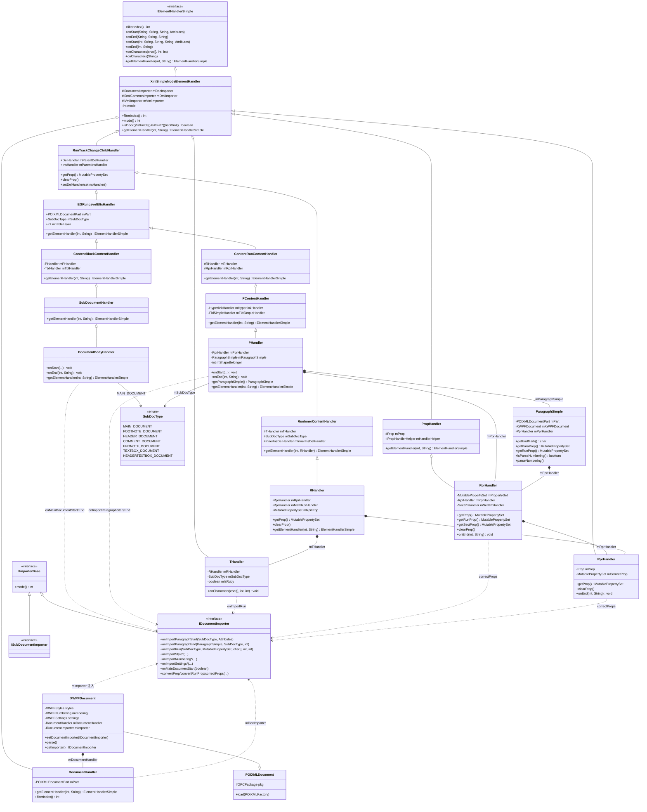
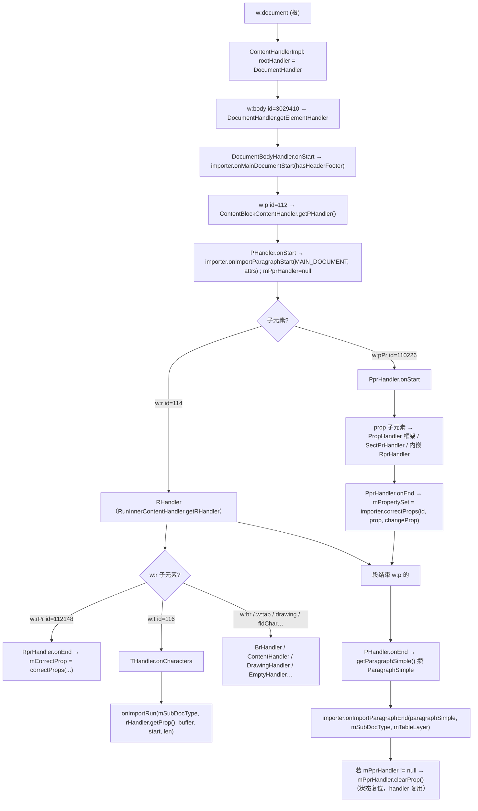
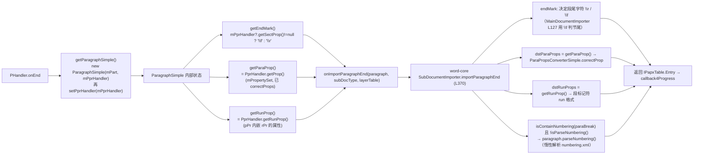
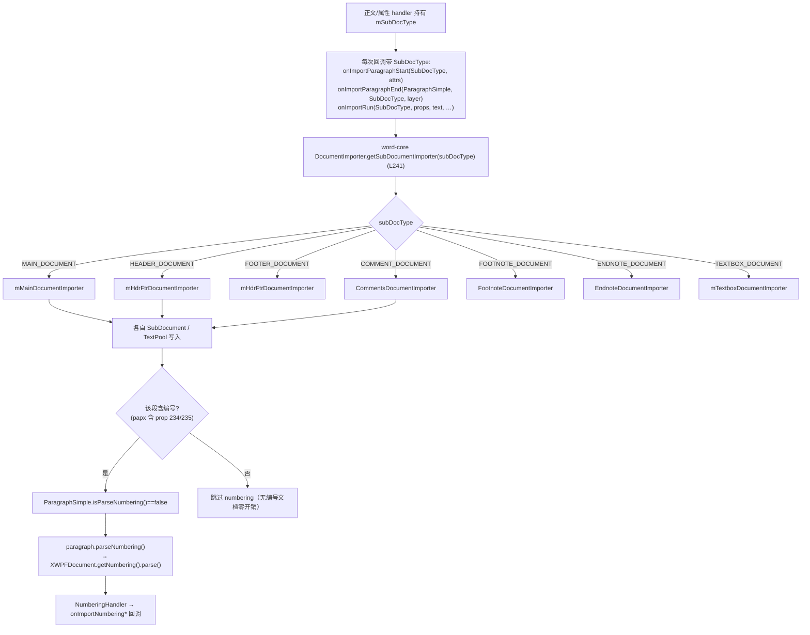

# XWPF 编排 + 正文 handler 深读（设计意图 · 类图 · 流程图 · 关键方法）

> 归属：`wave0-ooxml-standards` · 状态：实现已 done（parse 事件风暴 Rust 侧未接线，见 §5）
> 回答的问题：XWPFDocument.parse 怎么按 Part 顺序驱动、正文 handler 如何把 w:p/w:r/w:t 变成 IDocumentImporter 回调、SubDocType 如何路由
> 概览与心智模型：[STRUCTURE_ANALYSIS.md](../STRUCTURE_ANALYSIS.md) §0/§1.4/§1.5 · [wave0-xwpf-java-rust.md](./wave0-xwpf-java-rust.md) §1.2–§1.5
> Java 源码：`koffice/core-libs/io/wps-io/src/cn/wps/io/xwpf/` + `.../opc/model/POIXMLDocument.java` + `koffice/core-libs/util/util/src/cn/wps/base/io/SubDocType.java`
> Rust：`libs/core-libs/io/wps-io/src/cn/wps/io/xwpf/`（SubDocType 在 `libs/core-libs/util/util/`）

---

## 0. 家族全景：一句话定位 + 装配图

| 角色 | 类 | 一句话 |
|------|----|--------|
| **编排枢纽** | `XWPFDocument`（extends POIXMLDocument） | 持有全部子 Part + `IDocumentImporter`；`setDocumentImporter()` 注入回调、`parse()` 按 Part 顺序开火 |
| **回调契约** | `IImporterBase` → `IDocumentImporter` / `ISubDocumentImporter` | ~80 个回调方法，覆盖正文/样式/编号/设置/页眉页脚/批注/域/数学/绘图……**定义在 wps-io，实现在 word-core** |
| **文档类型** | `SubDocType` | 7 个枚举常量（ordinal 0–6），路由"这段文本属于哪个子文档" |
| **事件驱动** | `XmlReader` + `ContentHandlerImpl`（栈）+ `XmlSimpleNodeElementHandler` | 流式 SAX 栈：栈顶 handler 负责给子元素分派子 handler |
| **正文热路径** | `DocumentHandler` → `DocumentBodyHandler` → `PHandler` → `RHandler` → `THandler` | w:document/body/p/r/t 逐级降维成 importer 回调 |
| **属性累积** | `PprHandler`/`RprHandler`/`ParagraphSimple`/`PropHandler` | 把 pPr/rPr 累积成 `MutablePropertySet`，段结束时打包给回调 |
| **Part 工厂** | `XWPFFactory` + `XWPFStyles`/`XWPFNumbering`/`XWPFSettings` | Part 类型 ↔ 类映射；styles/numbering/settings 各自的根 handler 与 parse |

**装配图**（谁来驱动谁）：

```text
DocxReader.read()                                          （word-core, wc-05）
  └─ XWPFDocument.setDocumentImporter(DocumentImporter)  ← 注入回调实例
       └─ XWPFDocument.parse()
            ├─ 先序 Part：fontTable → settings → theme → styles → fontTable(重) → comments
            │     各自 parse()：XmlReader.parse(part流, Part专属根handler, "utf-8", …)
            │        → ContentHandlerImpl 栈 → 根 handler.getElementHandler(elementId)
            ├─ 正文：XmlReader.parse(document.xml, DocumentHandler, "utf-8", -1, 0)
            │     DocumentHandler
            │       └─ w:body(3029410) → DocumentBodyHandler
            │            └─ w:p(112) → PHandler
            │                 ├─ w:pPr(110226) → PprHandler  ─┐ 累积到
            │                 └─ w:r(114) → RHandler          │ ParagraphSimple
            │                      ├─ w:rPr(112148) → RprHandler
            │                      └─ w:t(116) → THandler → onImportRun(...)
            │           段结束 → onImportParagraphEnd(ParagraphSimple, SubDocType, tableLayer)
            └─ 后序 Part：numbering（惰性兜底）→ commentsEx
```

> **核心断言**：wps-io 这一层**只产事件、不落库**。handler 的全部动作就是"把 XML 变成对 `IDocumentImporter` 的方法调用"，TextRope/CHPX/PAPX 一律不碰（那是 wc-01/wc-04 的事）。

---

## 1. 类图

### 1.1 接口层（回调边界）

| 接口 | 关键成员 | 设计意图 |
|------|---------|---------|
| `IImporterBase` | `int mode()` | 模式开关：**0=DOCX、1=Xml07、2=GVml、3=Xml03**（`XmlSimpleNodeElementHandler.isDocx/isXml07/isGVml/isXml03` 的分流依据） |
| `IDocumentImporter extends IImporterBase` | `onImportParagraphStart(SubDocType, Attributes)`、`onImportParagraphEnd(ParagraphSimple, SubDocType, int)`、`onImportRun(SubDocType, MutablePropertySet, char[], int, int)`、`onImportRun(SubDocType, MutablePropertySet, String)`、`onImportStyle*`、`onImportNumbering*`、`onImportSettings*`、`onMainDocumentStart(boolean)/onMainDocumentEnd()`、`onHeaderDocumentEnd/onFooterDocumentEnd`、`convertProp/convertRunProp/correctProps`、`getVmlImporter/getDmlImporter/getDmlTextImporter`、`dispose/dispose4StyleXml`、`hasContent/isLock` | **跨 crate 回调契约**；定义在 wps-io（io 层），实现在 word-core（`DocumentImporter`，wc-05）；word-core 按 SubDocType 路由到各 `SubDocumentImporter` |
| `ISubDocumentImporter extends IImporterBase` | 空 marker（Java 侧无方法；word-core `SubDocumentImporter` 实现它并自带 `importParagraphStart/End` 等） | 声明"子文档 importer"身份；真正方法在 word-core 侧各自定义 |

### 1.2 编排层

| 类 | 继承/字段 | 方法表 |
|----|----------|--------|
| `POIXMLDocument extends POIXMLDocumentPart`（44 行） | `pkg: OPCPackage` | `getPackage()`；`hasOOXMLHeader(RandomAccessFile)`；`load(POIXMLFactory)`：`read(factory, context)` → **`onDocumentRead()`** → `context.clear()` |
| `XWPFDocument extends POIXMLDocument`（459 行） | `settings/comments/endnotes/footnotes/numbering/styles/fontTablePart/mTheme/mCommentsEx: 各 Part`、`mDocumentHandler: DocumentHandler`、`mImporter: IDocumentImporter`、`mNotePath`、`properties` | **`setDocumentImporter(importer)`**（L332）：存 importer → `new DocumentHandler(importer, this)` → 向 styles/theme/fontTable/numbering/settings/comments/endnotes/footnotes/commentsEx **广播** `setDocumentImporter`；**`parse()`**（L372，见 §3.1）；`parseXml(encoding)`（L451）：`XmlReader.parse(part流, mDocumentHandler, encoding, -1, 0)`；`getNumbering/getStyles/getSettings/…` |
| `XWPFFactory extends POIXMLFactory` | 单例 `inst` | `getInstance()`；`setGVmlFactory()/setXWPFFactory()` 切换；`createDocumentPart(parent, rel, part)`：relType → `XWPFRelation/_Purl` 查类 → 反射构造 |
| `XWPFStyles extends POIXMLDocumentPart` | `mStylesHandler: StylesHandler` | `setDocumentImporter` → `new StylesHandler(importer)`；`parse()` → `parseXml("utf-8")`，失败回退 utf-16；parseXml 用 `XmlReader.parse(流, mStylesHandler, "utf-8", 154284782(latentStyles), 0)` |
| `XWPFNumbering extends POIXMLDocumentPart` | `isNew`、`isParse`、`mNumberingHandler: NumberingHandler` | `setDocumentImporter` → `new NumberingHandler(importer)`；`isParse()`；`parse()` → `isParse=true` → parseXml(utf-8，失败 utf-16) |
| `XWPFSettings extends POIXMLDocumentPart` | `mSettingsHandler: SettingsHandler` | `setDocumentImporter` → `new SettingsHandler(importer, this)`；`parse()` → `XmlReader.parse(流, mSettingsHandler, "utf-8", -1, 0)` |

### 1.3 正文 handler 继承链（Java 行级核对）

```text
ElementHandlerSimple（cn.wps.io.simple，接口：filterIndex / onStart(x2) / onEnd(x2) / onCharacters(x2) / getElementHandler）
  ▲
XmlSimpleNodeElementHandler（默认空实现 + mDocImporter/mDmlImporter/mVmlImporter + mode() 懒解析）
  ├── DocumentHandler            （w:document 根）
  ├── RunTrackChangeChildHandler（implements IRunTrackChangeChildHandler, IPropHandler）
  │     ├── EGRunLevelEltsHandler ── ContentBlockContentHandler ── SubDocumentHandler ── DocumentBodyHandler
  │     ├── EGRunLevelEltsHandler ── ContentRunContentHandler ── PContentHandler ── PHandler
  │     └── RunInnerContentHandler ── RHandler
  ├── THandler
  ├── RprHandler（implements IPropHandler）
  └── PropHandler ── PprHandler（implements IPropHandler）
```

| 类 | 继承/字段 | 关键方法（行号） |
|----|----------|------------------|
| `DocumentHandler extends XmlSimpleNodeElementHandler`（35 行） | `mPart: POIXMLDocumentPart` | `getElementHandler`：`-1332194002`→`BackgroundHandler(importer.getVmlImporter(MAIN_DOCUMENT), mPart)`；`3029410`(=w:body)→`DocumentBodyHandler`；`filterIndex()=861720859` |
| `DocumentBodyHandler extends SubDocumentHandler` | 构造传 `SubDocType.MAIN_DOCUMENT` | `onStart`（L16）：`getRelationshipCollection(mPart)` → `onMainDocumentStart(hasHeaderFooter(relations))`；`onEnd`（L29）：`onMainDocumentEnd()`；`getElementHandler`：`-906275931`(=w:sectPr)→`SectPrHandler` |
| `PHandler extends PContentHandler` | `mPprHandler`、`mParagraphSimple`、`mShapeBelonger` | `onStart`（L25）：`onImportParagraphStart(mSubDocType, attributes)`、`mPprHandler=null`；`onEnd`（L29）：`getParagraphSimple()` → `onImportParagraphEnd(paragraphSimple, mSubDocType, mTableLayer)` → `mPprHandler.clearProp()`（若有）；`getParagraphSimple()` 懒建 `new ParagraphSimple(mPart, mPprHandler)` 再 `setPprHandler`；`getElementHandler`：`110226`(=w:pPr)→`PprHandler` |
| `RHandler extends RunInnerContentHandler implements IPropHandler` | `mRprHandler`、`mMathRprHandler`、`mRprProp`、嵌套 `mRHandler` | `getElementHandler`：`44`→math rPr、`114`(=w:r 嵌套)→新 `RHandler`、`112148`(=w:rPr)→`RprHandler`、`103772132`→`MediaHandler`，其余走 `super.getElementHandler(subElement, this)`；`getProp()`（L82）：**rpr + 内嵌 ins/del + mathRpr + 上层 paraInsDel 四源合并**；`onEnd`：非 ruby 时 `clearProp()` |
| `THandler extends XmlSimpleNodeElementHandler` | `mRHandler`、`mSubDocType`、`mIsRuby`、`mTmpText` | `onCharacters`（L26）：**ruby → 累积 `mTmpText`；否则 `onImportRun(mSubDocType, mRHandler?.getProp(), buffer, start, len)`**；`clearTmpText()` |
| `PprHandler extends PropHandler implements IPropHandler`（104 行） | `mPart`、`mPropertySet`、`mRprHandler`、`mSectPrHandler`、`mShapeBelonger` | `getElementHandler`：isGVml→GVml 分支，`-906275931`→`SectPrHandler`，`112148`→`RprHandler`；`onEnd`（L94）：`mPropertySet = correctProps(elementId, prop, originalProp)`（**pPr 唯一出口**）；`getProp()`→`mPropertySet`；`getRunProp()`→`mRprHandler.getProp()`；`getSectProp()`→`mSectPrHandler.getProp()`；`clearProp()` 级联清三个 |
| `RprHandler extends XmlSimpleNodeElementHandler implements IPropHandler` | `mProp: Prop`、`mCorrectProp`、`mRprBaseHandler`、`mRprChangeHandler`、`mDmlTextImporter` | `onEnd`（L122）：有 changeProp → `mCorrectProp = correctProps(...)`，否则 `mCorrectProp = prop`；`getProp()` → `new MutablePropertySet(mCorrectProp)`；其余属性子元素委托 `RprBaseHandler`/`RprChildHandler` |
| `ParagraphSimple`（84 行） | `mPart`、`mXWPFDocument`（缓存）、`mPprHandler` | `getEndMark()`（L40）：**`mPprHandler?.getSectProp()!=null ? '\f' : '\r'`**（段含 sectPr=节尾）；`getParaProp()`→`mPprHandler.getProp()`；`getRunProp()`→`mPprHandler.getRunProp()`；`isParseNumbering()`/`parseNumbering()`（惰性编号，见 §3.4）；`getDocumentPart()`：Header/Footer/Comment/Footnote/Endnote Part → **`mPart.getParent()`** 回溯到 XWPFDocument |
| `XmlSimpleNodeElementHandler implements ElementHandlerSimple` | `mDocImporter/mDmlImporter/mVmlImporter`、`mode=-1` | 默认空 onStart/onEnd/onCharacters、`getElementHandler→null`；`mode()` 懒取 `importer.mode()`；`isDocx()=0==mode`、`isXml03()=3==mode`、`isXml07()=1==mode`、`isGVml()=2==mode` |
| `PropHandler extends XmlSimpleNodeElementHandler` | `mProp: Prop`、`mHandlerHelper: IPropHandlerHelper`、`mBaseHandler`、`mChangeHandler` | `getElementHandler`：`mHandlerHelper.isChangeElement(id)` ? `getChangeHandler()` : `getBaseHandler().getElementHandler(...)`（change 版本与普通版本分流） |

### 1.4 类层次总图（mermaid）



---

## 2. 设计意图（为什么）

1. **为什么回调接口定义在 wps-io、实现在 word-core（跨 crate 边界）**：io 层（wps-io）只负责"读 OPC/XML 并产事件"，与排版内核（TextDocument/TextRope/CHPX/PAPX）零依赖——这是把 `.docx` 读取做成可复用 IO 库的关键。`IDocumentImporter` 是唯一连接点：`DocxReader.read()`（`koffice/writer/core/.../docxReader/DocxReader.java` L76-81）`setDocumentImporter(mImporter)` → `parse()`，之后一切回调都落到 `DocumentImporter`。回调实现与调用方物理隔离，io 层可独立单测。

2. **为什么 handler 是"栈式多态"**：`ContentHandlerImpl` 维护 `Stack<ElementHandlerSimple>`——startElement 时"当前栈顶.getElementHandler(elementId)"得到子 handler，先 `push` 再 `onStart`；endElement 时 `pop().onEnd`；文本 `peek().onCharacters`。每个 handler 只在 `getElementHandler` 的 `switch(elementId)` 里声明自己认识哪些子元素（不认识返回 null → 栈上压 null，子树被静默跳过）。**收益**：① 不需要建 DOM 树，流式一遍 O(n)；② 元素 → handler 的映射是编译期 switch（整数 elementId），热路径无字符串比较；③ 对未知/无关子树天然宽容（返回 null 即跳过）。`filterIndex()` 是另一种按整型索引选 handler 的口子（DocumentHandler 返回 861720859）。

3. **为什么 elementId 是整数**：`XmlReader`/`Name2IdMap.getId3(namespaceURI, localName)` 把本地名哈希成 int（如 w:body=3029410、w:p=112、w:r=114、w:t=116、w:pPr=110226、w:rPr=112148、w:sectPr=-906275931），handler 全部 `switch(int)`。热路径只做整数比较，字符串只在 id 冲突/首元素时兜底。**改错一个 elementId 常量 = 某个 handler 永远进不去**（wave0-xwpf-java-rust.md §5 自检项）。

4. **为什么 ParagraphSimple 累积"段状态"**：段结束回调 `onImportParagraphEnd(ParagraphSimple, SubDocType, int tableLayer)` 只带一个结构对象，而不是 `(paraProps, runProps, endMark, sectProp…)` 一堆参数——签名不爆炸。word-core 消费端（`SubDocumentImporter.importParagraphEnd(paragraph, layerTable)` L370）从中三取：`paragraph.getEndMark()`（段尾是 `\r` 还是 `\f`）、`getParaProp()`（段落属性，`ParaPropsConverterSimple.correctProp`）、`getRunProp()`（pPr 内嵌 rPr 的 run 属性，段标记符格式）。`MainDocumentImporter.importParagraphEnd` 再用 `'\f' == getEndMark()` 判定"本节最后一段"（L127）。

5. **为什么 parse 顺序是 styles → 正文 → numbering**：正文段落 import 需要"样式 ID → 内核样式"的映射（`StyleId2Sti`），styles 必须先于正文解析（XWPFDocument.parse L387-389 在正文前，正文是 L403-411 的 parseXml）；而 **numbering 是惰性的**——只有某段 papx 实际含编号属性（prop 234/235）时，word-core 才会经 `ParagraphSimple.parseNumbering()`（L401-402）触发 numbering.parse()；`XWPFDocument.parse()` 结尾（L439-441）`if (numbering != null && !numbering.isParse) numbering.parse()` 只是兜底。**先 styles、正文期间按需拉 numbering、末尾兜底** 使无编号文档完全跳过 numbering.xml。

6. **为什么 SubDocType 贯穿所有回调**：一个 `IDocumentImporter` 接口同时服务主文档、页眉、页脚、批注、脚注、尾注、文本框 7 类"文档"。每次回调都带 SubDocType，word-core 侧 `DocumentImporter.getSubDocumentImporter(subDocType)`（L241）switch 到 `mMainDocumentImporter/mHdrFtrDocumentImporter/mTextboxDocumentImporter/…`，把文本写进各自独立的 `SubDocument`。**同一套 handler 代码、同一份属性转换，只需在构造时注入不同的 SubDocType**——这是 handler 构造签名里 `SubDocType subDocType` 参数存在的原因（PHandler/RHandler/THandler 的构造函数都是 `(part, importer, subDocType, tableLayer)`）。

7. **为什么 mode()（IImporterBase）存在**：同一批 handler 要兼容 docx(0)/xml07(1)/gvml(2)/xml03(3) 四种文件格式。`XmlSimpleNodeElementHandler.mode()` 从 `mDocImporter.mode()` 懒解析一次并缓存，`isGVml()/isXml03()` 决定 handler 走哪条分支（如 PprHandler 的 GVml 分支、RprHandler 的 xml03 AnnotationHandler 分支）。

8. **为什么 setDocumentImporter 要广播给所有 Part**：`DocumentHandler` 只服务正文；styles/numbering/settings/theme/comments/endnotes/footnotes 各有自己的根 handler，都需要同一个 importer 实例（共享状态如 StyleId2Sti、生命周期如 `dispose4StyleXml`）。`XWPFDocument.setDocumentImporter`（L332-371）把 importer 挨个注入所有非空 Part，Part 内部各自 `new StylesHandler(importer)` 等——**一个 importer 贯穿整个 Part 图**。

---

## 3. 流程图（mermaid）

### 3.1 XWPFDocument.parse() 时序（Part 顺序 + handler 栈）

> 依据：XWPFDocument.java L372-454。注意 fontTablePart 被解析两次（L376 与 L391，Java 原样如此）。

```mermaid
sequenceDiagram
    autonumber
    participant DR as DocxReader (word-core)
    participant XD as XWPFDocument
    participant P as 子 Part (Styles/Settings/…)
    participant XR as XmlReader
    participant CH as ContentHandlerImpl (栈)
    participant DH as DocumentHandler
    participant IMP as IDocumentImporter

    DR->>XD: setDocumentImporter(importer)
    XD->>XD: mImporter = importer; mDocumentHandler = new DocumentHandler(importer, this)
    XD->>P: 广播 setDocumentImporter(importer)（styles/theme/fontTable/numbering/settings/comments/endnotes/footnotes/commentsEx）
    DR->>XD: parse()
    XD->>P: fontTablePart.parse()   [L376]
    XD->>P: settings.parse()        [L379]
    XD->>P: mTheme.parse()          [L383]
    XD->>P: styles.parse()          [L387]  ← 必须先于正文（StyleId2Sti）
    XD->>P: fontTablePart.parse()   [L391]  （重复）
    XD->>P: comments.parse()        [L395]
    Note over XD: DefaultElement/Attribute/Text.setMaxPoolSize(140/140/20)
    XD->>XR: parseXml("utf-8"): parse(part流, mDocumentHandler, "utf-8", -1, 0)
    XR->>CH: ContentHandlerImpl(mDocumentHandler)
    CH->>DH: 根元素 w:document → rootHandler.onStart
    CH->>DH: w:body(3029410) → DH.getElementHandler → DocumentBodyHandler.onStart
    CH->>IMP: onMainDocumentStart(hasHeaderFooter)   ← 正文开始
    Note over CH: 逐元素 栈式分发（w:p/w:r/w:t 见 3.2）
    CH->>IMP: onMainDocumentEnd()                     ← 正文结束
    Note over XD: 异常路径：ForceQuitException 重抛；ReadingLimitException 重抛；<br/>其他 Throwable 且 importer.isLock() → ContentLockedException；<br/>!importer.hasContent() → 回退 parseXml("utf-16")
    XD->>P: numbering.parse()（if != null && !isParse）  [L439] 惰性兜底
    XD->>P: mCommentsEx.parse()                        [L443]
```

### 3.2 w:p 生命周期（DocumentHandler → PHandler → PprHandler → RHandler → THandler → 回调）



### 3.3 段结束回调携带什么（ParagraphSimple 三件套 → word-core 消费）



### 3.4 SubDocType 路由 + numbering 惰性触发



---

## 4. 关键不变量（改写/测试锚点）

| # | 不变量 | 来源（行级） |
|---|--------|--------------|
| 1 | `SubDocType` ordinal 固定 0–6：MAIN=0、FOOTNOTE=1、HEADER=2、COMMENT=3、ENDNOTE=4、TEXTBOX=5、HEADERTEXTBOX=6（顺序即 enum 声明序，Rust 侧不可变） | `SubDocType.java` L4-10 |
| 2 | 回调签名钉死：`onImportParagraphStart(SubDocType, Attributes)`、`onImportParagraphEnd(ParagraphSimple, SubDocType, int tableLayer)`、`onImportRun(SubDocType, MutablePropertySet, char[], start, len)`、`onMainDocumentStart(boolean hasHeaderFooter)`、`onImportStyleStart(Attributes)`… | `IDocumentImporter.java`；`PHandler.java` L25-33 / `THandler.java` L34-36 / `DocumentBodyHandler.java` L22/L29 |
| 3 | handler 栈 push/pop 配对：`startElement` 先 `push(handler)` 再 `onStart`；`endElement` `pop().onEnd`；文本走 `peek().onCharacters`——**push 与 onStart 同序，pop 与 onEnd 同序** | `ContentHandlerImpl.java` L29-60 |
| 4 | styles 先于正文（`parse()` L387 < L403）；numbering 正文后惰性（L439 `if(!numbering.isParse)`）+ word-core 按需触发（`ParagraphSimple.parseNumbering`）；fontTablePart 被解析两次（L376+L391） | `XWPFDocument.java` |
| 5 | 段结束时 `PHandler.onEnd` 先回调再 `clearProp()`；`PprHandler.clearProp()` 级联清 `mPropertySet/mSectPrHandler/mRprHandler`——**handler 实例跨段落复用，状态必须归零** | `PHandler.java` L29-36、`PprHandler.java` L66-77 |
| 6 | `getEndMark()`：`'\f'` 当且仅当 `mPprHandler != null && getSectProp() != null`，否则 `'\r'`（sectPr 在 pPr 内 = 段是节尾） | `ParagraphSimple.java` L40-42 |
| 7 | `THandler.onCharacters` 非 ruby 才直接回调 `onImportRun`；ruby 路径累积到 `mTmpText` 由 RubyHandler 另行消费 | `THandler.java` L26-38 |
| 8 | `XmlSimpleNodeElementHandler.mode()` 从 importer 懒解析一次（`mode==-1` 缓存）；docx=0/xml07=1/gvml=2/xml03=3；`isGVml` 决定 PprHandler/RprHandler 的分支 | `XmlSimpleNodeElementHandler.java` L77-92 |
| 9 | elementId 常量：w:body=3029410、w:p=112、w:r=114、w:t=116、w:pPr=110226、w:rPr=112148、w:sectPr=-906275931、w:document 根走 `DocumentHandler.filterIndex()=861720859`；其余 handler `filterIndex()=0` | `DocumentHandler.java` L17-34、`PHandler.java` L48-53、`RHandler.java` L26-37 |
| 10 | `XWPFDocument` 子 Part 全可空（`if (this.styles != null)` 守卫），setDocumentImporter 与 parse 必须逐个判空；缺 Part 文档（无 numbering.xml）不许挂 | `XWPFDocument.java` L332-371、L372-449 |

---

## 5. 与 Rust 现状对照（parse-wave0-xwpf 批次，行级核对）

> **总体结论**：类骨架与字段（`// Java:` 注释 + struct 字段）已全部生成；`XmlReader`/`ContentHandlerImpl`/`DispatchHandler2` 的**栈式分发机制本身已移植**；但**从 `XWPFDocument.parse()` 到 handler 内 importer 回调的"事件风暴"整条链路 Rust 侧未接线**——`parse()` 不存在，正文 handler 是空桩，importer 被丢弃。wc-05-orchestration 的 STRUCTURE_ANALYSIS §4 已把 `xwpf.parse()` 列为跨 crate 缺口。

| Java | Rust 文件 | 状态（行级核实） |
|------|-----------|------------------|
| `XWPFDocument` | `usermodel/XWPFDocument.rs`（264 行） | **❌ `parse()` 方法不存在**（`impl XWPFDocument` 内只有 startPackage/new*/open/detect/getDocumentHandler/setImporter/getImporter/dispose/getset/…）；**`setDocumentImporter` 不存在**——只有 `setImporter(Box<dyn Any>)`，仅存字段，**不建 DocumentHandler、不广播子 Part**；`mImporter`/`mDocumentHandler` 为 `Option<Box<dyn Any + Send + Sync>>`（**类型擦除，非 `Box<dyn IDocumentImporter>`**）；构造器桩化（`new_from_file` → `open("")` 空包）；无 `onDocumentRead`/`parseXml`/异常回退逻辑 |
| `POIXMLDocument` | `opc/model/POIXMLDocument.rs` | ⚠️ `load()` 有（`base.read → base.onDocumentRead`）；`pkg: Option<OPCPackage>`；`hasOOXMLHeader` 只支持 `Cursor<Vec<u8>>` downcast |
| `IDocumentImporter` | `IDocumentImporter.rs` | ⚠️ trait 完整（~80 方法 + `isLock()` 默认实现），`: IImporterBase` 超 trait 在；**但参数全部 `&dyn Any` 类型擦除**（`SubDocType` 用 `i32`、`Attributes`/`MutablePropertySet` 用 `dyn Any`），下游实现需要 downcast——签名与 Java 语义一致但类型不可靠 |
| `IImporterBase` | `IImporterBase.rs` | ✅ `trait IImporterBase { fn mode(&self) -> i32; }` |
| `ISubDocumentImporter extends IImporterBase` | `ISubDocumentImporter.rs` | **❌ 空 trait 且缺 `: IImporterBase` 超 trait**（Java 有 `extends IImporterBase`），`mode()` 无法从 ISubDocumentImporter 侧调用 |
| `SubDocType` | `libs/…/util/…/SubDocType.rs` | ✅ enum 7 常量齐全，顺序与 Java 一致（derive Clone/Copy/Debug/PartialEq/Eq） |
| `DocumentHandler` | `element_handler/DocumentHandler.rs`（70 行） | **❌ 构造器 `new(_importer, part)` 丢弃 importer**（不调 `super(importer)`）；`getElementHandler` 造 `BackgroundHandler`/`DocumentBodyHandler` 时传 `Box::new(())` 桩 importer；`onStart` 空；`filterIndex=861720859` 保留 ✅ |
| `DocumentBodyHandler` | `element_handler/DocumentBodyHandler.rs`（67 行） | **❌ `{ _private: () }`**：无 SubDocumentHandler 基类、无 `mPart`/`mDocImporter` 字段；`onStart`/`onEnd` 空——**不调 `onMainDocumentStart/onMainDocumentEnd`**；`getElementHandler` 的 SectPrHandler 分支在 |
| `PHandler` | `element_handler/PHandler.rs`（48 行） | **❌ 只有 `new()`**：无 `onStart`（无 `onImportParagraphStart`）、无 `onEnd`（无 `onImportParagraphEnd`）、无 `getParagraphSimple`、无 `getElementHandler`（w:pPr=110226 分支缺失）、无 `filterIndex` |
| `RHandler` | `element_handler/RHandler.rs`（15 行） | **❌ 空桩 `{ _private: () }`**：无 `getProp`（四源合并）、无 `clearProp`、无 `getElementHandler` |
| `THandler` | `element_handler/THandler.rs`（15 行） | **❌ 空桩 `{ _private: () }`**：无 `onCharacters`——**`onImportRun` 回调完全缺失** |
| `PprHandler` | `element_handler/PprHandler.rs`（109 行） | ⚠️ 字段/`new`/`getElementHandler`（SectPr 分支在，RprHandler 分支返回 `None`）/`clearProp` 部分在；**`onEnd` 空（无 `correctProps`）**、`getRunProp`/`getSectProp` 恒 `None`、`onStart` 空（无 `convertProp`） |
| `RprHandler` | `element_handler/RprHandler.rs`（227 行） | ⚠️ 字段/`new`/`clearProp` 部分在；**`getElementHandler` 恒 `None`**、`getProp()` 返回 `Box::new(())`、`onEnd` 空（无 `correctProps`）、子 handler 全返回 `None` |
| `ParagraphSimple` | `element_handler/ParagraphSimple.rs`（156 行） | ✅ **本族最完整的类**：`new/setPprHandler/isParseNumbering/getEndMark(getProp/getRunProp` 与 Java 逻辑一致（`'\f'`/`'\r'` 判定在）；⚠️ `parseNumbering()` 只读 `isParse` **不真正触发 parse**；`getDocumentPart()` 只处理 mPart 直接是 XWPFDocument，**未移植 Header/Footer/Comment/Footnote/Endnote 的 `getParent()` 回溯** |
| `XmlSimpleNodeElementHandler` | `element_handler/XmlSimpleNodeElementHandler.rs`（213 行） | ⚠️ 字段/mode()/isDocx…/trait impl 都在，但 trait 方法（onStart/onEnd/onCharacters/getElementHandler）**全部返回 Ok(())/None 的默认实现**；子类未覆写 → 分发链走不通 |
| `PropHandler` | `element_handler/prop/PropHandler.rs`（91 行） | ⚠️ `new`/`getElementHandler`（isChange 分流）在，但走 `PlaceholderDocImporter` 桩 importer |
| `XWPFFactory` | `usermodel/XWPFFactory.rs` | ⚠️ 单例 `getInstance`/`createDocumentPart` 在（`static mut INST`）；反射构造降级为 `POIXMLDocumentPart::new_*` 直建 |
| `XWPFStyles` / `XWPFNumbering` / `XWPFSettings` | 同名 `.rs` | ⚠️ **`parse()` 已实现且接通 `XmlReader`**（utf-8→utf-16 回退、`isParse` 标志都在）；但 `setDocumentImporter` **丢弃 importer**，handler 以 `StylesHandler::new()`/`NumberingHandler::new()` 空参创建，**onImportStyle*/onImportNumbering*/onImportSettings* 回调链仍断** |
| `ContentHandlerImpl` / `DispatchHandler2` / `ElementHandlerSimple` | `opt/ContentHandlerImpl.rs`、`simple/DispatchHandler2.rs` | ✅ 栈机制（isFirst→rootHandler、peek→getElementHandler、push→onStart、pop→onEnd、onCharacters→peek）完整移植 |

**改写注意（下一批修复优先级）**：
- **必须先造 `XWPFDocument::parse()` + `set_document_importer`**（建 `DocumentHandler`、广播子 Part、实现 Part 顺序与 utf-16 回退），否则整条事件风暴无入口。
- handler 的 `mDocImporter` 必须从 `Box<dyn Any>` 换成 `Box<dyn IDocumentImporter>`（`XmlSimpleNodeElementHandler::new_from_doc` 已具备该通道，`DocumentHandler` 应走它）。
- 补齐 `PHandler.onStart/onEnd`、`THandler.onCharacters → onImportRun`、`RHandler.getProp`、`PprHandler/RprHandler.onEnd → correctProps`；`ISubDocumentImporter` 补 `: IImporterBase`。
- `ParagraphSimple.parseNumbering` 需真正调用 `XWPFNumbering.parse()`；`getDocumentPart` 需补 Header/Footer/… 的 parent 回溯。
- elementId 常量（w:p=112、w:r=114、w:t=116、w:pPr=110226、w:rPr=112148、w:sectPr=-906275931）是联调锚点，Rust 侧 `match elementId` 分支必须与 Java 严格一致。
