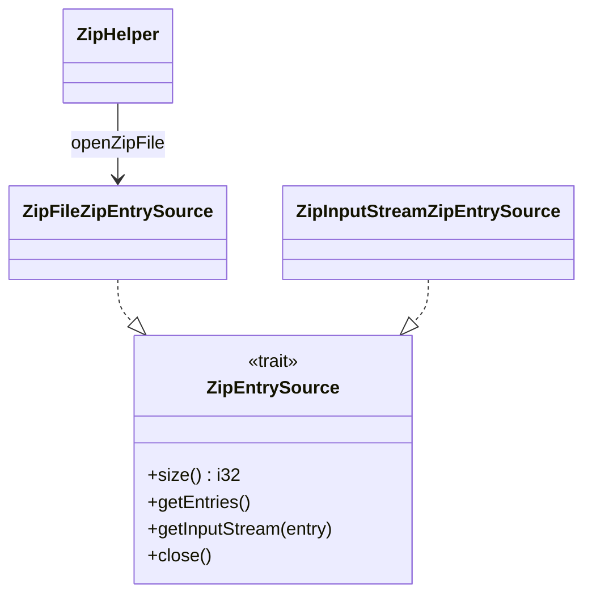
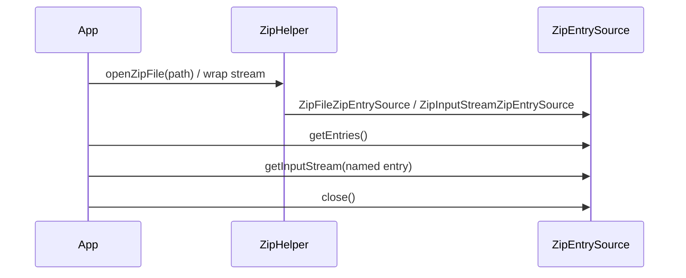

# 02_function_unzip — 从 docx 得到 zip entries

| 项 | 值 |
|----|----|
| feature | wave0-ooxml-standards |
| order | 2 |
| crate | `libs/core-libs/io/wps-io/Cargo.toml` |
| 入口 | `ZipHelper::openZipFile` / `ZipFileZipEntrySource` / `ZipInputStreamZipEntrySource` |
| 独立性 | 叶子 |
| 测试状态 | pass |

## 1. 功能说明

### 1.1 一句话

把一个 `.docx`（OPC ZIP）打开成可枚举、可按 entry 取流的 `ZipEntrySource`，不解释 Content Types 或 Relationships。

### 1.2 输入

| 形态 | Java 入口 | 不变量 |
|------|-----------|--------|
| 文件系统路径 | `ZipHelper.openZipFile(String)` | 文件存在；可读 |
| `RandomAccessFile` | `ZipFileZipEntrySource` | 魔数 `PK\x03\x04`（`POIXMLDocument.hasOOXMLHeader`） |
| `InputStream` | `ZipInputStreamZipEntrySource` | 流式 zip；不可随机 seek |

拒绝：entry 名含 `"../"`（`OPCPackage.checkEntryNameLegal`）→ `FileDamagedException`。单 entry 大小 > 1GB（`MAX_SIZE_ENTRY`）在 **parts/package** 层拒绝，本层只保证能列出/打开。

### 1.3 输出

`ZipEntrySource`：

- `size()` → entry 个数
- `getEntries()` → 可枚举 `ZipEntry`（逻辑名，如 `[Content_Types].xml`、`word/document.xml`）
- `getInputStream(entry)` → 该 entry 的解压字节流
- `close()` 释放底层 zip

本层 **不** 保证存在 `[Content_Types].xml`；缺文件是下游 content_types 的失败。

### 1.4 上游

`physical`：调用方持有的路径 / raf / 流。

### 1.5 下游

- `03_function_opc_content_types`：按名取 `[Content_Types].xml` 流
- `04_function_opc_relationships`：取 `_rels/.rels`、`word/_rels/document.xml.rels`
- `05_function_opc_parts` / `07_function_opc_package`：遍历全部 entries

## 2. 核心代码与流程

### 2.1 核心类

| 名字 | 角色 | Java | Rust |
|------|------|------|------|
| `ZipEntrySource` | 物理 ZIP 抽象 | `xwpf/util/ZipEntrySource.java` | `.../xwpf/util/ZipEntrySource.rs` |
| `ZipFileZipEntrySource` | 文件/raf 后端 | 同目录 | 同目录 |
| `ZipInputStreamZipEntrySource` | 流后端 | 同目录 | 同目录 |
| `ZipHelper` | 打开/URI 辅助 | `opc/internal/ZipHelper.java` | `.../opc/internal/ZipHelper.rs` |

### 2.2 类图



### 2.3 调用关系



★ 热路径：三种打开 → 枚举 → 按名取流。

### 2.4 不变量

- ZIP 局部头魔数：`PK\x03\x04`
- 入口名黑名单子串：`"../"`
- 本层输出名字保持 zip 内原始名（含 `[Content_Types].xml` 方括号）

## 3. 测试方案与代码

### 3.1 代码审计与测试面

| symbol | Java/Rust 路径 | 输入/状态 | 输出/副作用 | 关键分支/错误 |
|--------|----------------|-----------|-------------|---------------|
| `ZipEntrySource` | `xwpf/util/ZipEntrySource` | `dyn` trait | `getEntries`/`size`/`getInputStream*`/`close` | `FakeZipEntry` 切片；close 后 `None` |
| `parse_zip_bytes` / `try_new` | `ZipInputStreamZipEntrySource` | 任意 `Read` | 缓存 `Vec<FakeZipEntry>` | 空 ZIP；stored/deflate；`../`；截断/`ZipArchive::new` 失败 |
| `getEntries`/`size`（stream） | 同上 | open / closed | 列表或 `None`；size 0 在 close 后 | 0/1/N；写入顺序 |
| `getInputStream` / `_with_origin` | 同上 | entry + origin flag | 可重复 `Cursor` 字节 | 空 entry；flag 两值都转调同一实现 |
| `close`（stream） | 同上 | open source | `zipEntries = None` | 重复 close 幂等（Rust `Option`，Java 二次 close 会 NPE） |
| `ZipFileZipEntrySource::{from_path,from_file,new}` | `ZipFileZipEntrySource` | path / `File` / `Any` | 同一 entries 契约 | close 后 `size=-1`；`../` 在 `getInputStream` 抛错；缺 entry → `None` |
| `ZipHelper::openZipFile` | `opc/internal/ZipHelper` | 文件系统路径 | `Some(source)` / `None` | 存在合法 zip；缺失；坏/截断 zip |
| `ZipHelper::openZipFile_raf` | 同上 | `PathBuf` / 非路径 `Any` | 同上 | 路径成功；未知 `Any` → `None` |

### 3.2 覆盖矩阵

| coverage_id | 接口/代码路径 | 场景类别 | 必测? | test_id / 未覆盖理由 |
|-------------|---------------|----------|-------|----------------------|
| C01 | stream `try_new→entries→stream` | 最小正常 deflate | 是 | U1 |
| C02 | stream 多 entry/名称保持 | 典型 OPC 输入 | 是 | U2 |
| C03 | `ZipArchive::new` error | 非法输入 | 是 | U3 |
| C04 | name contains `../` | 安全失败 | 是 | U4 |
| C05 | stream empty ZIP | 循环 0 次 | 是 | U5 |
| C06 | stream N、stored | 循环与压缩后端 | 是 | U6（deflate 见 U1） |
| C07 | empty entry + repeated stream read | 边界/重复调用 | 是 | U7 |
| C08 | `close`、重复 close、close 后访问 | 状态转换/资源 | 是 | U8（stream）；U11（file size=-1） |
| C09 | `getInputStream_with_origin` flag 两值 | 接口分支 | 是 | U9 |
| C10 | `ZipEntrySource` trait object | 公共接口一致性 | 是 | U10 |
| C11 | `ZipFileZipEntrySource` path backend | 多后端一致性 | 是 | U11 |
| C12 | `ZipHelper::openZipFile(path)` | 存在/缺失/坏 ZIP | 是 | U12 |
| C13 | RAF / `from_file` / `openZipFile_raf` | 多后端一致性 | 是 | U13 |
| C14 | 截断 central directory/entry data | 损坏输入 | 是 | U14 |

### 3.3 可测试性

内存构造最小 zip（标准库 `zip` crate 或预置 fixture `.docx`），**不必**有合法 OPC。缺 Content Types 的 zip 对本 function 仍应 PASS。

### 3.4 用例表

| id | 覆盖项 | 前置状态 | 输入摘要 | 期望输出/副作用 | 失败语义 |
|----|--------|----------|----------|-----------------|----------|
| U1 | C01 | — | 内存 deflate zip：`hello.txt=abc` | `size=1`；名字与解压字节一致 | 枚举、命名或解压不符 |
| U2 | C02 | — | OPC 三件套 zip，按该顺序写入 | 三个名字**按写入顺序**列出；不解析 XML | 缺名或顺序错 |
| U3 | C03 | — | `not a zip` | `try_new` → `Err` | 当成 empty package |
| U4 | C04 | — | entry 名 `../evil.txt` | `Err` 含 `Unsafe zip file` | 接受穿越路径 |
| U5 | C05 | — | 合法 0-entry zip | `size=0`；entries 空切片 | 构造失败或假装有 entry |
| U6 | C06 | — | stored：`a/b/c.txt` | `size=3`；顺序 a,b,c；`b.txt=BB` | 顺序错或 stored 解压失败 |
| U7 | C07 | — | `empty.bin` 长度为 0 | 连续两次 `getInputStream` 都是空字节 | 二次读失败或非空 |
| U8 | C08 | open stream | `close` 两次 | entries=`None`；`size=0`；不 panic | close 后仍可枚举 |
| U9 | C09 | 一 entry | origin flag `false` 与 `true` | 两流字节均为 `abc` | 任一 flag 解压不同 |
| U10 | C10 | stream source | `Box<dyn ZipEntrySource>` | size/entries/两路 getInputStream/`as_any`/close | trait 与具体类型不一致 |
| U11 | C11 | temp 路径 | `from_path`；String 名查找；`../` FakeZipEntry | 字节一致；`../` → Err；close 后 `size=-1`、流 `None` | 文件后端与流不一致 |
| U12 | C12 | temp 文件 | 合法路径 / 缺失 / 坏 zip | `Some`+可读 / `None` / `None` | 缺失或坏 zip 假装成功 |
| U13 | C13 | temp 文件 | `from_file`；`openZipFile_raf(PathBuf)`；`new(PathBuf)`；`raf(i32)` | 前三者 size=1；`i32` → `None` | 打不开 File/RAF |
| U14 | C14 | 截半 zip 字节 | stream `try_new`；`from_path`；`openZipFile` | 全部失败/`None` | 截断包当成功 |

### 3.5 测试代码位置

crate: `libs/core-libs/io/wps-io`  
src:   `libs/core-libs/io/wps-io/src/cn/wps/io/xwpf/util/ZipEntrySource.rs`  
src:   `libs/core-libs/io/wps-io/src/cn/wps/io/xwpf/util/ZipFileZipEntrySource.rs`  
src:   `libs/core-libs/io/wps-io/src/cn/wps/io/xwpf/util/ZipInputStreamZipEntrySource.rs`  
src:   `libs/core-libs/io/wps-io/src/cn/wps/io/opc/internal/ZipHelper.rs`  
test:  `libs/core-libs/io/wps-io/tests/cn/wps/io/xwpf/util/ZipEntrySource.rs`

### 3.6 测试运行脚本

在仓库根目录：

```bash
# 功能测试
cargo test --manifest-path libs/core-libs/io/wps-io/Cargo.toml --test 02_function_unzip

# 本 function 源文件覆盖率（写入本节下方报告）
bash .cursor/skills/feature-function/scripts/function-coverage.sh \
  --crate libs/core-libs/io/wps-io \
  --test 02_function_unzip \
  --src src/cn/wps/io/xwpf/util/ZipEntrySource.rs \
  --src src/cn/wps/io/xwpf/util/ZipFileZipEntrySource.rs \
  --src src/cn/wps/io/xwpf/util/ZipInputStreamZipEntrySource.rs \
  --src src/cn/wps/io/opc/internal/ZipHelper.rs \
  --report libs/word-core/parser/features/wave0-ooxml-standards/functions/02_function_unzip/FUNCTION.md
```

首次需要：`rustup component add llvm-tools-preview && cargo install cargo-llvm-cov --locked`

### 3.7 覆盖率报告

<!-- coverage-report:begin -->
tool: cargo-llvm-cov (`cargo llvm-cov --test 02_function_unzip --json`)
date: 2026-08-18 09:13

| src | lines covered | line % | regions covered | region % |
|-----|---------------|--------|-----------------|----------|
| `src/cn/wps/io/opc/internal/ZipHelper.rs` | 15/105 | 14.3% | 18/175 | 10.3% |
| `src/cn/wps/io/xwpf/util/ZipEntrySource.rs` | 12/12 | 100.0% | 12/12 | 100.0% |
| `src/cn/wps/io/xwpf/util/ZipFileZipEntrySource.rs` | 61/92 | 66.3% | 94/137 | 68.6% |
| `src/cn/wps/io/xwpf/util/ZipInputStreamZipEntrySource.rs` | 63/78 | 80.8% | 99/121 | 81.8% |
| **function total** | **151/287** | **52.6%** |  |  |
<!-- coverage-report:end -->
