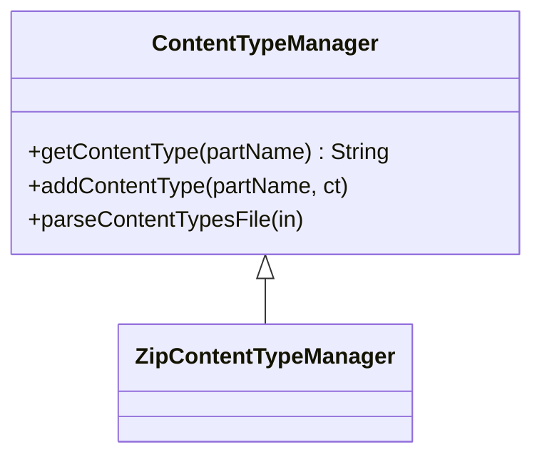

# 03_function_opc_content_types — 解析 `[Content_Types].xml`

| 项 | 值 |
|----|----|
| feature | wave0-ooxml-standards |
| order | 3 |
| crate | `libs/core-libs/io/wps-io/Cargo.toml` |
| 入口 | `ZipContentTypeManager::new(stream, package)` |
| 独立性 | 叶子 |
| 测试状态 | pass |

## 1. 功能说明

### 1.1 一句话

把 OPC 的 `[Content_Types].xml` 建成「扩展名 Default + Part Override」类型表，供每个 zip entry 领取 MIME。

### 1.2 输入

`[Content_Types].xml` 的字节流（由 unzip 按**精确文件名**取出）。命名空间：

`http://schemas.openxmlformats.org/package/2006/content-types`

根 `Types`；子元 `Default(Extension, ContentType)` 与 `Override(PartName, ContentType)`。

### 1.3 输出

`ContentTypeManager` / `ZipContentTypeManager`：

- 按 Part 名解析：先 Override，否则用扩展名 Default
- 查询失败 → `None`（下游 parts 不得把该 entry 合法入 `partList`）

不修关系图、不建 Part 对象。`save` / `saveImpl` 是写包路径，本 function 不测。

### 1.4 上游

`02_function_unzip`（必须能取出名为 `[Content_Types].xml` 的流）。本层测试用内存 XML，不跑 unzip。

### 1.5 下游

`05_function_opc_parts`、`07_function_opc_package`（`getPartsImpl` 第一步）。

## 2. 核心代码与流程

### 2.1 核心类

| 名字 | 角色 | Java | Rust |
|------|------|------|------|
| `ContentTypeManager` | Default/Override 表 | `opc/internal/ContentTypeManager.java` | `.../ContentTypeManager.rs` |
| `ZipContentTypeManager` | 从流构造（Java 继承） | `ZipContentTypeManager.java` | 同目录 |
| 常量 `CONTENT_TYPES_PART_NAME` | `"[Content_Types].xml"` | 同上 | `CONTENT_TYPES_PART_NAME` |

Java `parseContentTypesFile` 走 `SAXReader`；Rust `SAXReader::read_stream` 仍是 `todo!()`（06/08 XML 栈）。本 function 在 `parseContentTypesFile` 内按 Java 循环语义扫描 `Default`/`Override` 属性，不改 SAXReader。

### 2.2 类图



### 2.3 调用关系


★ 查找：Override 命中则返回；否则 `toLowercase(extension)` 查 Default。

### 2.4 不变量

- 主文档 Transitional CT：`application/vnd.openxmlformats-officedocument.wordprocessingml.document.main+xml`
- Override 的 `PartName` 以 `/` 开头（`/word/document.xml`）
- Default 的 extension 存小写（`addDefaultContentType`）
- 字符串不得改写（与 Java / 标准包一致）

## 3. 测试方案与代码

### 3.1 代码审计与测试面

| symbol | Java/Rust 路径 | 输入/状态 | 输出/副作用 | 关键分支/错误 |
|--------|----------------|-----------|-------------|---------------|
| `ZipContentTypeManager::new` | `ZipContentTypeManager` | XML 流 / `None` | `super(in,pkg)` | 委托 `ContentTypeManager::new` |
| `ContentTypeManager::new` | `ContentTypeManager` | `in==null` 跳过 parse；非 null 则 parse | 表 | 坏 XML → Java `InvalidFormatException` / Rust panic |
| `parseContentTypesFile` | 同上 | Types XML | Default 循环 0/1/N；Override 循环 0/1/N | 无 `<`；缺属性；`createPartName` 失败 |
| `getContentType` | 同上 | Override 命中 / Default 命中 / 都没有 | `Some` / `None` | Override 优先；extension `toLowercase` |
| `addContentType` | 同上 | 新扩展名 / 同扩展同 CT / 同扩展不同 CT / 无扩展名 | default 或 override | Java `containsKey`/`containsValue` 组合 |
| `addDefault` / `addOverride` | 同上 | 直接写入 | map | override map 惰性分配 |
| `isContentTypeRegister` | 同上 | default/override/都没有 | bool | |
| `clearAll` / `clearOverrideContentTypes` | 同上 | 已解析表 | 清空 | override=`None` 时 no-op |
| `removeContentType` | 同上 | 有 override / 无 override | 删 override 或 default | `container==null` 跳过 M2.4 扫描 |
| `CONTENT_TYPES_PART_NAME` | 常量 | — | `[Content_Types].xml` | 不得改字面量 |

### 3.2 覆盖矩阵

| coverage_id | 接口/代码路径 | 场景类别 | 必测? | test_id |
|-------------|---------------|----------|-------|---------|
| C01 | parse Default+Override，Override 优先 | 最小正常 | 是 | CT1 |
| C02 | 仅 Default | 典型 | 是 | CT2 |
| C03 | 无 XML 标记的非法字节 | 非法输入 | 是 | CT3 |
| C04 | 合法 XML 但非 Types 根 | 空表成功（Java `elementsRO` 空） | 是 | CT4 |
| C05 | 空 `<Types/>` | 循环 0 次 | 是 | CT5 |
| C06 | N 个 Default + N 个 Override | 循环 N | 是 | CT6 |
| C07 | Default extension 大小写 | toLowercase | 是 | CT7 |
| C08 | 未知 part | miss → None | 是 | CT8 |
| C09 | `ZipContentTypeManager` 入口 | 公共构造 | 是 | CT1（经 Zip 入口） |
| C10 | `addContentType` default vs override | 写入分支 | 是 | CT10 |
| C11 | `isContentTypeRegister` | 查询 | 是 | CT11 |
| C12 | `clearAll` / `clearOverride` | 状态 | 是 | CT12 |
| C13 | `removeContentType` | 删除分支 | 是 | CT13 |
| C14 | `new(None)` 空表 | 构造 | 是 | CT14 |

`save`/`saveImpl`：写包，非本 function 解析 I/O，不列入必测。

### 3.3 可测试性

内存 XML 字符串即可，不需要 zip，不调用 SAXReader。

### 3.4 用例表

| id | 覆盖项 | 前置状态 | 输入摘要 | 期望输出/副作用 | 失败语义 |
|----|--------|----------|----------|-----------------|----------|
| CT1 | C01,C09 | — | Default xml + Override 主文档 | `/word/document.xml` 为 MAIN_CT；`/foo.xml` 为 `application/xml` | Override 未优先或 Default 丢 |
| CT2 | C02 | — | 只有 Default xml | `/foo.xml`=`application/xml`；`/word/document.xml` 同 Default | 误走 Override |
| CT3 | C03 | — | `not xml` | `new` panic | 当成空表成功 |
| CT4 | C04 | — | `<foo/>` | `getContentType` 为 None | panic 或假装有类型 |
| CT5 | C05 | — | `<Types xmlns="…"/>` | 任意 part → None | 当成非法 XML |
| CT6 | C06 | — | 两个 Default + 两个 Override | 四个查询各命中 | 漏循环 |
| CT7 | C07 | — | Default `Extension="XML"` | 查询 `/a.xml` 命中（存小写） | 大小写敏感失败 |
| CT8 | C08 | CT1 XML | `/word/missing.bin` | None | 编造 MIME |
| CT10 | C10 | `new(None)` | add `.xml` 再 add 同扩不同 CT | 第一次 Default；第二次 Override 命中 | 全进 Default |
| CT11 | C11 | 已 add | register 已有/没有 | true / false | |
| CT12 | C12 | CT1 表 | clearOverride 后主文档走 Default；clearAll 全 None | 清错表 |
| CT13 | C13 | override+default | remove 主文档；再 remove foo.xml | 主文档改走 Default；xml Default 删除 | 删错桶 |
| CT14 | C14 | — | `new(None, None)` | 空；get→None | 误 parse |

### 3.5 测试代码位置

crate: `libs/core-libs/io/wps-io`  
src:   `libs/core-libs/io/wps-io/src/cn/wps/io/opc/internal/ContentTypeManager.rs`  
src:   `libs/core-libs/io/wps-io/src/cn/wps/io/opc/internal/ZipContentTypeManager.rs`  
test:  `libs/core-libs/io/wps-io/tests/cn/wps/io/opc/internal/ContentTypeManager.rs`

### 3.6 测试运行脚本

在仓库根目录：

```bash
# 功能测试
cargo test --manifest-path libs/core-libs/io/wps-io/Cargo.toml --test 03_function_opc_content_types

# 本 function 源文件覆盖率（写入本节下方报告）
bash .cursor/skills/feature-function/scripts/function-coverage.sh \
  --crate libs/core-libs/io/wps-io \
  --test 03_function_opc_content_types \
  --src src/cn/wps/io/opc/internal/ContentTypeManager.rs \
  --src src/cn/wps/io/opc/internal/ZipContentTypeManager.rs \
  --report libs/word-core/parser/features/wave0-ooxml-standards/functions/03_function_opc_content_types/FUNCTION.md
```

首次需要：`rustup component add llvm-tools-preview && cargo install cargo-llvm-cov --locked`

### 3.7 覆盖率报告

<!-- coverage-report:begin -->
tool: cargo-llvm-cov (`cargo llvm-cov --test 03_function_opc_content_types --json`)
date: 2026-08-18 09:18

| src | lines covered | line % | regions covered | region % |
|-----|---------------|--------|-----------------|----------|
| `src/cn/wps/io/opc/internal/ContentTypeManager.rs` | 166/214 | 77.6% | 278/348 | 79.9% |
| `src/cn/wps/io/opc/internal/ZipContentTypeManager.rs` | 11/22 | 50.0% | 10/24 | 41.7% |
| **function total** | **177/236** | **75.0%** |  |  |
<!-- coverage-report:end -->
