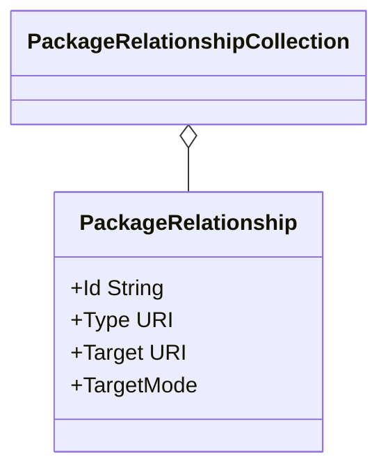
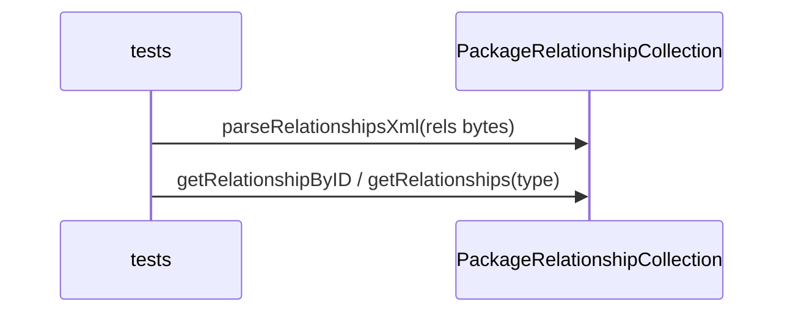

# 04_function_opc_relationships — 解析 `_rels` / `*.rels`

| 项 | 值 |
|----|----|
| feature | wave0-ooxml-standards |
| order | 4 |
| crate | `libs/core-libs/io/wps-io/Cargo.toml` |
| 入口 | `PackageRelationshipCollection::parseRelationshipsXml`（Java `parseRelationshipsPart` 循环） |
| 独立性 | 叶子 |
| 测试状态 | pass |

## 1. 功能说明

### 1.1 一句话

把关系 XML 解析成有向边：`Id` + `Type` URI + `Target`（相对路径）+ `TargetMode`，用于按类型找 Part，而不是拼绝对路径。

### 1.2 输入

- 包级：`/_rels/.rels` 字节 + 源 = 包根
- 部件级：如 `/word/_rels/document.xml.rels` + 源 = `/word/document.xml`

关系命名空间：`http://schemas.openxmlformats.org/package/2006/relationships`

测试用内存 XML；不跑 unzip / OPCPackage。`SAXReader` 仍 `todo!()`，解析 seam 是 `parseRelationshipsXml`。

### 1.3 输出

`PackageRelationshipCollection`：若干 `PackageRelationship`。

查询：`getRelationships(typeFilter)`、`getRelationshipByID(id)`、`iter_with_filter`。

主文档 Type（Transitional）：

- `http://schemas.openxmlformats.org/officeDocument/2006/relationships/officeDocument`

### 1.4 上游

`02_function_unzip`（取 rels 流）。源 Part URI 来自调用方。

### 1.5 下游

`07_function_opc_package`、`11_function_poixml_load`、`13_function_xwpf_parse`。

## 2. 核心代码与流程

### 2.1 核心类

| 名字 | 角色 | Java | Rust |
|------|------|------|------|
| `PackageRelationshipCollection` | rel 列表 | `opc/PackageRelationshipCollection.java` | 同名 |
| `PackageRelationship` | 一条边 | 同目录 | 同名 |
| `TargetMode` | INTERNAL/EXTERNAL | 同目录 | 同名 |

`RelationshipSource` / `OPCPackage` 编排留 07，本 function 只测 collection 的 XML→边。

### 2.2 类图



### 2.3 调用关系



### 2.4 不变量

- Target 相对源 Part；INTERNAL 的 `getTargetURI` 可能相对包根解析
- `TargetMode.EXTERNAL` 不解析成包内 Part
- 反斜杠 Target 换成 `/`
- 两条 core-properties → OPC M4.1
- 缺 Id/Type/Target → 失败（Java NPE / Rust panic）

## 3. 测试方案与代码

### 3.1 代码审计与测试面

| symbol | Java/Rust 路径 | 输入/状态 | 输出/副作用 | 关键分支/错误 |
|--------|----------------|-----------|-------------|---------------|
| `parseRelationshipsXml` | `PackageRelationshipCollection` | Relationships XML | 填 `relationshipsByID` | 0/1/N `Relationship`；缺属性；M4.1；`\`；TargetMode |
| `addRelationship` | 同上 | id 空或冲突 | 分配 `rIdN` | reserved ids |
| `getRelationshipByID` / `size` | 同上 | 已解析 | Some/None / 计数 | miss |
| `getRelationships` / `iter_with_filter` | 同上 | type 过滤 | 子集 | 同 Type 多条 |
| `removeRelationship` / `clear` | 同上 | 已有边 | 变空 | |
| `TargetMode` | 缺省 / External | INTERNAL / EXTERNAL | 缺省 INTERNAL |

`parseRelationshipsPart(PackagePart)` 依赖 Part 流，本层用 XML seam；不测 OPCPackage 构造。

### 3.2 覆盖矩阵

| coverage_id | 接口/代码路径 | 场景类别 | 必测? | test_id |
|-------------|---------------|----------|-------|---------|
| C01 | 最小 officeDocument | 正常 | 是 | R1 |
| C02 | 同 Type 两条 | 循环 N | 是 | R2 |
| C03 | 缺 Type | 非法 | 是 | R3 |
| C04 | 空 Relationships | 循环 0 | 是 | R4 |
| C05 | TargetMode External | 分支 | 是 | R5 |
| C06 | 双 core-properties | M4.1 | 是 | R6 |
| C07 | Target 含 `\` | 规范化 | 是 | R7 |
| C08 | type filter | 查询 | 是 | R8 |
| C09 | 缺 Target | 非法 | 是 | R9 |
| C10 | addRelationship 冲突 id | 写入 | 是 | R10 |
| C11 | remove / clear | 状态 | 是 | R11 |
| C12 | 非 XML | 非法 | 是 | R12 |

URI 语法失败后 `continue`：依赖 `URI::new` 失败；本轮用合法相对/绝对 Target 覆盖成功路径。

### 3.3 可测试性

`.rels` XML 字符串 + `PackageRelationshipCollection::new()` + `parseRelationshipsXml`。

### 3.4 用例表

| id | 覆盖项 | 前置状态 | 输入摘要 | 期望输出/副作用 | 失败语义 |
|----|--------|----------|----------|-----------------|----------|
| R1 | C01 | — | rId1 officeDocument → word/document.xml | size=1；type/id 命中；target 含该路径 | 解析空 |
| R2 | C02 | — | 两条同 Type 不同 Target | size=2；两 Id 都在 | 合并成一条 |
| R3 | C03 | — | 无 Type | panic | 插入空边 |
| R4 | C04 | — | 空根 | size=0 | 失败 |
| R5 | C05 | — | TargetMode=External | EXTERNAL；URI 含 host | 当成 INTERNAL |
| R6 | C06 | — | 两条 core-properties | M4.1 panic | 接受两条 |
| R7 | C07 | — | Target `word\document.xml` | 无反斜杠 | 保留 `\` |
| R8 | C08 | 两 Type | filter officeDocument | 只 rId1 | 漏过滤 |
| R9 | C09 | — | 无 Target | panic | 空 Target |
| R10 | C10 | 已有 rId1 | 再 add 同 id | 新 rId；size=2 | 覆盖旧边 |
| R11 | C11 | R1 表 | remove / clear | size=0 | 删不掉 |
| R12 | C12 | — | `not xml` | panic | 空表 |

### 3.5 测试代码位置

crate: `libs/core-libs/io/wps-io`  
src:   `libs/core-libs/io/wps-io/src/cn/wps/io/opc/PackageRelationshipCollection.rs`  
test:  `libs/core-libs/io/wps-io/tests/cn/wps/io/opc/PackageRelationshipCollection.rs`

### 3.6 测试运行脚本

在仓库根目录：

```bash
cargo test --manifest-path libs/core-libs/io/wps-io/Cargo.toml --test 04_function_opc_relationships

bash .cursor/skills/feature-function/scripts/function-coverage.sh \
  --crate libs/core-libs/io/wps-io \
  --test 04_function_opc_relationships \
  --src src/cn/wps/io/opc/PackageRelationshipCollection.rs \
  --report libs/word-core/parser/features/wave0-ooxml-standards/functions/04_function_opc_relationships/FUNCTION.md
```

首次需要：`rustup component add llvm-tools-preview && cargo install cargo-llvm-cov --locked`

### 3.7 覆盖率报告

<!-- coverage-report:begin -->
tool: cargo-llvm-cov (`cargo llvm-cov --test 04_function_opc_relationships --json`)
date: 2026-08-18 09:24

| src | lines covered | line % | regions covered | region % |
|-----|---------------|--------|-----------------|----------|
| `src/cn/wps/io/opc/PackageRelationshipCollection.rs` | 149/243 | 61.3% | 250/384 | 65.1% |
| **function total** | **149/243** | **61.3%** |  |  |
<!-- coverage-report:end -->
