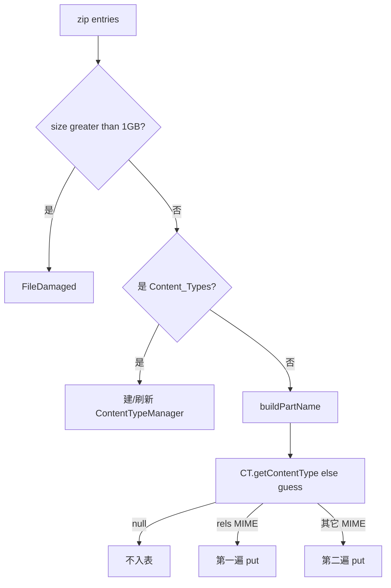

# 05_function_opc_parts — zip entry + Content Type → PackagePart

| 项 | 值 |
|----|----|
| feature | wave0-ooxml-standards |
| order | 5 |
| crate | `libs/core-libs/io/wps-io/Cargo.toml` |
| 入口 | `OPCPackage::getPartsImpl` 第二步：entry + CT → `PackagePartCollection` |
| 独立性 | 叶子（Content Types 用 fixture 表；entries 用内存 zip / `FakeZipEntry`） |
| 测试状态 | pass |

## 1. 功能说明

### 1.1 一句话

除 `[Content_Types].xml` 外的每个 zip entry，用类型表领到 MIME 后封装成 Part，放入 `partName → Part` 主表。

### 1.2 输入

- unzip 的 entries（名字 + 字节 + size）
- `ContentTypeManager`（03 的输出或 `addDefault`/`addOverride` fixture）

跳过：`[Content_Types].xml` 自身；非法名 `../`；size > `MAX_SIZE_ENTRY`（1073741824）。

无 CT 且 `guessContentTypeByExtension` 为 null → **不入表**（不是 panic）。

### 1.3 输出

`PackagePartCollection`：`PackagePartName` → `PackagePart`（名字以 `/` 开头；CT 可查）。

`ZipPackagePart` 可持 `FakeZipEntry`，`getInputStreamImpl` 再给出解压字节。

### 1.4 上游

`02_function_unzip`；`03_function_opc_content_types`。本层测试不跑 07 编排。

### 1.5 下游

`07_function_opc_package`（`partList`）；XML 解析走 `Part.getInputStream()`。

## 2. 核心代码与流程

| 名字 | 角色 | Java | Rust |
|------|------|------|------|
| `OPCPackage::getPartsImpl` | entry 循环 + 两遍 put | `opc/OPCPackage.java` | `OPCPackage.rs` |
| `isPartNameContentTypes` / `buildPartName` | 跳过 CT；zip 名 → OPC 名 | 同上 private | 同上 |
| `PackagePartCollection` | 主表 put/get/remove | `PackagePartCollection.java` | 同名 |
| `ZipPackagePart` | 持 zip entry | `ZipPackagePart.java` | 同名 |
| `PackagePart` | 名 + ContentType | `PackagePart.java` | 同名 |
| `ContentTypes::guessContentTypeByExtension` | 无 Override 时猜图 | `ContentTypes.java` | 同名 |



不变量：`partName` 以 `/` 开头；Content Types 文件名 19 字节、大小写不敏感；rels 先入表。

## 3. 测试方案与代码

### 3.1 代码审计与测试面

| symbol | Java/Rust 路径 | 输入/状态 | 输出/副作用 | 关键分支/错误 |
|--------|----------------|-----------|-------------|---------------|
| `getPartsImpl` | `OPCPackage` | `zipArchive` None / 有 entries | 填 `partList` | None→空表；CT 跳过；两遍 put |
| `isPartNameContentTypes` | 同上 | 19 字符名 | bool | 大小写；错长度 |
| `buildPartName` | 同上 | zip 名 | `Option<PartName>` | CT→None；`../` panic |
| `checkEntryNameLegal` | 同上 | 含 `../` | panic FileDamaged | |
| `isEntryTooLarge` / `MAX_SIZE_ENTRY` | 同上 | size | 1GB 门闩 | `>` 不是 `>=` |
| `getContentType` then `guess` | CT manager + `ContentTypes` | Override / Default / png / 未知 | Some / None | 未知不入表 |
| `PackagePartCollection::{put,get,remove,size}` | collection | 名+Part | 查得到 / 删掉 | Hash/Eq 必须用名字 |
| `ZipPackagePart::new_with_entry` + `getInputStreamImpl` | ZipPackagePart | FakeZipEntry | 解压字节 | 不经 OPCPackage 指针 |

### 3.2 覆盖矩阵

| coverage_id | 接口/代码路径 | 场景类别 | 必测? | test_id |
|-------------|---------------|----------|-------|---------|
| C01 | document.xml + Override | 最小正常 | 是 | P1 |
| C02 | 未知扩展、无 Override、guess null | 失败/跳过 | 是 | P2 |
| C03 | 仅 Content_Types | 循环 0 个业务 entry | 是 | P3 |
| C04 | `isPartNameContentTypes` | 名字分支 | 是 | P4 |
| C05 | `../` | 安全失败 | 是 | P5 |
| C06 | size > 1GB | 损坏输入 | 是 | P6 |
| C07 | guess `png` | 扩展名回退 | 是 | P7 |
| C08 | collection put/get/remove | 主表 | 是 | P8 |
| C09 | ZipPackagePart 流 | 再解压 | 是 | P9 |
| C10 | rels + document 两遍 put | 循环 N / rels 优先逻辑 | 是 | P10 |
| C11 | `buildPartName` 对 CT 返回 None | 构造 | 是 | P11 |
| C12 | 空 zip / archive None | 空表 | 是 | P12 |

### 3.3 可测试性

内存 zip + `ZipInputStreamZipEntrySource` + `ContentTypeManager` fixture。不 new 完整 XWPFPackage。

### 3.4 用例表

| id | 覆盖项 | 前置状态 | 输入摘要 | 期望输出/副作用 | 失败语义 |
|----|--------|----------|----------|-----------------|----------|
| P1 | C01 | Override 主文档 CT | zip 仅 `word/document.xml` | `getPart(/word/document.xml)` CT 含 `wordprocessingml.document.main` | 未入表或 CT 错 |
| P2 | C02 | 无 manager | `foo.bin` | size=0 | 误入表 |
| P3 | C03 | — | 仅 `[Content_Types].xml` | size=0 | CT 当成 Part |
| P4 | C04 | — | `[Content_Types].xml` / `[CONTENT_TYPES].XML` / `word/x.xml` | true / true / false | 漏大小写 |
| P5 | C05 | — | `../evil.xml` | panic FileDamaged | 接受穿越 |
| P6 | C06 | — | size=`MAX+1` / `MAX` | true / false | 门闩写错 |
| P7 | C07 | 无 manager | `a.png` | 入表；CT=`image/png` | 未 guess |
| P8 | C08 | 空 collection | put 再 get/remove | 同 CT；remove 后 None | Hash 对不上 |
| P9 | C09 | FakeZipEntry `abc` | ZipPackagePart 取流 | 字节 `abc` | panic getInputStream |
| P10 | C10 | Default rels + Override 文档 | `_rels/.rels` + `word/document.xml` | 两 Part 都在 | 只留一遍 |
| P11 | C11 | — | buildPartName CT 名 | None | 当成 `/[Content_Types].xml` |
| P12 | C12 | 无 archive / 空 zip | getPartsImpl | size=0 | panic |

### 3.5 测试代码位置

crate: `libs/core-libs/io/wps-io`  
src:   `libs/core-libs/io/wps-io/src/cn/wps/io/opc/PackagePart.rs`  
src:   `libs/core-libs/io/wps-io/src/cn/wps/io/opc/ZipPackagePart.rs`  
src:   `libs/core-libs/io/wps-io/src/cn/wps/io/opc/PackagePartCollection.rs`  
src:   `libs/core-libs/io/wps-io/src/cn/wps/io/opc/OPCPackage.rs`  
test:  `libs/core-libs/io/wps-io/tests/cn/wps/io/opc/PackagePart.rs`

### 3.6 测试运行脚本

在仓库根目录：

```bash
cargo test --manifest-path libs/core-libs/io/wps-io/Cargo.toml --test 05_function_opc_parts

bash .cursor/skills/feature-function/scripts/function-coverage.sh \
  --crate libs/core-libs/io/wps-io \
  --test 05_function_opc_parts \
  --src src/cn/wps/io/opc/PackagePart.rs \
  --src src/cn/wps/io/opc/ZipPackagePart.rs \
  --src src/cn/wps/io/opc/PackagePartCollection.rs \
  --src src/cn/wps/io/opc/OPCPackage.rs \
  --report libs/word-core/parser/features/wave0-ooxml-standards/functions/05_function_opc_parts/FUNCTION.md
```

首次需要：`rustup component add llvm-tools-preview && cargo install cargo-llvm-cov --locked`

### 3.7 覆盖率报告

<!-- coverage-report:begin -->
tool: cargo-llvm-cov (`cargo llvm-cov --test 05_function_opc_parts --json`)
date: 2026-08-18 09:50

| src | lines covered | line % | regions covered | region % |
|-----|---------------|--------|-----------------|----------|
| `src/cn/wps/io/opc/OPCPackage.rs` | 128/305 | 42.0% | 197/454 | 43.4% |
| `src/cn/wps/io/opc/PackagePart.rs` | 37/234 | 15.8% | 43/317 | 13.6% |
| `src/cn/wps/io/opc/PackagePartCollection.rs` | 15/21 | 71.4% | 23/27 | 85.2% |
| `src/cn/wps/io/opc/ZipPackagePart.rs` | 15/58 | 25.9% | 17/75 | 22.7% |
| **function total** | **195/618** | **31.6%** |  |  |
<!-- coverage-report:end -->
