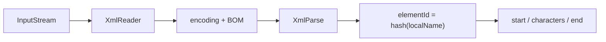

# 06_function_xml_elementid — XML 字节 → elementId 事件

| 项 | 值 |
|----|----|
| feature | wave0-ooxml-standards |
| order | 6 |
| crate | `libs/core-libs/io/wps-io/Cargo.toml` |
| 入口 | `XmlReader::parse(in, rootHandler, encoding, ignore, mode)` |
| 独立性 | 叶子（内存 XML，不必 OPC） |
| 测试状态 | pass |

## 1. 功能说明

### 1.1 一句话

把 Part 输入流词法分析成「元素本地名的 Java `String.hashCode` = elementId」事件流（start / characters / end），编码默认 utf-8，剥 UTF-8 BOM。

### 1.2 输入

`InputStream` + encoding（默认 `"utf-8"`）+ 可选 `ignoreElement`（`-1` 表示不忽略）+ `mode`。

路径：`opt/XmlParse` 自研状态机。业务只认 int id。分发给具体 Word handler 是 `08_function_xml_dispatch`。

### 1.3 输出

事件序列：`start(elementId)` / `characters` / `end(elementId)`。身份来自本地名哈希，与 `ElementIds` 常量表对齐（`w:p` → 112，`w:t` → 116，`b` → 98）。本层不分发业务 handler。

### 1.4 上游

`05_function_opc_parts` 的 `Part.getInputStream()`，或测试里的 XML 字节。

### 1.5 下游

`08_function_xml_dispatch`。

## 2. 核心代码与流程

| 名字 | 角色 | Java | Rust |
|------|------|------|------|
| `XmlReader` | 读流、解码、剥 BOM、装配 XmlParse | `opt/XmlReader.java` | `opt/XmlReader.rs` |
| `XmlParse` | 逐字符状态机 | `opt/XmlParse.java` | `opt/XmlParse.rs` |
| `Token` | `elementId = getNameHashCode()` | `opt/Token.java` | `opt/Token.rs` |
| `ContentHandlerImpl` | 把 start/end/chars 交给 root `ElementHandlerSimple` | `opt/ContentHandlerImpl.java` | 同名 |
| `ElementIds` | 本地名哈希常量表 | `simple/ElementIds.java` | 同名 |



不变量：elementId = Java `String.hashCode`（31 进制）；`RPR_B=98` 即 `"b".hashCode()`。对照 [xml-elementid-deep-dive.md](../../docs/xml-elementid-deep-dive.md)。

## 3. 测试方案与代码

### 3.1 代码审计与测试面

| symbol | Java/Rust 路径 | 输入/状态 | 输出/副作用 | 关键分支/错误 |
|--------|----------------|-----------|-------------|---------------|
| `XmlReader::parse` | `opt/XmlReader` | 流 + handler + encoding + ignore + mode | 事件灌进 handler | `ignore != -1` 时 `setIgnoreElement`；解码后喂 `XmlParse` |
| `XmlReader::parse4HwMemo` | 同上 | 流 + handler + encoding | 同上 + `initNamespace4HwMemo` | 公开入口；mode 固定 0 |
| `DEFAULT_ENCODING` | 同上 | 常量 | `"utf-8"` | 与 Java 字面量一致 |
| `parse` 私有 / BOM | `InputStreamReader` 后首 char | 首块 `'\ufeff'` | 从下标 1 起 parse | 无 BOM 从 0；空流不进循环 |
| encoding utf-8 / utf-16 | `InputStreamReader(in, encoding)` | 字节 | char 缓冲 | Numbering 有 utf-16 回退 |
| `XmlParse::parse` | `opt/XmlParse` | char[] + start + len | start/end/chars | 状态机 EMPTY_TAG→TAG→DATA |
| `Token::addElementName` | `opt/Token` | `w:t` / `t` | elementId=116 | 哈希本地名；`w`/`w14`/`m` 才 remap |
| `Token::isIgnore` | 同上 | ignoreElementId | 忽略子树名字装配 | `ignore == -1` 不调用 setter |
| `ContentHandlerImpl` | 根 + `getElementHandler` | 嵌套标签 | 子 handler 也收到事件 | 根 `isFirst` |
| `ElementIds::{P,T,RPR_B}` | `simple/ElementIds` | 常量 | 112 / 116 / 98 | 与 `String.hashCode` 一致 |
| `parseEscape` | `XmlParse.convertEscape` | `&amp;` 等 | 文本 `&` | 非法 escape panic |

### 3.2 覆盖矩阵

| coverage_id | 接口/代码路径 | 场景类别 | 必测? | test_id |
|-------------|---------------|----------|-------|---------|
| C01 | `parse` utf-8 `<w:t>Hi</w:t>` | 最小正常 | 是 | E1 |
| C02 | 首块 U+FEFF / UTF-8 BOM 字节 | BOM 剥离 | 是 | E2 |
| C03 | `ElementIds::{P,T,RPR_B}` | 常量/哈希 | 是 | E3 |
| C04 | 空流 | 循环 0 次 | 是 | E4 |
| C05 | 嵌套 `<w:p><w:t>` | 循环 N / 子 handler | 是 | E5 |
| C06 | `ignore != -1`（`T`） | ignore 分支 | 是 | E6 |
| C07 | 自闭合 `<w:t/>` | 状态转换 | 是 | E7 |
| C08 | `&amp;` | escape | 是 | E8 |
| C09 | `parse4HwMemo` | 公开入口 | 是 | E9 |
| C10 | `DEFAULT_ENCODING` | 常量 | 是 | E10 |
| C11 | encoding=`utf-16` + BOM | 编码后端 | 是 | E11 |
| C12 | `<?xml ...?>` 声明后仍出 `t` | PI / INVALID 状态 | 是 | E12 |

### 3.3 可测试性

内存 `Cursor<Vec<u8>>` + `Rc<RefCell<Recording>>` 实现 `ElementHandlerSimple`；`getElementHandler` 返回共享同一事件 vec 的新 Rc，嵌套标签仍记录。不跑 OPC / XWPF。

Rust `parse` 仍收 `&mut dyn Any`（Numbering/Styles 编译面）；测试传入 `ElementHandlerRef`。非该类型的 Any 保持 no-op，不算本 function 的事件契约。

### 3.4 用例表

| id | 覆盖项 | 前置状态 | 输入摘要 | 期望输出/副作用 | 失败语义 |
|----|--------|----------|----------|-----------------|----------|
| E1 | C01 | ignore=-1, mode=0 | utf-8 `<w:t>Hi</w:t>` | start(116)、chars=`Hi`、end(116) | 无事件或 id≠116 |
| E2 | C02 | 同 E1 | `EF BB BF` + `<w:t>Hi</w:t>` | 与 E1 相同；文本不含 BOM | BOM 进 characters |
| E3 | C03 | — | `"p"`/`"t"`/`"b"` 与常量 | `P=112` `T=116` `RPR_B=98` | 常量不可见或值错 |
| E4 | C04 | — | 空字节 | 无 start/end/chars | 误报事件 |
| E5 | C05 | — | `<w:p><w:t>Hi</w:t></w:p>` | 112 包住 116；文本 Hi | 子标签丢失 |
| E6 | C06 | ignore=`T` | 同 E5 | 仍有 `p` start/end=112（parse 未短路） | ignore 时整篇不 parse |
| E7 | C07 | — | `<w:t/>` | start(116)+end(116)，无 chars | 只 start 或 panic |
| E8 | C08 | — | `<w:t>A&amp;B</w:t>` | chars=`A&B` | 字面 `&amp;` 或 panic |
| E9 | C09 | — | parse4HwMemo `<w:t>Hi</w:t>` | start/end 116，chars=`Hi` | 公开入口仍是壳 |
| E10 | C10 | — | 常量 | `"utf-8"` | 字面量漂移 |
| E11 | C11 | encoding utf-16 | UTF-16LE BOM + `<w:t>Hi</w:t>` | 同 E1 | 当 utf-8 解或空事件 |
| E12 | C12 | — | `<?xml version="1.0"?><w:t>Hi</w:t>` | 同 E1 | PI 把状态机打挂 |

### 3.5 测试代码位置

crate: `libs/core-libs/io/wps-io`  
src:   `libs/core-libs/io/wps-io/src/cn/wps/io/opt/XmlReader.rs`  
src:   `libs/core-libs/io/wps-io/src/cn/wps/io/opt/XmlParse.rs`  
src:   `libs/core-libs/io/wps-io/src/cn/wps/io/opt/Token.rs`  
src:   `libs/core-libs/io/wps-io/src/cn/wps/io/opt/ContentHandlerImpl.rs`  
test:  `libs/core-libs/io/wps-io/tests/cn/wps/io/opt/XmlReader.rs`

### 3.6 测试运行脚本

在仓库根目录：

```bash
cargo test --manifest-path libs/core-libs/io/wps-io/Cargo.toml --test 06_function_xml_elementid

bash .cursor/skills/feature-function/scripts/function-coverage.sh \
  --crate libs/core-libs/io/wps-io \
  --test 06_function_xml_elementid \
  --src src/cn/wps/io/opt/XmlReader.rs \
  --src src/cn/wps/io/opt/XmlParse.rs \
  --src src/cn/wps/io/opt/Token.rs \
  --src src/cn/wps/io/opt/ContentHandlerImpl.rs \
  --report libs/word-core/parser/features/wave0-ooxml-standards/functions/06_function_xml_elementid/FUNCTION.md
```

首次需要：`rustup component add llvm-tools-preview && cargo install cargo-llvm-cov --locked`

### 3.7 覆盖率报告

<!-- coverage-report:begin -->
tool: cargo-llvm-cov (`cargo llvm-cov --test 06_function_xml_elementid --json`)
date: 2026-08-18 10:54

| src | lines covered | line % | regions covered | region % |
|-----|---------------|--------|-----------------|----------|
| `src/cn/wps/io/opt/ContentHandlerImpl.rs` | 47/89 | 52.8% | 87/133 | 65.4% |
| `src/cn/wps/io/opt/Token.rs` | 99/205 | 48.3% | 95/192 | 49.5% |
| `src/cn/wps/io/opt/XmlParse.rs` | 147/334 | 44.0% | 234/468 | 50.0% |
| `src/cn/wps/io/opt/XmlReader.rs` | 70/83 | 84.3% | 136/152 | 89.5% |
| **function total** | **363/711** | **51.1%** |  |  |
<!-- coverage-report:end -->
