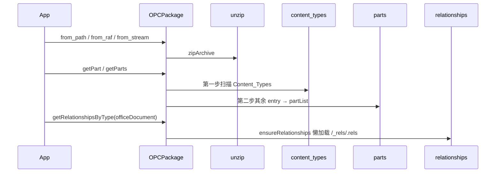

# 07_function_opc_package — 编排 unzip + types + rels + parts → OPCPackage

| 项 | 值 |
|----|----|
| feature | wave0-ooxml-standards |
| order | 7 |
| crate | `libs/core-libs/io/wps-io/Cargo.toml` |
| 入口 | `OPCPackage` 打开构造 / `getPart` → `getPartsImpl` / `ensureRelationships` |
| 独立性 | **编排**（叶子 02–05 的测试必须先能讲清 I/O） |
| 测试状态 | pass |

## 1. 功能说明

### 1.1 一句话

按 Java `getPartsImpl` **两步扫描**把物理 zip 变成已填充的 `OPCPackage`：先 Content Types，再 Parts；包级 rels **懒加载**。

### 1.2 输入

与 unzip 相同的三种端点（路径 / raf / 流）。本 function 不另发明入口。Word 薄封装 `XWPFPackage::open` 是 `09`。

### 1.3 输出

`OPCPackage`：

- `zipArchive: ZipEntrySource`
- `contentTypeManager`（从 `[Content_Types].xml` 建）
- `partList`（第二步 Parts）
- `relationships`（首次 `ensureRelationships` 才解析 `/_rels/.rels`）

### 1.4 上游

`02_function_unzip`、`03_function_opc_content_types`、`04_function_opc_relationships`、`05_function_opc_parts`。

### 1.5 下游

`09_function_xwpf_package`（子类打开即 `getParts()`）。本层不断言 XML 语义、不跑 unmarshaller。

## 2. 核心代码与流程

核心类：`OPCPackage`（`opc/OPCPackage.java`，609 行）。字段与方法表见 [opc-deep-dive.md](../../docs/opc-deep-dive.md) §1.1。



不变量：raf 路径先能打开 zip；`INVALID_NAME="../"`；`MAX_SIZE_ENTRY=1073741824`；`getPart` 在 `partList == null` 时才扫描，已扫描的空表不再当「未打开」。

## 3. 测试方案与代码

### 3.1 代码审计与测试面

| symbol | Java/Rust 路径 | 输入/状态 | 输出/副作用 | 关键分支/错误 |
|--------|----------------|-----------|-------------|---------------|
| `OPCPackage(path, access)` | `OPCPackage` | 路径 | `zipArchive` | zip 打不开 → ZipError panic |
| `OPCPackage(raf, access)` | 同上 | PathBuf/String | 同上 | `openZipFile(raf)` null → panic |
| stream 装配 | `ZipInputStreamZipEntrySource` + `setZipArchive` | 内存 zip | 同上 | 坏 zip 失败 |
| `getPart(partName)` | 同上 | `partList` None / Some | 查表 | None → `getPartsImpl`；已扫描不再清空 |
| `getPartsImpl` | 两步 | 有/无 CT | 填 CT + partList | 无 CT → 文档可不入表 |
| `ensureRelationships` | 同上 | `/_rels/.rels` Part | 解析 officeDocument | 无 rels part → 空集合 |
| `getRelationshipsByType` | 同上 | CORE_DOCUMENT | 过滤集合 | 懒加载 |
| `getPart(PackageRelationship)` | 同上 | officeDocument rel | 主文档 Part | Target 相对路径加 `/` |
| `close` READ | 同上 | 已打开 | 清 CT + `zipArchive=None` | |
| `DOCUMENT_CREATOR` | 常量 | — | `"WPS Office"` | |

### 3.2 覆盖矩阵

| coverage_id | 接口/代码路径 | 场景类别 | 必测? | test_id |
|-------------|---------------|----------|-------|---------|
| C01 | stream 最小 docx → getPart 主文档 | 最小正常 | 是 | O1 |
| C02 | officeDocument rel 解析到该 Part | 懒 rels | 是 | O2 |
| C03 | zip 无 `[Content_Types].xml` | 失败/跳过 | 是 | O3 |
| C04 | `from_path` 文件后端 | 路径后端 | 是 | O4 |
| C05 | `from_raf` PathBuf | raf 后端 | 是 | O5 |
| C06 | `getPart` 触发扫描（不预调 getPartsImpl） | 状态转换 | 是 | O6 |
| C07 | READ `close` | cleanup | 是 | O7 |
| C08 | `DOCUMENT_CREATOR` | 常量 | 是 | O8 |
| C09 | 打不开的路径 | 失败 | 是 | O9 |
| C10 | 有 CT 无 `_rels/.rels` | 空关系 | 是 | O10 |
| C11 | `getPart_rel` | rel → Part | 是 | O11 |
| C12 | 仅 CT、无业务 part | 循环 0 | 是 | O12 |

### 3.3 可测试性

内存 zip（CT + `_rels/.rels` + `word/document.xml`）经 `from_stream` / 临时文件 / PathBuf。不 new `XWPFPackage`，不跑 09 unmarshaller。

### 3.4 用例表

| id | 覆盖项 | 前置状态 | 输入摘要 | 期望输出/副作用 | 失败语义 |
|----|--------|----------|----------|-----------------|----------|
| O1 | C01 | stream | 最小合法 zip | `getPart(/word/document.xml)` Some；CT 含 document.main | 未扫描或未入表 |
| O2 | C02 | 同 O1 | `getRelationshipsByType(CORE_DOCUMENT)` | size=1；Target 含 `word/document.xml` | 空集合（未 parse rels） |
| O3 | C03 | — | 仅 `word/document.xml` 无 CT | `getPart` 主文档 None | 误入表 |
| O4 | C04 | 临时文件 | 同 O1 字节 | 同 O1 | 路径后端未接线 |
| O5 | C05 | PathBuf | 同 O4 | 同 O1 | raf 后端未接线 |
| O6 | C06 | stream | 只调 `getPart` | 主文档 Some | 建了空表导致永远 miss |
| O7 | C07 | 已打开 READ | `close` | `getZipArchive()` None | 句柄泄漏 |
| O8 | C08 | — | 常量 | `"WPS Office"` | 字面量漂移 |
| O9 | C09 | — | 不存在的路径 | panic 含 `Can't open` | 静默空包 |
| O10 | C10 | CT+document 无 rels | `getRelationships` | size=0 | panic |
| O11 | C11 | 同 O1 | `getPart_rel(officeDocument)` | 主文档 Part | Target 未加 `/` |
| O12 | C12 | 仅 CT xml | `getPartList` size=0 | CT 当成 Part | |

### 3.5 测试代码位置

crate: `libs/core-libs/io/wps-io`  
src:   `libs/core-libs/io/wps-io/src/cn/wps/io/opc/OPCPackage.rs`  
src:   `libs/core-libs/io/wps-io/src/cn/wps/io/opc/PackagePart.rs`  
test:  `libs/core-libs/io/wps-io/tests/cn/wps/io/opc/OPCPackage.rs`

### 3.6 测试运行脚本

在仓库根目录：

```bash
cargo test --manifest-path libs/core-libs/io/wps-io/Cargo.toml --test 07_function_opc_package

bash .cursor/skills/feature-function/scripts/function-coverage.sh \
  --crate libs/core-libs/io/wps-io \
  --test 07_function_opc_package \
  --src src/cn/wps/io/opc/OPCPackage.rs \
  --src src/cn/wps/io/opc/PackagePart.rs \
  --report libs/word-core/parser/features/wave0-ooxml-standards/functions/07_function_opc_package/FUNCTION.md
```

首次需要：`rustup component add llvm-tools-preview && cargo install cargo-llvm-cov --locked`

### 3.7 覆盖率报告

<!-- coverage-report:begin -->
tool: cargo-llvm-cov (`cargo llvm-cov --test 07_function_opc_package --json`)
date: 2026-08-18 11:00

| src | lines covered | line % | regions covered | region % |
|-----|---------------|--------|-----------------|----------|
| `src/cn/wps/io/opc/OPCPackage.rs` | 225/362 | 62.2% | 357/561 | 63.6% |
| `src/cn/wps/io/opc/PackagePart.rs` | 58/241 | 24.1% | 74/329 | 22.5% |
| **function total** | **283/603** | **46.9%** |  |  |
<!-- coverage-report:end -->
