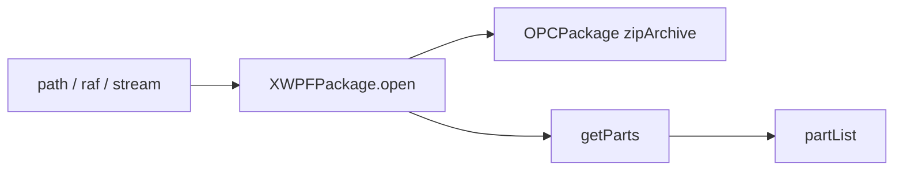

# 09_function_xwpf_package — OPC 上的 Word 薄封装

| 项 | 值 |
|----|----|
| feature | wave0-ooxml-standards |
| order | 9 |
| crate | `libs/core-libs/io/wps-io/Cargo.toml` |
| 入口 | `XWPFPackage::open(InputStream\|String\|RandomAccessFile)` |
| 独立性 | 编排（依赖 opc_package） |
| 测试状态 | pass |

## 1. 功能说明

### 1.1 一句话

在通用 `OPCPackage` 上挂 Word 打开入口：三种端点打开后 `getParts()`。三件套 unmarshaller 替换 Part 是 `11_function_poixml_load`，本层只要求包能打开、`partList` 非空。

### 1.2 输入

与 `07_function_opc_package` 相同的路径 / raf / 流。本层不重新解压。

### 1.3 输出

`XWPFPackage`：基类 `OPCPackage` 已扫描；`packageProperties` 等可仍为 None（无 docProps 的最小包）。

### 1.4 上游

`07_function_opc_package`。

### 1.5 下游

`11_function_poixml_load`。

## 2. 核心代码与流程

| 名字 | 角色 | Java | Rust |
|------|------|------|------|
| `XWPFPackage::open_*` | 三种端点 | `xwpf/XWPFPackage.java` | 同名 |
| `getParts` | 只读打开后扫描 | 覆盖；unmarshaller 循环 | 本层委托 `getPartsImpl` |



★ `open` 三重重载：`open_stream` / `open_path` / `open_raf`。只读路径 `access != WRITE → getParts()`。

## 3. 测试方案与代码

### 3.1 代码审计与测试面

| symbol | Java/Rust 路径 | 输入/状态 | 输出/副作用 | 关键分支/错误 |
|--------|----------------|-----------|-------------|---------------|
| `open_stream` | `XWPFPackage` | 内存 zip | getParts 后 part 可查 | 未设 zipArchive 则空表 |
| `open_path` READ | 同上 | 文件 | 同上 | 空 path panic |
| `open_path` WRITE | 同上 | 文件 | 不自动 getParts | |
| `open_raf` | 同上 | PathBuf | 同 READ | |
| `getParts` | 覆盖 | partList None | 调 getPartsImpl | 不得建空表短路 |
| core-properties rel | getRelationshipsByType | 最小包无 docProps | size=0 合法 | |

### 3.2 覆盖矩阵

| coverage_id | 接口/代码路径 | 场景类别 | 必测? | test_id |
|-------------|---------------|----------|-------|---------|
| C01 | open_stream 最小 docx | 最小正常 | 是 | X1 |
| C02 | core-properties rel 可空 | 可选 | 是 | X2 |
| C03 | open_path READ | 路径后端 | 是 | X3 |
| C04 | open_raf | raf 后端 | 是 | X4 |
| C05 | open_path WRITE 不扫描 | 状态 | 是 | X5 |
| C06 | 空 path | 失败 | 是 | X6 |

### 3.3 可测试性

与 07 相同的最小 zip（CT + `_rels/.rels` + `word/document.xml`）。不断言 unmarshaller / `packageProperties` 已填。

### 3.4 用例表

| id | 覆盖项 | 前置状态 | 输入摘要 | 期望输出/副作用 | 失败语义 |
|----|--------|----------|----------|-----------------|----------|
| X1 | C01 | stream | 最小 docx | `getPart(/word/document.xml)` Some | 空 partList |
| X2 | C02 | 同 X1 | core-properties Type | size=0 | 误要求必有 |
| X3 | C03 | 临时文件 | open_path READ | 同 X1 | 路径未接线 |
| X4 | C04 | PathBuf | open_raf | 同 X1 | raf 未接线 |
| X5 | C05 | WRITE | open_path WRITE | partList 仍 None | 误扫描 |
| X6 | C06 | — | `""` | panic `path` | 静默空包 |

### 3.5 测试代码位置

crate: `libs/core-libs/io/wps-io`  
src:   `libs/core-libs/io/wps-io/src/cn/wps/io/xwpf/XWPFPackage.rs`  
test:  `libs/core-libs/io/wps-io/tests/cn/wps/io/xwpf/XWPFPackage.rs`

### 3.6 测试运行脚本

在仓库根目录：

```bash
cargo test --manifest-path libs/core-libs/io/wps-io/Cargo.toml --test 09_function_xwpf_package

bash .cursor/skills/feature-function/scripts/function-coverage.sh \
  --crate libs/core-libs/io/wps-io \
  --test 09_function_xwpf_package \
  --src src/cn/wps/io/xwpf/XWPFPackage.rs \
  --report libs/word-core/parser/features/wave0-ooxml-standards/functions/09_function_xwpf_package/FUNCTION.md
```

首次需要：`rustup component add llvm-tools-preview && cargo install cargo-llvm-cov --locked`

### 3.7 覆盖率报告

<!-- coverage-report:begin -->
tool: cargo-llvm-cov (`cargo llvm-cov --test 09_function_xwpf_package --json`)
date: 2026-08-18 11:07

| src | lines covered | line % | regions covered | region % |
|-----|---------------|--------|-----------------|----------|
| `src/cn/wps/io/xwpf/XWPFPackage.rs` | 60/171 | 35.1% | 74/240 | 30.8% |
| **function total** | **60/171** | **35.1%** |  |  |
<!-- coverage-report:end -->
