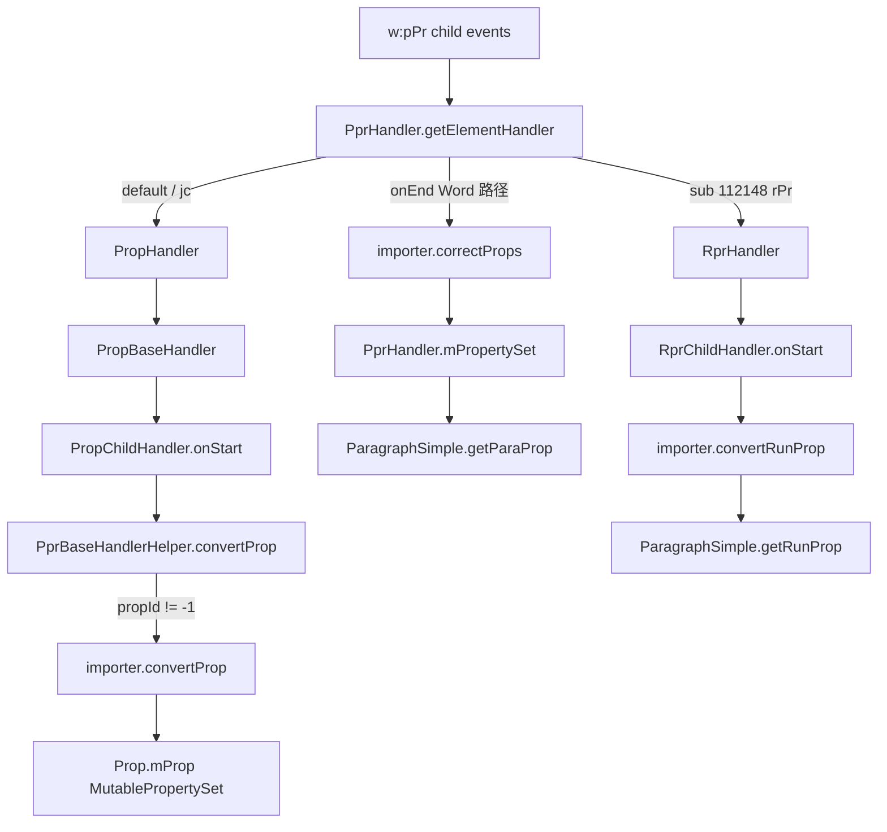

# 10_function_handler_props — pPr / rPr → MutablePropertySet

| 项 | 值 |
|----|----|
| feature | wave0-ooxml-standards |
| order | 10 |
| crate | `libs/core-libs/io/wps-io/Cargo.toml` |
| 入口 | `PprHandler` / `RprHandler` / `PropHandler` → `ParagraphSimple` |
| 独立性 | 叶子（注入 pPr/rPr 事件 + RecordingImporter；不跑 12/13） |
| 测试状态 | pass |

## 1. 功能说明

### 1.1 一句话

把 `w:pPr` / `w:rPr` 子树写成 `MutablePropertySet`。OOXML 属性值→propId 的**语义转换**在 wc-03（`IDocumentImporter.convertProp` / `convertRunProp`）；本层负责 handler 分发、helper 的 elementId→propId、把桶挂到 `ParagraphSimple`。

### 1.2 输入

dispatch 送到 `PprHandler` / `RprHandler` 的子事件（可直接调 `getElementHandler` + `onStart`/`onEnd`）。假 importer 只记录钩子调用并写入 `01` 的 `MutablePropertySet`。

### 1.3 输出

`ParagraphSimple.getParaProp()` / `getRunProp()` 上的桶（pPr `onEnd` 后 `mPropertySet`；rPr 来自嵌套 `RprHandler.getProp()`）。

### 1.4 上游

`08_function_xml_dispatch`；`01_function_property_set`。

### 1.5 下游

`12_function_handler_body`。

## 2. 核心代码与流程

| 名字 | 角色 | Java | Rust |
|------|------|------|------|
| `PprHandler` | pPr 根；`onEnd` 把 `correctProps` 结果存 `mPropertySet` | `element_handler/PprHandler.java` | 同名 |
| `PropHandler` | 默认子 handler：annotation / change / `PropBaseHandler` | `prop/PropHandler.java` | 同名 |
| `PropBaseHandler` | 懒建 `PropChildHandler` | `prop/PropBaseHandler.java` | 同名 |
| `PropChildHandler` | `helper.convertProp` 后 `importer.convertProp` | `prop/PropChildHandler.java` | 同名 |
| `PprHandlerHelper` / `PprBaseHandlerHelper` | pPr：多数 elementId 原样返回；`3403232\|3552126\|105180200` → `-1` | `PropHandlerHelper.java` | 同名 |
| `RprHandler` + `RprChildHandler` | rPr：`convertRunProp(prop, ns, elementId, attrs)` | `RprHandler.java` / `RprChildHandler.java` | 同名 |
| `ParagraphSimple` | `getParaProp` / `getRunProp` 转发 | `ParagraphSimple.java` | 同名 |
| `Prop` / `PropBase` | 懒建 `MutablePropertySet` 桶 | `prop/Prop*.java` | 同名 |



★ Word 路径：`PprHandler.onStart` **不**调 `convertProp`（仅 GVml / `mShapeBelonger==1556194562`）。写入发生在子 handler。  
★ `jc` Java `String.hashCode` = **3385**；`rPr` = **112148**；`pPr` = **110226**；`b` = **98**。  
★ `PprBaseHandlerHelper.convertProp`：`3403232|3552126|105180200` 返回 `-1`（不调 importer）。

## 3. 测试方案

### 3.1 代码审计与测试面

| symbol | Java/Rust 路径 | 输入/状态 | 输出/副作用 | 关键分支/错误 |
|--------|----------------|-----------|-------------|---------------|
| `PprHandler::new` | PprHandler | part + importer | `super(importer, PprHandlerHelper)`；`mPart` | helper 必须是真 `PprHandlerHelper` 非 `Any(())` |
| `getElementHandler` | PprHandler | `isGVml` / `-906275931` / `112148` / default | GVml 走 gvml 子树；sectPr；rPr；else `PropHandler` | Word 默认 `mode()!=2` |
| `PropHandler.getElementHandler` | PropHandler | `-1555043537` vs change vs base | annotation / `PropChangeHandler` / `PropBaseHandler` | Word 非 xml03：annotation→null |
| `PropBaseHandler.getElementHandler` | 任意 sub | 懒建 **同一个** `PropChildHandler` | 共享 `mDocImporter` + `mProp` + helper | 禁止 `PlaceholderDocImporter` |
| `PropChildHandler.onStart` | jc=3385 | `convertProp(-1, 3385)→3385` | `importer.convertProp(PPR, prop, ns, 3385, attrs)` | helper/prop null 应 assert |
| `PprBaseHandlerHelper.convertProp` | 3403232 | 返回 `-1` | **不**调 `importer.convertProp` | |
| `PprHandler.onEnd` | Word | `mProp.getProp()` + `getChangeProp()` | `mPropertySet = correctProps(...)` | GVml 走 `adjustParaProps`（本层不测） |
| `getProp` / `getRunProp` | PprHandler | rPr handler 未建 | run→null；para→`mPropertySet` | |
| `clearProp` | PprHandler | 已写入 | `mProp` 清空；`mPropertySet=null`；子 handler clear | |
| `RprHandler.getElementHandler` | default | → `RprBaseHandler` → `RprChildHandler` | | DML 特案本层不测 |
| `RprChildHandler.onStart` | b=98 | | `convertRunProp(prop, ns, 98, attrs)` | 无 helper 映射 |
| `RprHandler.onEnd` | Word | changeProp null | `mCorrectProp = prop` | change 非空走 `correctProps` |
| `RprHandler.getProp` | after onEnd | | `new MutablePropertySet(mCorrectProp)` | |
| `ParagraphSimple.getParaProp` | 有/无 PprHandler | | 转发 `PprHandler.getProp` | handler null → null |
| `PropBase.getProp` | 首次 | `mProp==null` | `new MutablePropertySet()` | `TODO_RUST_CODE` 必须填 |

### 3.2 覆盖矩阵

| coverage_id | 接口/代码路径 | 场景类别 | 必测? | test_id |
|-------------|---------------|----------|-------|---------|
| C01 | `getElementHandler(3385)` Word 默认 | 公开入口 | 是 | HP1 |
| C02 | `PropChildHandler.onStart` + `convertProp(PPR, …, 3385)` | 关键分支 | 是 | HP1 |
| C03 | `PprHandler.onEnd` → `ParagraphSimple.getParaProp` 非 empty | 状态转换 | 是 | HP1 |
| C04 | 空 pPr：无子 `onStart`，`onEnd` 后 para empty、run 未污染 | 边界 | 是 | HP2 |
| C05 | `getElementHandler(112148)` + `RprChildHandler.onStart(98)` → `getRunProp` 非 empty | 公开入口 | 是 | HP3 |
| C06 | `clearProp` 后 `getProp` null | cleanup | 是 | HP4 |
| C07 | `convertProp` 对 `3403232` 返回 -1，importer 不被调 | 关键分支 | 是 | HP5 |
| C08 | `isGetThirdSubElementHandler(115029)` 建孙 handler 并设 `mParentId` | 状态 | 是 | HP6 |

### 3.3 可测试性

- 不跑 document.xml 全解析；直接构造 `PprHandler` + `RecordingImporter`（`convertProp`/`convertRunProp` 对传入的 `MutablePropertySet` `setInt(propId, 1)`；`correctProps` 返回该桶的拷贝）。
- `IDocumentImporter.mode()` 返回 `0`（docx / 非 GVml）。
- part 可用任意 `Box<dyn Any>` 占位（sectPr 本层不测）。
- 属性值语义（`w:val="center"` → 具体对齐枚举）属 wc-03；本层只断言**写入发生**（桶非 `isEmpty`，且含 importer 记录的 propId）。

### 3.4 用例表

| id | 覆盖项 | 前置状态 | 输入摘要 | 期望输出/副作用 | 失败语义 |
|----|--------|----------|----------|-----------------|----------|
| HP1 | C01–C03 | RecordingImporter | `getElementHandler(3385)` → `onStart(jc)` → `onEnd(110226)` → `ParagraphSimple.getParaProp` | paraProp `Some` 且 `!isEmpty()`；importer 记录 propId **3385** | 子 handler 仍是 Placeholder / onStart 空壳 |
| HP2 | C04 | 同上 | 仅 `onEnd(110226)`，无 jc | paraProp empty 或无写入；`getRunProp` None | 空 pPr 误写入 run |
| HP3 | C05 | 同上 | `getElementHandler(112148)` → child `onStart(98)` → rPr `onEnd` | `getRunProp` 非 empty；para 未因 rPr 变非空（未 pPr onEnd 写入 jc） | rPr 未接线 |
| HP4 | C06 | HP1 之后 | `clearProp` | `getProp` None | 桶残留 |
| HP5 | C07 | RecordingImporter | child `onStart(3403232)` 再 `onEnd` | importer.convertProp **未**记录 3403232；para empty | -1 分支未实现 |
| HP6 | C08 | child 已 onStart(jc) | `getElementHandler(115029)` | 返回 Some；其 `mParentId == 3385` | 孙 handler 未建 |

### 3.5 测试代码位置

crate: `libs/core-libs/io/wps-io`  
src:   `libs/core-libs/io/wps-io/src/cn/wps/io/xwpf/element_handler/PprHandler.rs`（及同目录 `RprHandler.rs`、`ParagraphSimple.rs`、`prop/{PropHandler,PropBaseHandler,PropChildHandler,Prop,PropBase}.rs`）  
test:  `libs/core-libs/io/wps-io/tests/cn/wps/io/xwpf/element_handler/PprHandler.rs`

### 3.6 测试运行脚本

在仓库根目录：

```bash
cargo test --manifest-path libs/core-libs/io/wps-io/Cargo.toml --test 10_function_handler_props

bash .cursor/skills/feature-function/scripts/function-coverage.sh \
  --crate libs/core-libs/io/wps-io \
  --test 10_function_handler_props \
  --src src/cn/wps/io/xwpf/element_handler/PprHandler.rs \
  --src src/cn/wps/io/xwpf/element_handler/RprHandler.rs \
  --src src/cn/wps/io/xwpf/element_handler/RprBaseHandler.rs \
  --src src/cn/wps/io/xwpf/element_handler/RprChildHandler.rs \
  --src src/cn/wps/io/xwpf/element_handler/ParagraphSimple.rs \
  --src src/cn/wps/io/xwpf/element_handler/PprHandlerHelper.rs \
  --src src/cn/wps/io/xwpf/element_handler/prop/PropHandler.rs \
  --src src/cn/wps/io/xwpf/element_handler/prop/PropBaseHandler.rs \
  --src src/cn/wps/io/xwpf/element_handler/prop/PropChildHandler.rs \
  --src src/cn/wps/io/xwpf/element_handler/prop/Prop.rs \
  --src src/cn/wps/io/xwpf/element_handler/prop/PropBase.rs \
  --report libs/word-core/parser/features/wave0-ooxml-standards/functions/10_function_handler_props/FUNCTION.md
```

首次需要：`rustup component add llvm-tools-preview && cargo install cargo-llvm-cov --locked`

### 3.7 覆盖率报告

<!-- coverage-report:begin -->
tool: cargo-llvm-cov (`cargo llvm-cov --test 10_function_handler_props --json`)
date: 2026-08-18 18:03

| src | lines covered | line % | regions covered | region % |
|-----|---------------|--------|-----------------|----------|
| `src/cn/wps/io/xwpf/element_handler/ParagraphSimple.rs` | 15/65 | 23.1% | 16/87 | 18.4% |
| `src/cn/wps/io/xwpf/element_handler/PprHandler.rs` | 52/70 | 74.3% | 78/106 | 73.6% |
| `src/cn/wps/io/xwpf/element_handler/PprHandlerHelper.rs` | 26/38 | 68.4% | 33/48 | 68.8% |
| `src/cn/wps/io/xwpf/element_handler/RprBaseHandler.rs` | 22/71 | 31.0% | 29/86 | 33.7% |
| `src/cn/wps/io/xwpf/element_handler/RprChildHandler.rs` | 12/15 | 80.0% | 15/19 | 78.9% |
| `src/cn/wps/io/xwpf/element_handler/RprHandler.rs` | 42/73 | 57.5% | 59/110 | 53.6% |
| `src/cn/wps/io/xwpf/element_handler/prop/Prop.rs` | 18/43 | 41.9% | 17/50 | 34.0% |
| `src/cn/wps/io/xwpf/element_handler/prop/PropBase.rs` | 13/25 | 52.0% | 15/30 | 50.0% |
| `src/cn/wps/io/xwpf/element_handler/prop/PropBaseHandler.rs` | 25/30 | 83.3% | 26/32 | 81.2% |
| `src/cn/wps/io/xwpf/element_handler/prop/PropChildHandler.rs` | 49/52 | 94.2% | 66/71 | 93.0% |
| `src/cn/wps/io/xwpf/element_handler/prop/PropHandler.rs` | 38/59 | 64.4% | 51/78 | 65.4% |
| **function total** | **312/541** | **57.7%** |  |  |
<!-- coverage-report:end -->
