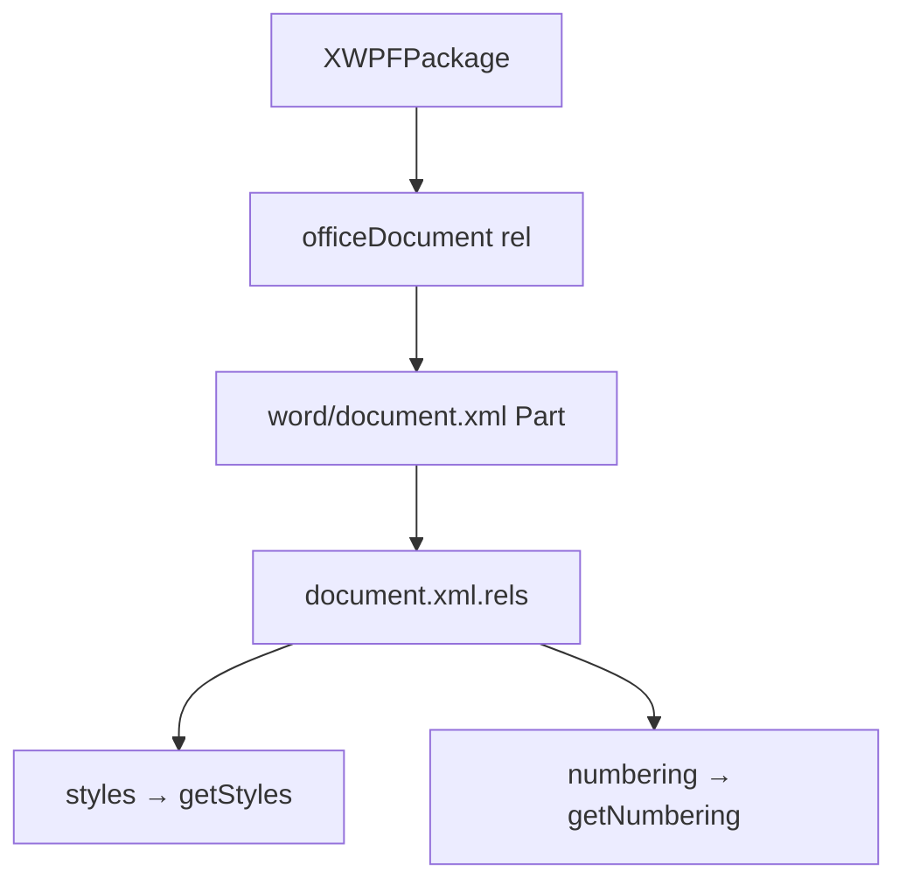

# 11_function_poixml_load — 按 rel 递归建成 Part 对象图

| 项 | 值 |
|----|----|
| feature | wave0-ooxml-standards |
| order | 11 |
| crate | `libs/core-libs/io/wps-io/Cargo.toml` |
| 入口 | `XWPFDocument::from_xwpf_package` / `POIXMLDocument::load` |
| 独立性 | 编排（依赖 09 打开的包） |
| 测试状态 | pass |

## 1. 功能说明

### 1.1 一句话

从已打开的 `XWPFPackage` 取 officeDocument 主 Part，读 `word/_rels/document.xml.rels`，按 rel Type 挂上 styles/numbering 等子对象。**不 parse XML 业务。**

### 1.2 输入

`XWPFPackage`（09 已 `getParts`）。

### 1.3 输出

`XWPFDocument`：`getStyles()` / `getNumbering()` 按 rel 存在与否填充。`mImporter` 仍为空。

### 1.4 上游

`09_function_xwpf_package`；`04_function_opc_relationships`。

### 1.5 下游

`13_function_xwpf_parse`。

## 2. 核心代码与流程

| 名字 | 角色 |
|------|------|
| `XWPFDocument::from_xwpf_package` | officeDocument rel → 主 Part → 子 rel 图 |
| `POIXMLDocument::load` | `read` + `onDocumentRead` |
| `XWPFFactory` | relType → 类名（本层至少 STYLES/NUMBERING） |



★ Transitional officeDocument Type 优先，Strict 回退。  
★ STYLES rel = `http://schemas.openxmlformats.org/officeDocument/2006/relationships/styles`

## 3. 测试方案

### 3.1 代码审计与测试面

| symbol | 路径 | 输入/状态 | 输出 | 关键分支 |
|--------|------|-----------|------|----------|
| `from_xwpf_package` | XWPFDocument | 标准 docx | styles Some | officeDocument size==1 |
| Strict officeDocument | 同上 | purl rel | 仍能打开 | Transitional 空则 Strict |
| `getStyles` | onDocumentRead | styles rel 存在 | Some | 无 styles → None |
| `getNumbering` | 同上 | 无 numbering rel | None | 惰性/可选 |

### 3.2 覆盖矩阵

| coverage_id | 接口 | 场景 | 必测? | test_id |
|-------------|------|------|-------|---------|
| C01 | from_xwpf_package + getStyles | 最小正常 | 是 | L1 |
| C02 | getNumbering 可空 | 可选 | 是 | L2 |
| C03 | 无 officeDocument | 失败 | 是 | L3 |

### 3.3 可测试性

`tests/fixtures/wave0-ooxml-standards/standard-hello.docx`（09 已测绿）。不 parse styles.xml。

### 3.4 用例表

| id | 覆盖项 | 前置 | 输入 | 期望 | 失败语义 |
|----|--------|------|------|------|----------|
| L1 | C01 | open_stream | standard-hello.docx | `getStyles().is_some()` | 丢包 / 未读 document rels |
| L2 | C02 | 同 L1 | 无 numbering 的包 | `getNumbering().is_none()` | 误造 numbering |
| L3 | C03 | 最小 zip 无 officeDocument | from_xwpf_package | panic 主文档 rel 数量 | 静默空 document |

### 3.5 测试代码位置

crate: `libs/core-libs/io/wps-io`  
src:   `libs/core-libs/io/wps-io/src/cn/wps/io/xwpf/usermodel/XWPFDocument.rs`  
test:  `libs/core-libs/io/wps-io/tests/cn/wps/io/opc/model/POIXMLDocument.rs`

### 3.6 测试运行脚本

```bash
cargo test --manifest-path libs/core-libs/io/wps-io/Cargo.toml --test 11_function_poixml_load

bash .cursor/skills/feature-function/scripts/function-coverage.sh \
  --crate libs/core-libs/io/wps-io \
  --test 11_function_poixml_load \
  --src src/cn/wps/io/xwpf/usermodel/XWPFDocument.rs \
  --src src/cn/wps/io/opc/model/POIXMLDocument.rs \
  --src src/cn/wps/io/xwpf/usermodel/XWPFFactory.rs \
  --report libs/word-core/parser/features/wave0-ooxml-standards/functions/11_function_poixml_load/FUNCTION.md
```

### 3.7 覆盖率报告

<!-- coverage-report:begin -->
tool: cargo-llvm-cov (`cargo llvm-cov --test 11_function_poixml_load --json`)
date: 2026-08-18 18:14

| src | lines covered | line % | regions covered | region % |
|-----|---------------|--------|-----------------|----------|
| `src/cn/wps/io/opc/model/POIXMLDocument.rs` | 12/29 | 41.4% | 16/43 | 37.2% |
| `src/cn/wps/io/xwpf/usermodel/XWPFDocument.rs` | 58/161 | 36.0% | 106/306 | 34.6% |
| `src/cn/wps/io/xwpf/usermodel/XWPFFactory.rs` | 9/81 | 11.1% | 11/110 | 10.0% |
| **function total** | **79/271** | **29.2%** |  |  |
<!-- coverage-report:end -->
