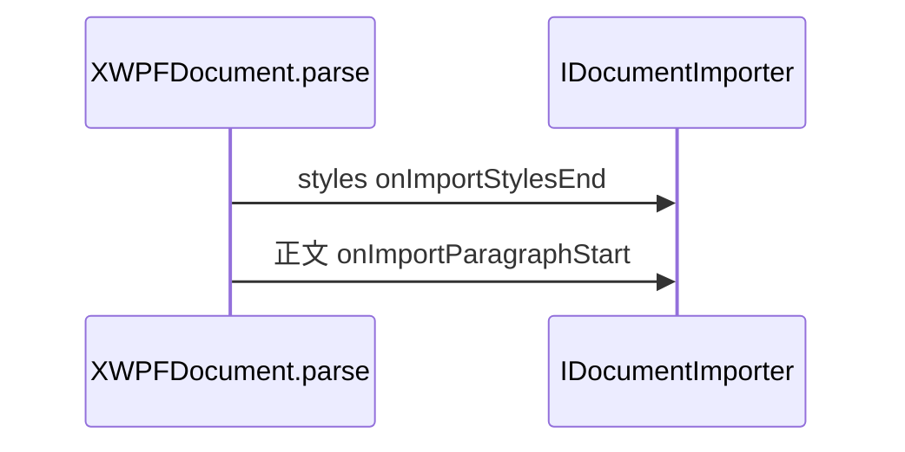

# 13_function_xwpf_parse — 按 Part 顺序驱动事件风暴

| 项 | 值 |
|----|----|
| feature | wave0-ooxml-standards |
| order | 13 |
| crate | `libs/core-libs/io/wps-io/Cargo.toml` |
| 入口 | `XWPFDocument::setDocumentImporter` + `parse()` |
| 独立性 | **编排**（11 的对象图 + 12 的 DocumentHandler） |
| 测试状态 | pass |

## 1. 功能说明

### 1.1 一句话

对已 load 的 `XWPFDocument` 注入 importer，再按固定 Part 顺序 `XmlReader.parse`：先 styles，再主文档。

### 1.2 输入

`11_function_poixml_load` 的对象图 + `IDocumentImporter` 记录器。

### 1.3 输出

跨 Part 的有序回调流。**顺序本身是契约**：styles 相关回调早于 `onImportParagraphStart`。

### 1.4 上游

`11_function_poixml_load`；`08_function_xml_dispatch`；`12_function_handler_body`。

### 1.5 下游

`14_function_importer_boundary`。

## 2. 核心代码与流程

Java `XWPFDocument.parse()`：`if (mImporter != null)` 才开火。顺序：fontTable / settings / theme / **styles** /（再 fontTable）/ comments → `parseXml` 主文档（`DocumentHandler`，ignore=`-1`）→ numbering 惰性。

本 function 必测：styles Part 先于正文；无 importer 不 panic；无 styles 仍能 parse 正文。



## 3. 测试方案

### 3.1 代码审计与测试面

| symbol | 路径 | 输入/状态 | 输出 | 关键分支 |
|--------|------|-----------|------|----------|
| `setDocumentImporter` | XWPFDocument | Rc importer | `mDocumentHandler` 非空 | importer null 不进 Java 体 |
| `parse` styles then body | parse() | standard-hello.docx | stylesEnd index < paraStart | styles rel 存在 |
| `parse` 无 styles | 最小包 | 仍有 ParaStart | styles 槽空 |
| `parse` 无 importer | 未 set | 无 panic、无回调 | Java `if (mImporter!=null)` |

### 3.2 覆盖矩阵

| coverage_id | 接口 | 场景 | 必测? | test_id |
|-------------|------|------|-------|---------|
| C01 | styles 先于正文 | 顺序契约 | 是 | XP1 |
| C02 | 无 styles Part | 可选 Part | 是 | XP2 |
| C03 | 未 set importer | 失败/空操作 | 是 | XP3 |

### 3.3 可测试性

XP1：`standard-hello.docx`。XP2：内存最小 docx（有 body 段、无 styles rel）。XP3：同 XP1 但不 `setDocumentImporter`。

### 3.4 用例表

| id | 覆盖项 | 前置 | 输入 | 期望 | 失败语义 |
|----|--------|------|------|------|----------|
| XP1 | C01 | from_xwpf_package + set + parse | fixture | 第一条 `onImportStylesEnd` index < 第一条 `onImportParagraphStart` | 正文先于 styles |
| XP2 | C02 | 无 styles 的 zip | parse | 有 ParaStart；无 StylesEnd | 缺 styles 就拒 parse |
| XP3 | C03 | 未 set importer | parse | 不 panic；无回调 | NPE / 静默乱 parse |

### 3.5 测试代码位置

crate: `libs/core-libs/io/wps-io`  
src:   `libs/core-libs/io/wps-io/src/cn/wps/io/xwpf/usermodel/XWPFDocument.rs`  
test:  `libs/core-libs/io/wps-io/tests/cn/wps/io/xwpf/usermodel/XWPFDocument.rs`

### 3.6 测试运行脚本

```bash
cargo test --manifest-path libs/core-libs/io/wps-io/Cargo.toml --test 13_function_xwpf_parse

bash .cursor/skills/feature-function/scripts/function-coverage.sh \
  --crate libs/core-libs/io/wps-io \
  --test 13_function_xwpf_parse \
  --src src/cn/wps/io/xwpf/usermodel/XWPFDocument.rs \
  --src src/cn/wps/io/xwpf/element_handler/styles/StylesHandler.rs \
  --report libs/word-core/parser/features/wave0-ooxml-standards/functions/13_function_xwpf_parse/FUNCTION.md
```

### 3.7 覆盖率报告

<!-- coverage-report:begin -->
tool: cargo-llvm-cov (`cargo llvm-cov --test 13_function_xwpf_parse --json`)
date: 2026-08-18 18:23

| src | lines covered | line % | regions covered | region % |
|-----|---------------|--------|-----------------|----------|
| `src/cn/wps/io/xwpf/element_handler/styles/StylesHandler.rs` | 41/83 | 49.4% | 35/63 | 55.6% |
| `src/cn/wps/io/xwpf/usermodel/XWPFDocument.rs` | 79/191 | 41.4% | 142/361 | 39.3% |
| **function total** | **120/274** | **43.8%** |  |  |
<!-- coverage-report:end -->
