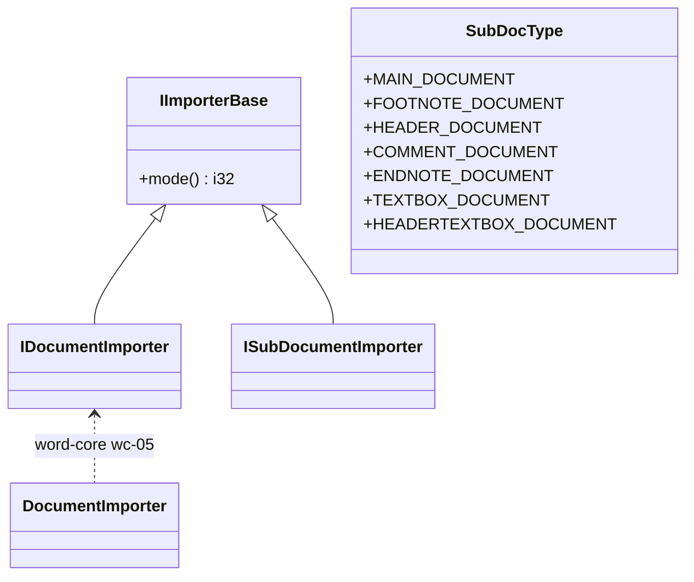

# 14_function_importer_boundary — wave0 对外回调契约

| 项 | 值 |
|----|----|
| feature | wave0-ooxml-standards |
| order | 14 |
| crate | 定义：`libs/core-libs/io/wps-io`；实现：`libs/word-core`（wc-05） |
| 入口 | `IDocumentImporter` / `IImporterBase` / `ISubDocumentImporter` |
| 独立性 | 叶子（契约测试：方法集合 + mode/SubDocType；不跑 zip） |
| 测试状态 | pass（7 tests，0 ignored；01–13 回归通过） |

## 1. 功能说明

### 1.1 一句话

钉死 wps-io 向 word-core 交出的回调面：~80 方法、`mode()`、`SubDocType`。本 feature 的**产品**是这条边界，不是文档模型。

### 1.2 输入

上游 parse/handler 产生的调用（本 function 文档化形状，不产生新数据）。

### 1.3 输出

trait 契约：

- `IImporterBase.mode()`：0=DOCX、1=Xml07、2=GVml、3=Xml03
- `IDocumentImporter`：87 个方法（`onImportRun` 拆成 `_chars` / `_str`）；`isLock` 默认 `false`
- `SubDocType` Java 序：MAIN=0, FOOTNOTE=1, HEADER=2, COMMENT=3, ENDNOTE=4, TEXTBOX=5, HEADERTEXTBOX=6（**无 FOOTER**）
- `ISubDocumentImporter`：Java 空 marker，必须 `: IImporterBase`

### 1.4 上游

`13_function_xwpf_parse`；`12_function_handler_body`。

### 1.5 下游

**feature-output** → wc-05 `DocumentImporter` → wc-04 `SubDocumentImporter` → wc-01 `CoreHelper`。

## 2. 核心代码与流程



不变量：ordinal 0–6 与下游 switch 一致；不得改 Type URI / mode 数字。

## 3. 测试方案

### 3.1 代码审计与测试面

| symbol | Java/Rust 路径 | 输入/状态 | 输出/副作用 | 关键分支/错误 |
|---|---|---|---|---|
| `SubDocType` | `koffice/core-libs/util/util/src/cn/wps/base/io/SubDocType.java`; `libs/core-libs/util/util/src/cn/wps/base/io/SubDocType.rs` | 七个 enum variant | ordinal 0–6 | 顺序是跨边界 ABI，不得重排 |
| `IImporterBase::mode` | `koffice/.../IImporterBase.java`; `wps-io/src/cn/wps/io/xwpf/IImporterBase.rs` | importer 实例 | `i32` mode | 0/1/2/3 分别驱动 DOCX/XML07/GVML/XML03 |
| `XmlSimpleNodeElementHandler::{isDocx,isXml07,isGVml,isXml03}` | `wps-io/src/cn/wps/io/xwpf/element_handler/XmlSimpleNodeElementHandler.rs` | doc importer mode 或无 importer | 单一格式判别 | mode 0/1/2/3；无 importer 保持 -1，四项均 false |
| `IDocumentImporter` 热路径 | `koffice/.../IDocumentImporter.java`; `wps-io/src/cn/wps/io/xwpf/IDocumentImporter.rs` | 段、run chars/str、style、main、convertProp | 实现方接收原参数形状 | chars 的 start/len；`onImportRun_str` 整串；默认 `isLock=false`、`hasContent=false` |
| `ISubDocumentImporter` | `koffice/.../ISubDocumentImporter.java`; `wps-io/src/cn/wps/io/xwpf/ISubDocumentImporter.rs` | marker implementation | 必须同时满足 `IImporterBase` | Rust 原实现遗漏 supertrait |
| 直接调用方 | `PHandler.rs`, `THandler.rs`, `XmlSimpleNodeElementHandler.rs` | handler 事件 | 调用 paragraph/run/mode 回调 | Option importer early return；本 function 只冻结边界，不重复 12/13 的 XML 管线 |

### 3.2 覆盖矩阵

| coverage_id | 接口/代码路径 | 场景类别 | 必测? | test_id / 未覆盖理由 |
|---|---|---|---|---|
| C1 | `SubDocType` 全部 variant | ABI/边界 | 是 | `i1_subdoctype_ordinals` |
| C2 | mode=0/1/2/3 | 分支 | 是 | `i2_mode_drives_exactly_one_format_branch` |
| C3 | 无 importer，mode=-1 | null/early return | 是 | `i3_missing_importer_matches_no_format` |
| C4 | paragraph start/end 参数 | 交互契约 | 是 | `i4_recording_importer_preserves_hot_path_shapes` |
| C5 | run chars start/len 与文本切片 | 边界/交互 | 是 | `i4_recording_importer_preserves_hot_path_shapes` |
| C6 | `onImportRun_str` 整串重载 | 公开入口 | 是 | `i4_recording_importer_preserves_hot_path_shapes` |
| C7 | `isLock` Java default | 默认分支 | 是 | `i5_is_lock_defaults_false` |
| C8 | `ISubDocumentImporter: IImporterBase` | 编译期契约 | 是 | `i6_subdocument_importer_inherits_mode_contract` |
| C9 | `convertProp` / `convertRunProp` / `correctProps` 形状 | 交互契约（10 的入口） | 是 | `i7_prop_and_default_surfaces` |
| C10 | `hasContent` 默认 false；getter 默认可调用 | 默认分支 | 是 | `i7_prop_and_default_surfaces` |
| C11 | 其余 wc-05 方法业务实现 | 下游实现 | 否 | 本 function 只定义边界；业务副作用归 wc-05 |

### 3.3 可测试性

使用内存中的 `RecordingImporter` 直接调用 trait 边界；mode 测试通过
`XmlSimpleNodeElementHandler::new_from_doc` 驱动真实分流，不启动 zip/XML 全管线。
`SubDocType` 从 `core_libs_util` 的真实 enum 读取 discriminant，不复制测试常量。

### 3.4 用例表

| id | 覆盖项 | 前置状态 | 输入摘要 | 期望输出/副作用 | 失败语义 |
|---|---|---|---|---|---|
| `i1_subdoctype_ordinals` | C1 | 无 | 七个真实 variant | `[0,1,2,3,4,5,6]` | Java/Rust enum 顺序漂移 |
| `i2_mode_drives_exactly_one_format_branch` | C2 | importer mode 0..3 | 四个 handler | 每个仅一个格式 predicate 为 true | mode 映射或分流错误 |
| `i3_missing_importer_matches_no_format` | C3 | 默认 handler | 无 importer | 四个 predicate 全 false | null/初始 mode 语义错误 |
| `i4_recording_importer_preserves_hot_path_shapes` | C4–C6 | RecordingImporter | main/paragraph/run chars+str/style | subdoc、layer、slice、整串均原样记录 | trait 参数形状漂移 |
| `i5_is_lock_defaults_false` | C7 | 最小 importer | 无 | false | Java default method 漂移 |
| `i6_subdocument_importer_inherits_mode_contract` | C8 | marker importer mode=3 | 泛型 supertrait 调用 | 返回 3 | Rust marker 丢失 Java 继承契约 |
| `i7_prop_and_default_surfaces` | C9–C10 | RecordingImporter + ModeImporter | convertProp/RunProp/correctProps；hasContent；getVml/Dml | id 原样记录；hasContent=false；getter 不 panic | 10 的入口形状或默认返回漂移 |

### 3.5 测试代码位置

crate: `libs/core-libs/io/wps-io`

src:

- `src/cn/wps/io/xwpf/IDocumentImporter.rs`
- `src/cn/wps/io/xwpf/IImporterBase.rs`
- `src/cn/wps/io/xwpf/ISubDocumentImporter.rs`
- `src/cn/wps/io/xwpf/element_handler/XmlSimpleNodeElementHandler.rs`
- `../../util/util/src/cn/wps/base/io/SubDocType.rs`（跨 crate 输入契约）

test: `libs/core-libs/io/wps-io/tests/cn/wps/io/xwpf/IDocumentImporter.rs`

### 3.6 测试运行脚本

```bash
cargo test --manifest-path libs/core-libs/io/wps-io/Cargo.toml --test 14_function_importer_boundary

bash .cursor/skills/feature-function/scripts/function-coverage.sh \
  --crate libs/core-libs/io/wps-io --test 14_function_importer_boundary \
  --src src/cn/wps/io/xwpf/IDocumentImporter.rs \
  --src src/cn/wps/io/xwpf/IImporterBase.rs \
  --src src/cn/wps/io/xwpf/ISubDocumentImporter.rs \
  --src src/cn/wps/io/xwpf/element_handler/XmlSimpleNodeElementHandler.rs \
  --report libs/word-core/parser/features/wave0-ooxml-standards/functions/14_function_importer_boundary/FUNCTION.md
```

### 3.7 覆盖率报告

<!-- coverage-report:begin -->
tool: cargo-llvm-cov (`cargo llvm-cov --test 14_function_importer_boundary --json`)
date: 2026-08-19 08:56

| src | lines covered | line % | regions covered | region % |
|-----|---------------|--------|-----------------|----------|
| `src/cn/wps/io/xwpf/IDocumentImporter.rs` | 8/89 | 9.0% | 17/180 | 9.4% |
| `src/cn/wps/io/xwpf/element_handler/XmlSimpleNodeElementHandler.rs` | 40/107 | 37.4% | 35/99 | 35.4% |
| `src/cn/wps/io/xwpf/IImporterBase.rs` | (not in report) | — | — | — |
| `src/cn/wps/io/xwpf/ISubDocumentImporter.rs` | (not in report) | — | — | — |
| **function total** | **48/196** | **24.5%** |  |  |
<!-- coverage-report:end -->
