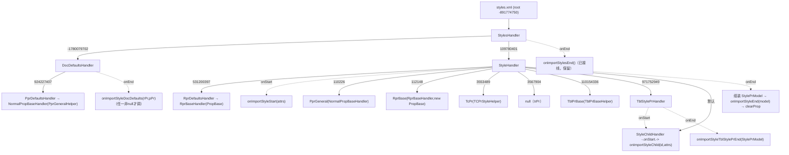

# 15_function_styles_handler_chain — styles.xml 事件树 → 样式回调族

| 项 | 值 |
|----|----|
| feature | wave0-ooxml-standards |
| order | 15 |
| crate | `libs/core-libs/io/wps-io/Cargo.toml` |
| 入口 | `StylesHandler`（styles 根，filterIndex -891774750）→ `DocDefaultsHandler` / `StyleHandler` → `RprDefaultsHandler`/`PprDefaultsHandler`/`StyleChildHandler`/`TblStylePrHandler` |
| 独立性 | styles.xml 整棵事件树 → `IDocumentImporter` 样式回调族（onImportStyleDocDefaults/Start/Child/End/StylesEnd/TblStylePrEnd） |
| 测试状态 | **pass**（2026-08-21：10/10 用例绿，含真实 XmlReader 引擎路径；回归 02–14 + e2e 全绿） |

## 1. 功能说明

### 1.1 一句话

把 wave0 缺失的 **styles 子链**补上：`StylesHandler.getElementHandler` 目前返回 `None`、`StyleHandler`/`DocDefaultsHandler` 是空壳、`StyleChildHandler` 等是 `// TODO`——本 function 把 styles.xml 的 SAX 事件树完整接到 `IDocumentImporter` 的样式回调，使 `onImportStylesEnd`（已接线）之前 `mIOStyleList` 有内容可收集。

> **为什么在 wave0 建这个 function（不在 wc-05）**：缺口 C 的断点在 core-libs wps-io crate 的 `element_handler/styles/*`，wc-05 的 crate 是 word-core，无法跨 crate 归属。本 function 归属 wave0（`13_function_xwpf_parse` 的 styles part 分支的补全），wc-05 `02_function_style_event` 消费其产出。

### 1.2 输入

| 入口 | 输入 | Java 路径 |
|------|------|-----------|
| `StylesHandler` 分发 | elementId：**-1780079702**→DocDefaults · **109780401**→Style · 其它→null | StylesHandler.java:16–26 |
| `DocDefaultsHandler` 分发 | **531200397**→RprDefaults · **924227407**→PprDefaults · 其它→IOAssert.fail | DocDefaultsHandler.java:18–29 |
| `StyleHandler` 分发 | **110226**→PprGeneral · **112148**→RprBase · **3553489**→TcPr · **3567904**→null(TrPr) · **110154336**→TblPrBase · **971752949**→TblStylePr · 默认→StyleChild | StyleHandler.java:31–49 |
| `TblStylePrHandler` 分发 | 同上（110226/112148/3553489/3567904(null)/110154336）· 默认→fail | TblStylePrHandler.java:29–44 |

### 1.3 输出（回调契约，钉死）

| 回调 | 触发点 | 参数 |
|------|--------|------|
| `onImportStyleDocDefaults(rPrSet, pPrSet)` | `DocDefaultsHandler.onEnd`，**rPr 或 pPr 至少一个非 null** 才调 | 各自 `MutablePropertySet`（RprBaseHandler.getProp / NormalPropBaseHandler.getProp），处理后 clearProp |
| `onImportStyleStart(attributes)` | `StyleHandler.onStart` | styles 根下的 `<w:style>` attrs |
| `onImportStyleChild(elementId, attributes)` | `StyleChildHandler.onStart`（StyleHandler 默认子）· `TblStylePrHandler.onStart`（携带 elementId=971752949） | 原 elementId + attrs |
| `onImportStyleEnd(StylePrModel)` | `StyleHandler.onEnd` | `mRprBaseSet/mPPrGeneralSet/mTcPrSet/mTblPrBaseSet`（handler 缺席→null），随后 clearProp + mStylePrModel.clear |
| `onImportStyleTblStylePrEnd(StylePrModel)` | `TblStylePrHandler.onEnd`（filterIndex 971752949） | 同上组装 + clearProp |
| `onImportStylesEnd()` | `StylesHandler.onEnd`（**已接线，须保留**） | — |

### 1.4 上游

- `08_function_xml_dispatch`（事件→handler 栈）+ `06_function_xml_elementid`（XML→elementId）。
- 已实现的属性侧依赖：`RprBaseHandler`（`new(importer: Rc<dyn IDocumentImporter>, iProp: Rc<RefCell<Prop>>)`，`getProp/clearProp` 已实现）、`NormalPropBaseHandler`（`new_with` + `getProp/clearProp`）、`PropHandlerHelper`（`PprGeneralBaseHandlerHelper::geHandlerHelper()` / `TcPrStyleBaseHandlerHelper::geHandlerHelper()` / `TblPrBaseHandlerHelper::getPropHandlerHelper()`，rs 均存在）、`XmlSimpleNodeElementHandler`（`new_from_doc_rc(Rc<dyn IDocumentImporter>)`）。

### 1.5 下游

- `13_function_xwpf_parse`（styles part 分支真实产出回调）。
- wc-05 `02_function_style_event`（StylesImporter 两阶段收集的入站端）+ `07_function_docx_read`（解除 `#[ignore = "spec: 缺口C"]`）。

### 1.6 关键不变量（钉死）

1. `StylesHandler` 只分发 2 个 elementId（docDefaults/style），**其它返回 null**（不 fail）。
2. `DocDefaultsHandler` 默认分支 `IOAssert.fail`；`TblStylePrHandler` 默认分支 `IOAssert.fail`；`StyleHandler` 默认分支**回落到 StyleChildHandler**（不 fail）。
3. `StyleHandler`/`TblStylePrHandler` 的 `3567904`（trPr）**返回 null**（Java 返回 null 而非 fail）。
4. `StylePrModel` 组装：handler 缺席的字段 = null，不构造空 set。
5. `DocDefaultsHandler.onEnd`：仅当 `rPrSet||pPrSet` 非 null 才调 `onImportStyleDocDefaults`；两 handler 都清。
6. `StyleHandler.onEnd` 顺序：组装 StylePrModel → `onImportStyleEnd` → `clearProp()` 全部 + `mStylePrModel.clear()`。
7. 子 handler 懒实例化（首次 getElementHandler 才 new）。
8. importer 注入统一走 `XmlSimpleNodeElementHandler::new_from_doc_rc(Rc<dyn IDocumentImporter>)`（与 PHandler/RprBaseHandler 的已接线模式一致，纠正各壳模板里 `Box<dyn Any+Send+Sync>` 的不一致）。

### 1.7 依赖与实现状态（必写，着重）

| 依赖 | 归属 | 本 function 需要的接口 | 已实现 | 暂缓（保留 Java 注释+签名） | 禁止本 function 去改 |
|------|------|------------------------|--------|-----------------------------|----------------------|
| `IDocumentImporter` | wps-io | 6 个样式回调 + 全部 trait 方法（测试 fake 靠 trait 默认实现省 body） | trait 已生成（多数方法有默认 `{}`） | — | 不改 trait 签名 |
| `XmlSimpleNodeElementHandler` | wps-io | `new_from_doc_rc(Rc<dyn IDocumentImporter>)`、`mDocImporter`、ElementHandlerSimple 基实现 | **已实现** | — | 不去改 |
| `StylePrModel` | wps-io styles | 4 字段读写 + `new/clear` | 已生成（`new` 有，`clear` 需核） | — | 不在本 function 补方法（除非改名依赖） |
| `RprBaseHandler` | wps-io | `new(importer, Rc<RefCell<Prop>>)`、`getProp`、`clearProp_mut` | **已实现** | — | 不去改 |
| `NormalPropBaseHandler` | wps-io prop | `new_with(...)`、`getProp`、`clearProp` | **已实现** | — | 不去改 |
| `PropHandlerHelper` | wps-io prop | 三个 `*BaseHandlerHelper` 单例 `geHandlerHelper/getPropHandlerHelper` | **已实现**（rs 核实） | — | 不去改 |
| `PropBase` / `Prop` | wps-io prop | `isContainProp()/getProp()/clearProp()`（RprDefaultsHandler 的 mRPrBaseSet） | 已实现（Prop 实现 IProp；getProp 惰建 set） | — | 不去改 |
| `IOAssert` | util | `fail` | 已实现 | — | — |
| 7 个 styles `*Handler.rs` | wps-io styles | **本 function 的 src（改写）** | 5 个空壳 + StyleChildHandler TODO + StylesHandler 半接 | — | — |
| **`NormalPropBaseHandler`（prop/）** | wps-io prop | `new_rc`、`onStart/onEnd/getProp/clearProp`（Java 语义）+ ElementHandlerSimple | **原为弱壳（getProp→None）→ 本 function 修复**（StyleHandler/DocDefaultsHandler 的 pPr/tcPr/tblPr 子 handler 依赖其 getProp） | 深层 PropChildHandler 分发（wave0-10 后续） | 不引入新类型 |
| **`RprBaseHandler`** | wps-io | `getProp/clearProp`（IPropHandler 修复）+ `getPropBoxed` + ElementHandlerSimple | **原 getProp/clearProp stub → 本 function 修复**（rPr 子树的 StylePrModel 组装依赖） | DML 子 handler（glow/shadow 等）保持 None（原有停车） | — |
| **`RprChildHandler`** | wps-io | ElementHandlerSimple | **原缺 trait impl → 本 function 补**（rPr 子树经引擎分发到 convertRunProp 的必须环节） | — | — |

## 2. 核心代码与流程

Java：`koffice/core-libs/io/wps-io/src/cn/wps/io/xwpf/element_handler/styles/*.java`（7 个文件，~230 行总）
Rust：`libs/core-libs/io/wps-io/src/cn/wps/io/xwpf/element_handler/styles/*.rs`（loop 改写）



## 3. 测试方案

### 3.1 代码审计与测试面

| symbol | Java/Rust 路径 | 输入/状态 | 输出/副作用 | 关键分支/错误 |
|--------|----------------|-----------|-------------|---------------|
| StylesHandler.getElementHandler | StylesHandler.java:16–26 | docDefaults/style/其它 | 返回子 handler / null | 其它→null |
| StylesHandler.onEnd | :46–50 | styles 根结束 | onImportStylesEnd 恰一次 | 已接，保留 |
| DocDefaultsHandler.getElementHandler | DocDefaultsHandler.java:18–29 | 531200397/924227407/其它 | rpr/ppr 子 / fail | 未知→fail |
| DocDefaultsHandler.onEnd | :43–65 | rPr/pPr 各 null 变体 | onImportStyleDocDefaults（任一非 null） | 双 null 不调 |
| StyleHandler.onStart | StyleHandler.java:27–29 | style attrs | onImportStyleStart(attrs) | — |
| StyleHandler.getElementHandler | :31–49 | 6 个 id + 默认 | 各子 handler / null(trPr) / StyleChild | trPr→null |
| StyleHandler.onEnd | :103–106 | 各子 handler 缺席变体 | StylePrModel 组装 + onImportStyleEnd + clearProp | 缺席→null 字段 |
| StyleChildHandler.onStart | StyleChildHandler.java:11–14 | elementId+attrs | onImportStyleChild(id, attrs) | — |
| RprDefaultsHandler | RprDefaultsHandler.java:20–42 | — | 子=RprBaseHandler(PropBase)；getProp/clearProp | isContainProp 分支 |
| PprDefaultsHandler | PprDefaultsHandler.java:18–39 | — | 子=NormalPropBaseHandler；getProp/clearProp | mPprGeneralHandler null |
| TblStylePrHandler | TblStylePrHandler.java:26–90 | tblStylePr 子树 | onStart→onImportStyleChild(971752949)；onEnd→onImportStyleTblStylePrEnd | 默认→fail |

### 3.2 覆盖矩阵

| coverage_id | 接口/代码路径 | 场景类别 | 必测? | test_id / 未覆盖理由 |
|-------------|---------------|----------|-------|----------------------|
| SC-DISPATCH-ROOT | StylesHandler 分发 docDefaults/style/null | 主路径 | 是 | SH1 |
| SC-STYLES-END | onImportStylesEnd 恰一次 | 主路径 | 是 | SH2 |
| SC-DEFAULTS-BOTH | docDefaults 双 prop → onImportStyleDocDefaults(rPr,pPr 均非null) | 主路径 | 是 | SH3 |
| SC-DEFAULTS-ONE | 仅 rPr / 仅 pPr | 分支 | 是 | SH4 |
| SC-DEFAULTS-NONE | 双 null → 不调 | 边界 | 是 | SH5 |
| SC-DEFAULTS-BAD | docDefaults 未知子 id → fail | 失败 | 是 | SH6 |
| SC-STYLE-START | onImportStyleStart(attrs)（styleId/customStyle/type 透传） | 主路径 | 是 | SH7 |
| SC-STYLE-CHILD-NAME | name(3373707)/basedOn(-332612366)/next(3377907)/link(3321850)/qFormat(-681243704)/uiPriority(872749144) → onImportStyleChild(id, attrs) | 分支 | 是 | SH8 |
| SC-STYLE-SUBDISPATCH | StyleHandler 分发 110226/112148/3553489/110154336/971752949/3567904 | 分支 | 是 | SH9 |
| SC-TRPR-NULL | 3567904 → null（不 fail、不回调） | 边界 | 是 | SH10 |
| SC-STYLE-END-MODEL | StylePrModel 四字段：子 handler 有/缺席 → 值流 | 主路径 | 是 | SH11 |
| SC-STYLE-END-CLEAR | onEnd 后 clearProp（二次 style 不串值） | 状态 | 是 | SH12 |
| SC-TBLSTYLE | tblStylePr 子树 → onImportStyleChild(971752949) + onImportStyleTblStylePrEnd(model) | 主路径 | 是 | SH13 |
| SC-TBLSTYLE-BAD | tblStylePr 未知子 id → fail | 失败 | 是 | SH14 |
| SC-STYLE-END-COUNT | 每个 style 恰一次 onImportStyleStart/End；序列 Start<Child*<End<StylesEnd | 交互契约 | 是 | SH15 |

### 3.3 可测试性

**不打开真实 docx。** 与 `12_function_handler_body` 同模式：内存 styles.xml 字节 → `XmlReader.parse`（或直接驱动 handler）→ **RecordingImporter**（实现 `IDocumentImporter`：该 trait 多数方法有默认 `{}`，只 override 6 个样式回调 + `onMainDocumentStart/End` 记录调用序）。fixture 覆盖：① docDefaults(rPr+pPr)；② 两条 style（一条完整含 name/basedOn/next/link/qFormat/uiPriority，一条仅 styleId）；③ tblStylePr 子树；④ 空 styles（仅根节点）。序列断言用 RecordingImporter 的调用日志（方法+参数摘要）。StylePrModel 字段断言：经 `onImportStyleEnd(model)` 捕获后读 4 字段（null vs 非 null + 关键 prop）。

### 3.4 用例表

| id | 覆盖项 | 前置状态 | 输入摘要 | 期望输出/副作用 | 失败语义 |
|----|--------|----------|----------|-----------------|----------|
| SH1 | SC-DISPATCH-ROOT | RecordingImporter | StylesHandler.getElementHandler(-1780079702/109780401/99999) | 前两者 Some(子 handler)，后者 None | 分发错 |
| SH2 | SC-STYLES-END | fixture 完整 styles.xml | 整树 parse | onImportStylesEnd 恰 1 次且为最后回调 | 次数/顺序错 |
| SH3 | SC-DEFAULTS-BOTH | fixture 含 `<w:docDefaults><w:rPrDefault><w:rPr><w:sz w:val="20"/></w:rPr></w:rPrDefault><w:pPrDefault>…` | parse | onImportStyleDocDefaults(Some(rPr含sz), Some(pPr))；且先于任何 style 回调 | 缺默认 |
| SH4 | SC-DEFAULTS-ONE | 仅 rPrDefault / 仅 pPrDefault | parse | rPr≠null,pPr==null 反之 | 分支错 |
| SH5 | SC-DEFAULTS-NONE | 无 docDefaults 或空子树 | parse | onImportStyleDocDefaults **不被调** | 误调 |
| SH6 | SC-DEFAULTS-BAD | docDefaults 下未知 elementId | parse | panic（IOAssert.fail） | 未拒绝 |
| SH7 | SC-STYLE-START | `<w:style w:type="paragraph" w:styleId="H1" w:customStyle="1">` | parse | onImportStyleStart(attrs) 的 attrs 含 type/styleId/customStyle 三键 | attrs 丢 |
| SH8 | SC-STYLE-CHILD-NAME | style 子：name/basedOn/next/link/qFormat/uiPriority 各一 | parse | onImportStyleChild 依次带正确 elementId（3373707/-332612366/3377907/3321850/-681243704/872749144） | elementId 错 |
| SH9 | SC-STYLE-SUBDISPATCH | StyleHandler 直接驱动各子 id | 调 getElementHandler×6 | 110226→PprGeneral、112148→RprBase、3553489→TcPr、110154336→TblPrBase、971752949→TblStylePr、默认→StyleChild | 分发错 |
| SH10 | SC-TRPR-NULL | 3567904 | getElementHandler(3567904) | None 且无回调（不 panic） | 误 fail |
| SH11 | SC-STYLE-END-MODEL | style 含 rPr 与 pPr 子 + 无 tcPr/tblPr | parse | onImportStyleEnd(model)：mRprBaseSet/mPPrGeneralSet 非 null、mTcPrSet/mTblPrBaseSet==null | 组装错 |
| SH12 | SC-STYLE-END-CLEAR | 两条 style 先后 | parse | 第二条 style 的 model 不残留第一条属性 | 串值 |
| SH13 | SC-TBLSTYLE | style 含 `<w:tblStylePr w:type="firstRow">` 子树 | parse | onImportStyleChild(971752949, attrs) + onImportStyleTblStylePrEnd(model) | 链断 |
| SH14 | SC-TBLSTYLE-BAD | tblStylePr 未知子 id | parse | panic（IOAssert.fail） | 未拒绝 |
| SH15 | SC-STYLE-END-COUNT | 两条 style | parse | 日志：Start(1)<[Child×n]<End(1)<Start(2)<[Child×m]<End(2)<StylesEnd | 序列错 |

### 3.5 测试代码位置
crate: `libs/core-libs/io/wps-io/Cargo.toml`
src:
- `libs/core-libs/io/wps-io/src/cn/wps/io/xwpf/element_handler/styles/StylesHandler.rs`
- `libs/core-libs/io/wps-io/src/cn/wps/io/xwpf/element_handler/styles/StyleHandler.rs`
- `libs/core-libs/io/wps-io/src/cn/wps/io/xwpf/element_handler/styles/DocDefaultsHandler.rs`
- `libs/core-libs/io/wps-io/src/cn/wps/io/xwpf/element_handler/styles/StyleChildHandler.rs`
- `libs/core-libs/io/wps-io/src/cn/wps/io/xwpf/element_handler/styles/RprDefaultsHandler.rs`
- `libs/core-libs/io/wps-io/src/cn/wps/io/xwpf/element_handler/styles/PprDefaultsHandler.rs`
- `libs/core-libs/io/wps-io/src/cn/wps/io/xwpf/element_handler/styles/TblStylePrHandler.rs`
- 点名依赖修复（同 crate，本轮编辑）：`element_handler/prop/NormalPropBaseHandler.rs`、`element_handler/RprBaseHandler.rs`、`element_handler/RprChildHandler.rs`
test:  `libs/core-libs/io/wps-io/tests/cn/wps/io/xwpf/element_handler/styles/StylesHandler.rs`（入口；其它类型用 `#[path]` 同目录模块）
fixtures: 无（内存 XML 字节）

`[[test]]` name = `15_function_styles_handler_chain`，path = 上述入口文件（loop L2 已落地）。

### 3.6 测试运行脚本

```bash
cargo test --manifest-path libs/core-libs/io/wps-io/Cargo.toml --test 15_function_styles_handler_chain

bash .cursor/skills/feature-function/scripts/function-coverage.sh \
  --crate libs/core-libs/io/wps-io --test 15_function_styles_handler_chain \
  --src src/cn/wps/io/xwpf/element_handler/styles/StylesHandler.rs \
  --src src/cn/wps/io/xwpf/element_handler/styles/StyleHandler.rs \
  --src src/cn/wps/io/xwpf/element_handler/styles/DocDefaultsHandler.rs \
  --src src/cn/wps/io/xwpf/element_handler/styles/StyleChildHandler.rs \
  --src src/cn/wps/io/xwpf/element_handler/styles/RprDefaultsHandler.rs \
  --src src/cn/wps/io/xwpf/element_handler/styles/PprDefaultsHandler.rs \
  --src src/cn/wps/io/xwpf/element_handler/styles/TblStylePrHandler.rs \
  --src src/cn/wps/io/xwpf/element_handler/prop/NormalPropBaseHandler.rs \
  --src src/cn/wps/io/xwpf/element_handler/RprBaseHandler.rs \
  --src src/cn/wps/io/xwpf/element_handler/RprChildHandler.rs \
  --report libs/word-core/parser/features/wave0-ooxml-standards/functions/15_function_styles_handler_chain/FUNCTION.md
```

### 3.7 覆盖率报告

<!-- coverage-report:begin -->
tool: cargo-llvm-cov (`cargo llvm-cov --test 15_function_styles_handler_chain --json`)
date: 2026-08-21 15:41

| src | lines covered | line % | regions covered | region % |
|-----|---------------|--------|-----------------|----------|
| `src/cn/wps/io/xwpf/element_handler/RprBaseHandler.rs` | 43/144 | 29.9% | 39/143 | 27.3% |
| `src/cn/wps/io/xwpf/element_handler/RprChildHandler.rs` | 30/73 | 41.1% | 28/57 | 49.1% |
| `src/cn/wps/io/xwpf/element_handler/prop/NormalPropBaseHandler.rs` | 48/89 | 53.9% | 52/78 | 66.7% |
| `src/cn/wps/io/xwpf/element_handler/styles/DocDefaultsHandler.rs` | 76/115 | 66.1% | 105/134 | 78.4% |
| `src/cn/wps/io/xwpf/element_handler/styles/PprDefaultsHandler.rs` | 47/88 | 53.4% | 46/75 | 61.3% |
| `src/cn/wps/io/xwpf/element_handler/styles/RprDefaultsHandler.rs` | 54/95 | 56.8% | 63/91 | 69.2% |
| `src/cn/wps/io/xwpf/element_handler/styles/StyleChildHandler.rs` | 29/72 | 40.3% | 24/54 | 44.4% |
| `src/cn/wps/io/xwpf/element_handler/styles/StyleHandler.rs` | 141/190 | 74.2% | 209/252 | 82.9% |
| `src/cn/wps/io/xwpf/element_handler/styles/StylesHandler.rs` | 61/101 | 60.4% | 72/99 | 72.7% |
| `src/cn/wps/io/xwpf/element_handler/styles/TblStylePrHandler.rs` | 93/175 | 53.1% | 116/217 | 53.5% |
| **function total** | **622/1142** | **54.5%** |  |  |
<!-- coverage-report:end -->

### 3.8 模板布局校验（必跑，PASS 才能标 pass）

```bash
node .cursor/skills/function-java2rust/scripts/check-template-layout.mjs \
  --rs libs/core-libs/io/wps-io/src/cn/wps/io/xwpf/element_handler/styles/StylesHandler.rs \
  --java koffice/core-libs/io/wps-io/src/cn/wps/io/xwpf/element_handler/styles/StylesHandler.java
# 其余 6 个 --rs/--java 组同理（StyleHandler / DocDefaultsHandler / StyleChildHandler /
# RprDefaultsHandler / PprDefaultsHandler / TblStylePrHandler）
# 点名依赖修复 3 组同检：NormalPropBaseHandler / RprBaseHandler / RprChildHandler
```

校验：`// java` 行数不降；每个 handler 的 `onStart/onEnd/getElementHandler/filterIndex` `// java` 注释与签名相邻；空壳模板需**按 Java 补全**（`_private: ()` 替换为真实字段），但 `// java` 注释必须保留；importer 注入统一 `new_from_doc_rc`（与已接线 handler 一致）；无对应语句处 `// rust: no-stmt`，禁止 dummy `let X = ()`。

Loop L5b（2026-08-21）：**PASS** — 10/10 文件 `check-template-layout.mjs` 全绿（`java comments preserved and aligned`），含 3 个点名依赖修复文件。