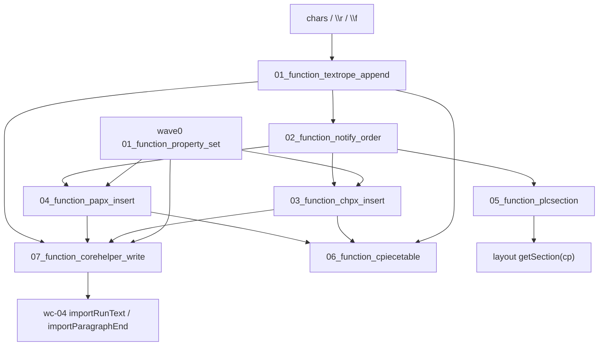

# wc-01-storage-write — Function 组合图

> 分析日期：2026-08-19
> 输入端点：字符 / `PropertySet`（wave0 `01_function_property_set`）+ 段首 CP / 段末标记
> 对外输出：TextRope 字符流 + CHPX/PAPX 区间 + PLCSection 节节点（经 `CoreHelper` 编排）
> 切分依据：I/O 边界（rope 字符 → 通知序 → CHPX 区间 → PAPX 段首 → 节节点 → 门面 → 写入编排）
> 类级蓝皮书：[STRUCTURE_ANALYSIS.md](./STRUCTURE_ANALYSIS.md) · 存储模型：[docs/STORAGE.md](./docs/STORAGE.md)

本文件只讲 **function 之间如何串联**。每个 function 的字段表、类图、**测试方案**在
`functions/<function_id>/FUNCTION.md`。可执行测试与 `src` 隔离，镜像落在 crate
`libs/word-core/tests/<relpath>/<Type>.rs`（见 §3）。

**本层不解析 docx / 不排版。** OOXML 回调是 wave0；落库是本 feature；importer 路由是 wc-05 / wc-04。

---

## 0. 一句话管线

目录名 `{NN}_function_*` 的 `NN` 是依赖拓扑序号（就绪即编号）。属性桶已在 wave0 测绿，本 feature **不重拆**。

```text
(wave0) 01_function_property_set            PropertySet 前置（util crate）
01_function_textrope_append                 chars → CP 长度 / charAt
02_function_notify_order                    写入前后 Listener 顺序
03_function_chpx_insert                     cp + PropertySet → CHPX 区间（含工厂 + 平移）
04_function_papx_insert                     段首 cp0 + PropertySet → PAPX 区间（含工厂）
05_function_plcsection                      \f / addSection → 节节点查询
06_function_cpiecetable                     门面 getters + setGuessedTotalLength
07_function_corehelper_write                编排 01+03+04：appendText / appendParagraph
```

热路径（钉死，来自 STORAGE.md）：

```text
CoreHelper.appendText(doc, text, chpx)
  → cp0 = document.getLength()
  → textRope.append(...)
  → chpxTable.insert(cp0, chpx)          # CHPX insert CP = append 前 length

CoreHelper.appendParagraph(doc, endMark, cp0, chpx, papx)   # IO 主路径
  → appendText(endMark, chpx)
  → papxTable.insert(cp0, papx)          # PAPX 挂段首 CP，不是段末

endMark == '\f' (0x0C)
  → PLCSection.setLastSectionEndCP(length)
  →（后续 sectPr）PLCSection.addSection(cp)
```

Notify 顺序：**before → mutate → after**。Listener `insertSpaceBefore` 平移后续节点。

---

## 1. Function 清单

| order | function_id | 一句话 | 输入 | 输出 | 上游 | 下游 |
|------|-------------|--------|------|------|------|------|
| 1 | [01_function_textrope_append](./functions/01_function_textrope_append/FUNCTION.md) | 如何把字符追加进 rope 并按 CP 读回 | char / char[] / String | `length` / `charAt` / `getText` | （无 docx） | 02; 07 |
| 2 | [02_function_notify_order](./functions/02_function_notify_order/FUNCTION.md) | 写入如何按 before→mutate→after 通知 | append/insert/erase | Listener 回调序 | 01 | 03; 04; 05 |
| 3 | [03_function_chpx_insert](./functions/03_function_chpx_insert/FUNCTION.md) | 如何把 run 属性挂到 CP 半开区间 | cp + `PropertySet` | CHPX Entry `[cp, next)` | 01; 02; wave0 property_set | 07 |
| 4 | [04_function_papx_insert](./functions/04_function_papx_insert/FUNCTION.md) | 如何把段属性挂到段首 CP | 段首 cp0 + `PropertySet` | PAPX Entry | 01; 02; wave0 property_set | 07 |
| 5 | [05_function_plcsection](./functions/05_function_plcsection/FUNCTION.md) | 如何用 `\f` / `addSection` 建节并查询 | 节 CP + 文档长度 | SectionNode / start/end | 01; 02 | feature-output（layout） |
| 6 | [06_function_cpiecetable](./functions/06_function_cpiecetable/FUNCTION.md) | 门面如何聚合 rope/CHPX/PAPX | Document 三件套 / guessed length | getters + `charAt` 委托 | 01; 03; 04 | 07; DocxReader |
| 7 | [07_function_corehelper_write](./functions/07_function_corehelper_write/FUNCTION.md) | 如何一次写入 run+段末 | text + endMark + chpx + papx + cp0 | rope+CHPX+PAPX 对齐 | 01; 03; 04 | feature-output（wc-04） |

---

## 2. 数据流



**串接规则：**

1. **属性桶不在本 feature 重测。** CHPX/PAPX 只消费已 freeze 的 `PropertySet`。
2. **CHPX insert CP = append 前 `getLength()`。** 测 03 用显式 cp；测 07 用 CoreHelper 返回值钉死。
3. **PAPX insert CP = 段首 cp0。** `appendParagraph(char)` 无 cp 重载把 PAPX 挂在 *刚写入的 endMark* 上，IO 主路径是带 cp0 的重载。
4. **`\f` 不在 CoreHelper 内改 PLCSection。** CoreHelper 只写入 `0x0C`；`setLastSectionEndCP` / `addSection` 是 05，由 importer 在收到 sectPr 时调用。
5. **Notify 平移是 02 的输出、03/04/05 的输入。** 测 03 的 `afterInsertText` 可用假 listener 调用，不必跑完整 Document 管线。
6. **`07_function_corehelper_write` 是编排。** 测 01/03/04 用直接 API；测 07 用它们的 golden 接线。
7. **失败停在本级。** 空字符串不应表现为「CHPX 没插上」；应在 CoreHelper `Assert text.length() > 0` 红。

---

## 3. 依赖与编译面

| 层级 | function | crate | 单独测 |
|------|----------|-------|--------|
| 叶子 | textrope_append, notify_order | `libs/word-core` | 是：`KNotifyTextRope::default()`，无 Document |
| 叶子 | chpx_insert, papx_insert | word-core | 需 `*mut dyn Document`（`getLength`/`getStyles`）；Loop 用最小 Document 缝 |
| 叶子 | plcsection | word-core | `PLCSection::new(None)` 可测 `setLastSectionEndCP`；`addSection`/`getSection` 需树 |
| 叶子 | cpiecetable | word-core | `CPieceTable__empty` + `setGuessedTotalLength` 无 Document；委托 getters 需三件套 |
| 编排 | corehelper_write | word-core | 需 Document 同时露出 rope + chpx + papx |

每个 function 一条 `[[test]]`，`name` = `function_id`，`path` = `tests/` 下与 `src` 同相对路径的入口类型文件。

```bash
# 单 function（loop 用这条）
cargo test --manifest-path libs/word-core/Cargo.toml --test 01_function_textrope_append
# … 02–07 同 crate、--test <function_id>

# 不要用 --lib 当 function 验收：src 内禁止 #[cfg(test)]
```

**编译面（Split 时）：** `libs/word-core/src/lib.rs` 默认不 `pub mod cn`（全量 writer 树仍有大量 off-queue 错误）。叶子 01/02 通过 lib.rs 里 **仅导出** `cn::wps::collections`（textrope 家族）接线。03–07 仍 `status=spec`，测试带 `#[ignore = "spec: …"]`，**不**用空测试假装 pass。

启动改写-测试-回归：对 agent 说 `loop 01_function_textrope_append` 或「开始 loop」（skill：`feature-function`）。每个 function 的 `FUNCTION.md` §3.6 / §3.7 含 `cargo test` 脚本与 `cargo-llvm-cov` 覆盖率报告。

---

## 4. Function 如何串联（逐步）

1. 调用方（wc-04 `importRunText`）给出字符串 + 已 freeze 的 run `PropertySet`。
2. `07` 读 `document.getLength()` 作为 `positionInserted`，把文本交给 `01` 的 rope `append`。
3. `02` 在 `insertImpl` 里先 `beforeInsertText`，再真正写入，再 `afterInsertText`。
4. CHPX/PAPX 作为 Listener：非 undo/redo 时对 `upperBound(cp)` 非 head 节点 `insertSpaceBefore`（03/04）。
5. `07` 用 **append 前** 的 `positionInserted` 调 `03` `chpxTable.insert`。
6. 段结束：`07` `appendParagraph(endMark, cp0, …)` 再调 `04` `papxTable.insert(cp0, papx)`。
7. 若 endMark 是 `\f`（0x0C），importer 调 `05` `setLastSectionEndCP(length)`；收到 sectPr 再 `addSection(cp)`。
8. `06` 把 rope/CHPX/PAPX 聚合成 `CPieceTable`；DocxReader 可先 `setGuessedTotalLength`。

---

## 5. 验收顺序

```text
01_function_textrope_append       （最快、无 Document）
02_function_notify_order          （RecordingListener；顺序钉死）
03_function_chpx_insert           （insert + seek + afterInsertText 平移 + null 工厂）
04_function_papx_insert           （段首 CP + 191/292 调用点 + beforeRemoveText）
05_function_plcsection            （INVALID_CP、\f 长度、getSectionStart/End）
06_function_cpiecetable           （guessed length；委托 charAt）
07_function_corehelper_write      （返回值 == append 前 length；PAPX 在 cp0）
```

STORAGE.md MVP checklist 映射：

| STORAGE 项 | function |
|------------|----------|
| append 后 length / charAt | 01, 07 |
| 每段 run 有 CHPX；段末有 PAPX | 03, 04, 07 |
| `\f` 更新 PLCSection | 05 |
| Listener 平移后 CP 与 Java 一致 | 02, 03, 04, 05 |

---

## 6. 与类级分析的对照

| function | STRUCTURE_ANALYSIS 枢纽 | 深读 |
|----------|-------------------------|------|
| textrope_append, notify_order | §1.8 ITextRope / KNotifyTextRope | [docs/textrope-deep-dive.md](./docs/textrope-deep-dive.md) |
| chpx_insert, papx_insert | §1.5–1.7 Chpx/Papx + Factory | [docs/chpx-papx-deep-dive.md](./docs/chpx-papx-deep-dive.md) |
| plcsection | §1.3–1.4 PLC / PLCSection | [docs/plc-deep-dive.md](./docs/plc-deep-dive.md) |
| cpiecetable, corehelper_write | §1.1–1.2 CPieceTable / CoreHelper | [docs/STORAGE.md](./docs/STORAGE.md) |

类图仍以 `STRUCTURE_ANALYSIS.md` 为准；function 按 **I/O** 切，不按类切。Factories 并入 03/04（同一「得到表并 insert」I/O）。
