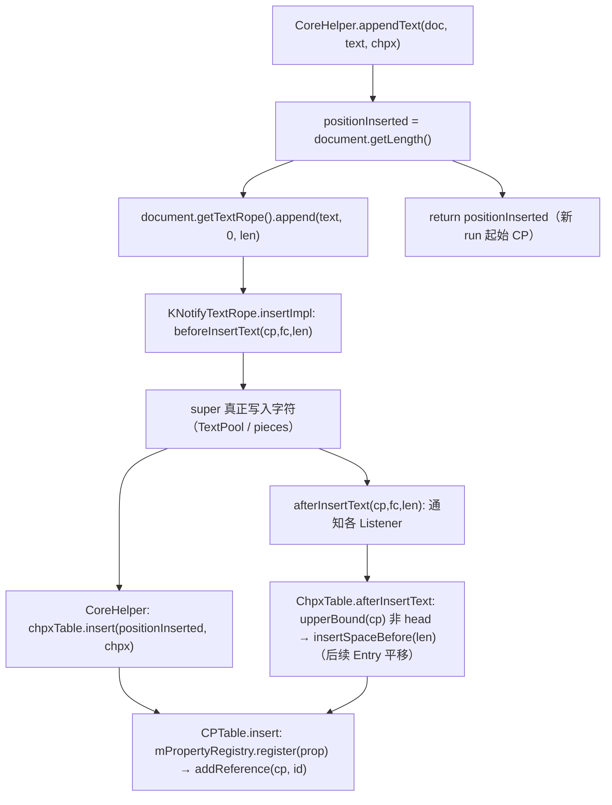
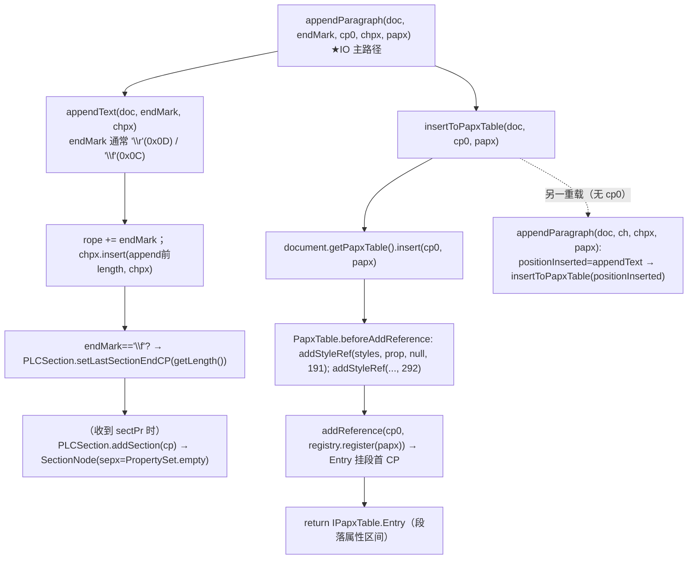
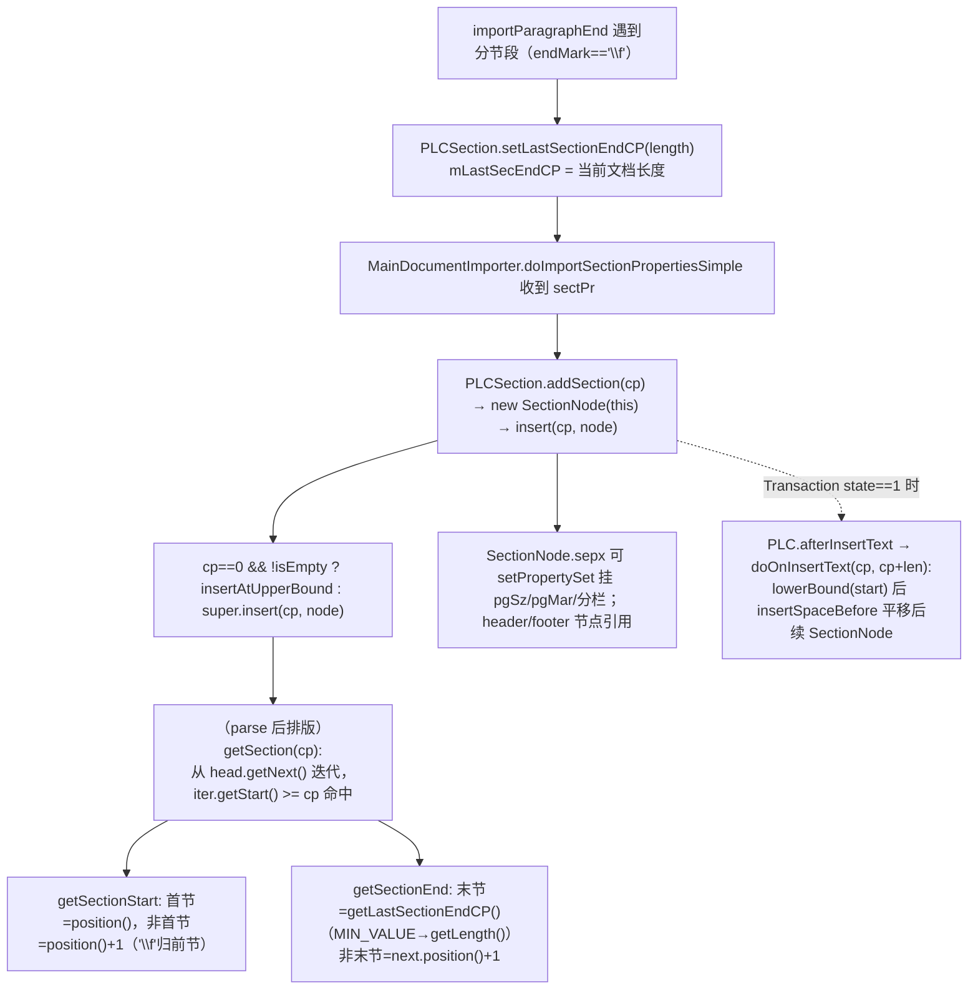
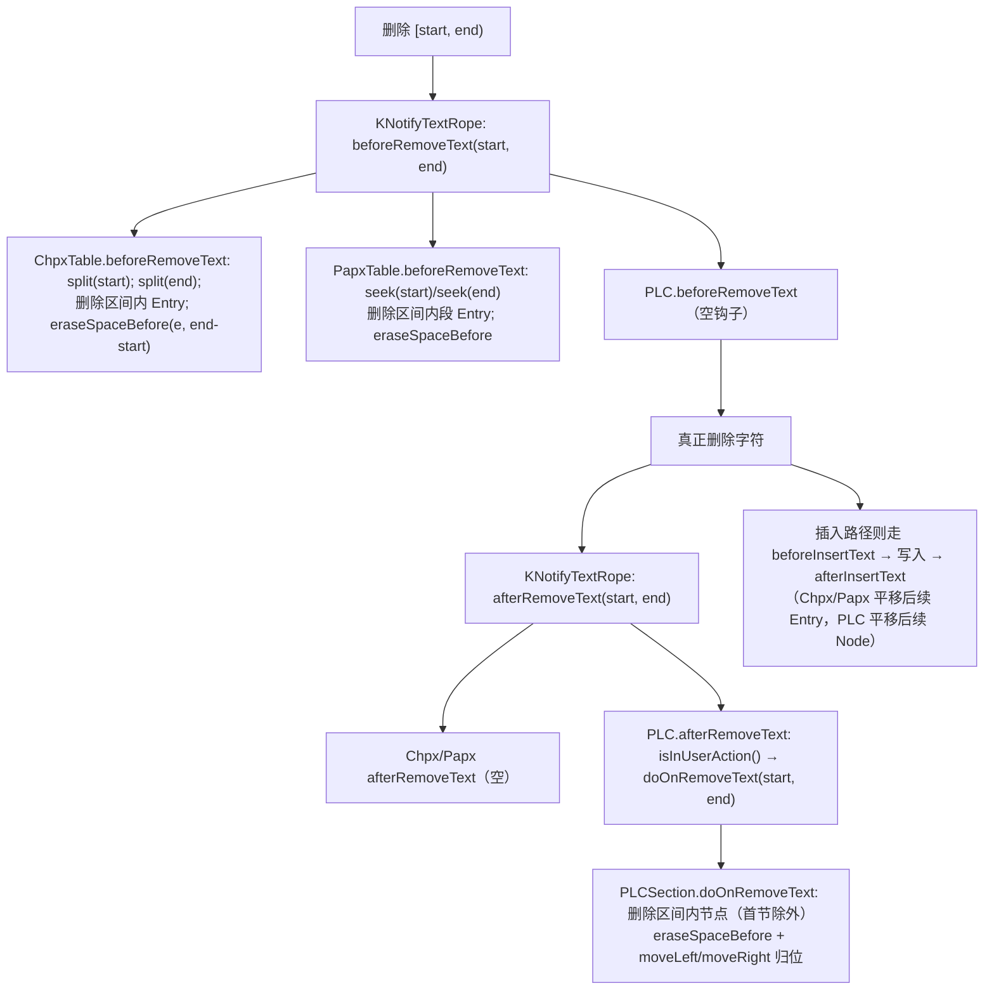

# wc-01-storage-write — 存储写入路径（类图/流程/依赖/最小改写范围）

> feature_id: `wc-01-storage-write`，batch: `parse-01-storage`
> 分析依据：`libs/word-core/parser/features/wc-01-storage-write/`（README / SEEDS_ANALYSIS / docs/STORAGE.md / dep_topo.csv / seeds.csv / rewriting_queue.csv）、Java 源码（koffice/writer/core/…）、Rust 现状（libs/word-core/src/…）逐行核对 + `cargo check` 实证。

---

## 0. Feature 目标与管线位置

**目标**：打通「字符流 + 按 CP 切分的属性 + CP 上的结构节点」的**写入热路径**：

```
CoreHelper.appendText(doc, text, chpx)
  → cp0 = document.getLength()          # append 前长度
  → textRope.append(...)                # 字符先进 rope
  → chpxTable.insert(cp0, chpx)         # CHPX 挂在新区间起点

CoreHelper.appendParagraph(doc, endMark, cp0, chpx, papx)   # IO 主路径
  → appendText(endMark, chpx)
  → papxTable.insert(cp0, papx)         # PAPX 挂在段首 CP（mPositionInserted）

endMark == '\f'（0x0C 分节符）
  → PLCSection.setLastSectionEndCP(length)
  → （MainDocumentImporter 收到 sectPr 时）PLCSection.addSection(cp)
```

**管线位置**：

- **前置**（wave0/依赖已 done）：PropertySet、Tree/PositionTree/IndexedPositionTree（core-libs util）；textrope 接口（ITextRope/INotifyTextRope）；ListIndexPositionTree；ITable/IChpxTable/IPapxTable/CPTable/ReferenceTable。
- **本 feature（Wave 1）**：textrope + Chpx/Papx 表 + PLC/PLCSection + CPieceTable + CoreHelper，是 **REWRITE_DESIGN_PARSE_MVP.md 中改写优先级最高的一波**。
- **下游**：wc-02-document-model（SubDocument 构造装配）；wc-04-paragraph-import（SubDocumentImporter.importRunText/importParagraphEnd 调用 appendText/appendParagraph）；wc-05-orchestration（DocxReader 调 CPieceTable.setGuessedTotalLength、FinishReadingWork 调 CoreHelper.supplyEndPara）。
- 本层是 **L1 逻辑文档模型**（可编辑真相），**不是**像素版面：PLCSection 只给页框约束，行/页盒由 layout 层另算。

---

## 0.5 设计动机与心智模型（为什么这么设计）

> 详细论证见 [docs/STORAGE.md](./docs/STORAGE.md) §B（§1 五矛盾、§1.2–1.7、§10 速查、§11 常见误解）。
> 本节是提炼版 + 三个最容易问"为什么"的细节钉死。

**一句话心智模型**：文档 = 一条扁平的字符流 + 若干层"按 CP（字符下标）切分"的稀疏属性/结构叠加。DOCX 的 XML 树适合**交换**，不适合**运行时编辑与排版的主索引**；Importer 把 XML **投影**成这套 CP 中心模型，排版引擎统一 `seek(cp)` 查询。

**五个设计矛盾**（每个结构都是被某个矛盾"逼"出来的）：

| # | 矛盾 | 主数据结构 | 关键手段 |
|---|------|-----------|---------|
| 1 | 编辑要局部：插/删一段字不能整篇重写 | TextRope + TextPool | 拆片/拼片，不搬字符 |
| 2 | 属性要稀疏：大多数字符共享格式，不能每字符一份拷贝 | ChpxTable/PapxTable + Registry | 区间共享同一 prop id |
| 3 | 结构要跟字符走：节/书签/锚点插段后自动平移 | PLC + TextRope Listener | `insertSpaceBefore` 平移节点 |
| 4 | 排版要随机查："CP=1200 的属性？"不能线性扫 | CPTable / 位置树 | `seek(cp)` ≈ O(log n) |
| 5 | 与历史 .doc 模型对齐 | 上述名词与形态 | CHPX/PAPX/PLC/Piece Table 沿用经典心智 |

**各结构角色速查**（解决什么矛盾 → 关键机制 → 谁消费）：

| 结构 | 解决 | 关键机制 | 谁消费 |
|------|------|---------|--------|
| CP 轴 | 统一坐标 | 所有层用同一把尺子；区间半开 `[pos, next.pos)` | 全部 |
| TextRope/TextPool | 矛盾① | append 只长尾巴；中间插入拆片；`KNotifyTextRope` 变更前→写入→变更后通知 | Importer 写 / Layout 读 |
| CHPX/PAPX（CPTable） | 矛盾②④ | 属性进 Registry 去重为 int id；Entry 按 cp 挂位置树；文本变更 `insertSpaceBefore` 平移 | `CoreHelper` 写 / Layout `seek` 切段切 run |
| PLC/PLCSection | 矛盾③ | 结构节点锚 CP；`Head.position()=getLength()` 哨兵；`afterInsertText→doOnInsertText→insertSpaceBefore` 平移 | 排版定页框、结构跳转 |
| CPieceTable | 统一访问 | 门面聚合 rope+chpx+papx，**非**经典 piece table，不参与 append 必经路径 | SubDocument/DocxReader |
| CoreHelper | 不变量 | 唯一写入口：字符/CHPX/PAPX 顺序与 CP 钉死，Listener before→mutate→after | 全部 importer |

**三个"为什么"细节（改写时钉死）**：

1. **CHPX 的 insert CP = append 前 length**：新 run 起点 = 旧长度，插入后区间正好覆盖刚写入的字符——先写字符、再挂属性，一次写入两结构对齐。
2. **PAPX 挂段首 CP（`mPositionInserted`）而非段末**：`seek(cp)` 取"最大 pos ≤ cp 的节点"，段首 PAPX 天然覆盖整段直到下一段 PAPX。必须用 `importParagraphStart` 抓的 cp0（End 时 length 已变大，用它会整段错位）。
3. **PLCSection 首节 `position()` / 非首节 `position()+1`**：`\f` 分节符字符归**前**一节所有，下一节从 `\f` 之后开始；末节 end = `getLastSectionEndCP()`（`MIN_VALUE` → `getLength()`）。

**与排版边界**：本层是 L1 逻辑模型（可编辑真相）；行/页几何由 layout 读 L1 + 字体度量**算出**，页树不写回存储。PLCSection 只给页框**约束**，一节可对应多页。

---

## 1. 类图

> 标注约定：★ = MVP 热路径方法（parse/IO 路径直接调用）。


### 1.1 CoreHelper（writer/helper，final，纯静态工具）

**继承/实现**：`public final class CoreHelper`（无基类）。只读 Document 接口 + PropertySet + rope/表接口。

**字段**：`TAG = null`（static，仅日志占位）。

**关键方法**：


| 方法                                                                                                       | 逻辑摘要                                                                                                                                                                                                                                                     |
| -------------------------------------------------------------------------------------------------------- | -------------------------------------------------------------------------------------------------------------------------------------------------------------------------------------------------------------------------------------------------------- |
| ★ `appendText(SubDocument, String, PropertySet) → int`                                                   | `positionInserted = document.getLength()` → `textRope.append(text, 0, text.length())` → `chpxTable.insert(positionInserted, props)` → return positionInserted。**CHPX 的 insert CP = append 前 length**                                                     |
| ★ `appendText(SubDocument, char, PropertySet) → int`                                                     | 转 `String.valueOf(ch)` 委托上者                                                                                                                                                                                                                              |
| ★ `appendText(SubDocument, char[] buffer, int start, int end, PropertySet) → int`                        | 同 String 版，`rope.append(buffer, start, end)`；断言 `end > 0`                                                                                                                                                                                                |
| ★ `appendParagraph(SubDocument, char ch, PropertySet chpx, PropertySet papx) → IPapxTable.Entry`         | `positionInserted = appendText(ch, chpx)` → `insertToPapxTable(positionInserted, papx)`。**PAPX 落在段末字符 CP**                                                                                                                                               |
| ★ `appendParagraph(SubDocument, char ch, int cp, PropertySet chpx, PropertySet papx) → IPapxTable.Entry` | `appendText(ch, chpx)` → `insertToPapxTable(cp, papx)`。**IO 主路径：PAPX 挂在段首 cp（importParagraphEnd 记下的 mPositionInserted）**                                                                                                                                 |
| ★ `insertToPapxTable(SubDocument, int cp, PropertySet) → IPapxTable.Entry`                               | `document.getPapxTable().insert(cp, papx)`                                                                                                                                                                                                               |
| ★ `setCellMark(char cellMark, Document, IPapxTable.Entry) → void`                                        | `cp = entry.endCp() - 1` → `fc = textRope.cp2fc(cp)` → `textPool.set(fc, cellMark)`（写单元格标记字符）                                                                                                                                                            |
| ★ `supplyEndPara(SubDocument) → void`                                                                    | `lastPara = papxTable.end().getPrev()`；若 `lastPara.isHead()` → `appendParagraph(doc, '\r', 0, empty, empty)`；否则若 `lastPara.getProperty().getBoolean(225, false)`（propId **225** = paragraph_rowEnd，段末行标志）→ `appendParagraph(doc, '\r', empty, empty)`    |
| `isValidChar(char) → boolean`                                                                            | `'\uffff' != ch && '�'(U+FFFD) != ch && '\ufffe' != ch`                                                                                                                                                                                                  |
| `collectAllOLE(TextDocument, List<OLE>)`                                                                 | 遍历 7 个子文档 PLCField，sepCP 处 `chpxTable.seek(cp).getProperty().getValue(56)`（propId **56** = OLE 形状），fieldChar == **20**（separate）                                                                                                                         |
| 其余 drawing/comment 工具                                                                                    | `getClsid`/`pickVersion`/`isChart`/`dumpPicture4Chart`/`getChartRectF`/`convert2vmlPertcent`（×10）/`vmlRotation2DmlRot`/`dmlRot2VmlRotation`/`dumpAllChartShapePictures`/`dumpAllDiagram`/`getNewGeometry`/`writeCommentCustDatas` —— **非 MVP，soft stub** |


### 1.2 PLC（writer/data，抽象基类）

**继承/实现**：`public abstract class PLC extends ListIndexPositionTree implements INotifyTextRope.Listener`。即同时是「位置树（环形链表 + 二叉索引树）」和「文本变更监听者」。

**字段**：

- `Document mDocument` — 所属子文档
- `Transaction mTransaction` — undo/redo 命令队列（parse 路径 state≠1 时不提交）
- `Head head` — 哨兵头节点（`Head.position() = document.getLength()`，即文档实时长度）

**关键方法**：


| 方法                                                                                                            | 逻辑摘要                                                                                                             |
| ------------------------------------------------------------------------------------------------------------- | ---------------------------------------------------------------------------------------------------------------- |
| ★ `insert(int cp, Node pNew)`                                                                                 | `lowerBound(cp, offset)` 定位 → `addReferenceImpl(cp, offset, pos, pNew)` → `notifyOnAdd` → （state==1）提交 CmdInsert |
| `insertAtUpperBound(cp, pNew)` / `push_back(cp, pNew)` / `insert(Node pos, pNew)` / `insert(Node, cp, index)` | 其它插入定位变体                                                                                                         |
| ★ `find(cp)` / `findFloor(cp)` / `findUpper(cp)` / `lowerBound(cp[,offset])` / `upperBound(cp[,offset])`      | 基于位置树的 CP 定位（O(log n)）                                                                                           |
| ★ `begin()` / `end()` / `last()` / `isEnd(Node)` / `isHead(Node)` / `getHead()` / `getByIndex` / `get(int)`   | 链表遍历                                                                                                             |
| ★ `insertSpaceBefore(Node pFrom, int length)`                                                                 | 非 head 时 `super.insertSpaceBefore`（位置树平移）+ 记 CmdInsertSpace。**Listener 平移核心**                                    |
| `eraseSpaceBefore(Node, int)`                                                                                 | `insertSpaceBefore(pFrom, -length)`                                                                              |
| `moveRight(Node, int)` / `moveLeft(Node, int)`                                                                | 节点右/左平移                                                                                                          |
| ★ `beforeInsertText(cp, fc, length)`                                                                          | 空实现（钩子）                                                                                                          |
| ★ `afterInsertText(cp, fc, length)`                                                                           | `!isEmpty() && isInUserAction()`（Transaction state==1）→ `doOnInsertText(cp, cp + length)`                        |
| ★ `beforeRemoveText(start, end)`                                                                              | 空实现（钩子）                                                                                                          |
| ★ `afterRemoveText(start, end)`                                                                               | `isInUserAction()` → `doOnRemoveText(start, end)`                                                                |
| `abstract doOnInsertText(int, int)` / `abstract doOnRemoveText(int, int)`                                     | **抽象方法**（Rust 侧以 `panic!("PLC::doOnInsertText abstract")` 占位，子类 override）                                        |
| `getRange(Node) → long`                                                                                       | `RANGEFactory.getRANGE(start, end)`（`next.position()` 为 end；Head 抛 WriterModelException）                         |
| `reset` / `resetHead` / `setTransaction` / `getTransaction` / `dispose`                                       | 生命周期                                                                                                             |


**内部类**：`Node extends ListIndexNode implements Cloneable`（`getCP()` = position）；`Head extends Node`（`position() = document.getLength()`，`moveRight` no-op）；`Iterator extends ListIndexPositionTree.CPIterator`；undo 命令 `CmdInsert` / `CmdRemove` / `CmdResetHead` / `CmdInsertSpace` / `CmdMoveRight`。

### 1.3 PLCSection（writer/data，节 PLC）

**继承/实现**：`public class PLCSection extends PLC`。

**字段**：`private int mLastSecEndCP = Integer.MIN_VALUE`（`INVALID_CP`）；继承 `head` / `mDocument` / `mTransaction`。

**关键方法**：


| 方法                                                                      | 逻辑摘要                                                                                                                                      |
| ----------------------------------------------------------------------- | ----------------------------------------------------------------------------------------------------------------------------------------- |
| ★ `setLastSectionEndCP(int cp)`                                         | `mLastSecEndCP = cp`（段末 `\f` 时由 importParagraphEnd 调）                                                                                     |
| ★ `addSection(int cp) → SectionNode`                                    | `new SectionNode(this)` → `insert(cp, pNode)`（收到 sectPr 时调）                                                                               |
| `insert(int cp, Node)`                                                  | `cp == 0 && !isEmpty()` → `insertAtUpperBound(cp, pNew)`（避免覆盖已有 0 节点）；否则 `super.insert`                                                   |
| ★ `getFirstSection()` / `getLastSection()` / `isFirstSection(pSection)` | `isEmpty()` 时返回 null；first=begin()、last=last()                                                                                            |
| ★ `getSection(int cp) → SectionNode`                                    | 从 `head.getNext()` 起迭代；`iter.getStart() >= cp` 即命中；越界返回 null。**排版取节热路径**                                                                  |
| `getSectionStart(pSection) → int`                                       | 首节 = `position()`；**非首节 =** `position() + 1`（`\f` 字符归前节所有）                                                                                |
| `getSectionEnd(pSection) → int`                                         | 末节 = `getLastSectionEndCP()`（`MIN_VALUE` 时退回 `document.getLength()`）；否则 `next.position() + 1`                                             |
| `getSectionRange(pSection) → long`                                      | `RANGEFactory.getRANGE(start, end)`                                                                                                       |
| `onEndLoad()`                                                           | `mLastSecEndCP = INVALID_CP`（读完复位）                                                                                                        |
| `doOnInsertText(start, end)`                                            | `len = end - start`；`upper = lowerBound(start)`；`start == 0 && !isEnd(upper)` → `upper = upper.getNext()`；`insertSpaceBefore(upper, len)` |
| `doOnRemoveText(start, end)`                                            | 删除落在区间内的 SectionNode（首节除外）；`eraseSpaceBefore(e, end - start)`；必要时 moveLeft/moveRight 归位                                                   |
| `notifyOnAdd / notifyOnRemoved`                                         | 非 IO 状态时发 `DocumentEvent`（type **4**，event **18**）通知排版                                                                                    |
| `removeSectionNode(SectionNode)`                                        | 删除节点后处理 header/footer 节点转移（PLCHeader / HelperHeaderFooter）                                                                                |


**内部类**：`SectionNode extends PLC.Node` —— 字段：`PLCSection parent`、`PropertySet sepx`（默认 `PropertySet.empty`）、6 个页眉页脚节点引用 `evenHeader / oddHeader / evenFooter / oddFooter / firstHeader / firstFooter`（`PLC.Node`）。方法：`getPropertySet` / `setPropertySet`（含 CmdSetData）、各 header/footer get/set（含 CmdModify）、`notifySectionChanged()`。枚举 `NodeType { firstFooter, firstHeader, evenFooter, evenHeader, oddFooter, oddHeader }`。

### 1.4 CPieceTable（writer/data，门面）

**继承/实现**：独立类，**不是 OOXML Part**，也不参与 append 必经路径。

**字段**：`Document document`；`ITextRope mTextRope`；`IChpxTable mChpxTable`；`IPapxTable mPapxTable`；`int mGuessedTotalLength = 0`（DocxReader 预估长度）；`KParaRunRevision mKParaRunRevision`（私有，修订用）。

**关键方法**：


| 方法                                                                                                                                                          | 逻辑摘要                                                                                                        |
| ----------------------------------------------------------------------------------------------------------------------------------------------------------- | ----------------------------------------------------------------------------------------------------------- |
| ★ `CPieceTable(Document)`                                                                                                                                   | 断言 TextDocument Transaction 非空；持有 document + 三个表引用                                                          |
| ★ `getTextRope()` / `getChpxTable()` / `getPapxTable()`                                                                                                     | 门面 getter（SubDocument 构造调用）                                                                                 |
| ★ `setGuessedTotalLength(int)` / `getGuessedTotalLength()`                                                                                                  | DocxReader.read 中 `pieceTable.setGuessedTotalLength(guessLength)`                                           |
| ★ `charAt(int cp)` / `getText(int, int, char[], int)` / `cp2fc(int)` / `fc2cp(int)`                                                                         | 委托 rope 的查询                                                                                                 |
| `begin()` / `end()`                                                                                                                                         | 委托 `mChpxTable.begin()/end()`                                                                               |
| `fragmentAtPosition(int cp, int[] offset)`                                                                                                                  | `mChpxTable.seek(cp)` + offset                                                                              |
| `isShape(IChpxTable.Entry)`                                                                                                                                 | `prop.getBoolean(28, false)` 且（`'\b'`==ch 或 `1 == ch` 且非 prop29/30/31）且 `shapeAnchors.findByCP(cp) != null` |
| `getParagraphRange(int,int)` / `getParagraphRange(int)`                                                                                                     | 经 `mPapxTable.seek` 拼 RANGE                                                                                 |
| `removeSpecialProperty` / `atomicRemoveRange*` / `atomicInsertField`（field 字符 **19/20/21**）/ `atomicInsertShape` / `atomicRemoveShape` / `atmoicInsertText` | **深度方法，MVP 后补**（shape/field/修订依赖 wc-03/04）                                                                  |


### 1.5 ChpxTable（internal_v2，Run 级字符属性表）

**继承/实现**：`final class ChpxTable extends CPTable implements IChpxTable`（包私有）。

**字段**：继承 CPTable 的 `mPropertyRegistry`（KPropertySetRegistry，`PROPERTYSET_BITS = 18`）、`document`、`listener`。

**关键方法**：


| 方法                                                        | 逻辑摘要                                                                                                                                           |
| --------------------------------------------------------- | ---------------------------------------------------------------------------------------------------------------------------------------------- |
| ★ `insert(int cp, PropertySet) → Entry`                   | `addReference(cp, mPropertyRegistry.register(property))` —— PropertySet 去重后以 int id 存节点                                                        |
| ★ `seek(cp)` / `begin()` / `end()` / `last()`             | CPTable 继承实现（`end() = head`，head.position() = `document.getLength()`）                                                                          |
| ★ `beforeRemoveText(int start, int end)`                  | 非 undo/redo 时：`split(start)` / `split(end)`，中间 Entry 全删，`eraseSpaceBefore(e, end - start)` —— **文本删除时 CHPX 区间同步**                              |
| `split(int cp) → Entry`                                   | `seek(cp)` 非端且 position != cp 时先 `insert(cp, chpx.getProperty())` 切分                                                                           |
| `beforeAddReference(cp, data)`                            | `super`（通知 listener）+ `StyleListenerBase.addStyleRef(styles, prop, null, 2)` —— **字符样式引用（type=2）**                                             |
| `beforeRemoveReference`                                   | 对称 removeStyleRef                                                                                                                              |
| `createCpIterator()`                                      | `CPIterator<Entry>` 遍历                                                                                                                         |
| `Head extends Entry`                                      | `position() = document.getLength()`；`getPropertySetId() = 0`；`endCp()/range()/length()/getProperty()/setProperty()` 均抛 RuntimeException（哨兵不可用） |
| `Entry extends CPTable.Entry implements IChpxTable.Entry` | getPrev/getNext 收敛为 ChpxTable.Entry 类型                                                                                                         |


### 1.6 PapxTable（internal_v2，段落属性表）

**继承/实现**：`final class PapxTable extends CPTable implements IPapxTable`（包私有）。

**关键方法**：


| 方法                                                                               | 逻辑摘要                                                                                                                                      |
| -------------------------------------------------------------------------------- | ----------------------------------------------------------------------------------------------------------------------------------------- |
| ★ `insert(int cp, PropertySet) → Entry`                                          | 同 Chpx：registry 注册 + addReference。**IO 主路径 PAPX 落段首 CP**                                                                                  |
| ★ `seek` / `begin` / `end` / `last`                                              | 同 Chpx                                                                                                                                    |
| ★ `beforeRemoveText(int start, int end)`                                         | 非 undo/redo 时按段起止 seek 两节点，删除中间 Entry 并 eraseSpaceBefore —— **段落级删除同步**                                                                   |
| `beforeAddReference(cp, data)`                                                   | `super` + `StyleListenerBase.addStyleRef(styles, prop, null, 191)` **且** `(…, null, 292)` —— 段落样式引用 **propId 191（sti）+ propId 292（样式引用）** |
| `beforeRemoveReference`                                                          | 对称 removeStyleRef(191/292)                                                                                                                |
| `createCpIterator()`                                                             | CPIterator                                                                                                                                |
| `Head extends Entry` / `Entry extends CPTable.Entry implements IPapxTable.Entry` | 同 Chpx 结构                                                                                                                                 |


### 1.7 ChpxTableFactory / PapxTableFactory（internal_v2，各 ~10 行）

```java
public class ChpxTableFactory {
   public static IChpxTable createChpxTable(Document document) {
      return document == null ? null : new ChpxTable(document);
   }
}
```

`PapxTableFactory.createPapxTable` 与 Chpx 完全对称。**职责：唯一创建入口，避免外层依赖具体类**；`SubDocument` 构造时调用。

### 1.8 基类与接口（非种子但为直接依赖）

- **ITable.Entry**：`position()` / `endCp()`（= next.position()，区间半开 `[pos, next.pos)`）/ `range()` / `length()` / `isHead()` / `isEnd()` / `isLast()`。
- **CPTable.Entry**：`endCp()`、`range()`、`length()`、`getProperty()`（registry 反查）、`setProperty(prop)`（register + setData）、`getPropertySetId()` = `(registryId << 18) + data`。
- **CPTable**：`insert` = registry.register + addReference；`seek` = `lowerBound` 修正（`position()!=cp` 时取 prev）；`afterInsertText(cp,fc,length)` = 非 undo/redo 时对 `upperBound(cp)` 非 head 节点 `insertSpaceBefore(length)` —— **文本插入后后续 Entry 平移**。
- **ReferenceTable**：位置树 `mTree = ListPositionTree(head)` + `mTransaction`；`addReference/removeReference/insertSpaceBefore/eraseSpaceBefore/moveRight/setData` + 全套 Cmd* undo 命令；`isInUndoRedo()` = state ∈ {2,3}。
- **ListIndexPositionTree extends IndexedPositionTree**：在 PositionTree 上加 `lists` 扩展（`ListTreeExtension`，扩展位 63）；`insertSpaceBefore`/`moveRight` 同时平移 lists。
- **ITextRope**：`append(char|char[]|String)`、`insert`、`erase`、`charAt`、`getText`、`length`、`cp2fc`/`fc2cp`、`getTextPool`、`begin`/`end`/`seek`（ITextPiece）、`addF0/removeF0/modifyF0Impl`。
- **INotifyTextRope extends ITextRope**：`setListener(Listener)`；`Listener { beforeInsertText(cp,fc,length); afterInsertText(cp,fc,length); beforeRemoveText(start,end); afterRemoveText(start,end) }`。
- **KNotifyTextRope**（textrope 实现）：`insertImpl` 中 `beforeInsertText → super.insertImpl → afterInsertText`（**顺序 before→mutate→after**）；SubDocument 把 Chpx/Papx/PLC 挂进 listeners。

> 📖 **深读索引**（类图 / 流程图 / 关键方法 / 设计意图，按家族）：
> - [docs/textrope-deep-dive.md](./docs/textrope-deep-dive.md) — TextRope/TextPool 家族
>   （KTextRope / KTextPieceTable / IntervalMap 双树 / KTextPool 块式池 / 事务与通知层）
> - [docs/chpx-papx-deep-dive.md](./docs/chpx-papx-deep-dive.md) — 属性表家族
>   （CPTable / ChpxTable / PapxTable / ReferenceTable / KPropertySetRegistry）
> - [docs/plc-deep-dive.md](./docs/plc-deep-dive.md) — 结构表家族
>   （PLC / PLCSection / SectionNode / ListIndexPositionTree）

---


## 2. 流程图（mermaid）


### 2.1 appendText 写入链（CoreHelper.appendText → rope + CHPX）




### 2.2 appendParagraph 写入链（段末字符 + PAPX）




### 2.3 PLCSection 分节链




### 2.4 文本删除 / Listener 链（Java 侧；Rust 已同步）




---


## 3. 依赖关系


### 3.1 类间依赖表（谁依赖谁）


| 类                     | 依赖                                                                                                                                                          | 说明                     |
| --------------------- | ----------------------------------------------------------------------------------------------------------------------------------------------------------- | ---------------------- |
| CoreHelper            | `Document`/`SubDocument`/`TextDocument`、`ITextRope`、`ITextPool`、`IChpxTable`、`IPapxTable`、`PropertySet`、`PLCField`、drawing soft stubs（Shape/OLE/MediaLib/…） | 写入门面，只走接口              |
| PLC                   | `ListIndexPositionTree`、`INotifyTextRope.Listener`、`Document`、`Transaction`、`RANGEFactory`、`ListIndexNode`                                                  | 结构节点树 + 监听者            |
| PLCSection            | `PLC`、`PropertySet`、`Transaction`、`DocumentEventDispatcher`/`DefaultModelEvent`、`PLCHeader`、`HelperHeaderFooter`                                            | 节节点 + header/footer 关联 |
| CPieceTable           | `ITextRope`、`IChpxTable`、`IPapxTable`、`Document`、`RANGEFactory`、`PLCShapeAnchor`、`ITextStream`、`PLCField`、`KParaRunRevision`、`KFieldType`                   | 门面                     |
| ChpxTable             | `CPTable`、`IChpxTable`、`PropertySet`、`StyleListenerBase`、`KPropertySetRegistry`（经 CPTable）                                                                  | 字符属性表                  |
| PapxTable             | `CPTable`、`IPapxTable`、`PropertySet`、`StyleListenerBase`                                                                                                    | 段落属性表                  |
| CPTable               | `ReferenceTable<Integer>`、`ITable`、`KPropertySetRegistry`、`RANGEFactory`、`TextDocument`/`UUCommentId`                                                       | 属性表基类                  |
| ReferenceTable        | `ListPositionTree`（core-libs util）、`Transaction`                                                                                                            | 位置树 + undo             |
| ListIndexPositionTree | `IndexedPositionTree`（core-libs util）、`ListTreeExtension`                                                                                                   | PLC 的树                 |
| ChpxTableFactory      | `ChpxTable`、`IChpxTable`                                                                                                                                    | 工厂                     |
| PapxTableFactory      | `PapxTable`、`IPapxTable`                                                                                                                                    | 工厂                     |
| KNotifyTextRope       | `ITextRope`、`INotifyTextRope.Listener`                                                                                                                      | 通知式 rope               |


### 3.2 外部依赖（core-libs / util）


| 外部依赖                                                             | Java 位置                      | 用途                                                                      | 本 feature 中                                    |
| ---------------------------------------------------------------- | ---------------------------- | ----------------------------------------------------------------------- | ---------------------------------------------- |
| `PropertySet` / `MutablePropertySet` / `KPropertySetRegistry`    | `cn.wps.moffice.property.*`  | propId→值的不可变桶 + 去重注册表（`getPropertySetId = (registryId<<18)+data`）       | **必须可用**（wave0 已 done）                         |
| `Tree` / `PositionTree` / `IndexedPositionTree` / `PositionNode` | `cn.wps.collections.*`       | 位置树（lowerBound/upperBound/insertLeft/erase/insertSpaceBefore/moveRight） | 必须可用（wave0 已 done）                             |
| `ListPositionTree` / `TextReference`                             | `data.internal_v2`（本 crate）  | ReferenceTable 的树 + 带 data 节点                                           | 已 done                                         |
| `Transaction` / `Command`                                        | `cn.wps.moffice.transaction` | undo/redo 命令链（state==1 时提交）                                             | parse 路径 state≠1，**可延后**，Listener 钩子保留         |
| `StyleListenerBase`                                              | `writer.core`                | addStyleRef/removeStyleRef（prop 191/292；字符 type=2）                      | 浅实现/保留调用                                       |
| `RANGEFactory`                                                   | `writer.data`                | `getRANGE(start,end) → long`（int 高低位打包）                                 | 已 done                                         |
| `KTextPool` / `KSwappableTextPool`                               | textrope                     | 字符池                                                                     | 内存 KTextPool 即可（**KSwappableTextPool 磁盘换页降级**） |


### 3.3 改写状态表（dep_topo.csv 全量 21 行）


| order | class                 | is_seed | mvp_state | rewrite_status | crate     | 备注                                  |
| ----- | --------------------- | ------- | --------- | -------------- | --------- | ----------------------------------- |
| 1     | IDisposable           | no      | done      | done           | core-libs | wave0 依赖                            |
| 2     | Tree                  | no      | done      | done           | core-libs | wave0 依赖                            |
| 3     | PositionTree          | no      | done      | done           | core-libs | 依赖 Tree                             |
| 4     | IndexedPositionTree   | no      | done      | done           | core-libs | 依赖 PositionTree                     |
| 5     | PropertySet           | no      | done      | done           | core-libs | wave0，MVP 前置                        |
| 6     | ITextRope             | no      | done      | done           | word-core | 接口                                  |
| 7     | INotifyTextRope       | no      | done      | done           | word-core | 依赖 ITextRope                        |
| 8     | ListIndexPositionTree | no      | done      | done           | word-core | 依赖 IndexedPositionTree              |
| 9     | **PLC**               | **yes** | **done**  | done           | word-core | mvp_order 228，mvp-must              |
| 10    | **PLCSection**        | **yes** | **done**  | done           | word-core | mvp_order 229，依赖 PLC;PropertySet    |
| 11    | ReferenceTable        | no      | done      | done           | word-core | CPTable 基类                          |
| 12    | ITable                | no      | done      | done           | word-core | 接口                                  |
| 13    | IChpxTable            | no      | done      | done           | word-core | 接口                                  |
| 14    | CPTable               | no      | done      | done           | word-core | 依赖 ITable;ReferenceTable            |
| 15    | ChpxTable             | no      | done      | done           | word-core | 依赖 CPTable;IChpxTable               |
| 16    | **ChpxTableFactory**  | **yes** | **done**  | done           | word-core | mvp_order 226，rs 为新建                |
| 17    | IPapxTable            | no      | done      | done           | word-core | 接口                                  |
| 18    | **PapxTable**         | **yes** | **done**  | done           | word-core | mvp_order 225，依赖 CPTable;IPapxTable |
| 19    | **PapxTableFactory**  | **yes** | **done**  | done           | word-core | mvp_order 227                       |
| 20    | **CPieceTable**       | **yes** | **done**  | done           | word-core | mvp_order 232                       |
| 21    | **CoreHelper**        | **yes** | **done**  | done           | word-core | mvp_order 233，验收枢纽                  |


**改写顺序建议（seeds 内）**：Factories(226/227) → PapxTable(225) → PLC(228) → PLCSection(229) → CPieceTable(232) → CoreHelper(233)。与 dep_topo mvp_order 一致。

---


## 4. 最小 feature-critical 改写范围


### 4.1 Must-write 清单（含理由）


| 文件                                                                                                                                                                                                      | 理由                                                                                                                         |
| ------------------------------------------------------------------------------------------------------------------------------------------------------------------------------------------------------- | -------------------------------------------------------------------------------------------------------------------------- |
| **CoreHelper**（种子，mvp_order 233）                                                                                                                                                                        | 唯一推荐写入入口；`appendText`/`appendParagraph(cp 版)`/`insertToPapxTable` 是 importer 的直接调用点；`setCellMark`/`supplyEndPara` 是表格与收尾路径 |
| **PLCSection**（种子，229）                                                                                                                                                                                  | `setLastSectionEndCP` + `addSection` + `getSection`/`getSectionStart/End` 是分节符与排版查询热路径                                     |
| **PLC**（种子，228）                                                                                                                                                                                         | PLCSection 基类；`insert`/遍历/`insertSpaceBefore`/Listener 钩子                                                                  |
| **PapxTable**（种子，225）                                                                                                                                                                                   | `insert(cp, papx)` 段属性落库；`beforeRemoveText` 删除同步                                                                           |
| **CPieceTable**（种子，232）                                                                                                                                                                                 | `setGuessedTotalLength`（DocxReader 调用）+ getter 门面                                                                          |
| **ChpxTableFactory / PapxTableFactory**（种子，226/227）                                                                                                                                                     | SubDocument 构造的创建入口                                                                                                        |
| 直接依赖（非种子但 must）：`CPTable`、`ReferenceTable`、`ITable`/`IChpxTable`/`IPapxTable`、`ListIndexPositionTree`、`ITextRope`/`INotifyTextRope`、core-libs `PropertySet`/`Tree`/`PositionTree`/`IndexedPositionTree` | 种子类编译与运行的必要基座；均已 done                                                                                                      |


**要点**：CHPX insert CP = append **前** length；PAPX insert CP = **段首** cp0；Notify 顺序 before → mutate → after；这三条不变量必须与 Java 一致。

### 4.2 可 stub / 延后清单（含理由）


| 项                                                                                                                                        | 理由                                                                                                            |
| ---------------------------------------------------------------------------------------------------------------------------------------- | ------------------------------------------------------------------------------------------------------------- |
| Transaction / undo Command 链（PLC/ReferenceTable/CPTable 内的 Cmd*）                                                                         | parse（IO）路径 Transaction state≠1，`submitCommand` 不触发；保留调用点但语义可空。**Listener 钩子必须留**（否则删除/插入后 CHPX/PAPX/PLC 不同步） |
| `KSwappableTextPool` 磁盘换页                                                                                                                | 降级为内存 `KTextPool`（TextDocument._create 已有 fallback）；MVP 文档规模足够                                                |
| PLC.doOnInsertText/doOnRemoveText 抽象占位                                                                                                   | Java 侧 abstract；Rust 以 `panic!` 默认体占位，PLCSection 已 override；其它 PLC 子类（PLCField/书签/形状锚点）属其它 feature            |
| StyleListenerBase.addStyleRef(191/292)                                                                                                   | 样式引用计数器；MVP 浅实现即可（core-libs util 已有），不影响 append 主链路                                                           |
| 页眉页脚节点（SectionNode 6 个 header/footer 引用、PLCHeader、HelperHeaderFooter）                                                                    | MVP 空 header/footer；`addSection` 不挂 header 节点即可                                                               |
| CPieceTable 深度方法（`isShape`/`atomicInsertField`/`atomicInsertShape`/`removeSpecialProperty`/`atomicRemoveRange*`/`getParagraphRange`）     | 依赖 Shape/Field/修订（wc-03/04），getter + `setGuessedTotalLength` 先通                                               |
| CoreHelper 非热路径方法（`dumpPicture4Chart`/`dumpAllChartShapePictures`/`dumpAllDiagram`/`collectAllOLE`/`writeCommentCustDatas`/rotation 工具等） | drawing/comment 输出类，MVP 以 soft stub 承载（当前 Rust 侧走 `soft_drawing` 模块）                                          |
| `KTransactionTextRope`                                                                                                                   | 事务 rope，IO 路径用不到                                                                                              |


### 4.3 当前进度（实证于 2026-08-12）

**结论：本 feature 21 个文件（7 种子 + 14 依赖）全部 done。**

- `dep_topo.csv`：全部 21 行 `rewrite_status=done`；种子 7 行 `is_seed=yes`、`mvp_state=done`、`mvp_order` 225–233。
- `rewriting_queue.csv`：21 行全部 `done`，review 均为 `java2rust PASS … cargo check`（含 PLC/PLCSection 的 interleaved repair、CPieceTable/CoreHelper 的 cargo check clean）。
- `seeds.csv` **仍显示 PapxTable=in_progress、其余 seed=pending —— 疑似未随流水线更新的陈旧快照，与 dep_topo/rewriting_queue 冲突；以 dep_topo 与 rewriting_queue 为准。**
- Rust 文件健康度（`cargo check` 实测）：
  - 本 feature 自身文件**无逻辑缺口**：无 `TODO_RUST_CODE` / `todo!()` / `unimplemented!()` 残留；热路径方法（`appendText__string_ps`、`appendParagraph__char_int_ps_ps`、`insertToPapxTable`、`setCellMark`、`supplyEndPara`、Chpx/Papx `insert_entry`/`beforeRemoveText`/`beforeAddReference`、PLC `insert`/`insertSpaceBefore`/`afterInsertText`、PLCSection `addSection`/`setLastSectionEndCP`/`getSection`、CPieceTable `setGuessedTotalLength`）与 Java 逐行对齐。
  - **唯一编译错误**（4 处，均在 CoreHelper.rs 的非 MVP 方法）：`dumpAllChartShapePictures`/`dumpAllDiagram`/`collectAllOLE` 缺 `SoftTextDocument` trait 导入、`writeCommentCustDatas` 缺 `SoftPLCCommentRef` 类型别名导入（两者都在 `Document` 模块中定义，属漏 import，补两行即可）。
  - 全 crate `cargo check` 仍有 1164 错误，但**均不在本 feature 文件内**（集中在 TextDocument.rs、IOHelper.rs、shape/table/layout 等尚未重写的下游模块；PLC/PLCSection 的错误是 KSectionRevision/KPLC_Headings 等**消费方**未写导致的引用缺失）。
  - 仅存的 PLCSection/ReferenceTable/KTextRope/KTextPool 等条目为 warnings（non_camel_case 等），不影响语义。

---


## 5. 验收口径（来自 STORAGE.md / REWRITE_DESIGN_PARSE_MVP.md）


### 5.1 STORAGE.md「MVP 验收」checklist

- [ ] append 后 `length` / `charAt` 正确
- [ ] 每段 run 有 CHPX；段末有 PAPX
- [ ] `\f`（0x0C）能更新 PLCSection（`setLastSectionEndCP` + `addSection`）
- [ ] Listener 平移后 CP 与 Java 一致


### 5.2 REWRITE_DESIGN_PARSE_MVP.md「最小闭环」口径

1. 文本进 rope，文档长度正确
2. 每个 run 有 CHPX；每个段末有 PAPX
3. styles.xml 映射进 `KStyles` + `StyleId2Sti`（下游 feature）
4. 分节符 `\f` 更新 `PLCSection`
5. 能 dump / JSON 对比主文档文本 + 属性桶（与 Java 侧一致）


### 5.3 关键对齐点（数字/字符钉死）


| 项                             | 值                   | 说明                                              |
| ----------------------------- | ------------------- | ----------------------------------------------- |
| `\r`                          | 0x0D                | 段落结束字符（appendParagraph 的 endMark）               |
| `\f`                          | 0x0C                | 分节符 → `PLCSection.setLastSectionEndCP`          |
| 单元格标记                         | 0x07                | `setCellMark` 经 `textPool.set(fc, cellMark)` 写入 |
| 形状占位                          | `\b`（0x08）、char `1` | `CPieceTable.isShape` 判定字符                      |
| 域字符                           | 19/20/21            | begin/separate/end（`collectAllOLE` 用 20）        |
| propId 191                    | 段落样式 sti            | `PapxTable.beforeAddReference` 引样式              |
| propId 225                    | paragraph_rowEnd    | `supplyEndPara` 判定是否补段                          |
| propId 282                    | paraId              | importParagraphEnd 写入（wc-04）                    |
| propId 292                    | 段落样式引用              | `PapxTable.beforeAddReference`                  |
| propId 28                     | 特殊占位标记              | `CPieceTable.isShape`                           |
| propId 56                     | OLE 形状              | `collectAllOLE`                                 |
| PROPERTYSET_BITS              | 18                  | `getPropertySetId = (registryId << 18) + data`  |
| StyleListenerBase 字符 ref type | 2                   | `ChpxTable.beforeAddReference`                  |
| INVALID_CP                    | `Integer.MIN_VALUE` | PLCSection.mLastSecEndCP 初值/复位                  |


### 5.4 Wave 6 对比维度与测试梯度

- 对比：① 主文档纯文本（含段末 `\r`）；② CHPX 区间 `[cp, next)` + 关键 propId；③ PAPX 段末 CP + prop（191/对齐/缩进）；④ Styles；⑤ Section 节点 CP 与节属性。
- 测试文档梯度：单段纯文本无样式 → 多段+粗体/字号 → 自定义段落样式 → 分节 `\f` →（可选）简单 numbering。
- 旁路（OPC 未通时）：`TextDocument::new` → importer → `importParagraphStart → importRunTextSimple → importParagraphEnd`，手工验证 CoreHelper 落库。

**一句话收尾**：本 feature 逻辑改写已全部完成且与 Java 逐行对齐，热路径无遗留缺口；唯一待办是 CoreHelper.rs 的 4 处 soft-drawing 漏 import（`SoftTextDocument`、`SoftPLCCommentRef`），以及 `seeds.csv` 状态陈旧（应以 dep_topo/rewriting_queue 的 done 为准）。