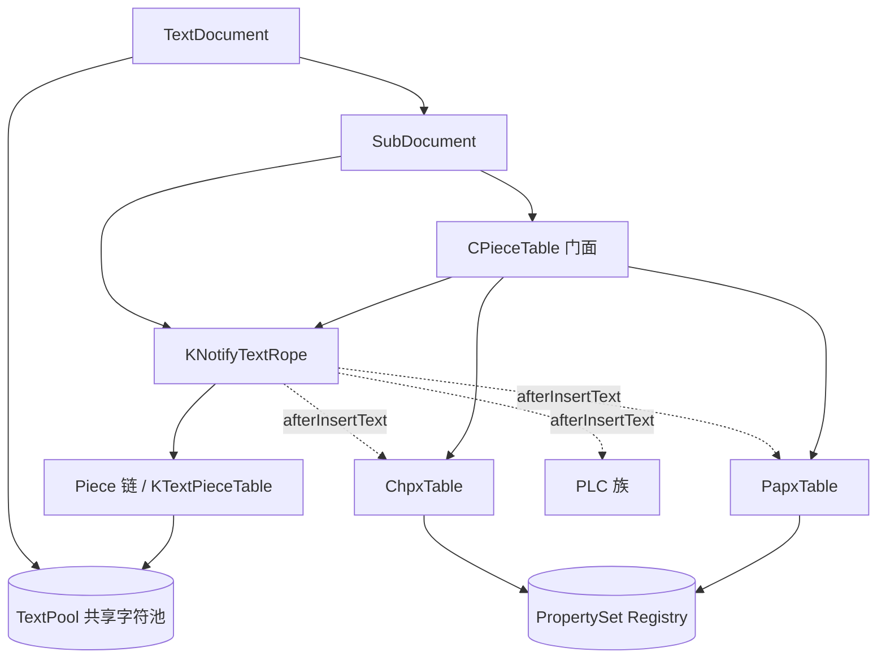

# wc-01-storage-write — 存储层文档

**feature**: [../README.md](../README.md) · **seeds 解析**: [../SEEDS_ANALYSIS.md](../SEEDS_ANALYSIS.md) · **seeds.csv**: [../seeds.csv](../seeds.csv)  
**前置**: [wave0-ooxml-standards](../../wave0-ooxml-standards/docs/README.md)（至少读 mapping）  
**下游**: [wc-02-document-model](../../wc-02-document-model/README.md)；写入调用方 [wc-04](../../wc-04-paragraph-import/README.md)

本文是本 feature **唯一**技术文档（不再按类拆分 md）。

---

## A. 子功能职责与验收

把「字符流 + 按 CP 切分的属性 + CP 上的结构节点」落成可追加、可查询的内存结构。  
没有本层，`importRunText` / `importParagraphEnd` 无处可写。

| 组件 | 承接概念 |
|------|----------|
| textrope | `w:t` + 合成 `\r`/`\f` |
| ChpxTable | `w:r` / `w:rPr` |
| PapxTable | `w:p` / `w:pPr` |
| PLCSection | Section / `sectPr` |
| CPieceTable | 门面（非 OOXML Part） |
| CoreHelper | 写入门面 |
| *TableFactory | `createChpxTable` / `createPapxTable` |

### 写入热路径（钉死）

```text
CoreHelper.appendText(doc, text, chpx)
  → cp0 = length → rope.append → chpx.insert(cp0, chpx)

CoreHelper.appendParagraph(doc, endMark, cp0, chpx, papx)   # IO 主路径
  → appendText(endMark, chpx) → papx.insert(cp0, papx)      # papx 挂段首 CP

'\f' → PLCSection.setLastSectionEndCP(length) →（后续）addSection
```

### MVP 验收

- [ ] append 后 length / charAt 正确  
- [ ] 每段 run 有 CHPX；段末有 PAPX  
- [ ] `\f` 能更新 PLCSection  
- [ ] Listener 平移后 CP 与 Java 一致  

### Seeds 改写序（详见 SEEDS_ANALYSIS）

Factories → PapxTable → PLC → PLCSection → CPieceTable → **CoreHelper**

### Java ↔ Rust 对照（parse-01-storage）

| Java | Rust | 角色 |
|------|------|------|
| ITextRope / KNotifyTextRope / KTextPool | `collections/textrope/*` | 字符流 |
| CPTable / ChpxTable / PapxTable | `data/internal_v2/*` | 属性表 |
| PLC / PLCSection | `data/PLC*.rs` | 结构 PLC |
| CPieceTable | `data/CPieceTable.rs` | 门面 |
| CoreHelper | `helper/CoreHelper.rs` | 写入门面 |
| Chpx/PapxTableFactory | `*Factory.rs` | 工厂 |

**对齐**: CHPX insert = append **前** length；PAPX insert = **段首** CP；Notify 顺序 before→mutate→after。

---

## B. 存储模型详解

**目的**: 讲清本内核「字符流 + 属性区间 + CP 结构节点」这一套，以及它和排版引擎的边界。  
**前置**: [ooxml-standard-deep-dive](../../wave0-ooxml-standards/docs/ooxml-standard-deep-dive.md)（L0–L3 分层）

---

## 0. 先钉死结论（回答「像素级排版」疑问）

| 问题 | 答案 |
|------|------|
| TextRope / PLC / CPieceTable **是不是**像素级版面？ | **不是**。它们是 **L1 逻辑文档模型**（可编辑真相）。 |
| 它们在排版引擎里扮演什么角色？ | **唯一权威输入**：排版器按 CP 读字符与属性，再**计算出**行盒/页盒。 |
| 谁把「宽泛逻辑」变成「精准像素」？ | **`writer/layout`**（如 `PageViewLayouter` / `*LineLayouter`）+ 字体度量 + 渲染缩放。 |
| 存储层有没有「已经排好的页面树」？ | **没有**。页面树是 layout 的输出，通常不写回 TextRope。 |

一句话：

> **DOCX →（Importer）→ TextRope/CHPX/PAPX/PLC →（Layout）→ 行/页几何 →（Render）→ 像素。**  
> 本目录只负责中间那个「可编辑、可随机访问的逻辑稿」。

```text
DOCX (宽泛逻辑 + 格式意图)
        │  parse / import
        ▼
┌───────────────────────────────────────┐
│ L1  存储模型 ★ 本文主角                 │
│  TextRope  字符流（CP 坐标）            │
│  ChpxTable 字符属性区间                 │
│  PapxTable 段落属性                     │
│  PLC*      CP 上的结构节点（节/域/锚点） │
│  CPieceTable 门面（聚合三件套）         │
└───────────────────────────────────────┘
        │  layout 读取 seek(cp) / charAt / props
        ▼
┌───────────────────────────────────────┐
│ L2  排版结果（Layout Result）           │
│  Page / Column / Line / Run 几何盒     │
│  换行点、分页点、浮动占位…              │
└───────────────────────────────────────┘
        │  zoom / DPI / layout2render
        ▼
┌───────────────────────────────────────┐
│ L3  呈现（像素 / 打印）                 │
└───────────────────────────────────────┘
```

---

## 1. 它们为了解决什么问题

Word 类引擎面对的矛盾：

1. **编辑要快、要局部**：插入/删除一段字，不能整篇重写数组。  
2. **属性要稀疏**：同一段里多数字符共享字体；不能每字符一份属性拷贝。  
3. **结构要挂在字符上**：节、书签、形状锚点、域……必须跟着 CP 走，文本一插就自动平移。  
4. **排版要能随机查询**：「从 CP=1200 起这一段的段落属性是什么？这一 run 的字体？」——O(log n) 级查找。  
5. **与历史 .doc 模型对齐**：CHPX / PAPX / PLC / Piece Table 名词来自经典 Word 二进制；内核沿用同一心智，便于互通与人才复用。

| # | 矛盾 | 主数据结构 | 关键手段 |
|---|------|------------|----------|
| 1 | 局部编辑 | TextRope + TextPool（piece 链） | 拆片 / 拼片，不搬整篇 |
| 2 | 稀疏属性 | ChpxTable / PapxTable + PropertySet registry | 区间共享同一 prop id |
| 3 | 结构跟 CP | PLC（Listener） | insertSpaceBefore 平移节点 |
| 4 | 随机查询 | CPTable / 位置树 | `seek(cp)` ≈ O(log n) |
| 5 | 历史对齐 | 上述名词与形态 | 与 .doc / 人才心智同构 |

DOCX 的 XML 树（`w:p` / `w:r`）适合**交换**，不适合作为**运行时编辑与排版的主索引**。  
Importer 的工作就是把 XML **投影**成这套 CP 中心的内存模型。

---

## 1.1 数据结构总览图（一张看清装配关系）

```text
TextDocument
  ├── TextPool  ◄──────────────────────── 全文档共享字符池
  ├── KStyles / Numbering / Settings …
  └── SubDocument[type]   (Main / Header / Footnote …)
        │
        ├── KNotifyTextRope ──────────────► pieces ──► TextPool 切片
        │         │ Listener
        │         ├──────────────────────► ChpxTable
        │         ├──────────────────────► PapxTable
        │         └──────────────────────► PLC* (Section/Field/Bookmark/Shape…)
        │
        └── CPieceTable  (门面，持有 rope+chpx+papx 引用)
```



**同一 CP 轴上的多层叠加**（排版 `seek` 时读的就是这些层）：

```text
 CP 轴 ──►  0    1    2    3    4    5    6    7    8    9   10   11
 字符      [H]  [e]  [l]  [l]  [o] [\r]  [W]  [o]  [r]  [l]  [d] [\r]
            ├──────── piece₀ ────────┤├──────── piece₁ ────────┤
 CHPX      [==== Normal 12pt =====)[B)[==== Normal 12pt =====)
            └──────── run A ────────┘│└─────── run B ─────────┘
                                    Bold
 PAPX      [======== 段落0 居中 ========)[===== 段落1 左齐 =====)
 PLC Sec   ▲节0─────────────────────────────────────────────────►
 Bookmark       ▲bmStart                    ▲bmEnd
 Shape                 ▲anchor@CP=3
```

---

## 1.2 矛盾① 局部编辑 → TextRope / Piece / TextPool

### 反面：整数组

```text
char[] buf = "Hello\rWorld\r"
在 CP=5 前插入 "!!!" ：
  必须 memmove 后面所有字符 → O(n) 搬移整篇
```

### 正面：Piece 表 + Pool（只改索引，少搬字符）

```text
┌─ TextRope（逻辑 CP 视图）─────────────────────────────┐
│  piece₀: CP[0,6)  → pool FC[100,106)  "Hello\r"       │
│  piece₁: CP[6,12) → pool FC[200,206)  "World\r"       │
└───────────────────────────────────────────────────────┘
                         │
                         ▼
┌─ TextPool（物理字符，可换页）──────────────────────────┐
│  FC: … 100:H e l l o \r … 200:W o r l d \r …          │
└───────────────────────────────────────────────────────┘
```

**在 CP=5（`\r` 前）插入 `"!!!"`：**

```text
Before:
  piece₀ [0,6) → "Hello\r"
  piece₁ [6,12) → "World\r"

After（示意：拆片 + 新片指向 pool 新写入区）:
  piece₀a [0,5)  → "Hello"      (原片截断)
  piece_new [5,8) → "!!!"       (pool 尾部新写，不搬旧字符)
  piece₀b [8,9)  → "\r"         (原片剩余)
  piece₁  [9,15) → "World\r"    (仅改 CP 起点，FC 不变)

  旧 "Hello\r"/"World\r" 在 pool 里可以原地不动
```

```text
插入过程（结构视角）:

     CP: 0    5    6         12
         ├─── A ───┼── B ────┤
                   ▲ insert "!!!"

     CP: 0    5    8    9         15
         ├──A'─┼─N─┼─A"─┼─── B' ──┤
               └新片┘
```

类型栈：

```text
ITextPool / KTextPool / KSwappableTextPool
        ▲
KTextRope / KTextPieceTable   ← 分片索引
        ▲
KTransactionTextRope          ← 可撤销
        ▲
KNotifyTextRope               ← SubDocument 实际持有
```

---

## 1.3 矛盾② 稀疏属性 → ChpxTable / PapxTable / Registry

### 反面：每字符一份属性

```text
CP:  0 1 2 3 4 5
     H e l l o \r
props[0]=Font{宋体,12}  props[1]=同样拷贝  … ×6 份
```

### 正面：区间 Entry + 共享 PropertySet id

```text
┌─ ChpxTable（字符属性区间，半开 [pos, next)）────────────┐
│                                                         │
│  Head(哨兵) position == document.length()               │
│                                                         │
│  Entry₀  pos=0   propId=7  ──► Registry[7] = {宋体,12} │
│  Entry₁  pos=5   propId=7  ──► 同一 id（段末也可共享）  │
│  Entry₂  pos=6   propId=9  ──► Registry[9] = {粗体,…}  │
│  …                                                      │
│  Head    pos=N                                          │
└─────────────────────────────────────────────────────────┘

┌─ PapxTable（段落属性，IO 路径挂在段首 CP）──────────────┐
│  Entry₀  pos=0   propId=3  → {对齐:居中, sti:Normal}   │
│  Entry₁  pos=6   propId=4  → {对齐:左,   sti:Heading1} │
│  Head    pos=N                                          │
└─────────────────────────────────────────────────────────┘

┌─ KPropertySet Registry ─────────────────────────────────┐
│  id → 冻结后的 PropertySet（去重，多 Entry 共指）        │
└─────────────────────────────────────────────────────────┘
```

**与字符对齐的一张图：**

```text
文本 CP:   0         5  6        11 12(=len)
字符:      H e l l o \r W o r l d \r
           ├─ CHPX id=7 ─┤├ CHPX id=9 ┤
           ├──── PAPX id=3 ────┤├── PAPX id=4 ──┤
```

`CoreHelper.appendText` 写入顺序：

```text
pos = length()
rope.append(text)           # 字符先进
chpx.insert(pos, props)     # 再挂区间起点
# 段结束时:
papx.insert(cp0, paraProps) # PAPX 在段首
```

---

## 1.4 矛盾③ 结构跟 CP → PLC + TextRope Listener

```text
┌─ PLC（环形链表 + 位置树）──────────────────────────────┐
│                                                         │
│   Head ⇄ Node₀ ⇄ Node₁ ⇄ Node₂ ⇄ … ⇄ Head             │
│           │        │        │                           │
│        pos=0    pos=120  pos=800                        │
│        Section  Bookmark ShapeAnchor                    │
└─────────────────────────────────────────────────────────┘
         ▲
         │ 注册为 KNotifyTextRope.Listener
         │
┌─ 文本变更时 ────────────────────────────────────────────┐
│  afterInsertText(cp, fc, len):                          │
│    所有 position ≥ 锚点 的 Node                         │
│      → insertSpaceBefore / 平移 +len                    │
│  beforeRemoveText / afterRemove:                        │
│    落在删除区内的 Node 删除；右侧 Node 左移              │
└─────────────────────────────────────────────────────────┘
```

**插入导致结构平移：**

```text
Before insert 3 chars at CP=100:

  字符 …[99][100][101]…
  PLC:       ▲Bookmark@100    ▲Section@500

After:

  字符 …[99][100][101][102][103]…   ← 新字符占 100..102
  PLC:             ▲Bookmark@103      ▲Section@503
                   （整体 +3，仍锚在「同一逻辑点」之后）
```

`PLCSection` 特化：

```text
PLCSection
  ├── mLastSecEndCP
  └── SectionNode @ cp
        ├── PropertySet（pgSz / pgMar / 分栏…）
        ├── even/odd/first Header  → 其它 SubDocument 的 PLC.Node
        └── even/odd/first Footer
```

---

## 1.5 矛盾④ 随机查询 → 位置树上的 `seek(cp)`

```text
排版热路径（示意）:

  cp = 1200
       │
       ├─► papx.seek(1200)  ──O(log n)──► Entry { pos=1180, paraProps }
       ├─► chpx.seek(1200)  ──O(log n)──► Entry { pos=1195, runProps  }
       ├─► rope.charAt(1200) / getText(...)
       └─► plcSection.getSection(1200) → 当前节页框
```

**CPTable / PLC 查找形态（概念）：**

```text
            [位置树 / 有序节点]
                   │
          ┌────────┼────────┐
       pos=0     pos=500   pos=2000     Head(pos=len)
         │         │         │
      Entry/Node  …         …
         │
   seek(1200): 找到「最大的 pos ≤ 1200」的节点
               → 该节点属性覆盖到 next.pos
```

区间语义：

```text
seek(cp) → Entry_i
覆盖范围:  [ Entry_i.pos , Entry_{i+1}.pos )
```

---

## 1.6 矛盾⑤ 历史对齐 → 名词与形态对照

```text
经典 .doc 文件概念          本内核运行时
─────────────────────      ─────────────────────────
Piece Table (文本片)   ≈   KTextPieceTable / Rope pieces
CLX / 字符流           ≈   TextRope + TextPool
CHPX 流                ≈   ChpxTable + PropertySet
PAPX 流                ≈   PapxTable + PropertySet
PLC (fkp/plcf…)        ≈   PLC / PLCSection / …
（无独立「页面表」）    →   Layout 运行时另建（不在存储层）

本仓库 CPieceTable     =   门面(rope+chpx+papx)，≠ 经典 Piece Table 本体
```

```text
┌────────────────── SubDocument ──────────────────┐
│                                                  │
│   ┌─ 经典「内容三件套」─╮                        │
│   │  TextRope            │◄── CPieceTable 门面   │
│   │  ChpxTable          │                        │
│   │  PapxTable          │                        │
│   └─────────────────────╯                        │
│   ┌─ 经典 PLC 族 ───────╮                        │
│   │  PLCSection / Field │                        │
│   │  Bookmark / Shape…  │                        │
│   └─────────────────────╯                        │
└──────────────────────────────────────────────────┘
```

---

## 1.7 五矛盾 × 数据结构：对照一图

```text
                 ┌─────────────────────────────────────┐
                 │            CP 公共坐标轴              │
                 └─────────────────────────────────────┘
                    │         │         │         │
         ┌──────────┘    ┌────┘    ┌────┘    ┌────┘
         ▼               ▼         ▼         ▼
   ┌──────────┐   ┌──────────┐ ┌──────┐ ┌─────────┐
   │ TextRope │   │ ChpxTable│ │Papx  │ │  PLC*   │
   │ + Pool   │   │ + Reg.   │ │Table │ │         │
   └────┬─────┘   └────┬─────┘ └──┬───┘ └────┬────┘
        │              │          │          │
        │ ①局部编辑    │ ②稀疏    │ ②稀疏   │ ③跟 CP
        │              │          │          │
        └──────────┬───┴────┬─────┴──────────┘
                   │        │
                   │   ④ seek(cp) O(log n)
                   │        │
                   ▼        ▼
              ┌────────────────────┐
              │ CPieceTable 门面   │  ⑤ 历史心智：三件套一站式
              └────────────────────┘
```

---

## 2. 坐标：CP（Character Position）

一切的枢纽是 **CP**：子文档内从 0 起的字符下标。

| 概念 | 含义 |
|------|------|
| CP | 逻辑字符位置；`document.getLength()` = 当前长度 |
| FC | File/pool 侧偏移（`cp2fc` / `fc2cp`）；大文档/换页池时有用 |
| 区间半开 | 属性节点通常描述 `[pos, next.pos)` |

**段边界不是 XML 元素，而是合成控制字符**（见 [wordprocessingml.md](../../wave0-ooxml-standards/docs/wordprocessingml.md)）：

| 字符 | 典型含义 |
|------|----------|
| `\r` | 段落结束 |
| `\f` | 分节（Form Feed）→ 驱动 `PLCSection` |
| 单元格标记等 | 表格结构 |

排版与 PLC 都认这些标记；DOCX 里本来没有「CHPX 字节流」，是导入时造出来的。

---

## 3. TextRope：可变字符流

> 📖 **深读**（类图 / 流程图 / 关键方法 / 设计意图）：见
> [textrope-deep-dive.md](./textrope-deep-dive.md)。本节是概览；深读逐类展开
> KTextRope / IntervalMap 双树 / KTextPool 块式池 / 事务与通知层。

### 3.1 职责

文档正文（某个 `SubDocument`）的**字符存储**。  
接口：`append` / `insert` / `erase` / `charAt` / `getText` / `length`。

### 3.2 为何叫 Rope / Piece

经典数据结构：文本拆成若干 **piece（片）**，片指向底层 **TextPool** 里的一段连续字符。

```text
逻辑视图（CP）:  [H][e][l][l][o][\r][W][o][r][l][d][\r]
                     └── piece A ──┘  └── piece B ──┘

TextPool（可能很大、可换页）:
  … "Hello\r" … "World\r" …
```

好处：

- **尾部 append（IO 热路径）** 几乎只增长最后一片  
- **中间插入** 可拆片，不必移动整篇  
- 多 `SubDocument` **共享同一个 TextPool**，各自有一条 rope 视图

### 3.3 关键类型分层

| 类型 | 角色 |
|------|------|
| `ITextPool` / `KTextPool` | 字符字节/字符池 |
| `KTextRope` / `KTextPieceTable` | 分片 rope |
| `KTransactionTextRope` | 事务 |
| `KNotifyTextRope` | **SubDocument 实际使用**：变更前后通知 Listener |

### 3.4 Notify：让属性表与 PLC 跟着文本走

```text
insertImpl(cp, fc, length):
  listener.beforeInsertText(...)
  真正插入
  listener.afterInsertText(...)   ← Chpx/Papx/PLC 在此平移节点
```

`SubDocument` 把 `ChpxTable`、`PapxTable`、各 `PLC` 挂进 `TextRopeListeners`。  
**没有这套通知，属性 CP 会和字符脱节**——排版读到的将是错位的「幽灵属性」。

### 3.5 在排版中的角色

Layout 问 rope：

- `charAt(cp)` / `getText(start,end)` → 量宽、断行、找 `\r`/`\f`  
- `length()` → 流结束  

它**不**问 rope「第 3 页在哪」——那是 layout 自己算的。

---

## 4. CHPX / PAPX：按 CP 切分的属性表

> 📖 **深读**（类图 / 流程图 / 关键方法 / 设计意图）：见
> [chpx-papx-deep-dive.md](./chpx-papx-deep-dive.md)。本节是概览；深读逐类展开
> CPTable / ChpxTable / PapxTable / ReferenceTable / KPropertySetRegistry。

名称来自 Word 二进制：**Ch**aracter **P**roperty e**X**ceptions / **P**aragraph **P**roperty e**X**ceptions。

### 4.1 共同形态（CPTable）

每个 Entry：`position()` + `PropertySet`（经 registry 变成整数 id）。  
语义：从该 CP 起到下一 Entry（或 Head）之前，属性为此套。

```text
CP:     0         5     7        12
CHPX:   [Normal)──[Bold)─[Normal)──[ Head→length ]
文本:   H e l l o \r W o r l d \r
```

### 4.2 ChpxTable —— Run 级

对应 OOXML `w:r` + `w:rPr`。

写入（见上文 [§A 热路径](#写入热路径钉死)）：

```text
pos = length()          # append 前
rope.append(text)
chpx.insert(pos, props) # 新 run 属性挂在刚写入区间起点
```

文本增长时，Listener 对后续节点做 `insertSpaceBefore`，保持区间对齐。

### 4.3 PapxTable —— 段落级

对应 `w:p` + `w:pPr`。  
**IO 主路径**把 PAPX 挂在**段首 CP**（`importParagraphEnd` 记下的 `cp0`），不是段末 `\r` 的 CP。

```text
一段 "Hi" + \r:
  rope:  H i \r          CP 0,1,2
  CHPX:  至少覆盖 [0,2] 与段末字符
  PAPX:  insert(0, paraProps)   # 描述这一整段
```

### 4.4 PropertySet 是什么

扁平的 **propId → 值**（字体名、字号、加粗、对齐、缩进、样式 sti…）。  
来自 OOXML 的树形 `rPr`/`pPr` 经 Converter **投影**而来；propId 是**内核契约**，不是 OOXML 标准号。

排版前通常还要做 **样式层叠**（段落样式 ⊕ 字符样式 ⊕ 直接格式 ⊕ docDefaults ⊕ theme），得到「最终属性」再量字。

### 4.5 在排版中的角色

Layout 代码（本仓库 Java 侧大量存在）典型用法：

```text
para = document.getPapxTable().seek(cp)     # 当前段落
run  = document.getChpxTable().seek(cp)     # 当前 run
finalRunProp = compose(run, para, styles…)  # 最终字符属性
measureWidth(text, finalRunProp, font…)     # → 像素/布局单位宽度
```

例如 `PhoneViewLineLayouter`、`PageViewFootEndNoteLayouter`、`PaginationTool` 都是 `seek(cp)` 读表。

**CHPX/PAPX 存的是意图与直接格式，不是行高像素结果。**

---

## 5. PLC：挂在 CP 上的结构表

> 📖 **深读**（类图 / 流程图 / 关键方法 / 设计意图）：见
> [plc-deep-dive.md](./plc-deep-dive.md)。本节是概览；深读逐类展开
> PLC / PLCSection / SectionNode / ListIndexPositionTree。
> 代码走读（Rust 实现 / 上下游数据流 / 流程角色 / 图）：[plc-code-walkthrough.md](./plc-code-walkthrough.md)。

### 5.1 名字与职责

PLC ≈ **P**iece **L**inked to **C**haracters（历史亦称 Word 文件里的 PLC 表）。  
基类 PLC：在 CP 上挂**非纯文本结构节点**的有序表（环形链表 + 位置树）。

子类例子：

| PLC | 节点含义 |
|-----|----------|
| `PLCSection` | 节；页大小/边距/页眉页脚引用 |
| `PLCField` | 域 |
| 书签 / 形状锚点 / 脚注引用… | 各结构 |

文本插入/删除时，PLC 作为 Listener **平移或删除节点**，保证「锚在第 N 个字符上」始终成立。

### 5.2 PLCSection（排版最敏感的一种）

见本节下文。

- 分节符 `\f` → `setLastSectionEndCP`  
- `addSection(cp)` → 插入 `SectionNode`  
- 节点上挂节属性 + header/footer 子文档引用  

**页面视图排版**（`PageViewSectionLayouter` / `PageViewLayouter`）会：

1. 用 `getPLCSection()` 取当前节  
2. 读纸张、边距、分栏 → 定 **页框与正文区**  
3. 在该几何约束下对 CP 流做段落/行排版  

没有 PLCSection，引擎不知道「从哪一页规则开始排」。

### 5.3 在排版中的角色

| 存储 | Layout 用法 |
|------|-------------|
| TextRope | 字符与边界标记 |
| Papx/Chpx | 段/run 格式与样式 |
| PLCSection | **页面坐标系**（纸张、边距、栏） |
| 其它 PLC | 域结果、锚点对象、脚注跳转… |

PLC **仍不是**「第 5 页的 LayoutPage 对象」；它是「从 CP=X 起换用这套节属性」的**逻辑分界**。

---

## 6. CPieceTable：门面，不是 OOXML Part

### 6.1 经典 Word「Piece Table」vs 本仓库

| | 经典 .doc Piece Table | 本仓库 `CPieceTable` |
|--|----------------------|----------------------|
| 本质 | 文本 piece 索引（多段存储、编码切换） | **门面**：聚合 rope + chpx + papx |
| IO append | 改 piece 表 | **不经** PieceTable；直接 `CoreHelper` → rope/表 |
| 排版 | 经 piece 映射到字符 | 多数路径直接 `getTextRope/Chpx/Papx`；PieceTable 提供遍历/辅助 API |

见本节下文与 [mapping-to-kernel.md](../../wave0-ooxml-standards/docs/mapping-to-kernel.md)。

### 6.2 字段与职责

```text
CPieceTable
  ├── mTextRope
  ├── mChpxTable
  ├── mPapxTable
  ├── mGuessedTotalLength   ← DocxReader 预估，优化用
  └── document / revision 辅助
```

提供：`getTextRope/Chpx/Papx`、`charAt`、`getText`、`cp2fc`、形状相关判定、`begin/end` 走 chpx 迭代等。

**心智模型**：把它想成「子文档内容的统一手柄」，而不是第四种独立存储。

### 6.3 与 SubDocument 装配

```text
NotifyTextRope + 共享 TextPool
  → ChpxTable / PapxTable
  → TextRopeListeners(chpx, papx, …)
  → CPieceTable(this)          # 门面
  → createPLC()                # PLCSection 等
```

详见 [SubDocument.md](../../wc-02-document-model/docs/SubDocument.md)。

---

## 7. 从 DOCX「宽泛逻辑」到「精准排版」——完整链路

下面把「转化」拆成四步。**前两步是存储层；后两步才是像素。**

### 步骤 A：DOCX → L1（Importer，本 MVP 主战场）

```text
<w:p>
  <w:pPr>…</w:pPr>
  <w:r><w:rPr>…</w:rPr><w:t>Hello</w:t></w:r>
</w:p>
```

↓ `CoreHelper` / Importer

```text
rope   += "Hello" + '\r'
chpx   : [0,5) runProps; [5,6) break 的 chpx
papx   : position=0 → paraProps（含样式 sti、对齐、缩进…）
（若分节）\f + PLCSection.addSection(...)
```

此时：**仍无换行、无分页、无 x/y。**  
但已经是排版引擎能高效查询的**规范输入**。

### 步骤 B：样式解析（仍属逻辑，接近排版前处理）

```text
最终段属性 = docDefaults ⊕ 段落样式链 ⊕ 直接 pPr ⊕ 编号 …
最终字属性 = … ⊕ 字符样式 ⊕ 直接 rPr ⊕ 主题字体 …
```

输出仍是 PropertySet / 度量参数，不是像素盒。

### 步骤 C：Layout —— **这里才变成精准几何**

排版引擎（`koffice/writer/.../layout/...`）大致：

```text
1. 取节：PLCSection → 页宽、页高、页边距、栏宽
2. 按 PAPX 切段：seek(cp) 得段起止
3. 段内按 CHPX 切 run；对每个 run：
     取字体度量（glyph advance、行高、基线）
     贪心/规则断行 → 得到 Line：起止 CP + 各 glyph 的 x
4. 行高、段前段后、对齐（左/中/右/两端）→ 行在页内的 y
5. 空间不够 → 分页 / 分栏；浮动图按锚点与环绕参与占位
6. 产出 Layout 树：Page → (Column) → Line → Run/Glyph 几何
```

「精准」来自：

- **字体文件的真实宽度表**（同一逻辑字号，不同字体宽度不同）  
- **实现定义的断行/分页算法**  
- **布局单位**（引擎内部常先用 twip / 布局坐标，再经 `layout2render_*` 乘 zoom 变屏幕像素）

对照本仓库已有工具：`LayoutMetricsUtil` / `ZoomService` 的 `layout2render_x/y` —— 说明 **layout 坐标与 render 像素是两层**。

### 步骤 D：Render —— 像素绘制

用 Layout 树画字形、边框、底纹、图片。  
缩放、HiDPI、抗锯齿属于 L3，不再改 L1。

---

## 8. 为什么不能指望存储层「直接给出像素布局」

| 若把像素页树存进 DOCX/存储 | 后果 |
|---------------------------|------|
| 改一个字 | 可能整章页树失效 |
| 换字体/缺字 | 旧页树全部错误 |
| 改页边距/纸张 | 必须重排 |
| 手机视图 vs 打印视图 | 需要多套页树 |

所以 Word 系选择：

> **持久化 / 编辑真相 = CP 流 + 属性 + PLC**  
> **像素真相 = 打开后（或改后）重算的 Layout 缓存**

TextRope 族解决的是前半句；Layout 模块解决后半句。

---

## 9. 一张「最小例子」走完两层

逻辑输入（导入后）：

```text
CP:  0 1 2 3 4 5
     H e l l o \r
CHPX: [0,5) 宋体 12pt; [5,6) …
PAPX: [0 → …) 两端对齐, 首行缩进 2 字符
PLCSection: 一节, A4, 上下左右边距 2.54cm
```

排版输出（示意，单位任意）：

```text
Page 0: contentBox = (x:90, y:90, w:595-180, h:…)   # 由节边距算出
  Line 0: y=90, baseline=110
    glyph 'H' @ x=90+indent
    glyph 'e' @ x=…
    …
  （若行宽不够则 Line 1 …）
```

注意：`Hello\r` 六个 CP 仍在 TextRope 里；**Line/Page 是另一棵树**，用 CP 范围回指存储。

---

## 10. 组件职责速查

| 组件 | 解决的问题 | 排版角色 | 是否含像素页树 |
|------|------------|----------|----------------|
| TextRope | 可变字符流、编辑局部性 | 提供字符与边界 | 否 |
| ChpxTable | 稀疏字符属性 | 按 CP 取 run 格式 | 否 |
| PapxTable | 段落属性与段边界索引 | 按 CP 取段格式/切段 | 否 |
| PLC / PLCSection | 结构锚点、节页面设置 | 定页框、结构跳转 | 否（仅约束） |
| CPieceTable | 统一访问门面 | 辅助遍历/查询 | 否 |
| Layout 引擎 | 断行分页、几何 | **生产**行/页盒 | **是（运行时）** |
| Render | 绘制 | 像素/打印 | 是 |

---

## 11. 常见误解

| 误解 | 校正 |
|------|------|
| 「CPieceTable 就是排版的 page table」 | 它是内容门面；page 在 layout |
| 「导入完 TextRope 就已经像素排好」 | 只建好 L1；还要 layout |
| 「PLC 存的是每一页」 | PLCSection 存的是**节**；一节可对应很多页 |
| 「CHPX 区间 = 屏幕上的 run 盒」 | CHPX 是逻辑 run；一行上可能有多个 run，一个 run 也可能折行 |
| 「CP 等于像素 x」 | CP 是字符下标；x 由度量累加得到 |

---


## 附录：五句话带走

1. **TextRope** = 以 CP 寻址的可变正文。  
2. **CHPX/PAPX** = 挂在 CP 上的稀疏格式表（DOCX 的 rPr/pPr 投影）。  
3. **PLC** = 挂在 CP 上的结构（节给出页框约束）。  
4. **CPieceTable** = 上述内容的门面，不是像素版面。  
5. **像素级精准**来自 Layout 读 L1 + 字体度量 + 断行分页算法；存储层提供的是**可重排的精确逻辑输入**，不是最终版面快照。
