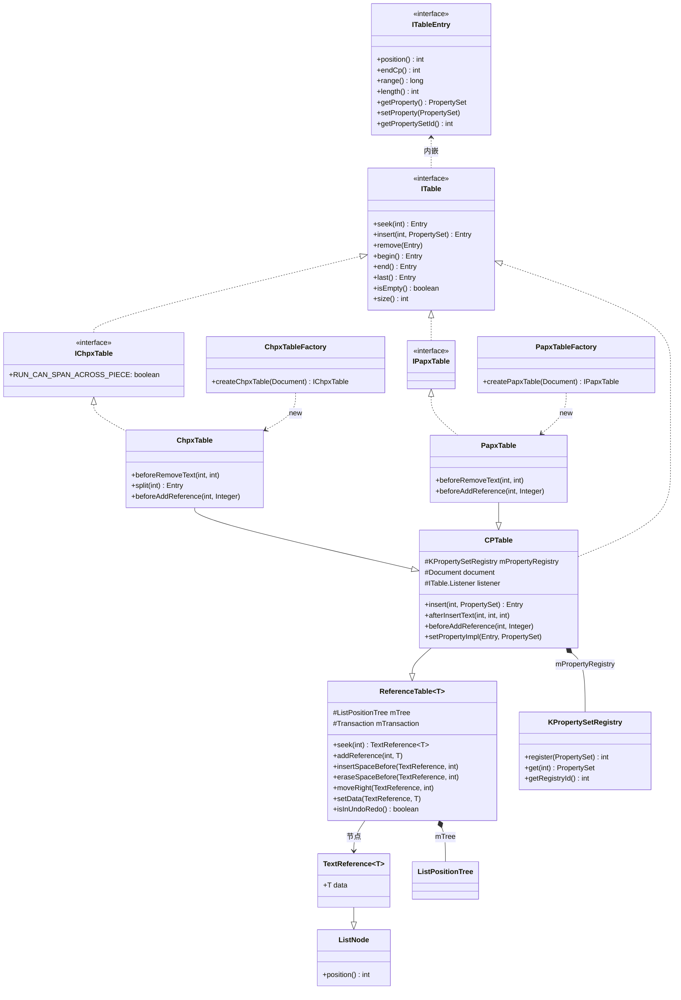
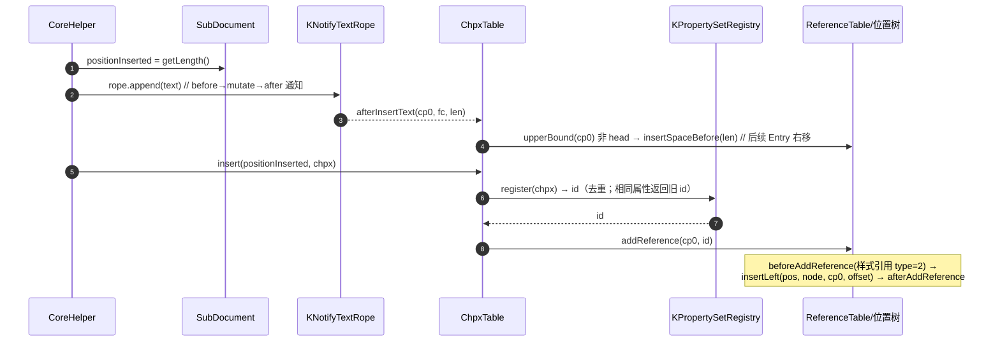
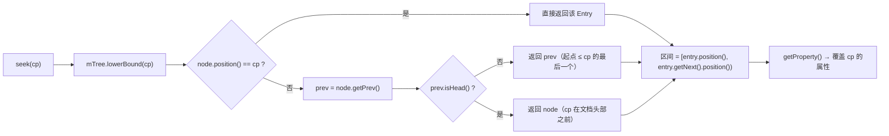
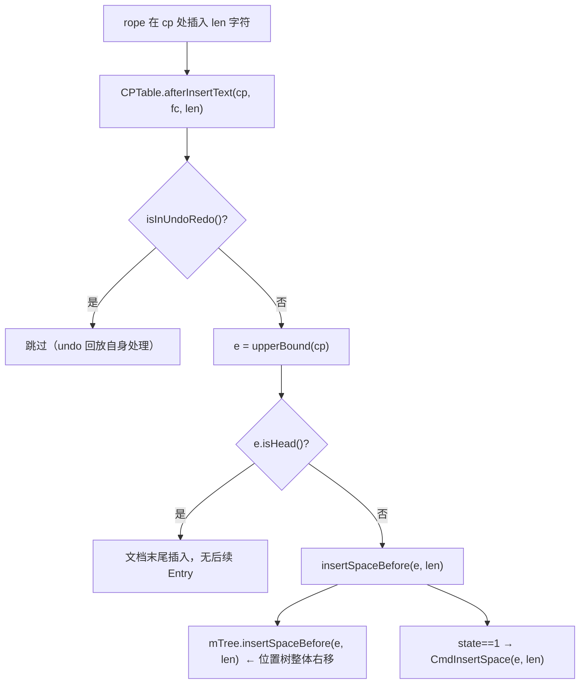
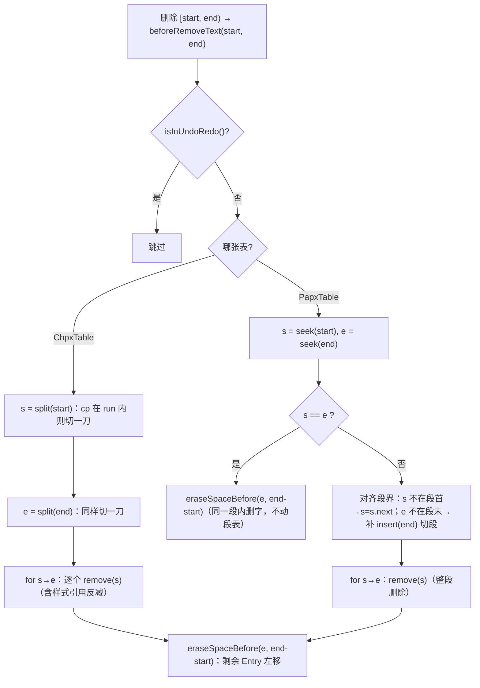
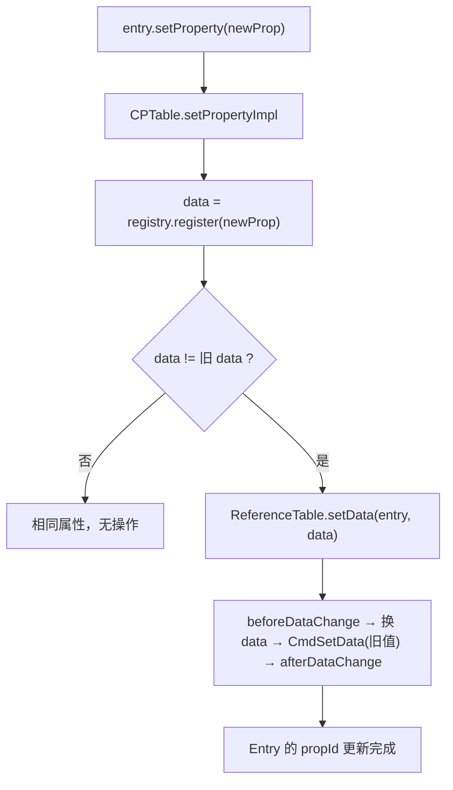

# CHPX / PAPX 属性表深读（设计意图 · 类图 · 流程图 · 关键方法）

> 归属：`wc-01-storage-write` · 状态：实现已 done（Java ↔ Rust 对齐）
> 回答的问题：**属性为什么按 CP 切区间存**、Entry 为什么只存 int、删除/插入时表如何
> 自我同步、Chpx 与 Papx 的差异在哪。
> 概览与心智模型：[STORAGE.md](./STORAGE.md) §1.3 / §4 · [STRUCTURE_ANALYSIS.md](../STRUCTURE_ANALYSIS.md) §0.5
> Java 源码：`koffice/writer/core/cn/wps/moffice/writer/data/`（接口）+ `data/internal_v2/`（实现）

---

## 0. 家族全景：一条"区间表"的解剖

```text
ITable（基契约：seek/insert/remove/Entry 语义/Listener）
   ▲
IChpxTable / IPapxTable        ← 字符/段落两种面向
   ▲
CPTable（抽象：PropertySet Registry + 位置树接线）      ← 家族中枢
   ├── ChpxTable    （字符属性，run 级）
   └── PapxTable    （段落属性，段级）
        ▲
ReferenceTable<T>（泛型位置表：增删/平移/undo）         ← 通用机制
        │  mTree = ListPositionTree(head)
        └── TextReference<T>（= ListNode + data 负载）
KPropertySetRegistry（PropertySet 去重表：对象 → int id）
ChpxTableFactory / PapxTableFactory（创建入口）
```

**一句话定位**：CHPX/PAPX 表 = **有序的 (cp, propId) 区间列表**。一个 Entry 表示
"从 `position()` 起到下一个 Entry（或文档末尾）之前，字符/段落属性是 `getProperty()`"。
文本插入/删除时，表作为 `ITable extends INotifyTextRope.Listener` 收到通知并**平移/切分/
删除自己的 Entry**——保证属性区间永远与字符对齐。

---

## 1. 类图（接口 / 字段 / 关键方法）

### 1.1 接口层

| 接口 | 关键成员 | 设计意图 |
|------|---------|---------|
| `ITable extends IDisposable, INotifyTextRope.Listener` | `isEmpty/begin/end/last/seek/insert/remove/size/setListener/treeNext/treePrev`；内嵌 `Entry { position(); endCp(); range(); length(); getPrev/Next; isHead/isEnd/isLast; getProperty(); setProperty(); getPropertySetId() }`；内嵌 `Listener { before/afterAddEntry, before/afterRemoveEntry, before/afterDataChange }` | 属性表的统一契约：**任何属性表都是文本监听者**；Entry 提供区间几何（`[position, endCp)`） |
| `IChpxTable extends ITable` | `RUN_CAN_SPAN_ACROSS_PIECE = true`、`createCpIterator`、`Entry { getProperty/setProperty }` | 字符属性表 |
| `IPapxTable extends ITable` | 同构于 Chpx | 段落属性表 |

**`ITable.Entry` 的区间语义（钉死）**：

```text
entry.endCp()  = entry.getNext().position()    // 半开区间 [position, endCp)
entry.range()  = RANGEFactory.getRANGE(position, endCp)   // 打包成 long
entry.length() = endCp - position
```

### 1.2 `CPTable extends ReferenceTable<Integer> implements ITable`（家族中枢）

```java
public abstract class CPTable extends ReferenceTable<Integer> implements ITable {
   static final int PROPERTYSET_BITS = 18;
   KPropertySetRegistry mPropertyRegistry;   // PropertySet → int id 去重表
   Document document;
   ITable.Listener listener;
}
```

| 方法 | 逻辑 | 热路径 |
|------|------|--------|
| 构造 | `mPropertyRegistry = new KPropertySetRegistry(document.getTextDocument().getUUPropertySetRegistryId())`；`setTransaction(textDocument.getTransaction())` | — |
| `insert(cp, property)` | `addReference(cp, mPropertyRegistry.register(property))`——**属性先进注册表换 int，再落树** | ★ |
| `seek(cp)` | 继承 `ReferenceTable.seek`：`lowerBound(cp)`，`position()!=cp` 时取 prev（"最大 pos ≤ cp"） | ★ 排版 |
| `afterInsertText(cp, fc, len)` | 非 undo/redo：`upperBound(cp)` 非 head → `insertSpaceBefore(entry, len)`——**后续 Entry 右移** | ★ 文本插入 |
| `setPropertyImpl(entry, prop)` | `data = registry.register(prop)`；`data != old` → `setData(entry, data)`（触发 before/afterDataChange） | 改属性 |
| `beforeAddReference(cp, data)` | `listener.beforeAddEntry(cp, registry.get(data))` | 样式引用钩子 |
| `begin/end/last` | `head.getNext()` / `head()` / `head.getPrev()` | 遍历 |
| `Head` | `position() = document.getLength()`（**哨兵 = 文档实时长度**）；`getPropertySetId()=0`；其余方法抛 RuntimeException | 哨兵 |

### 1.3 `ChpxTable extends CPTable implements IChpxTable`（字符属性）

| 方法 | 逻辑 |
|------|------|
| `insert(cp, property)` | `super.insert`（registry 去重 + 落树） |
| `beforeRemoveText(start, end)` | **非 undo/redo**：`s = split(start)`；`e = split(end)`；删 `[s, e)` 全部 Entry；`eraseSpaceBefore(e, end-start)`——**先切出边界，再删中间，再左移** |
| `split(cp)`（private） | `seek(cp)` 非 end 且 `position()!=cp` → `insert(cp, chpx.getProperty())`——在 cp 处**切一刀**（同一属性复制到新 Entry） |
| `beforeAddReference(cp, data)` | `super` + **`StyleListenerBase.addStyleRef(styles, prop, null, 2)`**（字符样式引用 type=2） |
| `beforeRemoveReference` | 对称 `removeStyleRef(…, 2)` |
| `Head extends Entry` | `position() = document.getLength()`；`moveRight` no-op；查询方法抛异常 |

### 1.4 `PapxTable extends CPTable implements IPapxTable`（段落属性）

| 方法 | 逻辑 |
|------|------|
| `beforeRemoveText(start, end)` | **与 Chpx 不同的删法**（见 §3.4）：不先 split(start)；`s=seek(start)`, `e=seek(end)`；`s==e` → 只 `eraseSpaceBefore(e, end-start)`；否则对齐段界后删中间 Entry——**段落表按"段"删除，不是按 run** |
| `beforeAddReference(cp, data)` | `super` + **`addStyleRef(…, null, 191)` 且 `addStyleRef(…, null, 292)`**（段落样式 sti + 样式引用） |
| `beforeRemoveReference` | 对称 `removeStyleRef(…, 191)` / `removeStyleRef(…, 292)` |
| `Head extends Entry` | 同 Chpx 结构 |

### 1.5 `ReferenceTable<T>`（泛型位置表——真正的机制层）

```java
public abstract class ReferenceTable<T> {
   ListPositionTree mTree;          // 环形链表 + 位置树
   Transaction mTransaction;        // undo/redo（state==1 才提交）
}
```

| 方法 | 逻辑 |
|------|------|
| `seek(cp)` | `lowerBound(cp)`；`position()!=cp` → 取 prev（非 head）——"最大 pos ≤ cp" |
| `addReference(cp, data)` | `lowerBound(cp, offset)` 定位 → `addReferenceImpl`：`beforeAddReference` → `mTree.insertLeft(pos, pNew, cp, offset)` →（state==1）`CmdInsert` → `afterAddReference` |
| `insertSpaceBefore(pFrom, len)` | 非 head：`mTree.insertSpaceBefore(pFrom, len)` + `CmdInsertSpace`——**文本插入时后续 Entry 平移** |
| `eraseSpaceBefore(pFrom, len)` | `insertSpaceBefore(pFrom, -len)`——左移 |
| `moveRight/moveLeft(node, len)` | 单节点平移 + `CmdMoveRight` |
| `setData(node, data)` | `beforeDataChange` → 换 data → `CmdSetData(旧值)` → `afterDataChange` |
| `removeReference(node)` | `beforeRemoveReference` → `mTree.erase` → `CmdRemove` → `afterRemoveReference` |
| `isInUndoRedo()` | `state ∈ {2,3}` |
| 抽象钩子 | `before/afterAddReference`、`before/afterRemoveReference`、`before/afterDataChange`、`createNode/createHead` |

内部 undo 命令：`CmdInsert` / `CmdRemove` / `CmdSetData` / `CmdInsertSpace` / `CmdMoveRight`
（execute/unexecute 成对；节点被删后 `parent==null` 时 `find(cp)` 重新定位）。

### 1.6 `TextReference<T> extends ListNode`

```java
public class TextReference<T> extends ListNode {
   T data;                                  // 负载（CPTable 里 T = Integer = registry id）
   int position() { return super.position(); }   // 经位置树计算的 CP
}
```

### 1.7 `KPropertySetRegistry`（PropertySet 去重表，data/internal）

```java
public class KPropertySetRegistry {
   private int mRegistryId;
   private List<PropertySet> mList;      // id → PropertySet
   private Map<PropertySet, Integer> mMap;  // PropertySet → id（去重）
   // 构造时先 register(PropertySet.empty) → id 0 恒为"空属性"
}
```

| 方法 | 逻辑 |
|------|------|
| `register(p)` | null → 0；已在 map → 旧 id；否则追加返回新 id |
| `get(id)` | 越界 → `PropertySet.empty`（防御） |
| `getRegistryId()` | 每个 document 的注册表专属 id（`getPropertySetId = (registryId << PROPERTYSET_BITS) + data`） |

### 1.8 工厂

```java
public class ChpxTableFactory {
   public static IChpxTable createChpxTable(Document document) {
      return document == null ? null : new ChpxTable(document);
   }
}
// PapxTableFactory 完全对称
```

**职责**：`SubDocument` 构造时的唯一创建入口，避免外层依赖包私有实现类。

### 1.9 类层次总图（mermaid）



---

## 2. 设计意图（为什么）

### 2.1 为什么"按 CP 切区间"而不是每字符一份属性

同一 run 里多数字符共享格式。存"变化点"（run 起点）比存"每个字符的属性"省
**一个数量级**：文档 10 万字、100 个格式变化 → 只需 ~100 个 Entry。排版按
`seek(cp)` 取"覆盖 cp 的那个区间"即可，无需逐字符比对。

### 2.2 为什么 Entry 只存 int（registry id）而不是 PropertySet 对象

1. **去重**：`KPropertySetRegistry` 保证相同属性只存一份；多 Entry 共享 id。
2. **紧凑**：节点负载是 4 字节 int，不是对象引用。
3. **比较快**：`setPropertyImpl` 里 `data != old_data` 直接比 int。
4. **id 可打包**：`getPropertySetId = (registryId << 18) + data`——一个 int 同时
   编码"哪个注册表 + 哪个属性"，跨文档交换/序列化友好。

### 2.3 为什么 `seek(cp)` 返回"最大 pos ≤ cp"而不是"恰好命中"

属性区间是**半开**的：`[entry.pos, next.pos)`。cp 落在区间内部时，覆盖它的 Entry
是"起点 ≤ cp 的最后一个"——这正是 `lowerBound` 修正为 prev 的原因。排版
`seek(1200)` 得到的 Entry 覆盖到 `next.pos` 之前，语义自洽。

### 2.4 为什么 `Head.position() = document.getLength()`

文档末尾必须永远是一个合法区间边界。Head 作为哨兵：`end() = head`、
`last() = head.prev`，且 **Head 的位置实时等于文档长度**——文本增长时末区间
自动延伸，无需特殊处理"最后一个 Entry 到哪为止"。

### 2.5 为什么 `beforeAddReference` 里做 StyleListener（2 / 191 / 292）

属性桶里可能引用样式（字符样式 id、段落样式 sti）。每次 Entry 增删都要维护
**样式引用计数**（`StyleListenerBase.addStyleRef/removeStyleRef`），否则样式被
删时无法判断"还有没有段落/run 在用它"。**type 参数区分引用面**：Chpx 用 `2`（字符
样式），Papx 用 `191`（段落样式 sti）与 `292`（样式引用）。

### 2.6 为什么"属性表 = 文本监听者"（ITable extends Listener）

文本是唯一真相，属性是派生。`afterInsertText` → `upperBound(cp)` 起全部 Entry
`insertSpaceBefore(len)` 右移；`beforeRemoveText` → 切分/删除/左移。表不需要
Importer 告诉它"该动了"——rope 一变它就自己同步。**删除监听钩子 = 排版读到
错位属性**。

### 2.7 为什么 Chpx 与 Papx 的 `beforeRemoveText` 不同

- **Chpx**（run 级）：删除会横切 run → 必须先 `split(start)`/`split(end)` 切出
  精确边界，再删中间——保留删除后仍存活 run 的区间完整性。
- **Papx**（段级）：段落属性挂段标，删除文本可能连带删段标 → 不能机械 split；
  按 `seek(start)/seek(end)` 得到的**段 Entry** 对齐后整段删除，避免留下指向
  已删段标的半段 Entry。

---

## 3. 流程图（mermaid）

### 3.1 append 热路径：`CoreHelper.appendText` → `chpx.insert(cp0, chpx)`



### 3.2 seek 查询（排版热路径）



### 3.3 文本插入后的平移（afterInsertText）



### 3.4 文本删除：Chpx（切分删） vs Papx（段对齐删）



### 3.5 改属性（setProperty）



---

## 4. 关键不变量（改写/测试锚点）

| # | 不变量 | 来源 |
|---|--------|------|
| 1 | Entry 区间半开：`[position, getNext().position())`；`endCp()=next.position()` | `ITable.Entry` |
| 2 | `seek(cp)` = 起点 ≤ cp 的最后一个 Entry（lowerBound 修正为 prev） | `ReferenceTable.seek` |
| 3 | `Head.position() = document.getLength()`；`getPropertySetId()=0`；查询方法抛异常 | `CPTable.Head` |
| 4 | `insert(cp, prop)`：属性先 `registry.register` 去重为 int，再落树 | `CPTable.insert` |
| 5 | `registry.register(null) → 0`；`get(越界) → PropertySet.empty`；id 0 恒为 empty | `KPropertySetRegistry` |
| 6 | `getPropertySetId = (registryId << 18) + data`（PROPERTYSET_BITS=18） | `CPTable` |
| 7 | 文本插入：`afterInsertText` 对 `upperBound(cp)` 起全部 Entry `insertSpaceBefore(len)` | `CPTable.afterInsertText` |
| 8 | 文本删除 Chpx：先 `split(start)`/`split(end)` 切界，删中间，`eraseSpaceBefore` | `ChpxTable.beforeRemoveText` |
| 9 | 文本删除 Papx：段对齐后整段删，不机械 split | `PapxTable.beforeRemoveText` |
| 10 | 样式引用计数：Chpx type=2；Papx type=191 且 292；增删成对 | `beforeAddReference/beforeRemoveReference` |
| 11 | undo 只在 `state==1` 提交；`isInUndoRedo()` = state∈{2,3} | `ReferenceTable` |
| 12 | CHPX insert cp = append **前** length；PAPX insert cp = **段首** cp0 | `CoreHelper.appendText/appendParagraph` |

---

## 5. 与 Rust 现状对照

| Java | Rust | 状态 |
|------|------|------|
| ITable / IChpxTable / IPapxTable | `data/{ITable,IChpxTable,IPapxTable}.rs` | done |
| CPTable | `data/internal_v2/CPTable.rs` | done（`insert_entry/seek/afterInsertText/beforeAddReference` 已对齐） |
| ChpxTable | `data/internal_v2/ChpxTable.rs` | done（`split/beforeRemoveText` 已对齐） |
| PapxTable | `data/internal_v2/PapxTable.rs` | done（段对齐删除 + 191/292 样式引用已对齐） |
| ReferenceTable | `data/internal_v2/ReferenceTable.rs` | done（Cmd* 已移植；parse 路径不触发） |
| TextReference / ListNode | `data/internal_v2/TextReference.rs` | done |
| KPropertySetRegistry | `data/internal/KPropertySetRegistry.rs` | done |
| 两个 Factory | `internal_v2/{ChpxTableFactory,PapxTableFactory}.rs` | done |

**改写注意**：
- `StyleListenerBase.addStyleRef/removeStyleRef`（type 2/191/292）在 parse 路径只做
  计数，可浅实现但**调用点必须保留**（后续样式删除依赖）。
- undo Cmd*（CmdInsert/CmdRemove/CmdSetData/CmdInsertSpace/CmdMoveRight）可延后，
  但 `insertSpaceBefore/eraseSpaceBefore/moveRight/setData` 本体必须实现——
  它们是文本插入/删除平移的机制。
- 关键常量：`PROPERTYSET_BITS=18`、`registry id 0 = PropertySet.empty`、
  Head `getPropertySetId()=0`。
