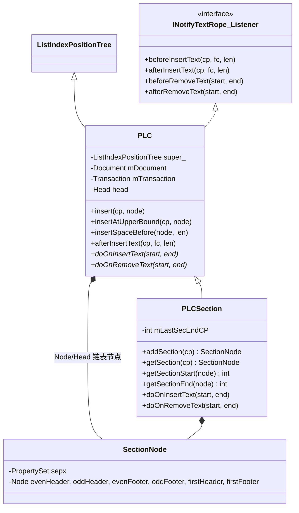

# PLC / PLCSection 代码走读（Rust 实现 · 上下游数据流 · 流程角色 · 图）

> 归属：`wc-01-storage-write` · 状态：与 Java 对齐已 done（wc-01 验收）
> 回答的问题：Rust 代码里 PLC / PLCSection 长什么样（字段 / 方法 / 堆布局）、
> 与 TextRope / CHPX / PAPX / CPieceTable / CoreHelper / SubDocument 如何连成一张网、
> 在解析 / 编辑 / 排版查询三条流程中各做什么。
> 概念与设计意图：[plc-deep-dive.md](./plc-deep-dive.md) · 心智模型：[STORAGE.md](./STORAGE.md) §1.4 / §5
> 代码：`src/cn/wps/moffice/writer/data/PLC.rs`、`data/PLCSection.rs`、
> `data/internal_v2/List{Node,IndexNode,IndexPositionTree,TreeExtension}.rs`、
> `core/SubDocument.rs`、`collections/textrope/KNotifyTextRope.rs`、`core/TextRopeListeners.rs`
> 测试：`tests/cn/wps/moffice/writer/data/PLCSection.rs`（function 05，sc1–sc11）

---

## 1. PLC：代码里的真实形态

### 1.1 它到底是什么

`data/PLC.rs` 里 PLC 是**抽象基类**，一句话：**一棵「自带环形链表的位置树」+ 一个「文本变更监听者」**，用来存"挂在 CP 上的结构节点"。

```rust
// PLC.rs:27-38
pub struct PLC {
    pub(crate) super_: ListIndexPositionTree,  // 位置树（二叉索引树 + 链表）
    pub(crate) mDocument: Option<*mut dyn Document>,  // 所属子文档
    pub(crate) mTransaction: *mut Transaction,        // undo/redo
    pub(crate) head: Head,                            // 哨兵头节点
}
```

`Node` 是「锚点」：`getCP() == position()`。`Head` 是特殊哨兵——`position()` 不存 offset，而是实时读 `document.getLength()`（PLC.rs:432-444），所以**文档末尾永远是合法锚点**，文本增长时"最后一个锚点"自动跟随。

### 1.2 继承树（代码对应）

```
INotifyTextRope.Listener (trait，4 个钩子)
        ▲ implements
PLC ──────────────── extends ListIndexPositionTree ── extends ListPositionTree ── extends IndexedPositionTree ── extends PositionTree
│                                                                                                                  (util::collections)
│   ├── PLCSection        data/PLCSection.rs         节：sepx + 6 头脚引用
│   ├── PLCField          data/PLCField.rs           域
│   ├── PLCBookmarkStart/End / PLCShapeAnchor / PLCHeader / PLCFootnoteEndnoteTxt …
└── Node/Head             data/PLC.rs                 链表节点（可携带负载）
```

树的部分在 `internal_v2/`，三层各管一件事：

| 层（文件） | 职责 | 关键字段 |
|---|---|---|
| `ListNode`（internal_v2/ListNode.rs） | **环形双向链表**：`prev`/`next` + `offset_prev`（相对前驱的偏移，即位置增量） | `offset_prev` |
| `ListIndexNode`（internal_v2/ListIndexNode.rs） | 在链表节点上加 **`mLeftCount`**，支持 `index()` 序号查询（列表索引用） | `mLeftCount` |
| `ListTreeExtension`（internal_v2/ListTreeExtension.rs） | **桥**：二叉树的每个插入/删除/旋转回调里同步维护 `prev`/`next` 链表（`onBinaryTreeInsertedLeft/Right`、`onBinaryTreeErased`…） | mask=63（扩展位） |

所以一个节点同时活在两个视图里：**二叉索引树**（O(log n) 按 CP 定位）和**环形链表**（O(1) 相邻遍历 `begin()/end()/getNext()`），树与链表由 `ListTreeExtension` 保证一致。平移时两者一起动：`ListTreeExtension::insertSpaceBefore` 把 `node.offset_prev += nLength`、`head.offset_prev -= nLength`（ListTreeExtension.rs:226-248）——**不做任何重建**，这是"结构跟着字符走"的 O(1) 核心。

### 1.3 节点负载：`#[repr(C)]` 堆布局

Rust 用"第一字段是基类节点"的堆结构模拟 Java 继承：

```rust
// PLC.rs:20-25 / PLCSection.rs:15-27
struct HeapNode { super_: ListIndexNode, document: Option<*mut dyn Document> }   // PLC.Node
struct HeapSection { super_: HeapNode, parent, sepx: PropertySet,
                     evenHeader, oddHeader, evenFooter, oddFooter, firstHeader, firstFooter }
```

`SectionNode` 就是把 `PLC.Node` 的裸指针再解释成 `HeapSection`（`as_section()`），多出的字段就是"负载"：节属性 `sepx` + 6 个头脚引用。

---

## 2. PLCSection：排版最敏感的特化

`PLCSection.rs` 只加了两个东西：`mLastSecEndCP` 状态 + `SectionNode` 负载。全部语义集中在 **CP 边界计算**上。

### 2.1 节的 CP 语义（`getSectionStart/End`，PLCSection.rs:168-182）

```text
分节符 \f 是段末控制字符，归【前面】那节所有 → 下一节从 \f 之后开始：

  CP:    0                500(\f)            900(\f)
 节节点: ▲节0              ▲节1               ▲节2
 start:  0                 501                901      ← position()+1（首节除外）
 end:    501               901                mLastSecEndCP
              └─────────┘└─────────┘         （未设置 → document.getLength()）
```

测试 `tests/.../PLCSection.rs` 里钉死了这些不变量：

- `sc1/sc2/sc3`：`setLastSectionEndCP(4)` → `getSectionEnd(末节)==4`；`INVALID_CP` 未设置时回退 `getLength()`；`onEndLoad()` 复位。
- `sc9`：`addSection(3)` 后 `getSectionStart==4`（跳过分节符字符）。
- `sc10`：`getSectionRange` 用 `RANGEFactory::getRANGE(start,end)` 打包成 i64（高 32 位 start）。

### 2.2 两个容易错的特判

```rust
// PLCSection.rs:106-113  cp==0 且树非空 → insertAtUpperBound
if cp == 0 && !self.isEmpty() { self.super_.insertAtUpperBound(cp, pNew); }

// PLCSection.rs:185-193  doOnInsertText 开头插入跳过一个
if start == 0 && !self.super_.isEnd(upper) { upper = upper.getNext(); }
```

- **`cp==0` 走 upper bound**：CP 0 已有隐式首节节点，再插一个 0 节点会同位重叠，upper bound 把它插在已有 0 节点**之前**保住两个独立锚点。
- **开头插入跳过一个**：文档最开头插入文本时，新文本属于第一个节，CP 0 的首节节点**不能右移**，只平移它之后的节节点。

### 2.3 SectionNode 的负载

```rust
// PLCSection.rs:276-422
getPropertySet / setPropertySet          → sepx（pgSz/pgMar/分栏，PropertySet 与 CHPX/PAPX 同构）
get/set EvenHeader|OddHeader|EvenFooter|OddFooter|FirstHeader|FirstFooter
                                         → 其它 SubDocument 的 PLC.Node 引用（PLCHeader 族）
NodeType 枚举                            → 6 种头脚类型
```

---

## 3. 与上下游数据结构的关系

### 3.1 全景图：同一 CP 轴上的多层叠加

```text
CP 轴 ──►  0    1    2    3    4    5    6    7    8    9    10   11
 字符      [H]  [e]  [l]  [l]  [o] [\r]  [W]  [o]  [r]  [l]  [d] [\r]   ← TextRope（共享 TextPool 的切片视图）
 CHPX      [==== Normal 12pt =====)[B)[==== Normal 12pt =====)           ← 字符属性区间（run）
 PAPX      [======== 段落0 居中 ========)[===== 段落1 左齐 =====)          ← 段落属性（挂段首 CP）
 PLC       ▲节0─────────────────────────────────────────────────────►   ← 结构节点（锚 CP）
 Bookmark       ▲bmStart                    ▲bmEnd
 Shape                 ▲anchor@CP=3
```

四者在**同一个 CP 尺子**上各管一层，全都实现 `INotifyTextRope.Listener`，全都在文本变更时被 `TextRopeListeners` 通知平移。区别是：**TextRope 是真字符（真相源），CHPX/PAPX/PLC 是派生索引**，文本一动它们必须跟随。

### 3.2 上游（写入端）：谁把数据灌进 PLC

```text
DOCX XML (w:p / w:r / sectPr)
   │  Importer 投影
   ▼
SubDocumentImporter / MainDocumentImporter（wc-04）
   │
   ├── CoreHelper.appendParagraph(doc, endMark, cp0, chpx, papx)   → rope + chpx + papx
   └── endMark == '\f'  → PLCSection.setLastSectionEndCP(getLength())   （SubDocumentImporter step 9）
        + MainDocumentImporter.doImportSectionPropertiesSimple（收到 sectPr 时）
              → PLCSection.addSection(mCpLastSectionEnd)
              → sectionNode.sepx = freeze(sectionProps)   + 可选挂 6 个 header/footer 节点
```

落库后收尾（`FinishReadingWork.correctSectionData`，wc-05）：若第一节不是 SectionNode → `addSection(0)` + 默认节属性（PageSetup 等，propId 676/677/678/682/683）——保证**文档必然有节**。

### 3.3 装配端：SubDocument 怎么挂上 PLCSection

```rust
// SubDocument.rs ctor（387-440）顺序：rope → chpx/papx 表 → TextRopeListeners → CPieceTable → createPLC
// SubDocument.rs:999-1065  createPLC 按 type 分发：
0 => { self.mSections = Some(PLCSection::new(Some(self))); }   // ★ Main 才有 PLCSection
1 => PLCField + FootnoteTxt；2 => PLCField + PLCHeader；3/4/5/6 同理
// 最后 mPLC 列表里的所有 PLC doAddTextListener(plc, false) —— 挂进 TextRopeListeners
```

要点：**7 个子文档共享同一个 TextPool，但各自有独立的 rope、CHPX/PAPX 表和 PLC**。只有 type=0（Main）有 `PLCSection`——`wc-02` 的验收断言就是 `getPLCSection()`：type0 为 `Some`、其余为 `None`。Header/Footnote 的 PLC（`PLCHeader` 等）引用会被 `SectionNode` 的 6 个头脚字段**反查**回来。

### 3.4 通知链（编辑端）：PLC 怎么"跟着字符走"

```rust
// KNotifyTextRope.rs:110-124  insertImpl
mListener.beforeInsertText(cp, fc, length);   // 变更前（倒序通知）
super.insertImpl(...);                        // 真正写入 rope
mListener.afterInsertText(cp, fc, length);    // 变更后（正序通知）

// TextRopeListeners.rs:149-168  afterInsertText 按注册顺序转发给所有 Listener：
//   ChpxTable → PapxTable → PLC（→ 其它）→ 最后 mDispatcher
```

关键门控在 PLC.rs:345-359：

```rust
pub fn afterInsertText(&mut self, cp, _fc, length) {
    if !self.isEmpty() && self.isInUserAction() {   // isInUserAction = transaction.state==1
        self.doOnInsertText(cp, cp + length);       // 抽象 → PLCSection 覆写
    }
}
```

**导入路径（IO state）不触发平移**：`TextRopeListeners.isDisabled()` = `isInIOState() && !isInUserAction()` 时整条通知链静默；`PLC` 内部还有 `isInUserAction()`（事务 state==1）第二道闸。所以 **parse 时只追加不平移，编辑时（用户操作事务内）才平移**——两套路径天然隔离。

平移算法（PLCSection.doOnInsertText，PLCSection.rs:185-193）：

```text
插入前:  …[99][100]Bookmark▲[500]Section▲…      在 CP=100 插入 3 字符
插入后:  …[99][100][101][102][103]Bookmark▲[503]Section▲…
              锚点整体 +3（CP 0 首节除外）        ← insertSpaceBefore，O(1) 改 offset 增量
```

删除反向：`doOnRemoveText`（PLCSection.rs:195-225）删区间内节点（**首节永远不删**）→ `eraseSpaceBefore` 左移 → 必要时 `moveLeft/moveRight` 归位。

### 3.5 下游（查询端）：谁消费 PLC

| 消费者 | 怎么用 |
|---|---|
| **Layout 排版**（`PageViewSectionLayouter` 等） | `getPLCSection().getSection(cp)` → `getSectionStart/End` 定页框（纸张/边距/分栏），一节可对应多页 |
| **`InsertFile`**（insert/InsertFile.rs:282-300） | 复制节：遍历 src 的 `createIterator()`，逐个 `sectionDest.addSection(iterSrc.getStart())` + `copySectionNode`（连 6 个头脚引用一起拷） |
| **`FinishReadingWork.correctSectionData`** | 兜底补第一个节 + 默认节属性 |
| **`CoreHelper.collectAllOLE`** | 遍历 7 个子文档的 `PLCField`，`chpxTable.seek(cp)` 找 OLE 形状 |

CPieceTable 是门面（不参与 append 必经路径），聚合 `rope + chpx + papx` 三件套（CPieceTable.rs:53-76），PLC 不属于它——PLCSection 由 `SubDocument.getPLCSection()` 直接取。

---

## 4. 三条流程里的 PLC 角色汇总

### 流程 A：解析（DOCX → L1 逻辑模型）

```text
w:p 结束
  ├─ endMark='\r' → 普通段尾：CoreHelper.appendParagraph（没 PLC 的事）
  └─ endMark='\f' → 分节段尾：
       ① SubDocumentImporter:  getPLCSection().setLastSectionEndCP(getLength())   ← 记 \f 锚点
       ② MainDocumentImporter:  mCpLastSectionEnd = getCpSubDocumentEnd()
       ③ 收到 sectPr 属性时:    addSection(mCpLastSectionEnd) → SectionNode
       ④ sepx = freeze(sectionProps)；可选挂 6 个头脚 PLC.Node
       ⑤ 读毕: onEndLoad() 复位 mLastSecEndCP=INVALID_CP
   （IO 态下 notifyOnAdd/notifyOnRemoved 不发 DocumentEvent，也不触发平移）
```

### 流程 B：编辑（用户改正文）

```rust
edit → rope.insert/erase
  → KNotifyTextRope  before → mutate → after
  → TextRopeListeners（not disabled，事务 state==1）
      → ChpxTable/PapxTable 同位平移
      → PLC.afterInsertText → doOnInsertText
          → insertSpaceBefore：cp 之后所有节点整体平移（CP0 首节除外）
      → DocumentEventDispatcher 通知排版更新
```

### 流程 C：排版查询

```text
layout 需要"CP=1200 的页框"
  → subdoc.getPLCSection().getSection(1200)      O(log n) 命中节节点
  → getSectionStart/End → [start, end) → sepx → 页宽/边距/分栏
  → 在该几何约束下对 CP 流分段落、分行、分页
```

---

## 5. 类图（代码实测对照）



---

## 6. 一句话总结 + 现状

- **PLC** = CP 上的结构锚点表：二叉索引树（O(log n) 查询）+ 环形链表（O(1) 遍历/平移）+ Listener（文本一动就整体平移），`Head.position()=len` 保证末尾永远合法。作用是承接 CHPX/PAPX **装不下的对象型结构**（节/域/书签/形状锚点）。
- **PLCSection** = 节的专化：`SectionNode` 带 `sepx`（页框约束）+ 6 个头脚引用；`\f` 归前节导致 `position()+1` 语义；CP 0 首节钉死不删不移；`addSection` 只在 Main 文档存在。
- **上下游**：写入端是 Importer→CoreHelper→`\f`/sectPr 落库；装配端是 `SubDocument.createPLC()` type0；消费端是 Layout（页框）、InsertFile（复制节）、FinishReadingWork（兜底补节）；与 TextRope/CHPX/PAPX 共享同一个 CP 轴和同一套 Listener 通知机制，`TextRopeListeners` 是注册枢纽。
- **现状**：`PLC.rs` / `PLCSection.rs` / `internal_v2` 树三层在 wc-01 已 done（Java↔Rust 对齐，`tests/.../PLCSection.rs` 11 条测试覆盖 CP 语义）；`doOnInsertText/doOnRemoveText` 的抽象占位（`panic!`）和 `notifyOnAdd/Removed`、`removeSectionNode` 的头脚级联是 DEFERRED 项，改写时不能删抽象语义（见 [plc-deep-dive.md](./plc-deep-dive.md) §5 改写注意）。