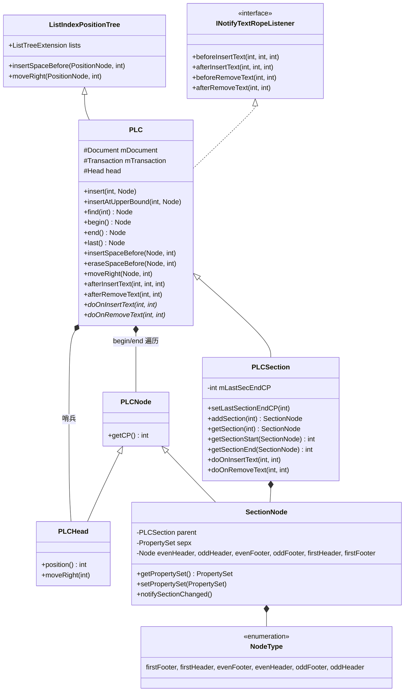
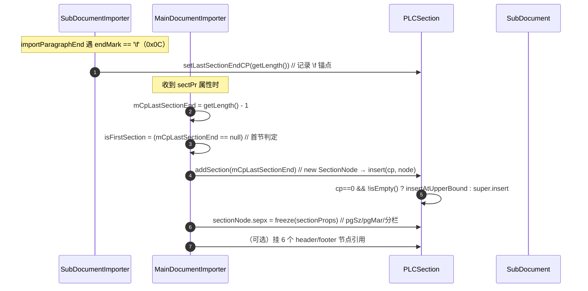
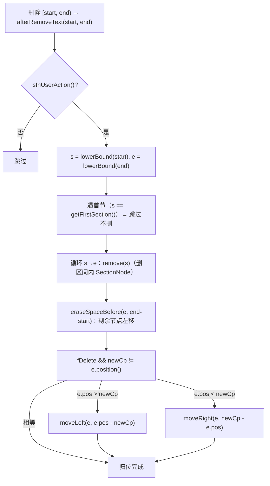
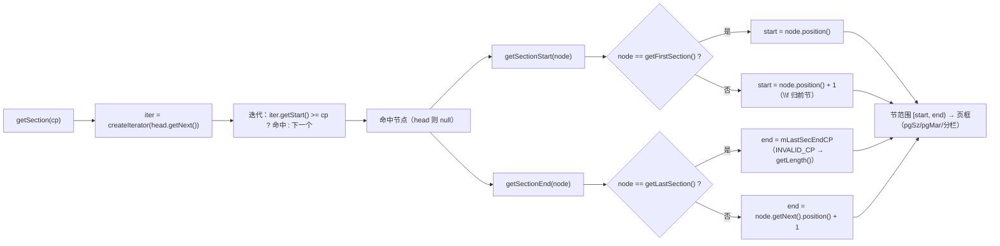

# PLC / PLCSection 深读（设计意图 · 类图 · 流程图 · 关键方法）

> 归属：`wc-01-storage-write` · 状态：实现已 done（Java ↔ Rust 对齐）
> 回答的问题：**结构节点（节/域/书签/锚点）为什么不能塞进属性表**、PLC 如何在文本
> 增删时保持"锚点跟字符走"、节的 CP 语义（首节/`\f`/`+1`）为什么这样定。
> 概览与心智模型：[STORAGE.md](./STORAGE.md) §1.4 / §5 · [STRUCTURE_ANALYSIS.md](../STRUCTURE_ANALYSIS.md) §0.5
> Java 源码：`koffice/writer/core/cn/wps/moffice/writer/data/PLC.java`、`PLCSection.java`
> 代码走读（Rust 实现 / 上下游数据流 / 流程角色 / 图）：[plc-code-walkthrough.md](./plc-code-walkthrough.md)

---

## 0. 家族全景：一个"能自己平移的结构锚点表"

```text
INotifyTextRope.Listener（before/after 钩子）
   ▲
PLC（抽象基类 = ListIndexPositionTree + Listener）     ← 结构节点表
   │  Head 哨兵（position() = document.getLength()）
   │  Node（锚 CP 的链表节点，可携带负载）
   └── PLCSection
         └── SectionNode（节节点：sepx 属性 + 6 个页眉页脚引用）
（PLCField / PLCBookmarkStart / PLCShapeAnchor … 同族，见 wc-02）
```

**一句话定位**：PLC 是挂在 CP 上的**非纯文本结构节点**有序表——每个节点锚定一个
CP，文本插入/删除时作为 `KNotifyTextRope.Listener` 自动**平移/删除**节点，
保证"锚在第 N 个字符上"永远成立。`PLCSection` 是其中最排版敏感的特化：节边界
（`\f` + `sectPr`）→ 页框约束。

**为什么不能塞进 CHPX/PAPX**：节/书签/形状锚点是需要长期存在、可遍历、带复杂
负载（`SectionNode` 挂 sepx + 6 个头脚引用）的**对象**，不是"一个属性桶"。

---

## 1. 类图（继承 / 字段 / 关键方法）

### 1.1 `PLC extends ListIndexPositionTree implements INotifyTextRope.Listener`（抽象基类）

```java
public abstract class PLC extends ListIndexPositionTree implements INotifyTextRope.Listener {
   Document mDocument;          // 所属子文档（Head.position() 需要 getLength()）
   Transaction mTransaction;    // undo/redo（state==1 才提交）
   Head head;                   // 哨兵头节点
}
```

| 方法 | 逻辑 | 热路径 |
|------|------|--------|
| 构造 | `super(new Head(document))`；`setTransaction(document.getTextDocument().getTransaction())` | — |
| `insert(cp, pNew)` | `lowerBound(cp, offset)` 定位 → `addReferenceImpl(cp, offset[0], pos, pNew)` | ★ |
| `insertAtUpperBound(cp, pNew)` | `upperBound(cp, offset)` → `addReferenceImpl`——**插在 ≥ cp 的第一个节点之前**（PLCSection cp==0 用） | ★ |
| `addReferenceImpl(cp, offset, pos, pNew)` | `insertLeft(pos, pNew, cp, offset)` → **`notifyOnAdd`** →（state==1）`CmdInsert` | 私有 |
| `removeReferenceImpl(node, cp, next)` | `erase(node)` → **`notifyOnRemoved`** → `CmdRemove` | 私有 |
| `find(cp)` / `findFloor` / `findUpper` / `lowerBound` / `upperBound` | 基于位置树的 CP 定位（O(log n)） | ★ 查询 |
| `begin/end/last` / `isEnd` / `isHead` / `getByIndex` / `get` | 链表遍历 | ★ |
| `insertSpaceBefore(pFrom, len)` | 非 head：`super`（位置树 + lists 扩展一起平移）→ `CmdInsertSpace` | ★ 文本插入 |
| `eraseSpaceBefore(pFrom, len)` | `insertSpaceBefore(pFrom, -len)` | ★ 文本删除 |
| `moveRight/moveLeft(node, len)` | 单节点平移 + `CmdMoveRight` | ★ |
| `getRange(node)` | `RANGEFactory.getRANGE(node.position(), node.getNext().position())`；Head 抛 WriterModelException | — |
| `beforeInsertText(cp, fc, len)` | **空实现（钩子）** | Listener |
| `afterInsertText(cp, fc, len)` | `!isEmpty() && isInUserAction()`（state==1）→ `doOnInsertText(cp, cp+len)` | ★ Listener |
| `beforeRemoveText(start, end)` | **空实现（钩子）** | Listener |
| `afterRemoveText(start, end)` | `isInUserAction()` → `doOnRemoveText(start, end)` | ★ Listener |
| `abstract doOnInsertText(int, int)` / `doOnRemoveText(int, int)` | 子类实现"自己怎么平移" | 抽象 |
| `reset/resetHead/setTransaction/getTransaction/dispose` | 生命周期 | — |

**内部类型**：
- `Node extends ListIndexNode implements Cloneable`：`getCP() = position()`（经位置树）；
  可携带负载（`SectionNode extends PLC.Node` 就是带负载的节点）。
- `Head extends Node`：`position() = document.getLength()`；`moveRight` no-op。
- `Iterator extends ListIndexPositionTree.CPIterator`：带 `index` 游标。
- undo 命令：`CmdInsert` / `CmdRemove` / `CmdResetHead` / `CmdInsertSpace` /
  `CmdMoveRight`。

### 1.2 `ListIndexPositionTree extends IndexedPositionTree`（PLC 的树）

```java
public class ListIndexPositionTree extends IndexedPositionTree {
   ListTreeExtension lists = new ListTreeExtension();   // 扩展位 63
   // insertSpaceBefore / moveRight：先 super（PositionTree 平移），再 lists 平移
}
```

**为什么"lists 扩展"**：同一棵树同时服务两类查询——位置（CP）与**列表序号**
（`index()`）。文本平移时两者必须一致平移，否则 `getByIndex` 错位。

### 1.3 `PLCSection extends PLC`（节 PLC——本 feature 的主角）

```java
public class PLCSection extends PLC {
   private static final int INVALID_CP = Integer.MIN_VALUE;
   private int mLastSecEndCP = Integer.MIN_VALUE;   // 最近一次 \f 锚点；读毕复位
}
```

| 方法 | 逻辑 | 热路径 |
|------|------|--------|
| `setLastSectionEndCP(cp)` | `mLastSecEndCP = cp`（`importParagraphEnd` 遇 `\f` 时调） | ★ |
| `onEndLoad()` | `mLastSecEndCP = INVALID_CP`（读完复位） | — |
| `addSection(cp)` | `new SectionNode(this)` → `insert(cp, node)`（收到 sectPr 时调） | ★ |
| `insert(cp, node)` | **`cp==0 && !isEmpty()` → `insertAtUpperBound`**（不覆盖已有 0 节点）；否则 `super.insert` | ★ |
| `getFirstSection` / `getLastSection` / `isFirstSection` | `isEmpty()` 返回 null；first=begin()、last=last() | ★ |
| `getSection(cp)` | 从 `head.getNext()` 迭代，`iter.getStart() >= cp` 即命中；越界 null——**排版取节热路径** | ★ |
| `getSectionStart(pSection)` | 首节 = `position()`；**非首节 = `position() + 1`**（`\f` 归前节） | ★ |
| `getSectionEnd(pSection)` | 末节 = `getLastSectionEndCP()`（`MIN_VALUE` → `getLength()`）；否则 `next.position() + 1` | ★ |
| `getSectionRange` | `RANGEFactory.getRANGE(start, end)` | — |
| `doOnInsertText(start, end)` | `len=end-start`；`upper=lowerBound(start)`；`start==0 && !isEnd(upper)` → `upper=upper.getNext()`；`insertSpaceBefore(upper, len)` | Listener |
| `doOnRemoveText(start, end)` | 删区间内 SectionNode（**首节除外**）；`eraseSpaceBefore`；必要时 moveLeft/Right 归位 | Listener |
| `remove(node)` | `removeSectionNode`（删节节点并处理 header/footer 节点转移） | — |
| `notifyOnAdd/notifyOnRemoved` | 非 IO 状态发 `DocumentEvent`（type 4, event 18）通知排版 | — |

**`SectionNode extends PLC.Node`（带负载的节节点）**：
- 字段：`parent: PLCSection`、`sepx: PropertySet`（默认 `PropertySet.empty`；
  pgSz/pgMar/分栏等节属性）、6 个页眉页脚节点引用
  `evenHeader/oddHeader/evenFooter/oddFooter/firstHeader/firstFooter`（`PLC.Node`）。
- 方法：`getPropertySet/setPropertySet`（含 `CmdSetData`）、各 header/footer
  get/set（含 `CmdModify`）、`notifySectionChanged()`。
- 枚举 `NodeType { firstFooter, firstHeader, evenFooter, evenHeader, oddFooter, oddHeader }`。

### 1.4 类层次总图（mermaid）



---

## 2. 设计意图（为什么）

### 2.1 为什么 PLC 用"环形链表 + 位置树"而不是 ArrayList

结构节点既要**按 CP 随机查**（`getSection(cp)`），又要**随时插入/删除/平移**
（文本编辑），还要**顺序遍历**（`begin/end/next`）。位置树（`ListPositionTree`）
同时满足三者：O(log n) 定位 + O(1) 相邻游走 + 整体平移（`insertSpaceBefore`）。

### 2.2 为什么 `Head.position() = document.getLength()`

与 CHPX/PAPX 的 Head 同理：**文档末尾必须永远是一个合法锚点**。遍历时
`end()` 恒为哨兵；文本增长时"最后的位置"自动跟随，无需特判。

### 2.3 为什么 `insert` 对 cp==0 走 `insertAtUpperBound`

首个 SectionNode 通常锚在 **CP 0**（文档开头的隐式首节）。若在 CP 0 再插一个
节点（如分节符 `\f` 在第 0 个字符时），普通 `insert(0, …)` 会与已有 0 节点**同位
重叠**。`insertAtUpperBound` 把新节点插在 ≥0 的第一个节点**之前**，保留两个独立
锚点。

### 2.4 为什么 `doOnInsertText` 对 start==0 特判"跳过一个"

```java
void doOnInsertText(int start, int end) {
   int len = end - start;
   PLC.Node upper = this.lowerBound(start);
   if (start == 0 && !this.isEnd(upper)) {
      upper = upper.getNext();          // 不平移 CP 0 的首节节点
   }
   this.insertSpaceBefore(upper, len);
}
```

在文档**最开头**插入文本时，CP 0 的首节节点**不应右移**——新文本属于第一个节，
节的起始边界必须钉在 0。跳过首节节点，只平移它之后的节节点。

### 2.5 为什么 `getSectionStart/End` 有 `+1` 语义（`\f` 归前节）

分节符 `\f` 是**段末控制字符**，属于它**前面的那个节**（节从 `\f` 之后才换页框）。
因此：

```text
SectionNode₀ @ cp=0       → start = 0                 （首节）
SectionNode₁ @ cp=500     → start = 500 + 1 = 501     （\f@500 归节₀）
SectionNode₁ end          → = next.position() + 1
末节 end                  → mLastSecEndCP（INVALID_CP → getLength()）
```

排版查 `getSection(cp)`：找"起点 ≥ cp 的第一个节点"——cp 落在
`[501, next.pos+1)` 就属于节₁。**错一个 CP，整节页框错位**。

### 2.6 为什么 SectionNode 带 sepx + 6 个页眉页脚引用

一个节 = 页框约束（pgSz/pgMar/分栏 → `sepx`）+ 头脚（奇/偶/首页 × 头/脚）。
`sepx` 是 `PropertySet`（与 CHPX/PAPX 同构），头脚是**其它 SubDocument 的
PLC.Node 引用**（Header/Footer 文档在 wc-02 `createSubDocument(2)` 建）。排版
`PageViewSectionLayouter` 读它定页框。

### 2.7 为什么"结构节点表 = 文本监听者"（与属性表同构）

与 CHPX/PAPX 完全同一模式：文本是唯一真相，PLC 是派生。`afterInsertText` →
`doOnInsertText` → `insertSpaceBefore` 平移；`afterRemoveText` → `doOnRemoveText`
删除区间内节点。**新结构（书签、锚点）只需继承 PLC 实现两个抽象方法**，不改 rope。

### 2.8 为什么 doOnRemoveText"首节除外"

首节节点在 CP 0 是文档的**隐式起点**，删除文本即使删到 0 也不能把首节删掉
（否则文档没有节）。所以循环里 `s != getFirstSection()` 才删。

---

## 3. 流程图（mermaid）

### 3.1 分节写入链（`\f` → setLastSectionEndCP → addSection）



### 3.2 文本插入 → 节点平移（afterInsertText → doOnInsertText）

```mermaid
flowchart TD
    A["rope 在 cp 处插入 len 字符"] --> B["KNotifyTextRope.afterInsertText(cp, fc, len)"]
    B --> C["TextRopeListeners 正序转发 → PLC.afterInsertText"]
    C --> D{"isEmpty() || !isInUserAction()?"}
    D -- 是 --> Z["跳过"]
    D -- 否 --> E["PLCSection.doOnInsertText(cp, cp+len)"]
    E --> F["upper = lowerBound(cp)"]
    F --> G{"start == 0 && !isEnd(upper) ?"}
    G -- 是 --> H["upper = upper.getNext()（首节钉在 0 不移）"]
    G -- 否 --> I["直接用 upper"]
    H --> J["insertSpaceBefore(upper, len)"]
    I --> J
    J --> J1["ListIndexPositionTree：位置树 + lists 扩展一起 +len"]
    J --> J2["state==1 → CmdInsertSpace(upper, len)"]
    Note over J: 效果：cp 之后的所有 SectionNode 整体右移 len
```

### 3.3 文本删除 → 节点删除/归位（afterRemoveText → doOnRemoveText）



### 3.4 排版取节（getSection / getSectionStart / getSectionEnd）



---

## 4. 关键不变量（改写/测试锚点）

| # | 不变量 | 来源 |
|---|--------|------|
| 1 | `Head.position() = document.getLength()`；`end() = head`、`last() = head.getPrev()` | `PLC.Head` |
| 2 | 节点区间 `[node.position(), node.getNext().position())`；`getRange` 用 RANGEFactory 打包 | `PLC.getRange` |
| 3 | 文本插入：`afterInsertText` → `isInUserAction()` → `doOnInsertText(cp, cp+len)` → `insertSpaceBefore` | `PLC` / `PLCSection.doOnInsertText` |
| 4 | 开头插入：`start==0` 跳过 CP 0 的首节节点（首节钉 0） | `PLCSection.doOnInsertText` |
| 5 | 文本删除：`doOnRemoveText` 删区间内节点但**首节除外**；删后 `eraseSpaceBefore` + moveLeft/Right 归位 | `PLCSection.doOnRemoveText` |
| 6 | 节边界：首节 start=`position()`；非首节 start=`position()+1`；非末节 end=`next.position()+1`；末节 end=`mLastSecEndCP`（MIN_VALUE→getLength()） | `PLCSection.getSectionStart/End` |
| 7 | `insert(cp==0 && !isEmpty)` → `insertAtUpperBound`（避免覆盖 0 节点） | `PLCSection.insert` |
| 8 | `\f` 写入链：`setLastSectionEndCP(getLength())`（父类 End 时）→ `addSection(getLength()-1)`（收到 sectPr 时）；`mCpLastSectionEnd` 首节为 null | `SubDocumentImporter` / `MainDocumentImporter`（wc-04） |
| 9 | undo 只在 `state==1` 提交；`isInUserAction()` = `transaction.getState()==1` | `PLC.addReferenceImpl` |
| 10 | `mLastSecEndCP` 初值/复位 = `INVALID_CP = Integer.MIN_VALUE` | `PLCSection` |

---

## 5. 与 Rust 现状对照

| Java | Rust | 状态 |
|------|------|------|
| PLC | `data/PLC.rs` | done（`insert/insertSpaceBefore/afterInsertText/doOnInsertText` 抽象占位已移植） |
| PLCSection | `data/PLCSection.rs` | done（`addSection/setLastSectionEndCP/getSection/getSectionStart/End` 已对齐） |
| SectionNode | `data/PLCSection.rs` 内嵌 | done（sepx + 6 头脚引用；MVP 头脚可空） |
| ListIndexPositionTree | `data/internal_v2/ListIndexPositionTree.rs` | done（lists 扩展位 63） |
| 同族 PLC（PLCField/PLC_Char/PLCShapeAnchor） | `data/PLCField.rs` 等 | done（wc-02 拉入；本 feature 只建不写） |

**改写注意**：
- `PLC.doOnInsertText/doOnRemoveText` 是 abstract：Rust 以 `panic!` 默认体占位，
  子类（PLCSection）override——**必须保留抽象语义**，不能删。
- undo Cmd*（CmdInsert/CmdRemove/CmdInsertSpace/CmdMoveRight）parse 路径不触发，
  可延后；但 `insertSpaceBefore/eraseSpaceBefore/moveRight` 本体必须实现。
- `notifyOnAdd/notifyOnRemoved` 的 DocumentEvent（type 4, event 18）是排版通知，
  MVP 可空实现但调用点保留。
- 关键常量：`INVALID_CP = Integer.MIN_VALUE`、`NodeType` 六值、
  首节判定 `mCpLastSectionEnd == null`。
