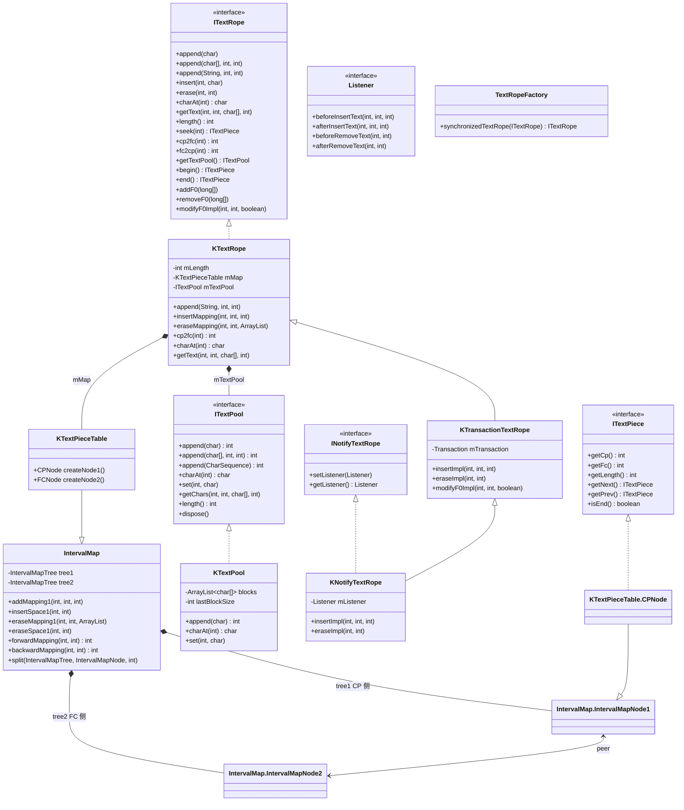
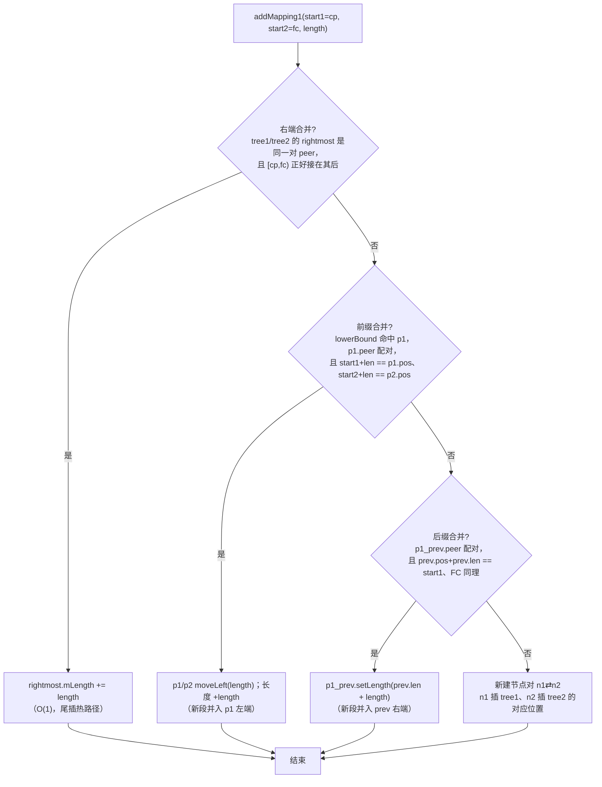
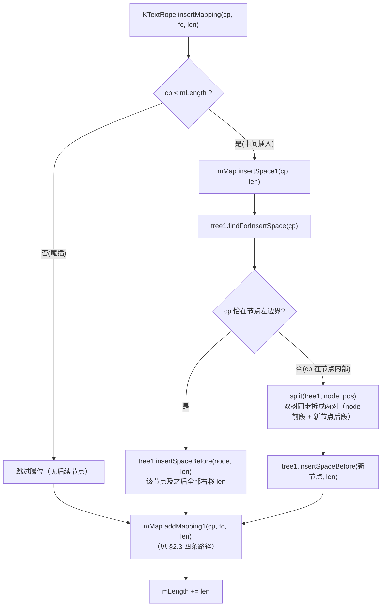
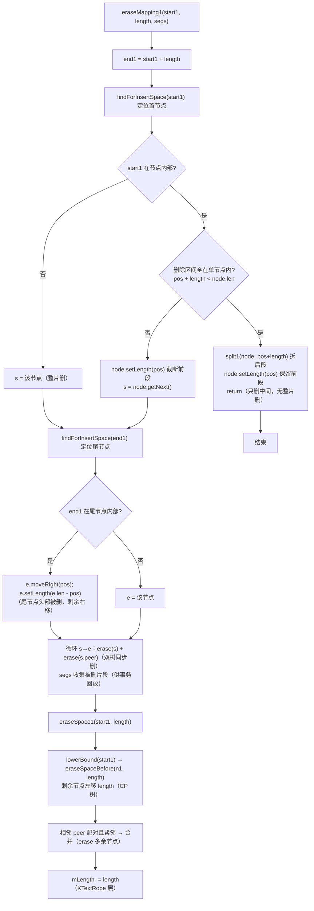
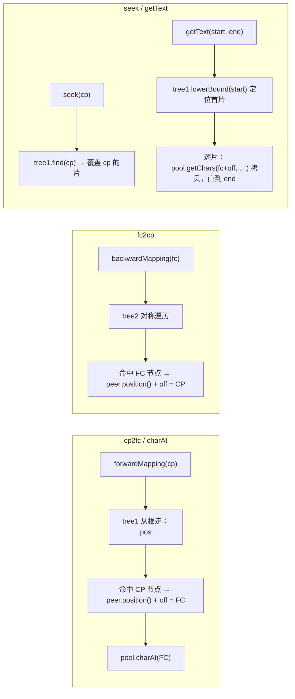
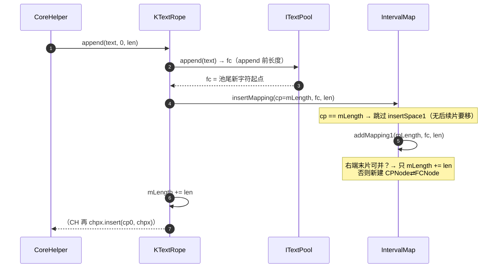
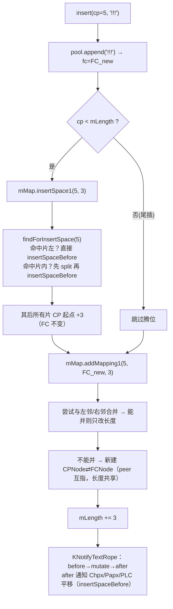
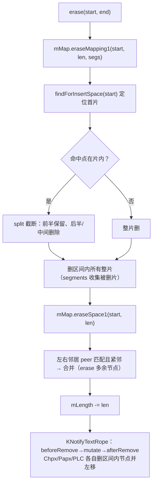
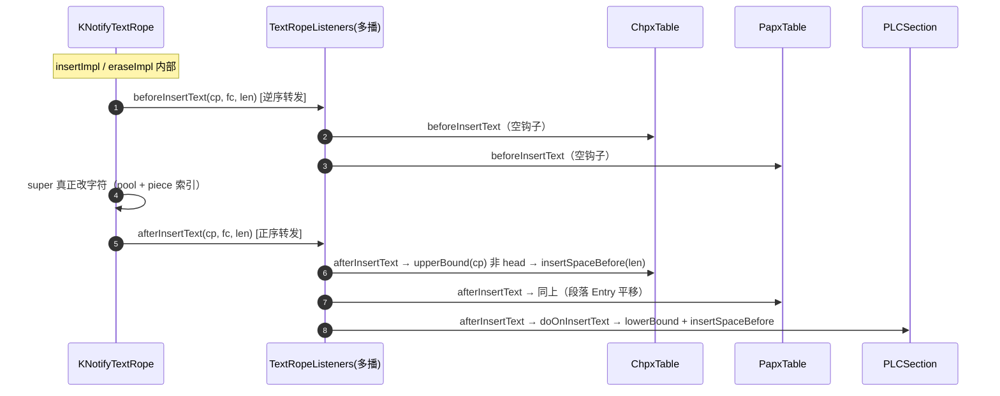
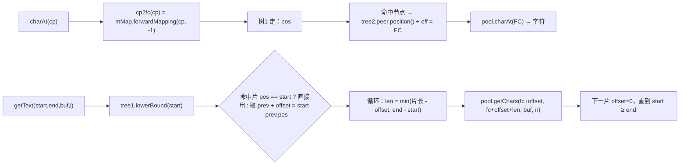

# TextRope / TextPool 深读（设计意图 · 类图 · 流程图 · 关键方法）

> 归属：`wc-01-storage-write` · 状态：实现已 done（Java ↔ Rust 对齐，无 `todo!()` 残留）
> 回答的问题：TextRope 家族**为什么**这样设计、**怎么**工作、**为谁**服务。
> 概览与心智模型：[STORAGE.md](./STORAGE.md) §3 · [STRUCTURE_ANALYSIS.md](../STRUCTURE_ANALYSIS.md) §0.5
> Java 源码：`koffice/writer/core/cn/wps/collections/textrope/`；Rust：`libs/word-core/src/cn/wps/collections/textrope/`

---

## 0. 家族全景：三个角色一句话

| 角色 | 类 | 一句话 |
|------|----|--------|
| **逻辑视图** | `TextRope`（KTextRope） | 以 CP 寻址的字符流；只存"片索引 + 长度"，不存字符 |
| **物理仓库** | `TextPool`（KTextPool） | 字符真正所在处；分块存储、按 FC 寻址 |
| **两者之间的索引** | `KTextPieceTable`（= `IntervalMap` 双树） | piece 的 CP↔FC 双向映射 + 区间增删拆合 |

```text
ITextRope（接口：append/insert/erase/charAt/getText/length/seek/cp2fc/fc2cp）
   ▲
KTextRope ──────────────► mTextPool: ITextPool   （字符仓库）
   │                          ▲
   │ mMap: KTextPieceTable ──► IntervalMap（tree1 CP 树 ⇄ peer ⇄ tree2 FC 树）
   ▲
KTransactionTextRope （事务：CmdInsert/CmdErase/CmdModify_F0）
   ▲
KNotifyTextRope      （变更通知：before → mutate → after）
```

**下游关系**：`SubDocument` 持有 `KNotifyTextRope`，并把 `ChpxTable / PapxTable / PLC*` 挂成 Listener——**字符一变，属性表与结构节点跟着平移**。这是整个存储层能保持"CP 对齐"的根。

---

## 1. 类图（继承 / 字段 / 关键方法）

### 1.1 接口层

| 接口 | 关键成员 | 设计意图 |
|------|---------|---------|
| `ITextRope` | `append(char|char[]|String[,start,end])`、`insert(cp, …)`、`erase(start,end)`、`charAt(cp)`、`getText(start,end,buf,bufStart)`、`length()`、`seek(cp)→ITextPiece`、`cp2fc/fc2cp`、`getTextPool`、`begin/end`、`addF0/removeF0/modifyF0Impl` | 定义"以 CP 寻址的可变字符流"契约；**不暴露 pool/分片细节** |
| `ITextPool extends CharSequence` | `append(char|char[]|CharSequence[,start,end])→int(FC)`、`charAt(int FC)`、`set(int FC, char)`、`getChars(start,end[,buf,index])`、`length()`、`dispose()` | 物理字符仓库契约；**按 FC 寻址** |
| `ITextPiece` | `getCp()`、`getFc()`、`getLength()`、`getNext()/getPrev()`、`isEnd()` | 一个"片"的只读视图（CP 起点 / FC 起点 / 长度 / 链表游走） |
| `INotifyTextRope extends ITextRope` | `setListener/getListener`；内嵌 `Listener { beforeInsertText(cp,fc,len); afterInsertText(cp,fc,len); beforeRemoveText(start,end); afterRemoveText(start,end) }` | 文本变更通知钩子——CHPX/PAPX/PLC 同步的根基 |

### 1.2 `KTextRope implements ITextRope`（核心实现）

```java
public class KTextRope implements ITextRope {
   public static final int INVALID_POSITION = -1;
   private int mLength;                    // 逻辑长度（CP 轴上界）
   private KTextPieceTable mMap;           // 分片双树索引
   private ITextPool mTextPool;            // 默认 new KTextPool()，可 setTextPool 换成共享池
}
```

| 方法 | 逻辑（1 行） | 热路径 |
|------|-------------|--------|
| `append(c|buf|s)` | `fc = pool.append(...)` → `insertImpl(mLength, fc, len)` | ★ IO 尾插 |
| `insert(cp, …)` | `fc = pool.append(...)` → `insertImpl(cp, fc, len)` | 编辑中间插 |
| `insertImpl→insertMapping(cp, fc, len)` | `cp < mLength` → `mMap.insertSpace1(cp, len)`（先腾位）；`mMap.addMapping1(cp, fc, len)`；`mLength += len` | ★ |
| `erase(start,end)→eraseMapping` | `mMap.eraseMapping1(start, len, segs)`（删区间内片）→ `mMap.eraseSpace1(start, len)`（合并空隙）→ `mLength -= len` | 删除 |
| `charAt(cp)` | `pool.charAt(cp2fc(cp))`（越界抛 IndexOutOfBounds） | ★ 排版读 |
| `cp2fc(cp)` / `fc2cp(fc)` | `mMap.forwardMapping(cp,-1)` / `backwardMapping(fc,-1)` | ★ |
| `getText(start,end,buf,i)` | `tree1.lowerBound(start)` 定位 → 逐片 `pool.getChars(fc+off, …)` 拷贝 | ★ 取整段 |
| `seek(cp)` | `mMap.getTree1().find(cp)` → 所在片 | 查询 |
| `addF0/removeF0/modifyF0Impl(cp,len,add)` | 对 pool 中字符置/清 **0xF000 高位**（私有区标记，特殊字体用）：`c | '\uf000'` 或 `c & 255` | 特殊字体 |
| `begin()/end()` | `tree1.leftmost()` / `tree1.getHead()`（哨兵） | 遍历 |

### 1.3 `KTextPieceTable extends IntervalMap`（分片双树）

```java
class KTextPieceTable extends IntervalMap {
   CPNode createNode1() { ... }   // 树1 节点 = ITextPiece（CP 侧）
   FCNode createNode2() { ... }   // 树2 节点（FC 侧）
   static class CPNode extends IntervalMapNode1 implements ITextPiece {
      int getCp()  { return position(); }          // 本片 CP 起点
      int getFc()  { return peer.position(); }     // 对应 FC 起点
      CPNode getNext()/getPrev()                   // 同树链表游走
      boolean isEnd() { return isHead(); }
   }
}
```

**两个节点一一对应（`peer` 互指），长度共享**：`IntervalMapNode2.getLength()` 直接读 `peer.getLength()`——CP 片与 FC 片长度必然一致，不可能错位。

### 1.4 `IntervalMap`（双树索引本体，cn.wps.collections）

字段：`tree1: IntervalMapTree`（CP 轴）+ `tree2: IntervalMapTree`（FC 轴），构造时互设 `peer`。

| 方法 | 逻辑 | 调用方 |
|------|------|--------|
| `addMapping1(start1, start2, length)` | 按 4 条路径落片（详见 §2.3）——**尽力与邻居合并** | KTextRope.insertMapping |
| `insertSpace1(start1, length)` | 在 CP=start 处腾出 length 空隙：命中片左/拆片后 `insertSpaceBefore`，其后所有片右移 | KTextRope 中间插入 |
| `eraseMapping1(start1, length, segments)` | 删除覆盖 `[start, start+len)` 的片：命中片内先截断/拆片，再删中间整片；`segments` 供事务回放 | KTextRope.erase |
| `eraseSpace1(start1, length)` | 删除后把两侧可合并的片并起来（peer 也并） | KTextRope.erase |
| `forwardMapping(start1, def)` / `backwardMapping(start2, def)` | 沿树走：`pos < offset` 左 / `pos < offset+len` 命中 / 否则 `pos-=offset` 右 → `peer.position() + off` | cp2fc / fc2cp |
| `split(tree, node, length)` | 一片拆两片（前 length、后剩余），peer 同步拆 | insertSpace / erase 命中片内时 |

### 1.5 `KTextPool implements ITextPool`（块式字符仓库）

```java
public class KTextPool implements ITextPool {
   private static final int BLOCK_SIZE_SHIFT = 13;   // 8192 = 2^13
   private static final int BLOCK_SIZE = 8192;
   private ArrayList<char[]> blocks;                 // 字符块列表
   private int lastBlockSize;                        // 末块已用长度
}
```

| 方法 | 逻辑 |
|------|------|
| `append(c)` | 末块写满则新建块；返回 **append 前**长度（= 新字符的 FC） |
| `append(s/buf, start, end)` | 跨块循环拷贝（`getChars` 对 String 走 `String.getChars` 快路径） |
| `charAt(index)` / `set(index, c)` | `blocks[index/8192][index%8192]` |
| `length()` | `(blocks.size()-1 << 13) + lastBlockSize` |
| `getChars(start,end,buf,i)` | 跨块 `System.arraycopy` |

### 1.6 `KTransactionTextRope extends KTextRope`（事务层）

- `mTransaction: Transaction`；当 `state == 1`（用户动作中）才提交 undo 命令：
  - `CmdInsert(cp,fc,len)`：execute = `insertImpl`；unexecute = `eraseImpl(cp, cp+len)`
  - `CmdErase(segments)`：**先备份被删片**（`eraseImpl` 时收集 `IntervalMap.Segment[]`），execute 逆序重删、unexecute 按序重插
  - `CmdModify_F0(cp,len,add)`：execute/unexecute 互为反操作

### 1.7 `KNotifyTextRope extends KTransactionTextRope implements INotifyTextRope`（通知层）

```java
protected void insertImpl(int cp, int fc, int length) {
   if (mListener != null) mListener.beforeInsertText(cp, fc, length);
   super.insertImpl(cp, fc, length);
   if (mListener != null) mListener.afterInsertText(cp, fc, length);
}
// eraseImpl 同理：beforeRemoveText → super → afterRemoveText
```

**顺序钉死：before → mutate → after**。`TextRopeListeners` 再把通知转发给 ChpxTable/PapxTable/PLC——它们各自实现"平移自己"（见 STRUCTURE_ANALYSIS §2.4）。

### 1.8 `TextRopeFactory`

```java
public static ITextRope synchronizedTextRope(ITextRope r) { return r; }
```

占位工厂：预留"包一层线程安全代理"的口子，当前原样返回（IO 单线程路径不需要）。

### 1.9 类层次总图（mermaid）



---

## 2. 双树映射与增删改查（CP/FC 坐标系）

> 本专章把 `KTextPieceTable`（= `IntervalMap`）的双树机制讲透：CP/FC 是什么、
> 两棵树如何一一映射、增删改查四条基本操作在树上的完整路径。
> 代码依据：`cn.wps.collections.IntervalMap` + `IntervalMapNode`（Java 全文已核对）。

### 2.1 坐标系：CP 与 FC

**CP（Character Position）——逻辑坐标**：

- 文档内从 0 起的字符下标；`rope.length()` = 最大合法 CP。
- `append/insert/erase/charAt/getText/seek` 全部以 CP 为参数/返回值。
- **会变**：插入/删除使后续字符的 CP 整体右移/左移。

**FC（池内字符下标）——物理坐标**：

- 字符池 `ITextPool` 内的下标；`pool.append(...)` 返回新字符的 FC；
  `pool.charAt(FC)` 取字符。
- **不变**：池是 append-only——新字符写池尾，旧字符原地不动，FC 永不因编辑改变。

**为什么需要两套坐标**（这是双树存在的根因）：

```text
编辑前:  逻辑 Hello\rWorld\r        物理池 [0..12) 与逻辑同序同址
在 CP=5 插入 "!!!"：
  逻辑:  Hello!!!\rWorld\r          ← 逻辑上 5 之后全部右移 3
  物理:  [Hello\r][World\r][!!!]    ← 物理上新字符落在池尾 [12..15)
                                     旧字符 [0..12) 一动不动
```

> 逻辑 CP 与物理 FC 的关系是**分段线性**的：每一片定义一段
> `[cp, cp+len) ↔ [fc, fc+len)` 的线性映射；片与片之间，CP 增量与 FC 增量可以
> 不同（插入造成的"错位"都堆在片边界上）。

**换算**：`cp2fc(cp) = mMap.forwardMapping(cp, -1)`；
`fc2cp(fc) = mMap.backwardMapping(fc, -1)`；映射失败返回 `-1`（`INVALID_POSITION`）。

### 2.2 双树结构：tree1（CP 树）/ tree2（FC 树）与 peer 映射

`IntervalMap` 维护**两棵平行树**：

```java
IntervalMapTree tree1;   // CP 轴：节点 = IntervalMapNode1（含 mLength）
IntervalMapTree tree2;   // FC 轴：节点 = IntervalMapNode2（长度读 peer）
// 构造时互设 peer：tree1.peer = tree2; tree2.peer = tree1;
```

**每一片 = 一对节点**：CP 节点 + FC 节点，`peer` 互指，**长度共享**：

```text
tree1（CP 侧）                        tree2（FC 侧）
┌─────────────────────────┐          ┌─────────────────────────┐
│ CPNode₀  pos=0   len=6  │──peer──►│ FCNode₀  pos=0          │
│ CPNode₁  pos=8   len=4  │──peer──►│ FCNode₁  pos=5          │
│ CPNode₂  pos=12  len=5  │──peer──►│ FCNode₂  pos=12         │
│ Head     pos=len        │          │ Head     pos=poolLen    │
└─────────────────────────┘          └─────────────────────────┘
       长度共享: FCNode.getLength() = peer.getLength()（CP 段长 ≡ FC 段长）
```

- **position()**：该节点在当前轴的绝对位置（树内 offset 累计）。
- **区间**：`[position(), position() + length)`——CP 侧是逻辑区间，FC 侧是物理区间。
- **不可错位**：`IntervalMapNode2.getLength()` 直接返回 `peer.getLength()`，
  所以"CP 段长 ≠ FC 段长"在结构上不可能发生。

### 2.3 增：addMapping1 的四条路径 + insertSpace1

#### addMapping1(start1, start2, length)——把一片 [cp↔fc, 长 length) 加入双树

先尽力与已有节点**合并**（保持 piece 数量 ≈ run 数量），合并不了才新建：



四条路径的**优先级与收益**：

| 路径 | 条件（简化） | 动作 | 收益 |
|------|-------------|------|------|
| ① 右端合并 | 新段紧跟两树 rightmost（同一对 peer） | `mLength += length` | **O(1) 尾插**；append 热路径全走这条 |
| ② 前缀合并 | 新段正好接在 lowerBound 命中节点之前（peer 配对） | `moveLeft + 加长` | 中间插入时并进右邻 |
| ③ 后缀合并 | 新段正好接在前驱之后（peer 配对） | `setLength 加长` | 中间插入时并进左邻 |
| ④ 新建 | 以上都不满足 | 建 n1⇄n2 插入两树 | 新片边界 |

#### insertSpace1(start1, length)——插入时"CP 腾位"

文本在 CP=start1 插入 length 字符时，CP 侧该点之后的**所有节点**必须右移 length；
FC 侧**完全不动**（物理字符没变）：



> **要点**：`insertSpace1` 只平移 CP 树——旧字符 FC 不变，FC 树无需平移；
> 新文本的 FC 落在池尾，`addMapping1` 在 FC 树尾部建立映射。两树各自独立平移，
> 靠"同一片两节点 peer 互指"保持对应。

### 2.4 删：eraseMapping1 + eraseSpace1

删除 CP 区间 `[start1, start1+length)` 时，双树同步删除对应节点：



> 删除后池中的字符**不回收**（append-only 池），只是没有 piece 再引用它们——
> 成为孤儿字符；`KTextPool` 无回收机制，MVP 接受（换页池可丢弃冷块）。

### 2.5 改：split / moveLeft / moveRight / setLength

| 操作 | 逻辑 | 何时用 |
|------|------|--------|
| `split(tree, node, length)` | node 保留前 length，**新建一对节点**（peer 互指）接在其后；`tree` 与 `tree.peer` 同步 insertRight | 插入/删除落在节点**内部**时先切界 |
| `moveLeft(node, length)` / `moveRight(node, length)` | 单节点在轴上平移 length（改 offset） | eraseSpace 后归位、insertSpace 前腾位 |
| `setLength(node, length)` | 改节点长度（peer 通过 `getLength()` 同步） | 截断/合并 |

> `split` 是"改"的核心：它保证**任何一次区间裁剪都同时发生在两棵树上**，
> 映射关系不会因切界而错位。

### 2.6 查：forwardMapping / seek / getText



- `forwardMapping/backwardMapping`：O(log n) 树遍历（`IntervalMap.mapping()` 方法）。
- 单节点退化：`tree.size()==1` 时直接算术判断（`start >= pos && start < pos+len`）。

### 2.7 完整例子：构造 "Hello\rWorld\r" 再插入 "!!!"

**Step 1：连续 append → 合并成一片**

```text
append "Hello\r"   → pool [0,6)      → 片₀ [cp 0,6)  ↔ [fc 0,6)
append "World\r"   → pool [6,12)     → 路径①右端合并 → 片₀ 变 [cp 0,12) ↔ [fc 0,12)
```

（`addMapping1` 的合并威力：10 个字符只有 1 片。）

**Step 2：在 CP=5 插入 "!!!"**

```text
① pool.append("!!!") → 池尾 [12,15)
② insertSpace1(5, 3)：
     CP=5 在片₀ [0,12) 内部 → split(片₀, 5)：
       CP 侧:  A [0,5)   B [8,12)      ← B 起点 = 5 + 3（腾位）
       FC 侧:  A'[0,5)   B'[5,12)      ← split 双树同步，FC 不 +3
     insertSpaceBefore(B, 3) → B 已在 [8,12)
③ addMapping1(5, 12, 3)：
     左邻 A：CP 侧 0+5==start1 ✓；但 FC 侧 A' 结束于 5 ≠ start2=12 → 后缀合并失败
     右邻 B：CP 侧 5+3==B.pos ✓；但 FC 侧 lowerBound(12) 落在 Head（pos=12），
             start2+len=15 ≠ 12 → 前缀合并失败
     → 路径④新建节点对：
       CP 侧 N [5,8)（offset=5）   FC 侧 N'[12,15)（offset=7）
```

**最终映射表**（片数 1 → 3）：

```text
        CP 侧（逻辑）              FC 侧（物理池）
片₀:    [0,5)   "Hello"      ↔    [0,5)   "Hello"
片₁:    [5,8)   "!!!"        ↔    [12,15) "!!!"      ← 池尾新写
片₂:    [8,12)  "\rWorld\r"  ↔    [5,12)  "\rWorld\r" ← 物理没动，CP 右移 3
```

**Step 3（可选）删除 [5,8)（"!!!"）→ 合并回一片**

```text
eraseMapping1(5, 3)：删片₁（含 peer）
eraseSpace1(5, 3)：片₂ 左移 3 → [5,9)；A[0,5) 与片₂[5,9) 紧邻、FC 侧 A'[0,5) 与片₂'[5,12) 紧邻
  → 合并 → 片 [0,9) ↔ [0,12)（池尾 [12,15) 的 "!!!" 成为孤儿，不回收）
```

> **带走的三个结论**：
> 1. CP 会因编辑而变，FC 不会（池 append-only）——所以插入只平移 CP 树。
> 2. 合并策略（§2.3 四条路径）让 piece 数量 ≈ 格式 run 数量，而不是字符数。
> 3. 删除不回收池字符，只断引用；映射靠 peer 永远一一对应。

## 3. 设计意图（为什么）

### 3.1 为什么"分片 + 池"而不是一个大 char[]

1. **append 热路径**：解析期文本只增不减，池尾追加 + 右末端片增长 = O(1) 摊还，不搬旧字符。
2. **中间插入**：只在池尾写新字符，拆旧片 + 加新片指向新 FC 区——旧字符原地不动，O(片段数)。
3. **共享**：多个 SubDocument（Main/Header/Footnote…）**共享同一个 TextPool**，各自维护自己的 rope 视图（见 `TextDocument._create` 的共享 `mCharBuffer`）——字符只存一份。
4. **可换页**：`KSwappableTextPool`（`writer/core/cn/wps/vm/`）可把冷块换到磁盘；MVP 降级为内存 `KTextPool`，接口不变。

### 3.2 为什么"双树 + peer"（IntervalMap）

文本有三样东西必须一一对应：**逻辑位置（CP）/ 物理位置（FC）/ 长度**。单链表只能顺序找；平衡树支持 O(log n) 的 `seek`。两棵平行树（CP 树、FC 树）通过 `peer` 互指，且长度共享（`Node2.getLength()` 读 peer）——保证 **CP↔FC 永远一致**，`cp2fc`/`fc2cp` 双向 O(log n)。

### 3.3 为什么 `addMapping1` 拼命"合并邻居"

每加一片都先试 4 条路径（详见 §2.3）：能并进右端末片、能并进左侧相邻片、能并进前一片，就**只改长度不加节点**。目的：**piece 数量 ≈ run 数量（格式变化次数），而不是字符数**——文档再多字，连续同格式的文本只有几片。排版遍历、内存、`getText` 都因此保持 O(run)。

### 3.4 为什么"块式池"（8192）

避免单个超大 `char[]`（连续内存压力、扩容搬移）；`append` 只动末块；`charAt` 一次除法取块；块可单独换页/丢弃。8192 = 2^13，`index/8192`、`index%8192` 可编译成移位/掩码。

### 3.5 为什么"通知层"单独一层（KNotifyTextRope）

文本是**唯一的真相**，属性表/PLC 是"派生"的。让 rope 在变更时广播（before → mutate → after），所有派生结构各自实现平移——**新增一种结构（书签、锚点）不需要改 rope**，只要挂一个 Listener。这是观察者模式解决"多结构同步"的经典用法。

### 3.6 为什么"事务层/工厂层"存在

- 事务：undo/redo 要精确回放"插了哪些片、删了哪些片"（`CmdErase` 备份 `Segment[]`）。parse（IO）路径 `state≠1` 不提交，**可延后**，但代码结构保留。
- 工厂：预留线程安全包装口子；当前单线程 IO 直接返回。

---

## 4. 流程图（mermaid）

### 4.1 append 尾插（IO 热路径：`CoreHelper.appendText` → `rope.append`）



### 4.2 中间 insert（编辑路径：在 CP=5 插入 "!!!"）



### 4.3 erase（删除 [start, end)）



### 4.4 notify 顺序与派生结构同步（全局视角）



> 顺序约定：**before 逆序通知（n-1→0），after 正序通知（0→n-1）**，先 dispatcher 再 listener 列表
> （`TextRopeListeners`，见 wc-02）。

### 4.5 查询链：cp2fc / charAt / getText



---

## 5. 关键不变量（改写/测试锚点）

| # | 不变量 | 来源 |
|---|--------|------|
| 1 | CP 区间半开：`[piece.cp, piece.cp + piece.len)` 且与 FC 区间同长 | `IntervalMapNode2.getLength() = peer.getLength()` |
| 2 | `mLength` = 全部片长之和 = `charAt` 合法上界 | `insertMapping/eraseMapping` 里 `mLength` 增减 |
| 3 | append 热路径返回 FC = append **前** `pool.length()`；`insertMapping` 的 cp = **旧** `mLength` | `KTextPool.append` / `KTextRope.append` |
| 4 | 中间插入先 `insertSpace1`（腾位）后 `addMapping1`（落片），顺序不可反 | `insertMapping` |
| 5 | 删除先 `eraseMapping1` 后 `eraseSpace1`（合并），再减 `mLength` | `eraseMapping` |
| 6 | 通知顺序 before → mutate → after；before 逆序、after 正序 | `KNotifyTextRope` / `TextRopeListeners` |
| 7 | `INVALID_POSITION = -1` 作 `cp2fc/fc2cp` 的缺省值（映射失败） | `KTextRope` |
| 8 | F0 私有区：`addF0` 置 `\uf000` 位、`removeF0` 清 `& 255`，只动 pool 不重建索引 | `modifyF0Impl` |
| 9 | `TextRopeFactory.synchronizedTextRope` 当前原样返回（无同步代理） | `TextRopeFactory` |

---

## 6. 与 Rust 现状对照

| Java | Rust | 状态 |
|------|------|------|
| ITextRope / ITextPool / ITextPiece / INotifyTextRope | `collections/textrope/*.rs` | done（无 `todo!()`） |
| KTextRope | `KTextRope.rs`（411 行） | done，`insertMapping/eraseMapping/cp2fc/getText` 已对齐 |
| KTextPieceTable / IntervalMap | `KTextPieceTable.rs`（190 行）+ `collections/IntervalMap.rs` | done |
| KTextPool | `KTextPool.rs`（339 行） | done（块式 BLOCK_SIZE=8192 保留） |
| KTransactionTextRope | `KTransactionTextRope.rs`（314 行） | done（Cmd* 已移植；parse 路径不触发） |
| KNotifyTextRope | `KNotifyTextRope.rs`（156 行） | done（before→mutate→after 保留） |
| TextRopeFactory | （无独立 Rust 文件，可直接返回引用） | 等价 |

**改写注意**：
- `KSwappableTextPool`（磁盘换页）可降级为 `KTextPool`（`TextDocument._create` 已有 fallback）。
- 事务/undo 命令链可延后，但 **Listener 钩子必须留**——否则 Chpx/Papx/PLC 不随文本平移，排版读到"幽灵属性"。
- 关键常量：`BLOCK_SIZE=8192`、`BLOCK_SIZE_SHIFT=13`、`INVALID_POSITION=-1`、F0 位 `\uf000`。
