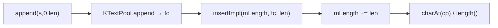

# 01_function_textrope_append — 字符进 rope

| 项 | 值 |
|----|----|
| feature | wc-01-storage-write |
| order | 1 |
| crate | `libs/word-core/Cargo.toml` |
| 入口 | `ITextRope::{append__char, append__chararr_int_int, append__string_int_int, length, charAt, getText, erase, insert__*}` / `KNotifyTextRope` |
| 独立性 | 叶子（**无 Document**，应最先测） |
| 测试状态 | pass |

## 1. 功能说明

### 1.1 一句话

把 `w:t` 与合成 `\r`/`\f` 追加进物理字符流，用 CP 坐标读回 `length` / `charAt` / `getText`。不解释 CHPX/PAPX。

### 1.2 输入

| 形态 | Java 入口 | 不变量 |
|------|-----------|--------|
| 单字符 | `ITextRope.append(char)` | 长度 +1 |
| `char[]` 切片 | `append(buf, start, end)` | 写入 `[start, end)`，长度 `end-start` |
| `String` 切片 | `append(s, start, end)` | 写入 UTF-16 码元语义下的 char 计数（Java `String.length`） |
| 中间插入 | `insert(cp, …)` | 后续 CP 右移 |
| 删除 | `erase(start, end)` | `start < end` 才改长度；否则 no-op |

### 1.3 输出

- `length()` → 当前 CP 长度
- `charAt(cp)` → 该 CP 字符；`cp < 0 \|\| cp >= length` → Java `IndexOutOfBoundsException`（Rust `panic!("IndexOutOfBoundsException")`）
- `getText(start, end, buffer, bufStart)` 填 buffer
- `cp2fc` / `fc2cp` 映射（append 后顺序写入时 fc 与 cp 同起点）

本层 **不** 保证 Listener 被调用（那是 02）；无 listener 时 append 仍必须写出字符。

### 1.4 上游

无包依赖。调用方持有空 rope 或已有 CP 流。

### 1.5 下游

- `02_function_notify_order`：同一 `insertImpl`/`eraseImpl`
- `07_function_corehelper_write`：`textRope.append((String)text, 0, text.length())`

## 2. 核心代码与流程

### 2.1 核心类

| 名字 | 角色 | Java | Rust |
|------|------|------|------|
| `ITextRope` | 字符流契约 | `collections/textrope/ITextRope.java` | `…/ITextRope.rs` |
| `KTextRope` | 池 + piece table | 同目录 | `KTextRope.rs` |
| `KTextPool` | 8192 块式池 | 同目录 | `KTextPool.rs` |
| `KTextPieceTable` | CP↔FC 双树 | 同目录 | `KTextPieceTable.rs` |
| `KNotifyTextRope` | IO 实际类型（SubDocument 持有） | 同目录 | `KNotifyTextRope.rs` |

`BLOCK_SIZE = 8192`，`BLOCK_SIZE_SHIFT = 13`。

### 2.2 调用关系



## 3. 测试方案

### 3.1 代码审计与测试面

Java：`koffice/writer/core/cn/wps/collections/textrope/{ITextRope,KTextRope,KTextPool,KNotifyTextRope}.java`  
Rust：`libs/word-core/src/cn/wps/collections/textrope/{ITextRope,KTextRope,KTextPool,KNotifyTextRope,KTextPieceTable}.rs`

| symbol | Java/Rust 路径 | 输入/状态 | 输出/副作用 | 关键分支/错误 |
|--------|----------------|-----------|-------------|---------------|
| `append__string_int_int` | KNotifyTextRope / KTextRope | 非空切片 | pool append + insertImpl at mLength | `end-start` 为增量 |
| `append__char` | 同上 | 单 char | 长度 +1 | |
| `append__chararr_int_int` | 同上 | buf + [start,end) | 与 string 后端等价 | 空区间 length 不变 |
| `charAt` | KTextRope | 合法 cp / 越界 | 字符 / panic IndexOutOfBounds | `cp>=0 && cp<mLength` |
| `getText` | KTextRope | [start,end) + buffer | 填入 buffer | 跨 piece 循环 |
| `erase` | KTextRope.eraseImpl | start&lt;end / start&gt;=end | 长度减少 / no-op | `if (start < end)` |
| `insert__int_char` | 中间插入 | cp &lt; length | 后续字符右移 | insertMapping `cp < mLength` |
| `KTextPool::KTextPool` | 构造 | 无 | 一块 8192、lastBlockSize=0 | Default 的 `blocks=None` 不可用 |
| 直接调用方 | CoreHelper.appendText__string_ps_doc | String + props | append 后 chpx.insert | 本 function 不断言 CHPX |
| `insertMapping` | KTextRope | length≠0 | `addMapping1` / 必要时 `insertSpace1` | 依赖 PositionTree.positions.mHead（与 Java 同一 extension 对象） |

### 3.2 覆盖矩阵

| coverage_id | 接口/代码路径 | 场景类别 | 必测? | test_id / 未覆盖理由 |
|-------------|---------------|----------|-------|----------------------|
| C-STR | append string + length + charAt | 主路径 | 是 | TR1 |
| C-CHAR | append 单字符 | 主路径 | 是 | TR2 |
| C-ARR | append char[] 切片 | 后端一致性 | 是 | TR3 |
| C-EMPTY-SLICE | append 空区间 end==start | 边界 | 是 | TR4 |
| C-OOB | charAt 越界 | 失败 | 是 | TR5 |
| C-GETTEXT | getText 回读 | 主路径 | 是 | TR6 |
| C-ERASE | erase 缩短 | 状态 | 是 | TR7 |
| C-ERASE-NOOP | erase start>=end | 分支 | 是 | TR8 |
| C-INSERT-MID | insert 中间 | 状态 | 是 | TR9 |
| C-CR-FF | append `\r`(0x0D) 与 `\f`(0x0C) | 边界/常量 | 是 | TR10 |
| C-MULTI | 两次 append 拼接 | 主路径 | 是 | TR11 |

### 3.3 可测试性

`KNotifyTextRope::default()`（内部 `KTextPool()` 已建块）。不构造 Document、不挂 Listener。

### 3.4 用例表

| id | 覆盖项 | 前置状态 | 输入摘要 | 期望输出/副作用 | 失败语义 |
|----|--------|----------|----------|-----------------|----------|
| TR1 | C-STR | 空 rope | `"Hi", 0, 2` | length=2, charAt(0)='H', charAt(1)='i' | 长度错 = pool/insertImpl 未写 |
| TR2 | C-CHAR | 空 | `'A'` | length=1, charAt(0)='A' | |
| TR3 | C-ARR | 空 | `['x','y','z'], 1, 3` | length=2, "yz" | start/end 切片错 |
| TR4 | C-EMPTY-SLICE | 空 | `"ab", 1, 1` | length=0 | 空切片仍增长 = 未用 end-start |
| TR5 | C-OOB | `"A"` | charAt(-1) 与 charAt(1) | panic IndexOutOfBoundsException | 静默返回 = 与 Java 不符 |
| TR6 | C-GETTEXT | `"Hi"` | getText(0,2,buf,0) | buf = ['H','i'] | |
| TR7 | C-ERASE | `"Hi"` | erase(0,1) | length=1, charAt(0)='i' | |
| TR8 | C-ERASE-NOOP | `"Hi"` | erase(1,1) | length 仍 2 | |
| TR9 | C-INSERT-MID | `"AC"` | insert(1,'B') | "ABC", length=3 | |
| TR10 | C-CR-FF | 空 | append `\r` 再 `\f` | charAt 为 0x0D 然后 0x0C | 常量被规范化 |
| TR11 | C-MULTI | 空 | `"a"` 再 `"b"` | "ab", 第二次后 length=2 | |

### 3.5 测试代码位置

crate: `libs/word-core/Cargo.toml`  
src:   `libs/word-core/src/cn/wps/collections/textrope/{KNotifyTextRope,KTextRope,KTextPool,KTextPieceTable}.rs`  
test:  `libs/word-core/tests/cn/wps/collections/textrope/KNotifyTextRope.rs`

### 3.6 测试运行脚本

```bash
cargo test --manifest-path libs/word-core/Cargo.toml --test 01_function_textrope_append

bash .cursor/skills/feature-function/scripts/function-coverage.sh \
  --crate libs/word-core --test 01_function_textrope_append \
  --src src/cn/wps/collections/textrope/KNotifyTextRope.rs \
  --src src/cn/wps/collections/textrope/KTextRope.rs \
  --src src/cn/wps/collections/textrope/KTextPool.rs \
  --src src/cn/wps/collections/textrope/KTextPieceTable.rs \
  --report libs/word-core/parser/features/wc-01-storage-write/functions/01_function_textrope_append/FUNCTION.md
```

工具缺失时先：

```bash
rustup component add llvm-tools-preview
cargo install cargo-llvm-cov --locked
```

### 3.7 覆盖率报告

<!-- coverage-report:begin -->
tool: cargo-llvm-cov (`cargo llvm-cov --test 01_function_textrope_append --json`)
date: 2026-08-19 09:39

| src | lines covered | line % | regions covered | region % |
|-----|---------------|--------|-----------------|----------|
| `src/cn/wps/collections/textrope/KNotifyTextRope.rs` | 42/100 | 42.0% | 90/196 | 45.9% |
| `src/cn/wps/collections/textrope/KTextPieceTable.rs` | 26/112 | 23.2% | 41/142 | 28.9% |
| `src/cn/wps/collections/textrope/KTextPool.rs` | 131/184 | 71.2% | 182/282 | 64.5% |
| `src/cn/wps/collections/textrope/KTextRope.rs` | 74/217 | 34.1% | 111/393 | 28.2% |
| **function total** | **273/613** | **44.5%** |  |  |
<!-- coverage-report:end -->
