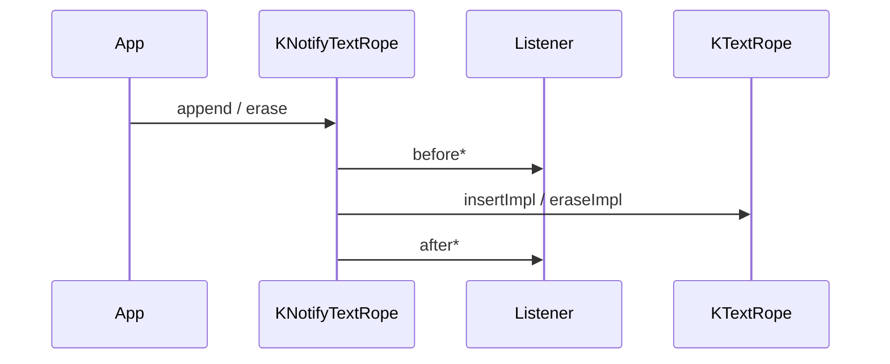

# 02_function_notify_order — before → mutate → after

| 项 | 值 |
|----|----|
| feature | wc-01-storage-write |
| order | 2 |
| crate | `libs/word-core/Cargo.toml` |
| 入口 | `KNotifyTextRope::{insertImpl, eraseImpl}` / `INotifyTextRope::{setListener, getListener}` / `Listener` |
| 独立性 | 叶子（RecordingListener；不断言 CHPX 内容） |
| 测试状态 | pass |

## 1. 功能说明

### 1.1 一句话

文本突变必须按 **before → 真正写入/删除 → after** 通知 `INotifyTextRope.Listener`。这是 CHPX/PAPX/PLC 平移的时钟。

### 1.2 输入

`append` / `insert` / `erase` 打到 `KNotifyTextRope`；可选 `setListener`。

### 1.3 输出

`Listener`：

- `beforeInsertText(cp, fc, length)` / `afterInsertText(cp, fc, length)`
- `beforeRemoveText(start, end)` / `afterRemoveText(start, end)`

`mListener == null` 时跳过回调，mutate 仍发生（01 已覆盖字符结果）。

Java `insertImpl`：

```java
if (mListener != null) mListener.beforeInsertText(cp, fc, length);
super.insertImpl(cp, fc, length);
if (mListener != null) mListener.afterInsertText(cp, fc, length);
```

### 1.4 上游

`01_function_textrope_append`（同一 rope）。

### 1.5 下游

SubDocument 把 ChpxTable / PapxTable / PLC 挂进 listeners。本 function 只钉顺序，不实例化那些表。

## 2. 核心代码与流程



Java：`koffice/writer/core/cn/wps/collections/textrope/KNotifyTextRope.java`  
Rust：`libs/word-core/src/cn/wps/collections/textrope/KNotifyTextRope.rs`

## 3. 测试方案

### 3.1 代码审计与测试面

| symbol | Java/Rust 路径 | 输入/状态 | 输出/副作用 | 关键分支/错误 |
|--------|----------------|-----------|-------------|---------------|
| `insertImpl` | KNotifyTextRope | listener Some/None | before、super、after | null 跳过回调 |
| `eraseImpl` | 同上 | start,end | beforeRemove、super、afterRemove | |
| `setListener` / `getListener` | INotifyTextRope | Box&lt;dyn Listener&gt; | 可取回 | |
| append 路径 | ITextRope on KNotifyTextRope | 走 insertImpl(mLength, fc, n) | cp = 追加前 length | |
| insert 路径 | insert__int_char | cp 在中间 | beforeInsert 的 cp 不是 length | |
| 直接调用方 | SubDocument 构造挂 TextRopeListeners | 多 listener | 本 function 用单个 RecordingListener | |

### 3.2 覆盖矩阵

| coverage_id | 接口/代码路径 | 场景类别 | 必测? | test_id |
|-------------|---------------|----------|-------|---------|
| C-INS-ORDER | append 时 before 在 after 前，且 after 时 length 已变 | 交互契约 | 是 | N1 |
| C-INS-ARGS | beforeInsertText(cp,fc,len) 的 cp=旧 length, len=写入量 | 主路径 | 是 | N2 |
| C-NULL | listener None 时 append 仍成功 | 分支 | 是 | N3 |
| C-ERASE-ORDER | erase beforeRemove 在 afterRemove 前 | 交互契约 | 是 | N4 |
| C-ERASE-ARGS | beforeRemoveText(start,end) | 主路径 | 是 | N5 |
| C-MID | insert 中间：before 的 cp 为目标 cp | 分支 | 是 | N6 |
| C-GETSET | setListener / getListener | 状态 | 是 | N7 |

### 3.3 可测试性

RecordingListener 记 `Vec<Event>`；在 afterInsert 回调里读 `rope.length()` 证明 mutate 已发生。不挂 ChpxTable。

### 3.4 用例表

| id | 覆盖项 | 前置状态 | 输入摘要 | 期望输出/副作用 | 失败语义 |
|----|--------|----------|----------|-----------------|----------|
| N1 | C-INS-ORDER | 空 + listener | append `"ab"` | 事件 `[BeforeInsert, AfterInsert]`；After 时 length=2 | after 先于 before = 顺序反 |
| N2 | C-INS-ARGS | 空 | append `"xy"` | BeforeInsert cp=0, length=2 | cp 用了新 length |
| N3 | C-NULL | listener None | append `'Z'` | length=1, 无 panic | |
| N4 | C-ERASE-ORDER | `"ab"` + listener | erase(0,2) | `[BeforeRemove, AfterRemove]` | |
| N5 | C-ERASE-ARGS | `"ab"` | erase(0,1) | BeforeRemove(0,1)；之后 length=1 | |
| N6 | C-MID | `"AC"` | insert(1,'B') | BeforeInsert cp=1, length=1 | 当成 append |
| N7 | C-GETSET | 空 | set 再 get | 同一 listener 身份（非 null） | |

### 3.5 测试代码位置

crate: `libs/word-core/Cargo.toml`  
src:   `libs/word-core/src/cn/wps/collections/textrope/{KNotifyTextRope,INotifyTextRope}.rs`  
test:  `libs/word-core/tests/cn/wps/collections/textrope/INotifyTextRope.rs`

### 3.6 测试运行脚本

```bash
cargo test --manifest-path libs/word-core/Cargo.toml --test 02_function_notify_order

bash .cursor/skills/feature-function/scripts/function-coverage.sh \
  --crate libs/word-core --test 02_function_notify_order \
  --src src/cn/wps/collections/textrope/KNotifyTextRope.rs \
  --src src/cn/wps/collections/textrope/INotifyTextRope.rs \
  --report libs/word-core/parser/features/wc-01-storage-write/functions/02_function_notify_order/FUNCTION.md
```

### 3.7 覆盖率报告

<!-- coverage-report:begin -->
tool: cargo-llvm-cov (`cargo llvm-cov --test 02_function_notify_order --json`)
date: 2026-08-19 09:40

| src | lines covered | line % | regions covered | region % |
|-----|---------------|--------|-----------------|----------|
| `src/cn/wps/collections/textrope/KNotifyTextRope.rs` | 49/100 | 49.0% | 93/196 | 47.4% |
| `src/cn/wps/collections/textrope/INotifyTextRope.rs` | (not in report) | — | — | — |
| **function total** | **49/100** | **49.0%** |  |  |
<!-- coverage-report:end -->
