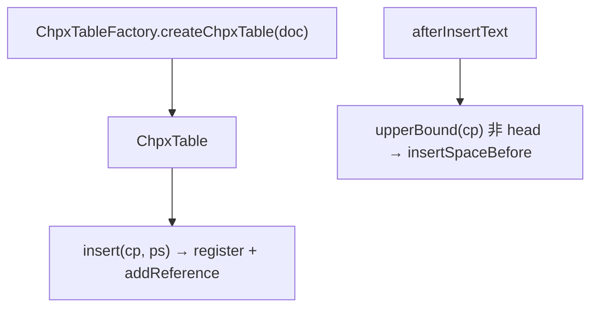

# 03_function_chpx_insert — CHPX 挂 CP 区间

| 项 | 值 |
|----|----|
| feature | wc-01-storage-write |
| order | 3 |
| crate | `libs/word-core/Cargo.toml` |
| 入口 | `ChpxTable::{insert_entry, seek_entry, afterInsertText, beforeRemoveText}` / `ChpxTableFactory::createChpxTable` / `CPTable::afterInsertText` |
| 独立性 | 叶子（用最小 Document 缝；不跑 CoreHelper） |
| 测试状态 | pass |

## 1. 功能说明

### 1.1 一句话

把 run 级 `PropertySet` 登记后挂到 CP 半开区间 `[pos, next.pos)`。文本插入后后续 Entry `insertSpaceBefore`。

### 1.2 输入

- `insert(cp, PropertySet)`：registry.register + addReference
- `afterInsertText(cp, fc, length)`：非 undo/redo 时 `upperBound(cp)` 非 head → `insertSpaceBefore(length)`
- `beforeRemoveText(start, end)`：split 两端、删中间、eraseSpaceBefore
- Factory：`Document == null → null`，否则 `new ChpxTable(document)`

### 1.3 输出

`IChpxTable.Entry`：`position()` / `endCp()` / `getProperty()`。Head 哨兵 `position() = document.getLength()`，若干方法抛 RuntimeException。

`getPropertySetId = (registryId << 18) + data`（`PROPERTYSET_BITS = 18`）。

`beforeAddReference` 额外 `StyleListenerBase.addStyleRef(styles, prop, null, 2)`（字符样式 type=2）。

### 1.4 上游

`01` 提供 CP 长度；`02` 提供 afterInsertText 时钟；wave0 `PropertySet`。

### 1.5 下游

`07` `chpxTable.insert(positionInserted, props)`。

## 2. 核心代码与流程



Java：`internal_v2/ChpxTable.java`、`ChpxTableFactory.java`、`CPTable.java`  
Rust：同相对路径 `.rs`

## 3. 测试方案

### 3.1 代码审计与测试面

| symbol | Java/Rust 路径 | 输入/状态 | 输出/副作用 | 关键分支/错误 |
|--------|----------------|-----------|-------------|---------------|
| `ChpxTableFactory::createChpxTable` | Factory.rs | null / 非 null Document | None / Some table | |
| `insert_entry` | ChpxTable / CPTable | cp + PropertySet | Entry.position==cp, getProperty 可读 prop | registry 去重 |
| `seek_entry` | CPTable.seek lowerBound 修正 | 区间内 cp | 命中覆盖该 cp 的 Entry | position!=cp 时取 prev |
| `afterInsertText` | CPTable | 非 undo；upperBound 非 head | 后续节点 CP += length | isHead 不平移；undo/redo 跳过 |
| `beforeRemoveText` | ChpxTable | 非 undo | split+remove+eraseSpaceBefore | isInUndoRedo 整段跳过 |
| `split` | 仅当 seek 非 end 且 position!=cp | 切分 | insert(cp, 原 property) | |
| `beforeAddReference` | style type=2 | styles 可 null | 浅 addStyleRef，insert 仍成功 | |
| Head | position=getLength | 哨兵 | 不可当普通 Entry 用 | |
| 直接调用方 | CoreHelper.appendText | insert(append前length) | 本 function 用显式 cp | |

### 3.2 覆盖矩阵

| coverage_id | 接口/代码路径 | 场景类别 | 必测? | test_id / 未覆盖理由 |
|-------------|---------------|----------|-------|----------------------|
| C-FAC-NULL | factory null document | 失败/边界 | 是 | CX1 |
| C-FAC-SOME | factory 非 null | 主路径 | 是 | CX2 |
| C-INS | insert(0, ps) seek 回读 | 主路径 | 是 | CX3 |
| C-SEEK-INNER | 区间内 seek | 分支 | 是 | CX4 |
| C-SHIFT | afterInsertText 平移后续 Entry | 状态 | 是 | CX5 |
| C-SHIFT-HEAD | upperBound 为 head 不平移 | 分支 | 是 | CX6 |
| C-RM | beforeRemoveText 删区间 | 状态 | 是 | CX7 |
| C-SPLIT | 删除跨 Entry 中部 → split | 分支 | 是 | CX8 |
| C-STYLE2 | insert 走 addStyleRef type=2 | 交互（可浅） | 是 | CX3 间接：insert 不因 styles=null 失败 |

### 3.3 可测试性

最小 `Document` 测试缝：实现 `getLength` / `getStyles` / `getTransaction` / `IDocument::getType`；rope 长度与 getLength 一致。不启动 CoreHelper、不打开 docx。

### 3.4 用例表

| id | 覆盖项 | 前置状态 | 输入摘要 | 期望输出/副作用 | 失败语义 |
|----|--------|----------|----------|-----------------|----------|
| CX1 | C-FAC-NULL | — | createChpxTable(null) | None | 空指针表 |
| CX2 | C-FAC-SOME | StorageDoc | factory(doc) | Some | |
| CX3 | C-INS | 空表 length=0 | insert(0, ps{193:1}) | entry.position=0, getInt(193)=1 | 丢 property |
| CX4 | C-SEEK-INNER | [0,3) 上有 chpx，length=3 | seek(1) | 同一 entry，position=0 | 当成新节点 |
| CX5 | C-SHIFT | entry 在 cp=5；在 0 插入 2 字符 | afterInsertText(0,_,2) | 该 entry.position=7 | 未平移 |
| CX6 | C-SHIFT-HEAD | 仅 head，在末尾插入 | afterInsertText(end,_,n) | 无非 head 被改 | |
| CX7 | C-RM | 两段 CHPX | beforeRemoveText 覆盖第一段 | 第一段消失，后续 eraseSpace | |
| CX8 | C-SPLIT | 一段覆盖 [0,4) | beforeRemoveText(1,3) | split 出边界节点 | 整段误删 |

### 3.5 测试代码位置

crate: `libs/word-core/Cargo.toml`  
src:   `libs/word-core/src/cn/wps/moffice/writer/data/internal_v2/{ChpxTable,ChpxTableFactory,CPTable}.rs`  
test:  `libs/word-core/tests/cn/wps/moffice/writer/data/internal_v2/ChpxTable.rs`

### 3.6 测试运行脚本

```bash
cargo test --manifest-path libs/word-core/Cargo.toml --test 03_function_chpx_insert

bash .cursor/skills/feature-function/scripts/function-coverage.sh \
  --crate libs/word-core --test 03_function_chpx_insert \
  --src src/cn/wps/moffice/writer/data/internal_v2/ChpxTable.rs \
  --src src/cn/wps/moffice/writer/data/internal_v2/ChpxTableFactory.rs \
  --src src/cn/wps/moffice/writer/data/internal_v2/CPTable.rs \
  --report libs/word-core/parser/features/wc-01-storage-write/functions/03_function_chpx_insert/FUNCTION.md
```

### 3.7 覆盖率报告

<!-- coverage-report:begin -->
tool: cargo-llvm-cov (`cargo llvm-cov --test 03_function_chpx_insert --json`)
date: 2026-08-19 10:11

| src | lines covered | line % | regions covered | region % |
|-----|---------------|--------|-----------------|----------|
| `src/cn/wps/moffice/writer/data/internal_v2/CPTable.rs` | 101/369 | 27.4% | 178/718 | 24.8% |
| `src/cn/wps/moffice/writer/data/internal_v2/ChpxTable.rs` | 115/274 | 42.0% | 215/507 | 42.4% |
| `src/cn/wps/moffice/writer/data/internal_v2/ChpxTableFactory.rs` | 5/5 | 100.0% | 8/8 | 100.0% |
| **function total** | **221/648** | **34.1%** |  |  |
<!-- coverage-report:end -->
