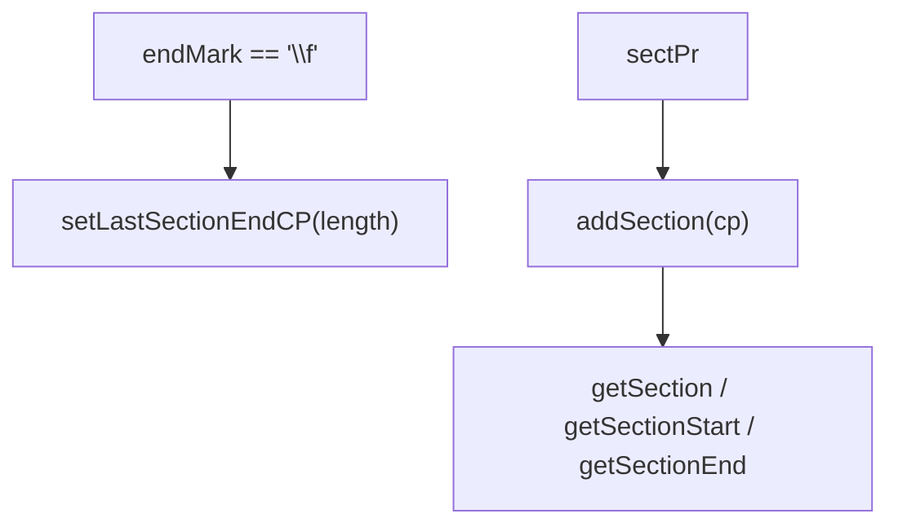

# 05_function_plcsection — 分节符与节查询

| 项 | 值 |
|----|----|
| feature | wc-01-storage-write |
| order | 5 |
| crate | `libs/word-core/Cargo.toml` |
| 入口 | `PLCSection::{setLastSectionEndCP, addSection, getSection, getSectionStart, getSectionEnd, onEndLoad, doOnInsertText}` / `PLC::insertSpaceBefore` |
| 独立性 | 叶子（不经 CoreHelper；`\f` 由测试直接当成 CP 事件） |
| 测试状态 | pass |

## 1. 功能说明

### 1.1 一句话

用分节符 `\f`（0x0C）对应的文档长度更新末节终点，并用 `addSection(cp)` 挂 `SectionNode`；查询时首节 start=`position()`，非首节 `position()+1`（`\f` 归前节）。

### 1.2 输入

- `setLastSectionEndCP(cp)` — importer 在 `\f` 段写入后传入 `getLength()`
- `addSection(cp)` — 收到 sectPr；`cp==0 && !isEmpty` 走 `insertAtUpperBound` 否则 `super.insert`
- `doOnInsertText(start,end)` — 用户事务路径平移后续节（parse 时 `isInUserAction` 常为 false；仍须可直接调用）

### 1.3 输出

- `getSection(cp)`：从 head.getNext() 迭代，`iter.getStart() >= cp` 命中；空树 / 仍是 head → null
- `getSectionEnd`：末节 = `getLastSectionEndCP()`；否则 `next.position()+1`
- `getLastSectionEndCP`：`mLastSecEndCP == Integer.MIN_VALUE` → `document.getLength()`，否则字段值
- `onEndLoad` 把 `mLastSecEndCP` 复位为 `MIN_VALUE`
- `getSectionRange` = `RANGEFactory.getRANGE(start, end)`（高 32 位 start）

`INVALID_CP = Integer.MIN_VALUE`（`i32::MIN`）。

### 1.4 上游

01 的 length；02 的 insert 通知（PLC `afterInsertText` 仅 `isInUserAction` 时 `doOnInsertText`）。

### 1.5 下游

layout `getSection(cp)`；**不是** CoreHelper（CoreHelper 不调 PLCSection）。

## 2. 核心代码与流程



Java：`writer/data/PLCSection.java`、`PLC.java`  
Rust：同相对路径

## 3. 测试方案

### 3.1 代码审计与测试面

| symbol | Java/Rust 路径 | 输入/状态 | 输出/副作用 | 关键分支/错误 |
|--------|----------------|-----------|-------------|---------------|
| `setLastSectionEndCP` | PLCSection.rs | 任意 i32 | 字段写入 | |
| `getLastSectionEndCP` | 私有但经 getSectionEnd | MIN vs 已设 | getLength() vs 字段 | document None → 0 |
| `onEndLoad` | | | 复位 MIN | |
| `addSection` | | cp | 新 SectionNode，sepx=empty | cp==0 && !empty → insertAtUpperBound |
| `insert` override | | 同上 | | |
| `getSection` | 空 / 有节点 | cp | None / node | iter.getStart() >= cp |
| `getSectionStart` | 首节 / 非首节 | | position / position+1 | |
| `getSectionEnd` | 末节 / 非末节 | | lastEnd / next.pos+1 | |
| `getSectionRange` | RANGEFactory | | (start<<32)\|end | |
| `doOnInsertText` | start==0 且 upper 非 end | upper=getNext 再 insertSpaceBefore | | |
| `insertSpaceBefore` | PLC | pFrom 是 head | 不平移 | |
| 直接调用方 | MainDocumentImporter doImportSectionPropertiesSimple | 本 function 直接 API | |

### 3.2 覆盖矩阵

| coverage_id | 接口/代码路径 | 场景类别 | 必测? | test_id |
|-------------|---------------|----------|-------|---------|
| C-SET-END | setLastSectionEndCP + 末节 end | 主路径 | 是 | SC1 |
| C-INVALID | 未 set 时 MIN → getLength | 边界 | 是 | SC2 |
| C-RELOAD | onEndLoad 复位 | 状态 | 是 | SC3 |
| C-ADD | addSection(0) 空树 | 主路径 | 是 | SC4 |
| C-ADD-UPPER | cp==0 且已有节 | 分支 | 是 | SC5 |
| C-GET | getSection 命中 | 主路径 | 是 | SC6 |
| C-EMPTY | 空树 getSection | 边界 | 是 | SC7 |
| C-START-FIRST | 首节 start=position | 分支 | 是 | SC8 |
| C-START-NEXT | 非首节 start=position+1 | 分支 | 是 | SC9 |
| C-RANGE | getSectionRange 打包 | 主路径 | 是 | SC10 |
| C-SHIFT | doOnInsertText 平移后续 | 状态 | 是 | SC11 |
| C-FF | 常量 0x0C 仅作文档约定 | 常量 | 是 | SC1 注释：endCP=写入 `\f` 后的 length |

### 3.3 可测试性

`PLCSection::new(None)` 测 set/onEndLoad。`addSection`/`getSection*` 需要 PLC 树可用；Loop 用 None document 或 StorageDoc。不跑 importer。

### 3.4 用例表

| id | 覆盖项 | 前置状态 | 输入摘要 | 期望输出/副作用 | 失败语义 |
|----|--------|----------|----------|-----------------|----------|
| SC1 | C-SET-END | 一节 | setLastSectionEndCP(4)；getSectionEnd(last)=4 | 仍用 getLength | |
| SC2 | C-INVALID | 一节未 set | getSectionEnd(last) | == document.getLength() 或 0 | |
| SC3 | C-RELOAD | 已 set 99 | onEndLoad | 再 get 走 MIN 分支 | |
| SC4 | C-ADD | 空 | addSection(0) | getFirstSection Some | |
| SC5 | C-ADD-UPPER | 已有节 | addSection(0) | 走 insertAtUpperBound 不崩 | |
| SC6 | C-GET | 节在 0 | getSection(0) | Some | |
| SC7 | C-EMPTY | 空 | getSection(0) | None | |
| SC8 | C-START-FIRST | 首节 pos=0 | getSectionStart=0 | | |
| SC9 | C-START-NEXT | 第二节 pos=3 | getSectionStart=4 | `\f` 未归前节 |
| SC10 | C-RANGE | start/end 已知 | RANGE 高 32=start | |
| SC11 | C-SHIFT | 第二节在 5 | doOnInsertText(0,2) | 第二节 CP+2 | |

### 3.5 测试代码位置

crate: `libs/word-core/Cargo.toml`  
src:   `libs/word-core/src/cn/wps/moffice/writer/data/{PLCSection,PLC}.rs`  
test:  `libs/word-core/tests/cn/wps/moffice/writer/data/PLCSection.rs`

### 3.6 测试运行脚本

```bash
cargo test --manifest-path libs/word-core/Cargo.toml --test 05_function_plcsection

bash .cursor/skills/feature-function/scripts/function-coverage.sh \
  --crate libs/word-core --test 05_function_plcsection \
  --src src/cn/wps/moffice/writer/data/PLCSection.rs \
  --src src/cn/wps/moffice/writer/data/PLC.rs \
  --report libs/word-core/parser/features/wc-01-storage-write/functions/05_function_plcsection/FUNCTION.md
```

### 3.7 覆盖率报告

<!-- coverage-report:begin -->
tool: cargo-llvm-cov (`cargo llvm-cov --test 05_function_plcsection --json`)
date: 2026-08-19 10:36

| src | lines covered | line % | regions covered | region % |
|-----|---------------|--------|-----------------|----------|
| `src/cn/wps/moffice/writer/data/PLC.rs` | 153/294 | 52.0% | 225/455 | 49.5% |
| `src/cn/wps/moffice/writer/data/PLCSection.rs` | 104/159 | 65.4% | 154/248 | 62.1% |
| **function total** | **257/453** | **56.7%** |  |  |
<!-- coverage-report:end -->
