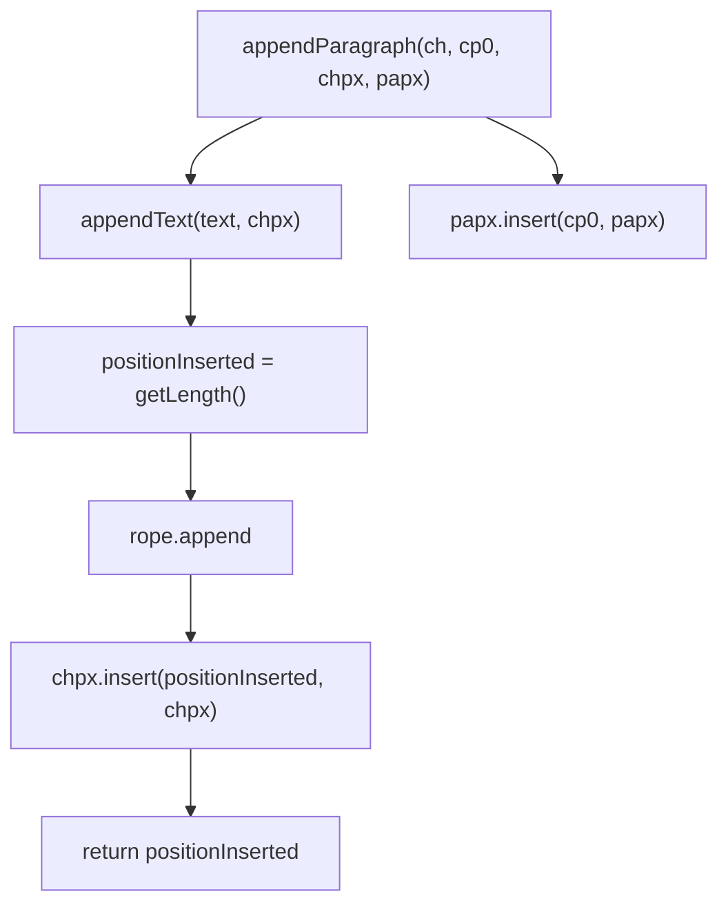

# 07_function_corehelper_write — 写入编排

| 项 | 值 |
|----|----|
| feature | wc-01-storage-write |
| order | 7 |
| crate | `libs/word-core/Cargo.toml` |
| 入口 | `CoreHelper::{appendText__string_ps, appendText__char_ps, appendText__chararr_int_int_ps, appendParagraph__char_int_ps_ps, appendParagraph__char_ps_ps, insertToPapxTable, supplyEndPara, setCellMark}` |
| 独立性 | 编排（接线 01+03+04 的 golden；不打开 docx） |
| 测试状态 | pass |

## 1. 功能说明

### 1.1 一句话

唯一推荐写入入口：先记下 **append 前 length**，追加字符，再把 CHPX 插在该 CP；段结束把 PAPX 插在调用方给的 **段首 cp0**。

### 1.2 输入

| 方法 | 输入 | 不变量 |
|------|------|--------|
| `appendText(doc, text, props)` | 非空 String + 非空 props | 返回 `positionInserted = getLength()` **调用前** |
| `appendText(doc, ch, props)` | 单 char | 转 String 后同上 |
| `appendText(doc, buf, start, end, props)` | `end > 0`（Java 断言，不是 end>start） | 同上 |
| `appendParagraph(doc, ch, cp, chpx, papx)` | IO 主路径 | appendText(ch) 然后 papx.insert(**cp**, papx) |
| `appendParagraph(doc, ch, chpx, papx)` | 无 cp | papx 挂在 **刚写入的 endMark 的 CP** |
| `insertToPapxTable` | cp + papx | 直接 papxTable.insert |
| `supplyEndPara` | 空文档或 last papx | head → append `\r` at cp=0；prop 225 → 无 cp 重载 |
| `setCellMark` | cellMark + papx entry | `textPool.set(cp2fc(endCp-1), cellMark)`；单元格标记 **0x07** |

Assert（失败必须停在本级）：document/text/props 非 null；`text.length() > 0`；rope/chpx/papx 非 null。Rust `document: None` 的 `appendText__string_ps` 返回 0（无 Java 对应的 null doc 调用）。

**不**调用 PLCSection。`\f` 只作为字符写入。

drawing dump / comment / rotation 工具不在本 function。

### 1.3 输出

- appendText → `i32` 新 run 起始 CP
- appendParagraph → PAPX Entry
- rope length / charAt / CHPX.position / PAPX.position 与 Java 对齐

### 1.4 上游

01、03、04 已测的 API。Document 必须同时 `getLength`/`getTextRope`/`getChpxTable`/`getPapxTable`。

### 1.5 下游

wc-04 `importRunText` / `importParagraphEnd`。

## 2. 核心代码与流程



Java：`writer/helper/CoreHelper.java`（appendText 154–181 行；appendParagraph 134–141；supplyEndPara 278–284；setCellMark 120–128）  
Rust：`…/helper/CoreHelper.rs`

## 3. 测试方案

### 3.1 代码审计与测试面

| symbol | Java/Rust 路径 | 输入/状态 | 输出/副作用 | 关键分支/错误 |
|--------|----------------|-----------|-------------|---------------|
| `appendText__string_ps` | CoreHelper.rs | 合法 / None doc / 空串 | CP / 0 / Assert | 空串不得表现为 CHPX 缺失 |
| `appendText__char_ps` | 转 String | 单 `\r` | 同 string | |
| `appendText__chararr_int_int_ps` | end>0 | 切片 | 同 string | Java 断言是 end>0 不是 len>0 |
| 二次 append | | 第二次返回值 = 第一次后 length | CHPX 第二段 position | |
| `appendParagraph__char_int_ps_ps` | IO 主路径 | papx.position==cp0 | 无 cp 重载会挂 endMark | |
| `appendParagraph__char_ps_ps` | 无 cp | papx 在 endMark CP | | |
| `insertToPapxTable` | papx null 表 | Assert | | |
| `supplyEndPara` | last isHead / prop 225 | 补 `\r` | 已有正常段不补 | |
| `setCellMark` | 0x07 | pool 在 endCp-1 | | |
| `isValidChar` | `\uffff`/`\ufffe`/`�` | false | 可选，非热路径 | |
| 直接调用方 | SubDocumentImporter importRunText | 本层用 StorageDoc | |

### 3.2 覆盖矩阵

| coverage_id | 接口/代码路径 | 场景类别 | 必测? | test_id |
|-------------|---------------|----------|-------|---------|
| C-STR | appendText string 返回 0，length=n，CHPX@0 | 主路径 | 是 | CH1 |
| C-SECOND | 第二次返回值=旧 length | 状态 | 是 | CH2 |
| C-CHAR | appendText char | 后端 | 是 | CH3 |
| C-ARR | appendText char[] | 后端 | 是 | CH4 |
| C-PARA-CP0 | appendParagraph 带 cp0，PAPX 在段首 | 主路径 | 是 | CH5 |
| C-PARA-NOCP | 无 cp 重载 PAPX 在 endMark | 分支 | 是 | CH6 |
| C-CR | endMark `\r`=0x0D | 常量 | 是 | CH5 |
| C-FF | endMark `\f`=0x0C 写入 rope，**不**改 PLCSection | 常量 | 是 | CH7 |
| C-EMPTY | 空串 Assert | 失败 | 是 | CH8 |
| C-NODC | document None → 0 | 边界 | 是 | CH9 |
| C-SUPPLY-HEAD | 空 papx head → `\r` at 0 | 分支 | 是 | CH10 |
| C-SUPPLY-225 | last papx 225=true → 再补段 | 分支 | 是 | CH11 |
| C-SUPPLY-SKIP | 正常 last 不补 | 分支 | 是 | CH12 |
| C-CELL | setCellMark 0x07 | 主路径 | 是 | CH13 |

### 3.3 可测试性

StorageDoc：持有 `KNotifyTextRope` + ChpxTable + PapxTable，`getLength` = rope.length()。不跑 wc-04 importer、不跑 PLCSection。

### 3.4 用例表

| id | 覆盖项 | 前置状态 | 输入摘要 | 期望输出/副作用 | 失败语义 |
|----|--------|----------|----------|-----------------|----------|
| CH1 | C-STR | 空 doc | appendText `"Hi", chpx` | ret=0, length=2, charAt 匹配, chpx.seek(0).position=0 | CHPX 用了 append 后 length |
| CH2 | C-SECOND | 已有 `"Hi"` | 再 append `"!"` | ret=2, 新 CHPX position=2 | |
| CH3 | C-CHAR | 空 | appendText `'A'` | 同 string `"A"` | |
| CH4 | C-ARR | 空 | buf `[a,b,c]` start=0 end=2 | `"ab"`, ret=0 | 用了 end 当 length 断言失败但切片错 |
| CH5 | C-PARA-CP0 / C-CR | 先 append `"Hi"` ret=0 | appendParagraph(`\r`, 0, chpx, papx) | papx.position=0；rope 末为 0x0D | papx 挂在 `\r` 的 CP |
| CH6 | C-PARA-NOCP | 空 | appendParagraph(`\r`, chpx, papx) | papx.position = `\r` 的 CP（0） | 与带 cp0 在已有正文后行为不同 |
| CH7 | C-FF | 空 | appendText `"\u{000C}"` | charAt(0)=0x0C；无 PLCSection 调用 | 偷偷 addSection |
| CH8 | C-EMPTY | 空 | appendText `""` | Assert / panic text.length()>0 | 静默 ret=0 当成功 |
| CH9 | C-NODC | — | appendText(None, `"a"`, ps) | 0 | |
| CH10 | C-SUPPLY-HEAD | 无 papx 节点 | supplyEndPara | 出现 `\r` 与 papx@0 | |
| CH11 | C-SUPPLY-225 | last papx 225 | supplyEndPara | 再增一段 | |
| CH12 | C-SUPPLY-SKIP | last 正常段 | supplyEndPara | length 不变 | 误补段 |
| CH13 | C-CELL | 一段 endCp=4 | setCellMark(0x07) | pool 在 endCp-1 为 0x07 | 写错 CP |

### 3.5 测试代码位置

crate: `libs/word-core/Cargo.toml`  
src:   `libs/word-core/src/cn/wps/moffice/writer/helper/CoreHelper.rs`  
test:  `libs/word-core/tests/cn/wps/moffice/writer/helper/CoreHelper.rs`

### 3.6 测试运行脚本

```bash
cargo test --manifest-path libs/word-core/Cargo.toml --test 07_function_corehelper_write

bash .cursor/skills/feature-function/scripts/function-coverage.sh \
  --crate libs/word-core --test 07_function_corehelper_write \
  --src src/cn/wps/moffice/writer/helper/CoreHelper.rs \
  --report libs/word-core/parser/features/wc-01-storage-write/functions/07_function_corehelper_write/FUNCTION.md
```

### 3.7 覆盖率报告

<!-- coverage-report:begin -->
tool: cargo-llvm-cov (`cargo llvm-cov --test 07_function_corehelper_write --json`)
date: 2026-08-19 10:45

| src | lines covered | line % | regions covered | region % |
|-----|---------------|--------|-----------------|----------|
| `src/cn/wps/moffice/writer/helper/CoreHelper.rs` | 165/182 | 90.7% | 265/289 | 91.7% |
| **function total** | **165/182** | **90.7%** |  |  |
<!-- coverage-report:end -->
