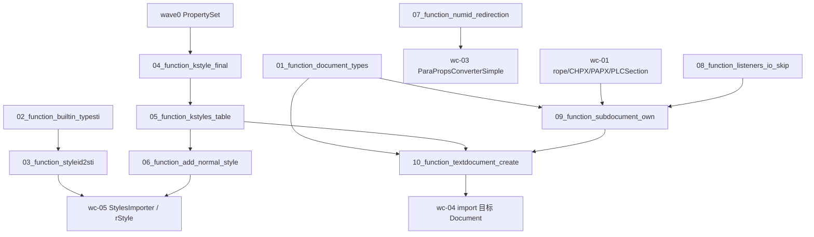

# wc-02-document-model — Function 组合图

> 分析日期：2026-08-19
> 输入端点：wc-01 已测绿的 rope / CHPX / PAPX / PLCSection；wave0 `PropertySet`
> 对外输出：TextDocument 对象图（7 个 SubDocument + 共享 pool + KStyles）+ importer 用的 styleId/numId 映射
> 切分依据：I/O 边界（类型号 → 内置名表 → XML styleId 映射 → 样式合并 → 表覆盖 → Normal 保障 → numId 映射 → IO 期 listener 跳过 → SubDocument 拥有存储 → TextDocument._create 编排）
> 类级蓝皮书：[STRUCTURE_ANALYSIS.md](./STRUCTURE_ANALYSIS.md) · 09 依赖分界：[docs/09-subdocument-own-scope.md](./docs/09-subdocument-own-scope.md) · 深读：[docs/README.md](./docs/README.md)

本文件只讲 **function 之间如何串联**。每个 function 的字段表、类图、**测试方案**在
`functions/<function_id>/FUNCTION.md`。可执行测试与 `src` 隔离，镜像落在 crate
`libs/word-core/tests/<relpath>/<Type>.rs`（见 §3）。

**本层不解析 docx、不写 CHPX/PAPX。** 落库是 wc-01；pPr/rPr 转换是 wc-03；段/run 导入是 wc-04；StylesImporter 填表是 wc-05。本层验的是「谁拥有存储、create 顺序、styleId→sti」。

---

## 0. 一句话管线

目录名 `{NN}_function_*` 的 `NN` 是依赖拓扑序号（就绪即编号）。属性桶已在 wave0 测绿；rope/CHPX/PAPX 已在 wc-01 测绿，本 feature **不重拆**。

```text
(wave0) 01_function_property_set            PropertySet 前置（util crate）
(wc-01) 01–07                               rope / CHPX / PAPX / PLCSection / CoreHelper
01_function_document_types                  type id 0..6 + SUBDOCUMENT_COUNT=7
02_function_builtin_typesti                 内置名 → TypeSti{type,sti}；reserved 0..=267
03_function_styleid2sti                     XML styleId → kernel sti（含 UUSti / isCustom）
04_function_kstyle_final                    getFinalProperty base 链 + 214–219 / 57
05_function_kstyles_table                   add 同 id 覆盖；getStyleById miss→Normal
06_function_add_normal_style                保证 sti=0 Normal（prop 10=10.5f, 193=3）
07_function_numid_redirection               OOXML numId → kernel numbering id
08_function_listeners_io_skip               before 逆序 / after 正序；IO 期跳过
09_function_subdocument_own                 ctor 拥有 rope/chpx/papx/CPieceTable；type0→PLCSection
10_function_textdocument_create             _create：Transaction → KStyles → pool → 7 SubDocument
```

热路径（钉死，来自 STRUCTURE_ANALYSIS.md）：

```text
TextDocument._create()
  → Transaction + listeners
  → KStyles(this)
  → KSwappableTextPool(262144) | KTextPool
  → createAllSubDocument()          # for i < 7；Rust 现状缺 i+=1，Loop 必须修
       SubDocument(parent, type)
         → rope + shared parent.getTextPool()
         → ChpxTable / PapxTable
         → TextRopeListeners + add(chpx)+add(papx)
         → CPieceTable
         → createPLC()              # 09 必测：type==0 → PLCSection；PLCField 非 09 I/O

DocumentImporter
  → new StyleId2Sti(document.getUUSti())     # 首个 getUUSti() == 4097
  → new NumIdRedirection(document.getUUNumberingId())  # 首个 getNextId() == 1
  → IOHelper.addNormalStyle(document.getStyles())
```

---

## 1. Function 清单

| order | function_id | 一句话 | 输入 | 输出 | 上游 | 下游 |
|------|-------------|--------|------|------|------|------|
| 1 | [01_function_document_types](./functions/01_function_document_types/FUNCTION.md) | 子文档类型号 0..6 与槽位数 7 | （常量） | `MAIN_DOCUMENT..HEADERTEXTBOX` + `SUBDOCUMENT_COUNT` | （无） | 09; 10 |
| 2 | [02_function_builtin_typesti](./functions/02_function_builtin_typesti/FUNCTION.md) | 内置样式名如何变成 type+sti | 样式名 / sti | `TypeSti` / reserved 判定 / `getName` | 01 的 type 常量 | 03 |
| 3 | [03_function_styleid2sti](./functions/03_function_styleid2sti/FUNCTION.md) | XML styleId 如何变成内核 sti | styleId + name + type + isCustom | map 中的 coreId；miss ≠ 4095 | 02; UUSti | wc-05 StylesImporter |
| 4 | [04_function_kstyle_final](./functions/04_function_kstyle_final/FUNCTION.md) | 单条样式如何沿 basedOn 合成 final | KStyle + base 链 | freeze 后的 `PropertySet` | wave0 property_set | 05; wc-03 |
| 5 | [05_function_kstyles_table](./functions/05_function_kstyles_table/FUNCTION.md) | 样式表如何按 id 覆盖与查找 | KStyle / id / name / rPr/pPr | `getStyleById` / defaults | 04 | 06; 10 |
| 6 | [06_function_add_normal_style](./functions/06_function_add_normal_style/FUNCTION.md) | 导入前如何保证 Normal(sti=0) 存在 | `KStyles` | id=0, type=1, name Normal, prop 10/193 | 05 | wc-05 onMainDocumentStart |
| 7 | [07_function_numid_redirection](./functions/07_function_numid_redirection/FUNCTION.md) | OOXML numId 如何变成内核 id | OOXML numId | kernel id（首个 1） | TextDocument.UUNumberingId | wc-03 / wc-05 numbering |
| 8 | [08_function_listeners_io_skip](./functions/08_function_listeners_io_skip/FUNCTION.md) | 写入通知顺序与 IO 期跳过 | insert/remove + IO 标志 | dispatcher↔list 顺序；disabled 无回调 | wc-01 notify_order | 09 |
| 9 | [09_function_subdocument_own](./functions/09_function_subdocument_own/FUNCTION.md) | 一个 SubDocument 如何拥有存储（**装配**，不重写 PLC/KRange） | parent + type | rope/chpx/papx/pieceTable；type0 有 PLCSection（`Option`） | wc-01; 01; 08 | 10 |
| 10 | [10_function_textdocument_create](./functions/10_function_textdocument_create/FUNCTION.md) | 如何一次建成 7 槽对象图 | （无 / bMock） | 7 SubDocument + KStyles + 共享 pool + UUSti | 05; 09 | feature-output（wc-04/05） |

`WordBuildinStyleNames` 全库无引用（BuildinStyleSheet 硬编码字面量），折进 02，不单独成 function。

---

## 2. 数据流



**串接规则：**

1. **不重测 wc-01。** 09 只断言「ctor 把已测绿的表挂上」；不重跑 CHPX insert 矩阵；**不** java2rust `CPieceTable` / `PLC` / `PLCSection`。
1b. **09 不按类改写 SubDocument 闭包。** `KRange` / `HelperHeaderFooter` / `PLCHeader` 深层不是本 function，也不是 wc-02 parse-critical。见 [docs/09-subdocument-own-scope.md](./docs/09-subdocument-own-scope.md)。
2. **styleId miss ≠ stiNil。** `StyleId2Sti.getSti` 未注册返回 null；4095 是 StylesImporter `toSti(null)`（wc-05），不是本层 map 默认值。
3. **isCustom 强制 UUSti。** 即使 name 是 `"Normal"` / `"heading 1"`，`isCustom=true` 也走 `getUUSti()`，不采用 TypeSti.sti。
4. **Java map 有 `"Normal" → TypeSti(1,0)`**（`BuildinStyleSheet.java` 1388 行）。STRUCTURE §1.8 曾写「无 Normal 键」——以 Java 源码为准。`addNormalStyle` 仍必须保证表里有 sti=0 的 KStyle 对象。
5. **`setRPrDefault` / `setPPrDefault` 只在当前 empty 时写入。** 第二次调用不得覆盖。
6. **测 09/10 不打开 docx。** fixture 是内存 `TextDocument` / 假 parent；编排 function 10 才组 7 槽。
7. **失败停在本级。** `StyleId2Sti` 构造 null maker 应 Assert；不得表现为「getSti 返回 4095」。

---

## 3. 依赖与编译面

| 层级 | function | crate | 单独测 |
|------|----------|-------|--------|
| 叶子 | document_types | `libs/word-core` | 是：`Document.rs` 已导出常量；`IDocument::getType` |
| 叶子 | builtin_typesti, styleid2sti, kstyle_final, kstyles_table, add_normal_style, numid_redirection, listeners_io_skip | word-core | Split 时 **未** 导出 writer 树；测试 `#[ignore = "spec: export …"]` |
| 叶子 | subdocument_own | word-core | 假 parent + **完整** `SubDocument.rs` 模板（critical 真写，其余空体+留注释）；`getPLCSection`=`Option`；禁止实现 KRange/全量 TextDocument |
| 编排 | textdocument_create | word-core | 需 09 + KStyles + pool；Rust `createAllSubDocument` 缺 `i += 1` |

每个 function 一条 `[[test]]`，`name` = `function_id`，`path` = `tests/` 下与 `src` 同相对路径的入口类型文件。

```bash
# 单 function（loop 用这条）
cargo test --manifest-path libs/word-core/Cargo.toml --test 01_function_document_types
# … 02–10 同 crate、--test <function_id>

# 不要用 --lib 当 function 验收：src 内禁止 #[cfg(test)]
```

**编译面：** `libs/word-core/src/lib.rs` 默认不 `pub mod cn` 全量 writer 树。`01`–`08` 已 `pass`。09–10 仍 `status=spec`。

**09 编译面冻结（依赖发散后的硬约束）：** 只装配 wc-01 已导出的 rope/CHPX/PAPX/`CPieceTable`/`PLCSection` + 本 feature 已导出的 Document 常量 / KStyles / Listeners。**禁止**为 09 新增 `KRange`、`HelperHeaderFooter`、完整 `TextDocument.rs`、完整 1886 行 `SubDocument` 全 `use`。详情 [docs/09-subdocument-own-scope.md](./docs/09-subdocument-own-scope.md)。

wc-01 的 `01_function_textrope_append`…`07_function_corehelper_write` 条目保留。

启动改写-测试-回归：对 agent 说 `loop 01_function_document_types` 或「开始 loop」（skill：`feature-function`）。每个 function 的 `FUNCTION.md` §3.6 / §3.7 含 `cargo test` 脚本与 `cargo-llvm-cov` 覆盖率报告。

---

## 4. Function 如何串联（逐步）

1. importer 用 `Document.MAIN_DOCUMENT=0` 取主文档槽（01）。
2. `StylesImporter` 用样式 **name** 查 `BuildinStyleSheet.getTypeSti`（02），再 `StyleId2Sti.put(styleId, name, type, isCustom)`（03）。
3. 自定义样式走 `TextDocument.getUUSti().getUUSti()`：计数从 4096 起，`++` 后首个用户 sti 为 **4097**。
4. `KStyles.add` 按 id 覆盖（05）；`getFinalProperty` 沿 base 合并（04）。
5. `onMainDocumentStart` 调 `IOHelper.addNormalStyle`：表中无 id=0 则插入 Normal（06）。
6. numbering.xml 的 numId 经 `NumIdRedirection.put` 换成内核 id（07）。
7. `DocxReader.read` 置 `setInIOState(true)` → `TextRopeListeners.isDisabled` 为真，导入期不转发 CHPX/PAPX 平移（08）。
8. `_create` 建 7 个 `SubDocument`；type 0 的 `createPLC` 建 `PLCSection`（09+10）。

---

## 5. 验收顺序

```text
01_function_document_types        （已导出常量，最快）
02_function_builtin_typesti       （静态表，无 Document）
03_function_styleid2sti           （UUSti + 02 的 TypeSti）
04_function_kstyle_final          （无 stylesheet / base 链 / 214–219 / 57）
05_function_kstyles_table         （add 覆盖 + miss→Normal + empty defaults）
06_function_add_normal_style      （sti=0；第二次 no-op）
07_function_numid_redirection     （首个 id=1；get miss=null）
08_function_listeners_io_skip     （RecordingListener 顺序 + IO skip）
09_function_subdocument_own       （假 parent；type 0/1 PLCSection）
10_function_textdocument_create   （7 槽；首个 UUSti=4097；修 i+=1）
```

README / STRUCTURE MVP checklist 映射：

| 目标项 | function |
|--------|----------|
| 类型号 0..6 与 7 槽 | 01, 10 |
| styleId → kernel sti | 02, 03 |
| KStyles 可供 importer | 04, 05, 06 |
| numId 重定向 | 07 |
| SubDocument 拥有存储 | 09 |
| TextDocument._create 对象图 | 10 |
| IO 期不转发 listener | 08 |

---

## 6. 与类级分析的对照

| function | STRUCTURE_ANALYSIS 枢纽 | 深读 |
|----------|-------------------------|------|
| document_types | §1.1 Document 常量 | — |
| builtin_typesti | §1.7–1.8 WordBuildinStyleNames / BuildinStyleSheet | — |
| styleid2sti | §1.9 StyleId2Sti | [docs/StyleId2Sti.md](./docs/StyleId2Sti.md) |
| kstyle_final | §1.2 KStyle | [docs/KStyles.md](./docs/KStyles.md) |
| kstyles_table | §1.3 KStyles | [docs/KStyles.md](./docs/KStyles.md) |
| add_normal_style | §1.10 IOHelper subset | — |
| numid_redirection | §1.11 NumIdRedirection | [docs/NumIdRedirection.md](./docs/NumIdRedirection.md) |
| listeners_io_skip | §1.4 TextRopeListeners | [docs/TextRopeListeners.md](./docs/TextRopeListeners.md) |
| subdocument_own | §1.5 SubDocument · **§4.5 收敛** | [docs/SubDocument.md](./docs/SubDocument.md) · [docs/09-subdocument-own-scope.md](./docs/09-subdocument-own-scope.md) |
| textdocument_create | §1.6 TextDocument | [docs/TextDocument.md](./docs/TextDocument.md) |

类图仍以 `STRUCTURE_ANALYSIS.md` 为准；function 按 **I/O** 切，不按类切。每个 `FUNCTION.md` 必须有 **§1.7 依赖实现状态**（已实现 vs 暂缓接口）和 **§3.8 模板布局校验**。`UUSti` 并入 03/10。Factories 并入 09（同一「ctor 得到表」I/O）——指 **调用** wc-01 工厂，不是重写工厂类。
