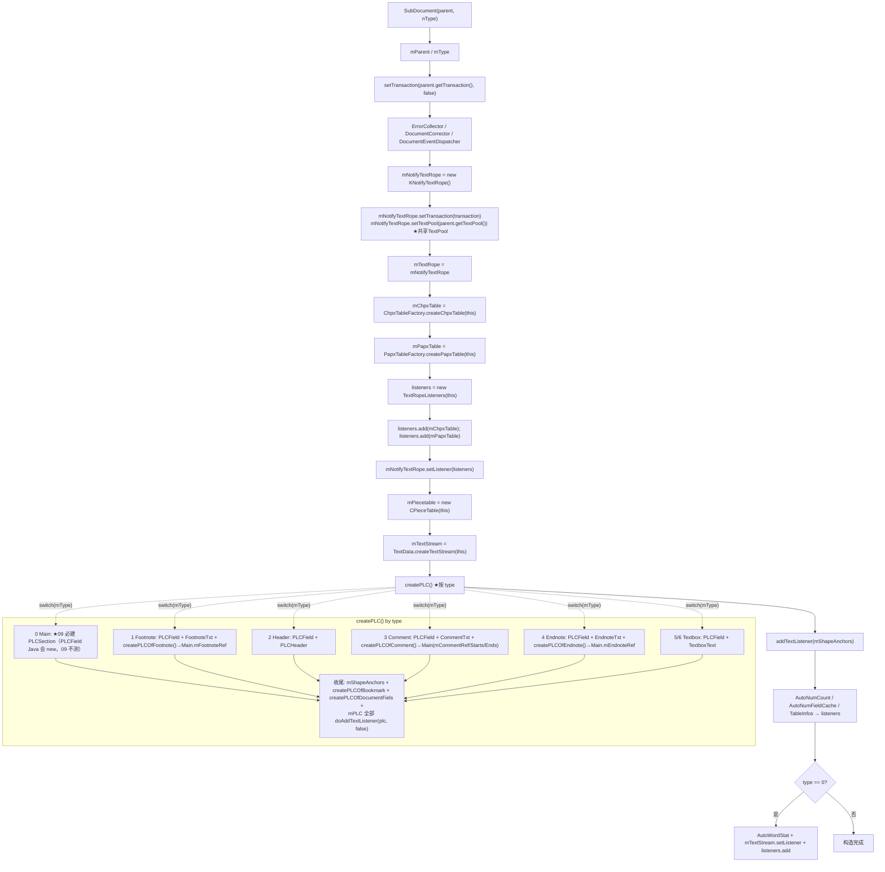
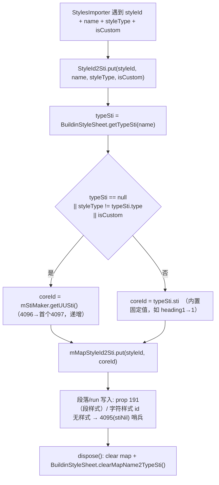
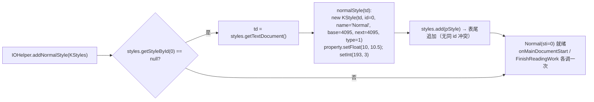

# wc-02-document-model — 文档模型（类图/流程/依赖/最小改写范围）

> 分析基线：Java 源码 `koffice/writer/core/...` + Rust 现状 `libs/word-core/src/...` + feature 目录 CSV/报告。cargo check 复跑结果与 `cargo_gate_report.json`（2026-08-12T03:53Z）一致：整 crate 1164 错误 / 137 文件，**本 feature 11 个种子文件 9 个零错误**，仅 TextDocument.rs(22) 与 IOHelper.rs(12) 有残余（全部落在非 MVP 方法，见 §4）。
>
> **2026-08-19 收敛**：`dep_topo` 队列 `SubDocument=done` **≠** function `09_function_subdocument_own` 已验收。按类改写会把 PLC / CPieceTable / KRange / HelperHeaderFooter 整棵树拉进 09。权威分界见 [docs/09-subdocument-own-scope.md](./docs/09-subdocument-own-scope.md) 与 **§4.5**。`KRange` / `HelperHeaderFooter` **不是**本 feature 的 parse-critical。

---

## 0. Feature 目标与管线位置

- **feature_id**：`wc-02-document-model`，batch `parse-02-document-model`（order 300–313）
- **depends_on**：`wc-01-storage-write`（textrope / ChpxTable / PapxTable / PLC* 已 done，作为依赖拉入本切片）
- **下游**：`wc-03-property-convert` → `wc-04-paragraph-import` → `wc-05-orchestration`
- **目标（README）**：TextDocument / SubDocument 拥有存储结构；KStyles + StyleId2Sti 可供 importer（StylesImporter 在 wc-05 填充样式）
- **本层回答的问题**：谁拥有 rope / 属性表 / PLC，以及 create 顺序。写入细节归 01/04，本层是「对象图」。

```
TextDocument._create()
  ├─ Transaction（+ TransactionListeners + MergeListener）
  ├─ KStyles(this)
  ├─ 共享 TextPool（KSwappableTextPool 256K，失败回落 KTextPool）
  └─ createAllSubDocument() → 7 个 SubDocument(this, i)
       └─ SubDocument(parent, type)
            ├─ KNotifyTextRope + setTextPool(parent.getTextPool())
            ├─ ChpxTableFactory.createChpxTable / PapxTableFactory.createPapxTable
            ├─ TextRopeListeners(this) + add(chpx)+add(papx)
            ├─ mNotifyTextRope.setListener(listeners)
            ├─ CPieceTable(this)
            ├─ TextData.createTextStream(this)
            └─ createPLC()   // ★ 按 type（parse MVP：type==0 → PLCSection；PLCField 非 09 必测）
```

---

## 1. 类图

### 1.1 `Document`（接口，order 300，dep_topo 行 33，is_seed=yes）
- **继承**：`extends IDocument`（core-libs adapter，已 done）
- **关键常量（必须与 Java 一致）**：
  - `MAIN_DOCUMENT = 0`、`FOOTNOTE_DOCUMENT = 1`、`HEADER_DOCUMENT = 2`、`COMMENT_DOCUMENT = 3`、`ENDNOTE_DOCUMENT = 4`、`TEXTBOX_DOCUMENT = 5`、`HEADERTEXTBOX_DOCUMENT = 6`、`SUBDOCUMENT_COUNT = 7`
- **关键方法（MVP 热路径 ★）**：
  - `getLength()` ★ / `getTextRope()` ★ / `getChpxTable()` ★ / `getPapxTable()` ★ → importer/CoreHelper 写入目标
  - `getPieceTable()` ★（DocxReader.setGuessedTotalLength）
  - `getPLCSection()` ★（分节，Main 专用）
  - `getStyles()` ★ / `getTextDocument()` ★ / `getType()` ★（putId）
  - `addTextListener(INotifyTextRope.Listener)` / `removeTextListener` ★（PLC 挂 rope）
  - `getTextStream()` / `getDispatcher()` / `createPLCOfBookmark()` / `createPLCOfDocumentFiels()`（createPLC 内部用）
  - `getDrawingContainer()`（beginRead，可 stub）
  - 非 MVP：视图/修订/lock/缩略图/`getShapes` 等后置
- **Rust**：`Document.rs` 为 `pub trait Document: IDocument`，常量 `MAIN_DOCUMENT..SUBDOCUMENT_COUNT` 已落地（行 462–469）。

### 1.2 `KStyle`（order 301，is_seed=yes）
- **继承**：`extends Atom`（core-libs transaction，已 done）
- **关键字段**：
  - `@AtomMember int id` — sti 内部样式号（0=Normal，4095=stiNil 哨兵，4096=stiCustom，4094=stiUser）
  - `@AtomMember String name`；`String mDisplayName`（显示名，回退内置）
  - `@AtomMember int base`（basedOn sti，4095=无）、`@AtomMember int next`（默认同自身）、`int link`（默认 4095）
  - `@AtomMember int type` — **1=PARAGRAPH_STYLE / 2=CHARACTER_STYLE / 3=TABLE_STYLE / 4=NUMBERING_STYLE / 5=LINKED_STYLE**
  - `@AtomMember PropertySet property`（直接格式）；`PropertySet finalProperty`（basedOn 合并缓存）
  - `KStyles styleSheet`（反向引用，`add()` 时赋值）
- **关键常量（sti 表）**：`stiNormal=0`，`stiHeading1..9=1..9`，`stiIndex1..9=10..18`，`stiToc1..9=19..27`，`stiNormalIndent=28`…`stiBuildinStiEnd=267`；`stiUser=4094`、`stiNil=4095`、`stiCustom=4096`；linked-char 段 `stiLinkedStyle_char_begin=12288`，`stiHeading1Char=12289`…`stiFooterChar=12320`
- **关键方法**：
  - `getFinalProperty()` ★ — 沿 base 链合并（styleSheet 缺失时直接返回 property）；内部 `justifyParagraphMargin` 处理 **prop 214/215/216（spaceAfter）/ 217/218/219（spaceBefore）**，`justifyToggle` 处理 **prop 57（run_bidi）** 的 Toggle 语义
  - `isDefault()` = id ∈ {0, 65, 105, 107}；`isUserCustom()` = id ≥ 4096
  - `clone()` — 拷贝 id/name/base/next/type/property + link/qFormat/uiPriority（BuiltinStyles 克隆用）
  - getter/setter 均 `writeLockAtom()` 保护
- **Rust**：`KStyle.rs`（1288 行）已移植，`stiNil/stiUser/stiCustom` const 就位（行 629–634），`getFinalProperty__wintarraylist` 在（行 1101）。

### 1.3 `KStyles`（order 302，is_seed=yes）
- **继承**：`extends Atom`
- **关键字段**：
  - `@AtomMember PropertySet rPrDefault / pPrDefault` — docDefaults（run/para 默认）
  - `@AtomMember ArrayList<KStyle> styles` — 样式表本体
  - `HashMap<Integer,Integer> stylesInUse` — 引用计数（deleteUnusedStyles 用，非 parse 热路径）
  - `static HashMap<Integer,KStyle> mBuiltinStyles`（BuiltinStyles.getBuiltinStyles() 惰性初始化）+ `mBuiltinTableStyles`
- **关键方法**：
  - `add(KStyle)` ★ — 按 id 去重：同 id 覆盖 `styles.set(i,style)`，否则 append；设置 `style.styleSheet = this`
  - `getStyleById(id, bForceNormal)` ★ — 线性查；**bForceNormal=true 且 id≠0 未命中 → 回落 `getStyleById(0)`（Normal）**；`getStyleById(id)` 默认 `bForceNormal=true`
  - `setRPrDefault / setPPrDefault` ★ — 仅当当前空时写入，随后 `PropertyCalculateFactory.updateStyleCache`
  - `getFontLatin/Asian/Other` — rPrDefault.getString(3/4/35)，默认 "Times New Roman"/"宋体"
  - `getStyleByName` — 未命中回落 Normal
  - `getBuiltinStyles()` — static 懒加载（Rust 用 `thread_local! RefCell<Option<HashMap>>` 模拟，行 76–78）
- **Rust**：`KStyles.rs`（610 行）已移植；注意 add 中按 id 覆盖语义保留。

### 1.4 `TextRopeListeners`（order 306，is_seed=yes）
- **实现**：`INotifyTextRope.Listener`（多播器）
- **字段**：`ArrayList<INotifyTextRope.Listener> mListeners`；`Document mDocument`；`TextDocument mTextDocument`；`DocumentEventDispatcher mDispatcher`
- **关键逻辑**（MVP 必须对齐）：
  - `beforeInsertText / beforeRemoveText`：**先 dispatcher，再逆序（n-1→0）通知** list
  - `afterInsertText / afterRemoveText`：**先正序（0→n-1）通知，再 dispatcher**
  - `isDisabled()`：`mTextDocument.isInIOState() && !mTextDocument.isInUserAction()` — **IO 期间跳过全部转发（导入加速）**
  - `add/remove/clear/size/get`
- **Rust 现状**：`TextRopeListeners.rs`（219 行）转发顺序与 Java 一致；但 `mTextDocument` 是 **soft 桩 `SoftTextDocumentHolder`（isInIOState/isInUserAction 恒 false）** → `isDisabled()` 恒 false，**IO 加速语义尚未真正接线**。TextDocument 已 done，可将桩替换为真实 `*mut TextDocument` 引用（待接线项，见 §4）。

### 1.5 `SubDocument`（order 307，is_seed=yes — 本切片枢纽，Java ~1173 行 / 实际 1835 行）
- **继承**：`extends Atom implements Document, IRange`
- **关键字段**（全部与 Java 同名）：
  - `@AtomMember TextDocument mParent`；`@AtomMember int mType`；`@AtomMember CPieceTable mPiecetable`
  - `KNotifyTextRope mNotifyTextRope`；`ITextRope mTextRope`（= mNotifyTextRope）
  - `IChpxTable mChpxTable`；`IPapxTable mPapxTable`；`ITextStream mTextStream`
  - `PLCSection mSections`（type=0 专属）；`PLCField mFields`；`PLCShapeAnchor mShapeAnchors`
  - `PLCTextboxText mTextboxText`（5/6）；`PLCCommentTxt mCommentTxt`（3）；`PLCHeader mPLCHeader`（2）；`PLCFootnoteEndnoteTxt mFootnoteTxt`（1）/ `mEndnotTxt`（4）
  - `ArrayList<PLC> mPLC` — 登记全部 PLC
  - `AutoNumCount / AutoNumFieldCache / TableInfos / AutoWordStat`（type=0 才有 AutoWordStat + textStream.setListener）
  - `DocumentEventDispatcher mDispatcher`；`ErrorCollector / DocumentCorrector`；`RangeLock lock`
  - 注释/脚注 ref 全部挂在 **Main** 上：`mCommentStarts/mCommentEnds/mCommentRef/mFootnoteRef/mEndnoteRef`
- **构造顺序（不可乱，Java 121–158 / Rust 260–341 已对齐）**：
  1. `mParent/mType` → 2. `setTransaction(parent.getTransaction(), false)` → 3. `ErrorCollector/DocumentCorrector/DocumentEventDispatcher` → 4. `mNotifyTextRope = new KNotifyTextRope()` + `setTransaction + setTextPool(parent.getTextPool())` → 5. `mTextRope = mNotifyTextRope` → 6. `mChpxTable = ChpxTableFactory.createChpxTable(this)` → 7. `mPapxTable = PapxTableFactory.createPapxTable(this)` → 8. `listeners = new TextRopeListeners(this)` + add(chpx)+add(papx) → 9. `mNotifyTextRope.setListener(listeners)` → 10. `mPiecetable = new CPieceTable(this)` → 11. `mTextStream = TextData.createTextStream(this)` → 12. `createPLC()` ★ → 13. `addTextListener(mShapeAnchors)` → 14. AutoNumCount/AutoNumField/TableInfos（逐个 add 进 listeners）→ 15. type==0 → `new AutoWordStat` + `mTextStream.setListener` + add
- **`createPLC()` 按 type（Java 738–782 / Rust 1194+ 已对齐）**：

  | type | Java 额外 PLC | parse MVP / function 09 |
  |------|----------------|-------------------------|
  | 0 Main | `PLCSection` + `PLCField` | **必须真建 `PLCSection`**。`PLCField` Java 会 new，**09 不测、可 defer**（见 §4.5） |
  | 1 Footnote | `PLCField` + `PLCFootnoteEndnoteTxt` + `createPLCOfFootnote()`（ref 挂 Main） | 09：`getPLCSection()` 必须为 Java null |
  | 2 Header | `PLCField` + `PLCHeader` | 09：无 `PLCSection`；**禁止**为 PLCHeader 去改 `KRange` / `HelperHeaderFooter` |
  | 3 Comment | `PLCField` + `PLCCommentTxt` + `createPLCOfComment()`（ref/starts/ends 挂 Main） | 写入延后 wc-04/05 |
  | 4 Endnote | `PLCField` + `PLCFootnoteEndnoteTxt` + `createPLCOfEndnote()` | 写入延后 |
  | 5/6 Textbox | `PLCField` + `PLCTextboxText` | 可空壳 |

  所有 type 收尾（Java 完整性，**不是 09 验收闭包**）：`mShapeAnchors = new PLCShapeAnchor(this)`；`createPLCOfBookmark()`；`createPLCOfDocumentFiels()`；最后把 `mPLC` 全部 `doAddTextListener(plc, false)`。
- **MVP 热路径 API**：
  - `getLength()` = `mTextRope.length()` ★（Java 726–728 / Rust 1176–1178）
  - `getTextRope/getChpxTable/getPapxTable/getPieceTable/getPLCSection/getStyles(→parent.getStyles())/getType/getTextDocument` ★
  - `createPLCOfBookmark/createPLCOfDocumentFiels`（PLC 挂接）+ `addTextListener` — **feature 级可 defer**；09 不测
  - 非 MVP：copy/getContentThumb/修订/revision/headings/math/开关脚注；**整棵 `KRange` / `HelperHeaderFooter`**
- **Rust（2026-08-19）**：队列 `rewrite_status=done` 留下约 1886 行交错模板，**不能**当作 09 已绿。**禁止瘦模板、禁止删 `// java`。** 09 在完整模板上原位修：ctor + 存储 getters + type0 `PLCSection` 真写；其余方法可 `DEFERRED_NON_FUNCTION`。`getPLCSection` 须对齐 Java null（`Option`）。`PLCSection.rs` 布局校验必须 PASS。存储语义权威在 **wc-01**，09 只装配。

### 1.6 `TextDocument`（order 308，is_seed=yes，Java 4264 行 / Rust 6672 行）
- **继承**：`extends Atom implements IDocument, ITextOpenDocument, DocumentProtection`
- **关键字段**：
  - `UUSti mStiMaker`（=4096 起，`getUUSti()` 返回 `++mStiCustom` → 首个用户 sti **4097**）★ StyleId2Sti 分配源
  - `UUCommentId mCommentIdMaker / mPropertSetRegistryId`；`UUNumberingId mNumberingIdMaker`（NumIdRedirection 分配源）★
  - `ITextPool mCharBuffer`（共享 TextPool）★；`KStyles styles` ★；`FontTable fontTable`；`@AtomMember PropertySet property`
  - `protected Document[] mSubdocuments = new Document[7]` ★（0=Main 必须）
  - `boolean mStateIO` ★（setInIOState / isInIOState）；`KParagraphsID mParasID`（getKParagraphsID ★）
  - `Metadata mMetadata`（@Deprecated）；`Theme mTheme`；`KExchange mExchange` / `KFootnoteEndnote mFootnoteEndnote`（**E0072 递归类型来源**）
- **构造链**：
  - `TextDocument()` → `this(false)`；`TextDocument(boolean bMock)`：初始化字段 → `if (!bMock) _create()` → UUID/tmpDir/FileManager/openListeners
  - **`_create()`（Java 351–370 / Rust 807–837）★ 顺序**：
    1. `new Transaction()` + `setTransaction(pTransaction, false)`
    2. `pTransaction.setListener(new TransactionListeners())`
    3. `pTransaction.getActionList().setActionChangeListener(new MergeListener())`
    4. `styles = new KStyles(this)`
    5. `KSwappableTextPool.setPoolSize(262144)`，catch IOException → `new KTextPool()` 回落
    6. `mCharBuffer = pFixedPool`
    7. `createAllSubDocument()`
    8. `ShapeFactoryDoc.createShapeFactory()`（MVP stub 可）
  - `createAllSubDocument()`（Java 539–542）：for i<7 → `mSubdocuments[i] = new SubDocument(this, i)`
  - `createSubDocument(nSubdocId)`（Java 530–537）：`writeLockAtom`；**slot 为 null 才 new**（`createAllSubDocument` 之后不会重复建 Main）★
  - `getSubdocument(nSubdocId)` / `getMainDocument() = mSubdocuments[0]` ★
- **IO 标志**：`setInIOState(true)` 由 DocxReader.read 打开；`isInUserAction()` = `mTransaction != null && mTransaction.getState() == 1`（**注意：Java 里 mTransaction 是 Atom 的成员**，Rust 为 `Option<bool>` 返回）
- **其它 MVP**：`getUUSti()/getUUCommentId()/getUUNumberingId()`；`addBuiltinStyles(sti)`（sti==4095→null，按 base/next/link 递归补入）；`addBuiltinTableStyle`
- **Rust 现状**：核心链全部移植。**⚠ 发现运行时 bug：`createAllSubDocument` 的 while 循环缺 `i += 1`（Rust 行 1096–1103），`_create()` 一调即死循环**。另外残余 22 编译错误全部在非 MVP 方法（详见 §4.4）。

### 1.7 `WordBuildinStyleNames`（order 309，is_seed=yes）
- **继承**：final class，纯常量表（~140 个 `public static final String`，如 `NORMAL="Normal"`、`HEADING_1="heading 1"`）
- **用途**：名义上供 BuildinStyleSheet 查表；**实际 Java 全库无任何引用（grep 仅命中定义处），BuildinStyleSheet 直接硬编码字符串字面量** → 属文档性常量表，非阻塞
- **Rust**：`WordBuildinStyleNames.rs`（573 行）已 interleaved 移植（`pub(crate) const`），cargo 干净。

### 1.8 `BuildinStyleSheet`（order 310，is_seed=yes，Java 1480 行 / Rust 3514 行）
- **继承**：final class，全 static
- **字段**：`static Map<String, TypeSti> mMapName2TypeSti`（惰性 init）
- **关键方法**：
  - `isReservedName(name)` / `isReservedIndex(value)`：**0 ≤ value ≤ 267**
  - `getTypeSti(name)` → `TypeSti{ int type; int sti; }` ★（StyleId2Sti.put 使用）
  - `clearMapName2TypeSti()` ★（StyleId2Sti.dispose 调用）
  - `getName(sti)` → 内置名（"Normal"…"heading 9"…）
  - `initMapName2TypeSti()` — **282 条映射**（Rust 已逐条移植，`map.insert` 计数 282 == Java `mMapName2TypeSti.put` 计数 282）
- 典型条目：`("Normal", TypeSti(1,0))`？—— 注：Java map 中**无 "Normal" 键**（Normal 由 addNormalStyle 保障），`heading 1..9 → (1,1..9)`，`Heading 1 Char → (2,12289)`，`Default Paragraph Font → (2,65)`，表格样式 → `(3, 105..259)`。
- **Rust**：`BuildinStyleSheet.rs` 已移植，`thread_local` 静态表（`mMapName2TypeSti.lock()`）。

### 1.9 `StyleId2Sti`（order 311，is_seed=yes，Java 55 行 / Rust 119 行）
- **继承**：final class
- **字段**：`Map<String,Integer> mMapStyleId2Sti`；`UUSti mStiMaker`（来自 `TextDocument.getUUSti()`）
- **关键方法**：
  - `getSti(styleId)` → `Option<i32>`（map miss = 未注册，与 4095 哨兵不同）★
  - `put(styleId, name, styleType, isCustom)` ★：`typeSti = BuildinStyleSheet.getTypeSti(name)`；`isMakeUUSti = typeSti==null || styleType != typeSti.type || isCustom`；**isCustom=true 时强制走 UUSti 新分配（内置名也无效）**；coreId = isMakeUUSti ? `mStiMaker.getUUSti()` : `typeSti.sti`；写入 map 并返回 coreId
  - `put(styleId, sti)` 强制指定（Rust 对 null sti 做了 remove-entry 处理）；`put(styleId)` 直接新分配
  - `nextUserSti()`；`dispose()` — clear map + `BuildinStyleSheet.clearMapName2TypeSti()`
- **下游用法**：`ParaPropsConverterSimple.setStyle` / run `rStyle` 把 XML styleId 写成 **prop 191（段样式）** / 字符样式 id；`StylesImporter.toSti(null) → 4095` 为「无样式」哨兵
- **Rust**：`StyleId2Sti.rs` 逐行移植，put 三态、isCustom 分支齐全。

### 1.10 `IOHelper`（order 312，is_seed=yes，标签 `subset-addNormalStyle`，Java 1674 行基线 / Rust 4029 行）
- **MVP 子集方法**：
  - **`addNormalStyle(KStyles)` ★（Java 297–305 / Rust 567–580）**：`styles.getStyleById(0)` 为 null 时 `styles.add(normalStyle(styles.getTextDocument()))`
  - **`normalStyle(TextDocument)`（Java 307–315 / Rust 583–598）**：`displayName="Normal"`，`type=1`（PARAGRAPH_STYLE），`property.setFloat(10, 10.5F)`、`property.setInt(193, 3)`，`new KStyle(textDocument, 0, "Normal", 4095, 4095, 1, property.freeze())` → **保证 Normal（sti=0）存在**，由 `onMainDocumentStart` 与 `FinishReadingWork` 各调一次
- **Rust 现状**：addNormalStyle/normalStyle 与 Java 完全一致；12 个残余编译错误全部在非 MVP 方法（getNumInXmlName/getRelationshipCollection/getTargetMode/collectExternalRelation/newDiagramInstance/dumpInkFile/convertDate/getDifferenceRunProp/convertLvlTextVal2Xst），见 §4.4。

### 1.11 `NumIdRedirection`（order 313，is_seed=yes，与 wc-03/05 共享）
- **继承**：final class
- **字段**：`Map<Integer,Integer> mMapNumberingId`；`TextDocument.UUNumberingId mNumberingIdMaker`（`TextDocument.getUUNumberingId()`）
- **关键方法**：`getId(numId)` → Option；`put(numId)` → `mNumberingIdMaker.getNextId()` 分配内核 numbering id 并写 map
- **调用方**：`ParaPropsConverterSimple`（写编号属性）、`NumberingImporter`（解析 numbering.xml，wc-05）
- **Rust**：`NumIdRedirection.rs`（93 行）已移植；`UUNumberingId` 为 soft 桩（软实现自增计数器），TextDocument.getUUNumberingId 就位后可对接。

---

## 2. 流程图

### 2.1 SubDocument 构造顺序链

下图是 **Java 真实 ctor**（完整性）。**09 必做**仅到 rope → 表 → listeners → `CPieceTable` → `createPLC` 的 **type0 `PLCSection`**；D / N / P–S 与 createPLC 非 0 case 不是 09 I/O（§4.5）。



### 2.2 TextDocument._create 链

```mermaid
flowchart LR
    A["new TextDocument()"] --> B["this(false)"]
    B --> C["字段初始化: mStiMaker(UUSti), mNumberingIdMaker,<br/>fontTable, mSubdocuments[7], mStateIO=false, mParasID ..."]
    C --> D{"bMock?"}
    D -- false --> E["_create()"]
    D -- true --> F["跳过 _create（测试用空壳）"]
    E --> G["new Transaction() + setTransaction(false)"]
    G --> H["setListener(TransactionListeners) +<br/>ActionChangeListener(MergeListener)"]
    H --> I["styles = new KStyles(this)"]
    I --> J["KSwappableTextPool setPoolSize(262144)<br/>(IOException → 回落 KTextPool)"]
    J --> K["mCharBuffer = pFixedPool  ★共享TextPool"]
    K --> L["createAllSubDocument():<br/>for i in 0..7 → mSubdocuments[i] = new SubDocument(this, i)"]
    L --> M["ShapeFactoryDoc.createShapeFactory() (可stub)"]
    L --> N["（外部）DocxReader → setInIOState(true) →<br/>createSubDocument(0) 确保 Main → 填充"]
```



### 2.3 StyleId2Sti 分配 sti 流



### 2.4 addNormalStyle 流



---

## 3. 依赖关系

### 3.1 类间依赖表

| 依赖方 | 被依赖方 | 性质 |
|--------|----------|------|
| TextDocument | KStyles, ITextPool(KTextPool/KSwappableTextPool), SubDocument, Transaction, DocumentProtection, IDocument, ITextOpenDocument, UUSti/UUNumberingId | 拥有/组合 |
| SubDocument | **09 必装**：TextDocument 最小 parent、KNotifyTextRope、Chpx/Papx 工厂、CPieceTable、TextRopeListeners、**PLCSection（仅 type0）**。**Java ctor 还会 new、但 09/parse MVP 不强制**：PLCField/PLCShapeAnchor/PLCHeader/…、AutoNum*、TableInfos、AutoWordStat、Dispatcher、ErrorCollector、TextData。**禁止当 09 依赖**：KRange、HelperHeaderFooter | 组合/装配 vs 类拓扑（见 §4.5） |
| TextRopeListeners | INotifyTextRope.Listener, Document, TextDocument, DocumentEventDispatcher | 多播 |
| KStyles | KStyle, PropertySet, Atom, TextDocument, BuiltinStyles, PropertyCalculateFactory | 组合 |
| KStyle | Atom, PropertySet, TextDocument, KStyles(styleSheet), MutablePropertySet, Toggle(prop 57) | 组合 |
| StyleId2Sti | UUSti(TextDocument), BuildinStyleSheet | 使用 |
| BuildinStyleSheet | WordBuildinStyleNames（名义，实际未引用） | 常量表 |
| IOHelper.addNormalStyle | KStyles, KStyle, TextDocument, PropertySet/MutablePropertySet | 使用 |
| NumIdRedirection | TextDocument.UUNumberingId | 使用 |

### 3.2 外部依赖（core-libs，均已 done）
- `Atom` / `IUndoable` / `IUndoableImpl`（transaction）— SubDocument/KStyle/KStyles/TextDocument 都 extends Atom
- `IDocument` / `ITextOpenDocument`（adapter）— TextDocument 实现；Document 接口 extends IDocument
- `PropertySet` / `MutablePropertySet` / `Toggle` — KStyle.property / rPrDefault / pPrDefault / Normal 属性
- `IDisposable` — ITable 等基座
- `Tree` / `PositionTree` / `IndexedPositionTree` — PLC 底层
- 全部在 dep_topo 中 rewrite_status=done（行 3–12）。

### 3.3 改写状态表（dep_topo.csv：11 个种子全部 rewrite_status=done, mvp_state=done, is_seed=yes）

| order | class | rust_path | depends | rewrite_status | rs_exists | is_seed | mvp_state | tags |
|-------|-------|-----------|---------|----------------|-----------|---------|-----------|------|
| 300 | Document | core/Document.rs | CPieceTable;IChpxTable;IPapxTable;ITextRope | done | yes | yes | done | mvp-must |
| 301 | KStyle | core/KStyle.rs | Atom;PropertySet | done | yes | yes | done | mvp-must |
| 302 | KStyles | core/KStyles.rs | Atom;KStyle;PropertySet | done | yes | yes | done | mvp-must |
| 306 | TextRopeListeners | core/TextRopeListeners.rs | INotifyTextRope | done | no* | yes | done | mvp-must |
| 307 | SubDocument | core/SubDocument.rs | Atom;CPieceTable;ChpxTableFactory;Document;IRange;KNotifyTextRope;KStyles;PLC;PLCField;PLCSection;PLCShapeAnchor;PapxTableFactory;TextRopeListeners | done | yes | yes | done | mvp-must |
| 308 | TextDocument | core/TextDocument.rs | Atom;DocumentProtection;IDocument;ITextOpenDocument;KStyles;KTextPool;SubDocument | done | yes | yes | done | mvp-must |
| 309 | WordBuildinStyleNames | importer/helpers/WordBuildinStyleNames.rs | — | done | no* | yes | done | mvp-must |
| 310 | BuildinStyleSheet | importer/helpers/BuildinStyleSheet.rs | KStyles;WordBuildinStyleNames | done | yes | yes | done | mvp-must |
| 311 | StyleId2Sti | importer/StyleId2Sti.rs | BuildinStyleSheet | done | no* | yes | done | mvp-must |
| 312 | IOHelper | io/reader/helper/IOHelper.rs | KStyles;StyleId2Sti;TextDocument | done | yes | yes | done | subset-addNormalStyle |
| 313 | NumIdRedirection | importer/NumIdRedirection.rs | — | done | no* | yes | done | shared-with-03-05 |

\* `rs_exists=no` 表示由 java2rust 模板新建（非既有文件），已生成并编译。

依赖行 17–39（ITextPool/ITextRope/INotifyTextRope/KTextPool/KTextRope/KTransactionTextRope/KNotifyTextRope/CPieceTable/DocumentProtection/ChpxTableFactory/PapxTableFactory/ITable/IChpxTable/IPapxTable/PLC/PLC_Char/PLCField/PLCSection/PLCShapeAnchor/IRange）全部 done。`in_cycle=no` 全部。

---

## 4. 最小 feature-critical 改写范围

**分层**：下表是 **wc-02 对象图** 必须真写的语义。`CPieceTable` / `PLC` / `PLCSection` / rope / CHPX / PAPX 的**算法**属于 **wc-01**，本 feature 只 **装配**。`dep_topo` 的 `depends=PLCField;PLCShapeAnchor;…` 是类拓扑，**不是** function 09 的验收闭包。

### 4.1 Must-write 清单（队列 done ≠ function pass）

| 文件 | 理由 | 由哪个 function 验收 |
|------|------|----------------------|
| `Document.rs`（接口 + 常量） | importer 的唯一写入接口面；SubDocType 常量 0–6/7 | **01** |
| `KStyle.rs` | sti 常量表 + getFinalProperty（basedOn 合并，prop 57/214–219） | **04** |
| `KStyles.rs` | add/getStyleById(bForceNormal)/rPrDefault/pPrDefault | **05** |
| `TextRopeListeners.rs` | 通知转发顺序（before 逆序/after 正序）+ isDisabled 语义 | **08** |
| `SubDocument.rs` | **装配** rope/表/piece；`createPLC` **仅强制 type0 → PLCSection**（完整模板，非 critical 空体，见 §4.5） | **09**（`functions.csv` 仍 spec 直至测试绿） |
| `TextDocument.rs` | _create 链 + createAllSubDocument/createSubDocument + 7 槽 + setInIOState/getUUSti/getUUNumberingId | **10** |
| `WordBuildinStyleNames.rs` | 内置名常量表（文档性，已移植） | 并入 **02** |
| `BuildinStyleSheet.rs` | 282 条 name→(type,sti) 固定表（sti 双端一致性关键） | **02** |
| `StyleId2Sti.rs` | styleId→sti 映射 + isCustom 分支 + 4095 哨兵语义 | **03** |
| `IOHelper.addNormalStyle/normalStyle` | 保证 Normal(sti=0, prop 10=10.5, 193=3, base/next=4095) | **06** |
| `NumIdRedirection.rs` | OOXML numId→内核 numberingId（wc-03/05 共享） | **07** |

### 4.2 可 stub / 延后清单（含理由）

| 项 | 理由 |
|----|------|
| ShapeFactoryDoc / DrawingContainer / PLCShapeAnchor 深层 | 无图形内容解析时零写入；beginRead 可返回空容器 |
| AutoWordStat / MediaLib / getContentThumb | 统计与媒体，导入不依赖 |
| Theme / FontTable 深度 / Metadata | wc-05 theme 切片另行处理；Metadata @Deprecated |
| KExchange / KFootnoteEndnote（E0072 递归类型） | 脚注/尾注视图模型，非 parse 热路径；当前 `mExchange: Option<KExchange>` 与 KExchange 含 TextDocument 按值引用导致「infinite size」——修复方向：字段改 `Box<dyn ...>`/`*mut`（与 SubDocument.mParent 同模式） |
| 编辑/修订/undo 链（copy/beginSectionChange/UpdateAfterUndo/Redo/revisionListeners） | 只读导入不需要 |
| deleteUnusedStyles / stylesInUse 引用计数 | 清理路径，非导入路径；PapxTable prop 191/292、ChpxTable prop 2 的引用计数可简化 |
| SubDocType 1–6 的 PLC 内容（Field / Header / FootnoteTxt / …） | Java `createPLC` 会 new；**parse 写入在 wc-04/05**。09 只断言 type≠0 **没有** `PLCSection` |
| **PLCField / AutoWordStat**（即使 type=0 Java 会建） | 域字符与统计不是 CoreHelper 落库热路径；与 [docs/SubDocument.md](./docs/SubDocument.md)「其它 PLC 可空壳」一致 |
| **KRange / KRangeBase / RangeTool 深层** | 编辑选区（Java ~4924 行）。**不是** wc-02 parse-critical；**禁止**从 09 或页眉 PLC 发散 java2rust |
| **HelperHeaderFooter** | 页眉页脚内容 range。type=2 故事槽由 10 创建即可；**禁止**为 09 扩编译面 |
| RangeTool / Math / Character / StringBuilder 等 stub 缺失 | 均在非 MVP 方法（getDigest/charCount 等），修 stub 或裁剪均可 |

### 4.3 SubDocType ↔ type 映射表

| index | 常量名 | 用途 | MVP 状态 |
|-------|--------|------|----------|
| 0 | MAIN_DOCUMENT | Main body | **必须真写存储句柄 + `PLCSection`**。PLCField / AutoWordStat **非** 09 必测（§4.5） |
| 1 | FOOTNOTE_DOCUMENT | Footnote | 构造已建 PLC（Field+FootnoteTxt），写入延后 |
| 2 | HEADER_DOCUMENT | Header/Footer | 构造已建 PLC（Field+PLCHeader），可空壳 |
| 3 | COMMENT_DOCUMENT | Comment | 构造已建 PLC + ref 挂 Main，写入延后 |
| 4 | ENDNOTE_DOCUMENT | Endnote | 构造已建 PLC，写入延后 |
| 5 | TEXTBOX_DOCUMENT | Textbox | 构造已建 PLC（TextboxText），可空壳 |
| 6 | HEADERTEXTBOX_DOCUMENT | Header textbox | 同上 |
| — | SUBDOCUMENT_COUNT=7 | 槽位数 | 数组长度 |

`DocumentImporter`（wc-05）会 `createSubDocument(type)` 覆盖/确保槽存在——`createSubDocument` 只在 slot 为 null 时 new，与 `createAllSubDocument` 不重复创建（对照 docs/TextDocument.md §6 读懂检查 1：**不重复**）。

### 4.4 当前进度与残余问题

**进度**：`rewriting_queue.csv` 42/42 行 done（11 种子 + 31 依赖）；dep_topo 全部 `rewrite_status=done, mvp_state=done`。cargo 复跑：**9/11 种子文件零错误**。

**残余编译错误（均非 MVP 方法，`cargo_gate_report.json` 与实测一致）**：
- `TextDocument.rs` 22 错误：`System`(correctDataFields)、`DomNode`(deleteIllegalSection)、`WtStatistic`×3 + `IllegalArgumentException`(charCount 统计)、`TextTool`/`Character`/`StringBuilder`/`Math`(getDigest)、`HashSet`(fillFirstPageFont)、`UpdateAfterUndo/Redo`(begin/endSectionChange)、`params`(onDebug)、`RangeTool`×2(afterDataChange)、**E0072 KExchange 递归结构**（§4.2）
- `IOHelper.rs` 12 错误：`Pattern`/`PATTERN`(getNumInXmlName/convertDate)、`URI`/`OpcTargetMode`/`cn`(getRelationshipCollection/getTargetMode/collectExternalRelation)、`ClassLoader`(newDiagramInstance)、`InputStream`(dumpInkFile)、`Character`(convertLvlTextVal2Xst)、`DefaultIODocxRunProperties`(getDifferenceRunProp)。**addNormalStyle/normalStyle 本身编译干净**
- 其余 1164−34 个错误全在 off-queue 未改写文件（RangeTool.rs 41、shape/* 41、KSwappableTextPool 等），属 crate 级基线，不阻塞本 feature 的种子完成度

**⚠ 运行时风险（结构分析发现，未在 queue 备注）**：
1. **`TextDocument::createAllSubDocument` 死循环**（TextDocument.rs 1096–1103）：`while i < 7 { mSubdocuments[i] = SubDocument::new(...) }` **缺 `i += 1`** → `_create()` 一旦被调用即无限重建 SubDocument(0)。必须补 `i += 1;`。
2. **TextRopeListeners.isDisabled 未接线**：`mTextDocument` 为 `SoftTextDocumentHolder`（恒 false）→ IO 导入加速语义失效；TextDocument 已 done，应改为真实引用 `isInIOState()/isInUserAction()`。（function **08** 已用软 `TextDocument` 指针测 IO skip；整文件 `_create` 仍归 **10**。）
3. **09 依赖发散（2026-08-19）**：把 `SubDocument.java` ctor 闭包当 must-write 会拉入 `PLCHeader` → `HelperHeaderFooter` → `KRange`。约束与冻结编译面见 **§4.5**。

### 4.5 Function 09 vs feature-critical vs wc-01（依赖收敛）

权威全文：[docs/09-subdocument-own-scope.md](./docs/09-subdocument-own-scope.md)。摘要：

| 层 | 包含 | 09 Loop 做什么 |
|----|------|----------------|
| **wc-01**（已测绿） | `CPieceTable`、`PLC`/`PLCSection`、Chpx/Papx 工厂与表、`KNotifyTextRope`/`ITextPool` | **调用**，禁止再 java2rust 这些类 |
| **wc-02 feature-critical** | Document 常量；KStyle/KStyles；StyleId2Sti；NumId；Listeners IO skip；SubDocument **装配**；TextDocument `_create` 7 槽 | 分摊 01–10；09 **只**装配 |
| **09 function-critical** | `SubDocument(parent,type)` → 自有 rope/chpx/papx/`CPieceTable`；type0 `getPLCSection=Some`；type≠0 `None`；共享 pool；`getStyles` 委托 | 完整模板 + 假 parent；**不**测 append / 7 槽 / CoreHelper |
| **禁止从 09 拉入（实现）** | `KRange` 全语义、`HelperHeaderFooter` 真写、完整 `TextDocument._create`、PLCField 必非空 | 挡住 cargo 时 **空体暂缓**，不要删 `// java`、不要扩去 java2rust KRange |

**`createPLC` 09 最小真写**：`type==0` 则 `mSections = Some(PLCSection::new(this))`；否则 `mSections` 保持 `None`。其余 case 允许 skip 或 `COMPILE_SHELL`。

**java2rust 硬禁止（09 进行中）**：`SubDocument.java` 全叶（>700）；`KRange` / `HelperHeaderFooter` / `PLCHeader` 深层；wc-01 已绿的存储类。

---

## 5. 验收口径

对应 docs/README §5 MVP 验收 + 结构对齐点：

1. **构造链可运行**：`new TextDocument()` → `_create()` 不挂死（**必须先修 createAllSubDocument 死循环**，function **10**），得到 7 个 SubDocument 槽；`mSubdocuments[0]`（Main）真实拥有 KNotifyTextRope+共享 TextPool、ChpxTable、PapxTable、TextRopeListeners、CPieceTable、**PLCSection**。PLCField 非本 feature parse 必测（§4.5）。function **09** 用假 parent 先验「单故事装配」，不跑满 7 槽。
2. **共享性**：styles / textPool / transaction 非空且多故事共用同一 `mCharBuffer` 实例、同一 Transaction。
3. **getLength ≡ textRope.length()**：Main 空文档长度为 0；写入后一致。
4. **StyleId2Sti 行为对齐**：
   - `put("Normal", "Normal", 1, false)` → **sti 0**（BuildinStyleSheet 命中）
   - `put(自定义 styleId, name, type, isCustom=true)` → UUSti 分配（首个 4097）
   - `getSti(未注册) → None`；`StylesImporter.toSti(null) → 4095`（stiNil 哨兵，与 map miss 区分）
   - `dispose()` 后 map 与 BuildinStyleSheet 静态表均清空
5. **KStyles**：`add` 同 id 覆盖、`getStyleById(id,true)` 缺失回落 Normal(0)、rPrDefault/pPrDefault 仅在空时写入、Normal 由 `IOHelper.addNormalStyle` 保障（sti=0，prop 10=10.5、193=3，type=1）。
6. **BuildinStyleSheet**：`isReservedIndex` 区间 0..=267；282 条 name→(type,sti) 与 Java 逐条一致（已核对 insert 计数）。
7. **TextRopeListeners**：before 逆序 + dispatcher、after 正序 + dispatcher；isDisabled 接真实 TextDocument（待接线）。
8. **NumIdRedirection**：`put(numId)` 返回 `getNextId()` 递增内核 id，`getId` 查表；UUNumberingId 与 TextDocument 对接后替换 soft 桩。
9. **编译门**：本 feature 11 个种子文件 cargo 零错误（TextDocument/IOHelper 残余 34 错属非 MVP 方法，处理方式：修 stub 或裁剪非热路径代码，不得影响 §4.1 清单）。
