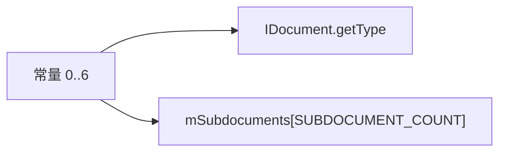

# 01_function_document_types — 子文档类型号

| 项 | 值 |
|----|----|
| feature | wc-02-document-model |
| order | 1 |
| crate | `libs/word-core/Cargo.toml` |
| 入口 | `Document::{MAIN_DOCUMENT, FOOTNOTE_DOCUMENT, HEADER_DOCUMENT, COMMENT_DOCUMENT, ENDNOTE_DOCUMENT, TEXTBOX_DOCUMENT, HEADERTEXTBOX_DOCUMENT, SUBDOCUMENT_COUNT}` / `IDocument::getType` |
| 独立性 | 叶子（已导出常量；不建 SubDocument） |
| 测试状态 | pass |

## 1. 功能说明

### 1.1 一句话

七种子文档用 **0..6** 编号，数组槽位数 **7**；`getType()` 返回该槽号，importer 用它决定 createPLC 分支与 `putId`。

### 1.2 输入

无运行时输入。Java 接口常量（`Document.java` 42–49 行）与 `IDocument.getType()`。

### 1.3 输出

| 符号 | 值 |
|------|----|
| `MAIN_DOCUMENT` | 0 |
| `FOOTNOTE_DOCUMENT` | 1 |
| `HEADER_DOCUMENT` | 2 |
| `COMMENT_DOCUMENT` | 3 |
| `ENDNOTE_DOCUMENT` | 4 |
| `TEXTBOX_DOCUMENT` | 5 |
| `HEADERTEXTBOX_DOCUMENT` | 6 |
| `SUBDOCUMENT_COUNT` | 7 |

`getType()` 对实现该 trait 的对象返回上述之一。本 function **不**断言 SubDocument ctor。

### 1.4 上游

无。

### 1.5 下游

09 `createPLC` switch(type)；10 `mSubdocuments[7]`；DocxReader `createSubDocument(2)` 页眉。

## 2. 核心代码与流程

Java：`koffice/writer/core/cn/wps/moffice/writer/core/Document.java` 42–49、`getType()`  
Rust：`libs/word-core/src/cn/wps/moffice/writer/core/Document.rs` 常量 `MAIN_DOCUMENT..SUBDOCUMENT_COUNT`；`getType` 在 `IDocument`（不在 `Document` trait 上重复声明，避免 dyn E0034）



## 3. 测试方案

### 3.1 代码审计与测试面

| symbol | Java/Rust 路径 | 输入/状态 | 输出/副作用 | 关键分支/错误 |
|--------|----------------|-----------|-------------|---------------|
| `MAIN_DOCUMENT` | Document.java:42 / Document.rs | — | 0 | 与 createPLC case 0 对齐 |
| `FOOTNOTE_DOCUMENT` | :43 | — | 1 | |
| `HEADER_DOCUMENT` | :44 | — | 2 | DocxReader createSubDocument(2) |
| `COMMENT_DOCUMENT` | :45 | — | 3 | |
| `ENDNOTE_DOCUMENT` | :46 | — | 4 | |
| `TEXTBOX_DOCUMENT` | :47 | — | 5 | |
| `HEADERTEXTBOX_DOCUMENT` | :48 | — | 6 | |
| `SUBDOCUMENT_COUNT` | :49 | — | 7 | 必须 = 6+1，不是 6 |
| `IDocument::getType` | drawing IDocument | StorageDoc 设为 2 | 返回 HEADER_DOCUMENT | 不得与 Document trait 再声明冲突 |

### 3.2 覆盖矩阵

| coverage_id | 接口/代码路径 | 场景类别 | 必测? | test_id |
|-------------|---------------|----------|-------|---------|
| C-MAIN | MAIN_DOCUMENT==0 | 常量 | 是 | DT1 |
| C-FN | FOOTNOTE_DOCUMENT==1 | 常量 | 是 | DT2 |
| C-HDR | HEADER_DOCUMENT==2 | 常量 | 是 | DT3 |
| C-CMT | COMMENT_DOCUMENT==3 | 常量 | 是 | DT4 |
| C-EN | ENDNOTE_DOCUMENT==4 | 常量 | 是 | DT5 |
| C-TB | TEXTBOX_DOCUMENT==5 | 常量 | 是 | DT6 |
| C-HTB | HEADERTEXTBOX_DOCUMENT==6 | 常量 | 是 | DT7 |
| C-CNT | SUBDOCUMENT_COUNT==7 | 边界 | 是 | DT8 |
| C-SEQ | 0..6 两两不等 | 边界 | 是 | DT9 |
| C-GET | getType()==HEADER_DOCUMENT | 主路径 | 是 | DT10 |

### 3.3 可测试性

常量直接 `use word_core::…::Document::*`。`getType` 用最小 `StorageDoc`（只实现 `IDocument`+`Document::getLength`），不构造 SubDocument / TextDocument。

### 3.4 用例表

| id | 覆盖项 | 前置状态 | 输入摘要 | 期望输出/副作用 | 失败语义 |
|----|--------|----------|----------|-----------------|----------|
| DT1 | C-MAIN | — | 读常量 | 0 | 槽 0 不是 Main |
| DT2 | C-FN | — | 读常量 | 1 | |
| DT3 | C-HDR | — | 读常量 | 2 | |
| DT4 | C-CMT | — | 读常量 | 3 | |
| DT5 | C-EN | — | 读常量 | 4 | |
| DT6 | C-TB | — | 读常量 | 5 | |
| DT7 | C-HTB | — | 读常量 | 6 | |
| DT8 | C-CNT | — | 读常量 | 7 | 写成 6 导致少一槽 |
| DT9 | C-SEQ | — | 七个类型常量 | 互不相同且等于 0..=6 | 重复编号 |
| DT10 | C-GET | StorageDoc type=2 | getType() | HEADER_DOCUMENT | getType 走错 trait |

### 3.5 测试代码位置

crate: `libs/word-core/Cargo.toml`  
src:   `libs/word-core/src/cn/wps/moffice/writer/core/Document.rs`  
test:  `libs/word-core/tests/cn/wps/moffice/writer/core/Document.rs`

### 3.6 测试运行脚本

```bash
cargo test --manifest-path libs/word-core/Cargo.toml --test 01_function_document_types

bash .cursor/skills/feature-function/scripts/function-coverage.sh \
  --crate libs/word-core --test 01_function_document_types \
  --src src/cn/wps/moffice/writer/core/Document.rs \
  --report libs/word-core/parser/features/wc-02-document-model/functions/01_function_document_types/FUNCTION.md
```

### 3.7 覆盖率报告

<!-- coverage-report:begin -->
tool: cargo-llvm-cov (`cargo llvm-cov --test 01_function_document_types --json`)
date: 2026-08-19 11:15

| src | lines covered | line % | regions covered | region % |
|-----|---------------|--------|-----------------|----------|
| `src/cn/wps/moffice/writer/core/Document.rs` | 0/230 | 0.0% | 0/243 | 0.0% |
| **function total** | **0/230** | **0.0%** |  |  |
<!-- coverage-report:end -->
