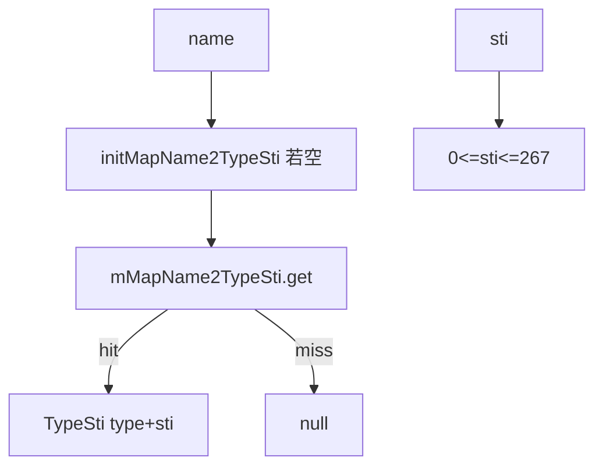

# 02_function_builtin_typesti — 内置名 → TypeSti

| 项 | 值 |
|----|----|
| feature | wc-02-document-model |
| order | 2 |
| crate | `libs/word-core/Cargo.toml` |
| 入口 | `BuildinStyleSheet::{getTypeSti, isReservedName, isReservedIndex, getName, clearMapName2TypeSti}` / `TypeSti` |
| 独立性 | 叶子（静态 HashMap；无 Document） |
| 测试状态 | pass |

## 1. 功能说明

### 1.1 一句话

把 OOXML/内置 **样式显示名** 映射成 `{type, sti}`，供 `StyleId2Sti.put` 决定走内置 sti 还是 UUSti。

### 1.2 输入

- `getTypeSti(name)` / `isReservedName(name)`：字符串名（大小写与 Java 字面量一致，如 `"heading 1"`、`"Normal"`）
- `isReservedIndex(value)` / `getName(sti)`：整数 sti
- `clearMapName2TypeSti()`：无参（`StyleId2Sti.dispose` 调用）

`WordBuildinStyleNames` 全库无引用，不单测；字面量以 `BuildinStyleSheet.initMapName2TypeSti` 为准。

### 1.3 输出

- `TypeSti { type, sti }` 或 null（map miss）
- `isReservedIndex`：`0 <= value && value <= 267`（`stiBuildinStiEnd=267`）
- `getName(0)="Normal"`，`getName(1)="heading 1"`
- Java map **含** `"Normal" → TypeSti(1, 0)`（`BuildinStyleSheet.java` 1388）。STRUCTURE §1.8「无 Normal 键」以源码为准作废。

type 取值与 `KStyle`：1=PARAGRAPH、2=CHARACTER、3=TABLE。

### 1.4 上游

01 的 type 语义（段落样式 type=1）。

### 1.5 下游

03 `StyleId2Sti.put`；dispose 清表。

## 2. 核心代码与流程

Java：`…/importer/helpers/BuildinStyleSheet.java`（`isReservedIndex` 20–22；`getTypeSti` 24–29；`getName` 40+；`put("heading 1", new TypeSti(1,1))` 1247；`put("Normal", new TypeSti(1,0))` 1388；`TypeSti` 1471）  
Rust：`…/importer/helpers/BuildinStyleSheet.rs`（`thread_local`/`Mutex` 静态表）



## 3. 测试方案

### 3.1 代码审计与测试面

| symbol | Java/Rust 路径 | 输入/状态 | 输出/副作用 | 关键分支/错误 |
|--------|----------------|-----------|-------------|---------------|
| `getTypeSti("heading 1")` | put 1247 | 惰性 init | type=1, sti=1 | 名写成 `"Heading 1"` 则 miss |
| `getTypeSti("Normal")` | put 1388 | | type=1, sti=0 | 断言 miss 即与 Java 不符 |
| `getTypeSti("Default Paragraph Font")` | 表内 | | type=2, sti=65 | 字符样式 |
| `getTypeSti("Heading 1 Char")` | 表内 | | type=2, sti=12289 | linked-char |
| `getTypeSti("no-such-style")` | | | null | |
| `isReservedName` | 11–17 | 名在表中 / 不在 | true / false | 先 init |
| `isReservedIndex` | 20–22 | -1 / 0 / 267 / 268 | F/T/T/F | 上界含 267 |
| `getName(0)` / `getName(1)` | 40–45 | | `"Normal"` / `"heading 1"` | |
| `clearMapName2TypeSti` | 32–35 | 已 init | 再 getTypeSti 仍可用（重新 init） | 清后变永久 miss |
| 直接调用方 | StyleId2Sti.put | 本层只测静态表 | |

### 3.2 覆盖矩阵

| coverage_id | 接口/代码路径 | 场景类别 | 必测? | test_id |
|-------------|---------------|----------|-------|---------|
| C-H1 | heading 1 → (1,1) | 主路径 | 是 | BS1 |
| C-NOR | Normal → (1,0) | 主路径 | 是 | BS2 |
| C-DPF | Default Paragraph Font → (2,65) | 分支 | 是 | BS3 |
| C-H1C | Heading 1 Char → (2, 12289) | 分支 | 是 | BS4 |
| C-MISS | 未知名 → null | 失败 | 是 | BS5 |
| C-RN | isReservedName heading 1 / garbage | 主路径 | 是 | BS6 |
| C-RI | isReservedIndex -1,0,267,268 | 边界 | 是 | BS7 |
| C-GN | getName 0 与 1 | 主路径 | 是 | BS8 |
| C-CLR | clear 后再 getTypeSti heading 1 | cleanup | 是 | BS9 |

### 3.3 可测试性

纯静态方法。Loop 导出 `BuildinStyleSheet` 即可；不跑 StylesImporter。测完 BS9 后其它用例若共享静态表，须容忍 re-init。

### 3.4 用例表

| id | 覆盖项 | 前置状态 | 输入摘要 | 期望输出/副作用 | 失败语义 |
|----|--------|----------|----------|-----------------|----------|
| BS1 | C-H1 | 表未/已 init | `"heading 1"` | type=1 sti=1 | 用了 WordBuildinStyleNames 之外的别名 |
| BS2 | C-NOR | | `"Normal"` | type=1 sti=0 | 当成 miss（STRUCTURE 旧说） |
| BS3 | C-DPF | | `"Default Paragraph Font"` | type=2 sti=65 | |
| BS4 | C-H1C | | `"Heading 1 Char"` | type=2 sti=12289 | 与 heading 1 的 sti=1 混淆 |
| BS5 | C-MISS | | `"not-a-builtin"` | null | 误分配 sti |
| BS6 | C-RN | | reserved + unknown | true / false | |
| BS7 | C-RI | | -1,0,267,268 | F,T,T,F | 268 仍当内置 |
| BS8 | C-GN | | sti 0,1 | Normal, heading 1 | |
| BS9 | C-CLR | 已查过 heading 1 | clear 再 getTypeSti | 仍 (1,1)（重新 init） | 清表后永久空 |

### 3.5 测试代码位置

crate: `libs/word-core/Cargo.toml`  
src:   `libs/word-core/src/cn/wps/moffice/writer/io/reader/docxReader/importer/helpers/BuildinStyleSheet.rs`  
test:  `libs/word-core/tests/cn/wps/moffice/writer/io/reader/docxReader/importer/helpers/BuildinStyleSheet.rs`

### 3.6 测试运行脚本

```bash
cargo test --manifest-path libs/word-core/Cargo.toml --test 02_function_builtin_typesti

bash .cursor/skills/feature-function/scripts/function-coverage.sh \
  --crate libs/word-core --test 02_function_builtin_typesti \
  --src src/cn/wps/moffice/writer/io/reader/docxReader/importer/helpers/BuildinStyleSheet.rs \
  --report libs/word-core/parser/features/wc-02-document-model/functions/02_function_builtin_typesti/FUNCTION.md
```

### 3.7 覆盖率报告

<!-- coverage-report:begin -->
tool: cargo-llvm-cov (`cargo llvm-cov --test 02_function_builtin_typesti --json`)
date: 2026-08-19 11:21

| src | lines covered | line % | regions covered | region % |
|-----|---------------|--------|-----------------|----------|
| `src/cn/wps/moffice/writer/io/reader/docxReader/importer/helpers/BuildinStyleSheet.rs` | 620/1189 | 52.1% | 1480/2330 | 63.5% |
| **function total** | **620/1189** | **52.1%** |  |  |
<!-- coverage-report:end -->
