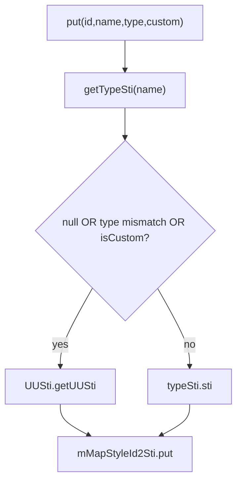

# 03_function_styleid2sti — XML styleId → 内核 sti

| 项 | 值 |
|----|----|
| feature | wc-02-document-model |
| order | 3 |
| crate | `libs/word-core/Cargo.toml` |
| 入口 | `StyleId2Sti::{put(styleId,name,type,isCustom), put(styleId,sti), put(styleId), getSti, nextUserSti, dispose}` / `UUSti::getUUSti` |
| 独立性 | 叶子（内存 HashMap + UUSti；不打开 styles.xml） |
| 测试状态 | pass |

## 1. 功能说明

### 1.1 一句话

把 OOXML `w:style/@w:styleId` 映射成内核 sti：内置名且类型匹配且非 custom 用 `TypeSti.sti`，否则 `UUSti.getUUSti()`。

### 1.2 输入

- 构造：`UUSti`（`TextDocument.getUUSti()`；Java `mStiCustom=4096`，`getUUSti` 为 `++mStiCustom` → **首个 4097**）
- `put(styleId, name, styleType, isCustom)`
- `put(styleId, Integer sti)` 强制写入；`put(styleId)` 只分配 UUSti
- `getSti(styleId)`；`dispose()`

`isMakeUUSti = typeSti==null \|\| styleType != typeSti.type \|\| isCustom`（Java 39 行）。

### 1.3 输出

- `put` 返回 coreId 并写入 map
- `getSti` miss = **null**，不是 4095（`stiNil` 是 wc-05 `toSti(null)`）
- `dispose`：map clear+null，并 `BuildinStyleSheet.clearMapName2TypeSti()`

### 1.4 上游

02 `getTypeSti`；`UUSti`。

### 1.5 下游

`DocumentImporter` 构造；`ParaPropsConverterSimple` 写 prop 191；wc-05 StylesImporter。

## 2. 核心代码与流程

Java：`…/importer/StyleId2Sti.java`（全文件 55 行）；`UUSti.java` 3–11  
Rust：`…/importer/StyleId2Sti.rs`；`core/UUSti.rs`



## 3. 测试方案

### 3.1 代码审计与测试面

| symbol | Java/Rust 路径 | 输入/状态 | 输出/副作用 | 关键分支/错误 |
|--------|----------------|-----------|-------------|---------------|
| `UUSti.getUUSti` | UUSti.java:9 | 新 UUSti | 4097 然后 4098 | 返回 4096（没 ++） |
| `put` 内置 heading 1 type=1 custom=false | StyleId2Sti.java:37–42 | | coreId=1，getSti 命中 | 走了 UUSti |
| `put` name Normal type=1 custom=false | | | coreId=0 | map 无 Normal 键时会 UUSti |
| `put` isCustom=true 即使 heading 1 | | | coreId=4097（新 maker） | 仍用 sti=1 |
| `put` type 不匹配 | name heading 1, styleType=2 | | UUSti | |
| `put` 未知 name | | | UUSti | |
| `getSti` miss | | 未 put | null | 返回 4095 |
| `put(styleId)` 无 name | :49–53 | | UUSti 并写入 | |
| `put(styleId, sti)` 强制 | :45–47 | sti=99 | getSti=99 | |
| `nextUserSti` | :33–35 | | 同 getUUSti，**不**写 map | |
| `dispose` | :18–25 | 已 put | getSti 不可用 / map null | 未清 BuildinStyleSheet |
| ctor null maker | :13–16 | | Assert | |

### 3.2 覆盖矩阵

| coverage_id | 接口/代码路径 | 场景类别 | 必测? | test_id |
|-------------|---------------|----------|-------|---------|
| C-UU | 首个 getUUSti==4097 | 常量/状态 | 是 | SI1 |
| C-H1 | heading 1 非 custom → 1 | 主路径 | 是 | SI2 |
| C-NOR | Normal 非 custom → 0 | 主路径 | 是 | SI3 |
| C-CUS | isCustom 强制 UUSti | 分支 | 是 | SI4 |
| C-TYP | type 不匹配 → UUSti | 分支 | 是 | SI5 |
| C-UNK | 未知 name → UUSti | 分支 | 是 | SI6 |
| C-MISS | getSti 未注册 → null | 失败 | 是 | SI7 |
| C-PUT1 | put(styleId) 只分配 | 主路径 | 是 | SI8 |
| C-FORCE | put(styleId, 99) | 主路径 | 是 | SI9 |
| C-NEXT | nextUserSti 不写 map | 分支 | 是 | SI10 |
| C-DSP | dispose 后 map 空 | cleanup | 是 | SI11 |

### 3.3 可测试性

`StyleId2Sti(UUSti::UUSti())`。不构造 TextDocument。SI4/SI5/SI6 用**新的** UUSti，断言返回值 ≥4097 且 `getSti` 等于该返回值。

### 3.4 用例表

| id | 覆盖项 | 前置状态 | 输入摘要 | 期望输出/副作用 | 失败语义 |
|----|--------|----------|----------|-----------------|----------|
| SI1 | C-UU | 新 UUSti | getUUSti 两次 | 4097, 4098 | 从 4096 起不自增 |
| SI2 | C-H1 | 新 map | put("h1","heading 1",1,false) | 1；getSti("h1")==1 | |
| SI3 | C-NOR | | put("n","Normal",1,false) | 0 | 当成自定义 |
| SI4 | C-CUS | 新 UUSti | put("h1","heading 1",1,**true**) | ≥4097，≠1 | 忽略 isCustom |
| SI5 | C-TYP | | put(..., type=2) | ≥4097 | 字符 type 误用段落 sti |
| SI6 | C-UNK | | put("x","zzz",1,false) | ≥4097 | |
| SI7 | C-MISS | 空 map | getSti("missing") | null | 4095 哨兵 |
| SI8 | C-PUT1 | | put("only-id") | 4097 且 getSti 命中 | 没写 map |
| SI9 | C-FORCE | | put("a", 99) | getSti=99 | |
| SI10 | C-NEXT | 空 map | nextUserSti | 4097；getSti("a") 仍 miss | 误写入 |
| SI11 | C-DSP | 已 SI2 | dispose | map 不可用；BuildinStyleSheet 可再 init | 泄漏静态表 |

### 3.5 测试代码位置

crate: `libs/word-core/Cargo.toml`  
src:   `libs/word-core/src/cn/wps/moffice/writer/io/reader/docxReader/importer/StyleId2Sti.rs`  
test:  `libs/word-core/tests/cn/wps/moffice/writer/io/reader/docxReader/importer/StyleId2Sti.rs`

覆盖率 `--src` 另加 `src/cn/wps/moffice/writer/core/UUSti.rs`。

### 3.6 测试运行脚本

```bash
cargo test --manifest-path libs/word-core/Cargo.toml --test 03_function_styleid2sti

bash .cursor/skills/feature-function/scripts/function-coverage.sh \
  --crate libs/word-core --test 03_function_styleid2sti \
  --src src/cn/wps/moffice/writer/io/reader/docxReader/importer/StyleId2Sti.rs \
  --src src/cn/wps/moffice/writer/core/UUSti.rs \
  --report libs/word-core/parser/features/wc-02-document-model/functions/03_function_styleid2sti/FUNCTION.md
```

### 3.7 覆盖率报告

<!-- coverage-report:begin -->
tool: cargo-llvm-cov (`cargo llvm-cov --test 03_function_styleid2sti --json`)
date: 2026-08-19 11:23

| src | lines covered | line % | regions covered | region % |
|-----|---------------|--------|-----------------|----------|
| `src/cn/wps/moffice/writer/core/UUSti.rs` | 7/7 | 100.0% | 7/7 | 100.0% |
| `src/cn/wps/moffice/writer/io/reader/docxReader/importer/StyleId2Sti.rs` | 59/62 | 95.2% | 101/108 | 93.5% |
| **function total** | **66/69** | **95.7%** |  |  |
<!-- coverage-report:end -->
