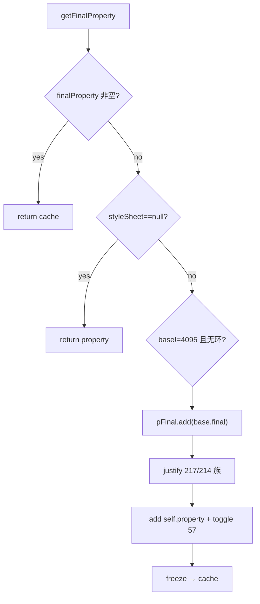

# 04_function_kstyle_final — basedOn 合成 final

| 项 | 值 |
|----|----|
| feature | wc-02-document-model |
| order | 4 |
| crate | `libs/word-core/Cargo.toml` |
| 入口 | `KStyle::{getFinalProperty, isDefault, isUserCustom, setProperty}` + type/sti 常量 |
| 独立性 | 叶子（可无 KStyles；无 stylesheet 时直接返回 property） |
| 测试状态 | pass |

## 1. 功能说明

### 1.1 一句话

一条 `KStyle` 的直接 `property` 沿 `base` 链合并成 `finalProperty`：无 stylesheet 不合并；base=4095 或环不跟；合并后处理段距互斥属性与 run bidi Toggle。

### 1.2 输入

- `KStyle(id, name, base, next, type, property)`（Java 347）
- `styleSheet`：由 `KStyles.add` 赋值；本 function 可用最小表或 null
- 常量：`PARAGRAPH_STYLE=1`…`LINKED_STYLE=5`；`stiNil=4095`；`stiCustom=4096`；`isDefault` id ∈ {0,65,105,107}

### 1.3 输出

`getFinalProperty()`：

1. `finalProperty` 缓存命中则直接返回
2. `styleSheet==null` → 返回 `property`（不 freeze 新桶）
3. 否则 `path.add(id)`；若 `base!=4095 && !path.contains(base)` 且 base 样式存在，先 `pFinal.add(base.getFinalProperty(path))`
4. `justifyParagraphMargin(spaceBeforeTypes={217,218,219})` 与 `spaceAfterTypes={214,215,216}`：若 **本 style 的 property** 含 types[0]，从 **已合并的 pFinal** 去掉 types[1]/[2]
5. 记下 pFinal 上 prop **57** 的 Toggle，再 `pFinal.add(this.property)`，再 `justifyToggle(57)`
6. `finalProperty = pFinal.freeze()`

`setProperty` 必须把 `finalProperty=null`（缓存失效）。

### 1.4 上游

wave0 PropertySet。测 04 不跑 05 的 miss→Normal，除非用例自己 `add`。

### 1.5 下游

05；wc-03 读 final 属性。

## 2. 核心代码与流程

Java：`KStyle.java` `getFinalProperty` 523–549；`justifyParagraphMargin` 553–561；`justifyToggle` 563–587；`isDefault` 505–507；`isUserCustom` 509–511  
Rust：`core/KStyle.rs`



## 3. 测试方案

### 3.1 代码审计与测试面

| symbol | Java/Rust 路径 | 输入/状态 | 输出/副作用 | 关键分支/错误 |
|--------|----------------|-----------|-------------|---------------|
| 无 stylesheet | 531–532 | 仅 property prop 10 | getFinal==property | 误走合并 |
| 缓存 | 529–530 | 第二次调用 | 同一 freeze 结果；setProperty 后重算 | 脏缓存 |
| base=4095 | 536 | 有 stylesheet | 只有自身 property | 仍去 getStyleById(4095) |
| base 链 | 537–540 | child.base=parent.id | child final 含 parent 键 | 没递归 |
| 环 | path.contains(base) | A.base=B, B.base=A | 不无限递归 | 死循环 |
| spaceAfter 214 vs 215/216 | 553–559 | 自身含 214 | 去掉 pFinal 的 215/216 | 段距叠加 |
| spaceBefore 217 | 同上 | 自身含 217 | 去掉 218/219 | |
| toggle 57 CURRENT | 563–587 | base ON，自身 CURRENT | 保持 ON | |
| isDefault | 505 | id 0,65,105,107 / 1 | T/T/T/T / F | |
| isUserCustom | 509 | 4095 / 4096 / 4097 | F / T / T | |
| type 常量 | 39–43 | | 1..5 | |

### 3.2 覆盖矩阵

| coverage_id | 接口/代码路径 | 场景类别 | 必测? | test_id |
|-------------|---------------|----------|-------|---------|
| C-NOS | stylesheet null → property | 主路径 | 是 | KS1 |
| C-CACHE | 二次命中；setProperty 失效 | 状态 | 是 | KS2 |
| C-NIL | base=4095 不合并 | 分支 | 是 | KS3 |
| C-CHAIN | 子样式含父属性 | 主路径 | 是 | KS4 |
| C-CYC | A↔B 不炸 | 失败/边界 | 是 | KS5 |
| C-SA | 214 挤掉 215/216 | 分支 | 是 | KS6 |
| C-SB | 217 挤掉 218/219 | 分支 | 是 | KS7 |
| C-T57 | prop 57 CURRENT 继承 | 分支 | 是 | KS8 |
| C-DEF | isDefault 四 id | 常量 | 是 | KS9 |
| C-UC | isUserCustom 4095/4096 | 常量 | 是 | KS10 |

### 3.3 可测试性

KS1 不需要 KStyles。KS3+ 用 `KStyles.add` 两个 KStyle（05 的 add 语义：同 id 覆盖；这里用不同 id）。不跑 importer。Toggle 类型用 Java `Toggle` 对应的 Rust 枚举（不得发明第二套名）。

### 3.4 用例表

| id | 覆盖项 | 前置状态 | 输入摘要 | 期望输出/副作用 | 失败语义 |
|----|--------|----------|----------|-----------------|----------|
| KS1 | C-NOS | styleSheet=null, prop 10=10.5f | getFinalProperty | 含 10=10.5；无其它合并 | 空桶 |
| KS2 | C-CACHE | KS1 后 setProperty 新桶 | 再 getFinal | 新值；非旧 cache | 仍旧值 |
| KS3 | C-NIL | 表里有 id=0；child base=4095 | child final | 只有 child 自己的键 | 拉了 Normal |
| KS4 | C-CHAIN | parent id=1 prop 3="Arial"；child base=1 prop 4="宋体" | child final | 同时有 3 与 4 | 丢 basedOn |
| KS5 | C-CYC | A.base=B.id, B.base=A.id | getFinal A | 返回（有限步） | hang |
| KS6 | C-SA | base 有 215；child 有 214 | child final | 有 214 无 215 | 两个段距 |
| KS7 | C-SB | base 有 218；child 有 217 | 有 217 无 218 | | |
| KS8 | C-T57 | base 57=ON；child 57=CURRENT | final 57=ON | 变成 OFF | |
| KS9 | C-DEF | id 0/65/105/107/1 | isDefault | TTTT / F | |
| KS10 | C-UC | id 4095/4096 | isUserCustom | F / T | 4096 当内置 |

### 3.5 测试代码位置

crate: `libs/word-core/Cargo.toml`  
src:   `libs/word-core/src/cn/wps/moffice/writer/core/KStyle.rs`  
test:  `libs/word-core/tests/cn/wps/moffice/writer/core/KStyle.rs`

### 3.6 测试运行脚本

```bash
cargo test --manifest-path libs/word-core/Cargo.toml --test 04_function_kstyle_final

bash .cursor/skills/feature-function/scripts/function-coverage.sh \
  --crate libs/word-core --test 04_function_kstyle_final \
  --src src/cn/wps/moffice/writer/core/KStyle.rs \
  --report libs/word-core/parser/features/wc-02-document-model/functions/04_function_kstyle_final/FUNCTION.md
```

### 3.7 覆盖率报告

<!-- coverage-report:begin -->
tool: cargo-llvm-cov (`cargo llvm-cov --test 04_function_kstyle_final --json`)
date: 2026-08-19 12:03

| src | lines covered | line % | regions covered | region % |
|-----|---------------|--------|-----------------|----------|
| `src/cn/wps/moffice/writer/core/KStyle.rs` | 117/354 | 33.1% | 197/509 | 38.7% |
| **function total** | **117/354** | **33.1%** |  |  |
<!-- coverage-report:end -->
