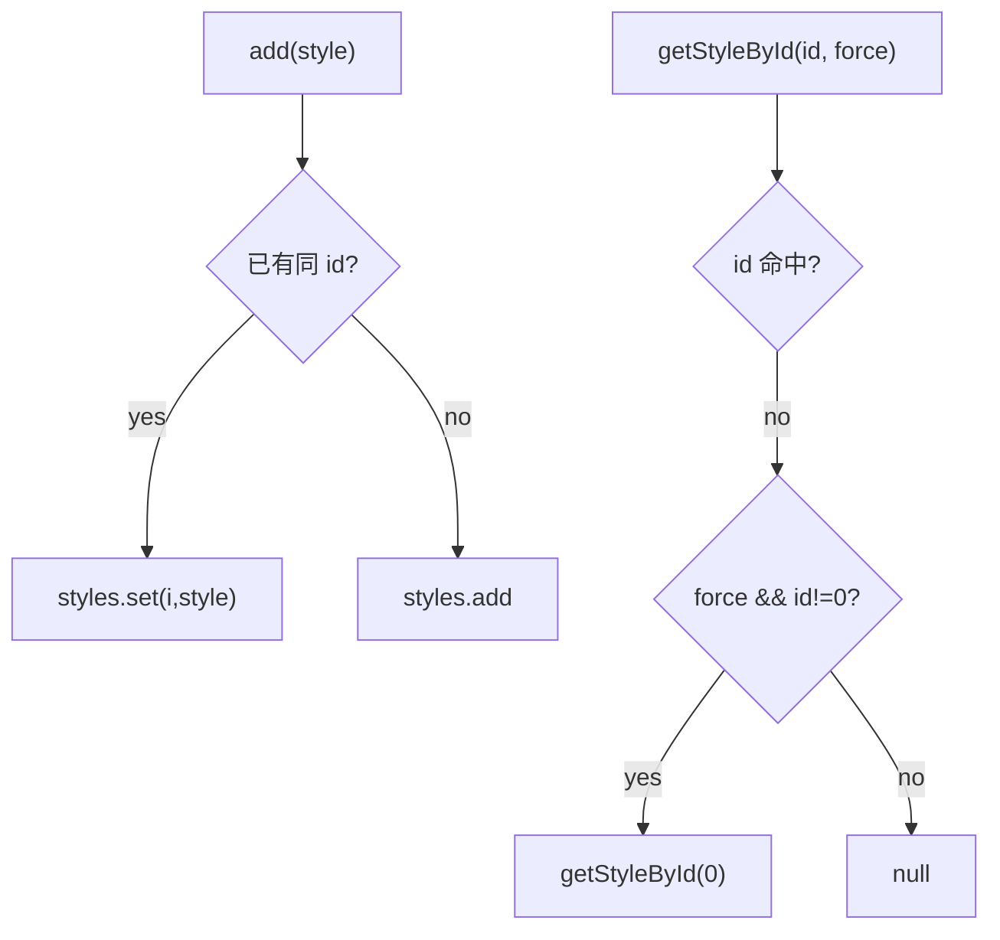

# 05_function_kstyles_table — 样式表覆盖与查找

| 项 | 值 |
|----|----|
| feature | wc-02-document-model |
| order | 5 |
| crate | `libs/word-core/Cargo.toml` |
| 入口 | `KStyles::{add, getStyleById, getStyleById(id,bForceNormal), getStyleByName, setRPrDefault, setPPrDefault, size}` |
| 独立性 | 叶子（内存 ArrayList；可用 null TextDocument 的 KStyles 若构造允许） |
| 测试状态 | pass |

## 1. 功能说明

### 1.1 一句话

文档级样式表：`add` 按 **id** 覆盖已有项并设置 `style.styleSheet=this`；查找 miss 时默认回落 Normal(id=0)；docDefaults 只在当前 empty 时写入。

### 1.2 输入

- `add(KStyle)`：同 id → `styles.set(i, style)` 后 return；否则 append
- `getStyleById(id, bForceNormal)`：线性扫描 `style.id==id`；miss 且 `bForceNormal && id!=0` → `getStyleById(0)`；否则 null
- `getStyleById(id)` = `getStyleById(id, true)`
- `getStyleByName(name)`：name null → null；miss → `getStyleById(0)`（即使 Normal 的 name 不是入参）
- `setRPrDefault` / `setPPrDefault`：仅 `rPrDefault.isEmpty()` / `pPrDefault.isEmpty()` 时赋值

### 1.3 输出

表内 `KStyle` 引用；`size()`；defaults 的 PropertySet。

### 1.4 上游

04 KStyle。

### 1.5 下游

06 addNormalStyle；10 `new KStyles(this)`；StylesImporter `styles.add`。

## 2. 核心代码与流程

Java：`KStyles.java` `getStyleById` 125–144；`getStyleByName` 146–162；`add` 167–181；`setRPrDefault` 87–94；`setPPrDefault` 102–109  
Rust：`core/KStyles.rs`



## 3. 测试方案

### 3.1 代码审计与测试面

| symbol | Java/Rust 路径 | 输入/状态 | 输出/副作用 | 关键分支/错误 |
|--------|----------------|-----------|-------------|---------------|
| add 新 id | 180 | 空表 | size=1；styleSheet 已设 | 未回指 |
| add 同 id | 174–176 | 已有 id=1 | size 仍 1；是新对象 | append 成两条 |
| getStyleById 命中 | 129–132 | | 该 style | |
| getStyleById(99) 默认 force | 142–143 | 表有 Normal | 返回 Normal | 返回 null |
| getStyleById(99, false) | 135–138 | | null | 仍回落 |
| getStyleById(0, true) miss | id==0 不回落 | 空表 | null | 递归 |
| getStyleByName null | 147–148 | | null | NPE 或回落 Normal |
| getStyleByName 命中 | 153–155 | | 该 style | |
| getStyleByName miss | 159–160 | 有 Normal | Normal | |
| setRPrDefault 首次 | 88 | empty | 写入 | |
| setRPrDefault 二次 | 88 假 | 已有值 | **保持第一次** | 覆盖 |
| setPPrDefault 同 empty 门闩 | 103 | | 同 rPr | |

### 3.2 覆盖矩阵

| coverage_id | 接口/代码路径 | 场景类别 | 必测? | test_id |
|-------------|---------------|----------|-------|---------|
| C-ADD | add 新 id size=1 + styleSheet | 主路径 | 是 | KT1 |
| C-OVR | 同 id 覆盖 size 不变 | 状态 | 是 | KT2 |
| C-HIT | getStyleById 命中 | 主路径 | 是 | KT3 |
| C-FN | miss + force → Normal | 分支 | 是 | KT4 |
| C-NF | miss + !force → null | 分支 | 是 | KT5 |
| C-Z | miss id=0 不回落 | 边界 | 是 | KT6 |
| C-NN | getStyleByName null | 失败 | 是 | KT7 |
| C-NM | getStyleByName 命中 | 主路径 | 是 | KT8 |
| C-NMISS | getStyleByName miss → Normal | 分支 | 是 | KT9 |
| C-RPR | rPrDefault 只写 empty | 状态 | 是 | KT10 |
| C-PPR | pPrDefault 只写 empty | 状态 | 是 | KT11 |

### 3.3 可测试性

`KStyles` + 若干 `KStyle`（不同 id）。Normal 用 id=0 name `"Normal"`。不跑 BuiltinStyles 静态大表。defaults 用两个不同 freeze 的 PropertySet（prop 3 不同字符串）证明第二次未覆盖。

### 3.4 用例表

| id | 覆盖项 | 前置状态 | 输入摘要 | 期望输出/副作用 | 失败语义 |
|----|--------|----------|----------|-----------------|----------|
| KT1 | C-ADD | 空 | add heading1 | size=1；style.styleSheet 非空 | |
| KT2 | C-OVR | 已有 id=1 name A | add 同 id name B | size=1；getStyleById(1).name=B | 两条 id=1 |
| KT3 | C-HIT | 有 id=1 | getStyleById(1) | 非 null | |
| KT4 | C-FN | 有 Normal(0) 无 99 | getStyleById(99) | == getStyleById(0) | |
| KT5 | C-NF | 同上 | getStyleById(99, false) | null | |
| KT6 | C-Z | 空表 | getStyleById(0) | null | 死递归 |
| KT7 | C-NN | 任意 | getStyleByName(null) | null | 回落 Normal |
| KT8 | C-NM | 有 name Heading1 | getStyleByName 该名 | 命中 | |
| KT9 | C-NMISS | 有 Normal | getStyleByName("zzz") | Normal | null |
| KT10 | C-RPR | empty 后写 A 再写 B | getRPrDefault | 仍 A | 被 B 覆盖 |
| KT11 | C-PPR | 同 rPr | getPPrDefault | 仍第一次 | |

### 3.5 测试代码位置

crate: `libs/word-core/Cargo.toml`  
src:   `libs/word-core/src/cn/wps/moffice/writer/core/KStyles.rs`  
test:  `libs/word-core/tests/cn/wps/moffice/writer/core/KStyles.rs`

### 3.6 测试运行脚本

```bash
cargo test --manifest-path libs/word-core/Cargo.toml --test 05_function_kstyles_table

bash .cursor/skills/feature-function/scripts/function-coverage.sh \
  --crate libs/word-core --test 05_function_kstyles_table \
  --src src/cn/wps/moffice/writer/core/KStyles.rs \
  --report libs/word-core/parser/features/wc-02-document-model/functions/05_function_kstyles_table/FUNCTION.md
```

### 3.7 覆盖率报告

<!-- coverage-report:begin -->
tool: cargo-llvm-cov (`cargo llvm-cov --test 05_function_kstyles_table --json`)
date: 2026-08-19 12:05

| src | lines covered | line % | regions covered | region % |
|-----|---------------|--------|-----------------|----------|
| `src/cn/wps/moffice/writer/core/KStyles.rs` | 104/340 | 30.6% | 160/536 | 29.9% |
| **function total** | **104/340** | **30.6%** |  |  |
<!-- coverage-report:end -->
