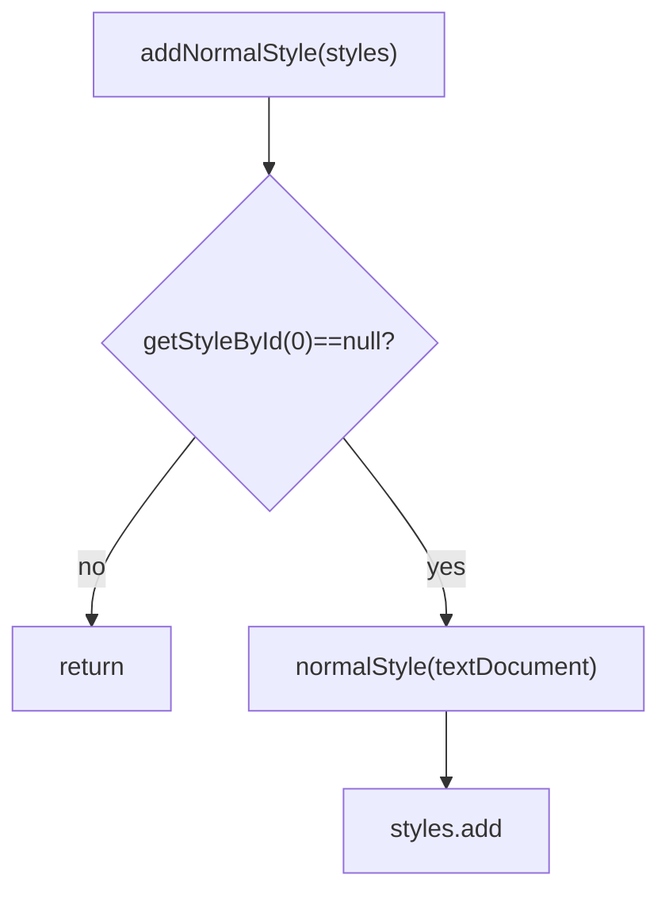

# 06_function_add_normal_style — 保证 Normal sti=0

| 项 | 值 |
|----|----|
| feature | wc-02-document-model |
| order | 6 |
| crate | `libs/word-core/Cargo.toml` |
| 入口 | `IOHelper::{addNormalStyle, normalStyle}` |
| 独立性 | 叶子（只碰 KStyles id=0；不跑 onMainDocumentStart 全管线） |
| 测试状态 | pass |

## 1. 功能说明

### 1.1 一句话

导入主文档前：若表中没有 id=0，则插入一条 **Normal** 段落样式（sti=0, type=1, base/next=4095, float **10=10.5**, int **193=3**）。

### 1.2 输入

`addNormalStyle(KStyles styles)`：styles 非 null；若 `getStyleById(0)==null` 则需要 `styles.getTextDocument()` 非 null。

`normalStyle`（Java private）：`new KStyle(textDocument, 0, "Normal", 4095, 4095, 1, freeze)`。

### 1.3 输出

- 空表：之后 `getStyleById(0)` 非 null；`name=="Normal"`；`type==1`；`base==next==4095`；property 含 10=10.5f 与 193=3
- 已有 id=0：不替换（第二次 addNormalStyle 是 no-op）
- styles null → Assert（失败停在本级）

### 1.4 上游

05 `getStyleById` / `add`。

### 1.5 下游

`DocumentImporter` / `onMainDocumentStart`；`FinishReadingWork` 再调一次。

## 2. 核心代码与流程

Java：`IOHelper.java` 297–315  
Rust：`io/reader/helper/IOHelper.rs` addNormalStyle / normalStyle



## 3. 测试方案

### 3.1 代码审计与测试面

| symbol | Java/Rust 路径 | 输入/状态 | 输出/副作用 | 关键分支/错误 |
|--------|----------------|-----------|-------------|---------------|
| addNormalStyle 空表 | 297–303 | getStyleById(0) null | 插入 Normal | 没插 |
| 字段 | 307–314 | | id=0 name Normal type=1 base/next=4095 | type 写成 2 |
| prop 10 | setFloat(10, 10.5F) | | getFloat(10)==10.5 | 写成 10 或 int |
| prop 193 | setInt(193, 3) | | getInt(193)==3 | |
| 第二次 | 298 假 | 已有 id=0 其它 name | **保留原对象** | 覆盖成新 Normal |
| styles null | 298 | | Assert | 静默 |
| textDocument null 且需插入 | 301 | | Assert | |

### 3.2 覆盖矩阵

| coverage_id | 接口/代码路径 | 场景类别 | 必测? | test_id |
|-------------|---------------|----------|-------|---------|
| C-INS | 空表插入 | 主路径 | 是 | NS1 |
| C-ID | id=0 type=1 name Normal | 常量 | 是 | NS2 |
| C-BASE | base=next=4095 | 常量 | 是 | NS3 |
| C-10 | prop 10 = 10.5f | 主路径 | 是 | NS4 |
| C-193 | prop 193 = 3 | 主路径 | 是 | NS5 |
| C-2ND | 已有 id=0 不覆盖 | 状态 | 是 | NS6 |
| C-NULL | styles null Assert | 失败 | 否（Rust `&mut KStyles` 无法传 null） | — |

### 3.3 可测试性

最小 `KStyles` 绑一个能 `getTextDocument` 的对象（Loop 可用 `TextDocument(true)` mock 或 10 的产物）。测 06 **不**调用 `_create` 的 7 槽。NS6：先 `add` 一条 id=0 name `"KeepMe"`，再 addNormalStyle，name 仍 KeepMe。

### 3.4 用例表

| id | 覆盖项 | 前置状态 | 输入摘要 | 期望输出/副作用 | 失败语义 |
|----|--------|----------|----------|-----------------|----------|
| NS1 | C-INS | 空 KStyles | addNormalStyle | getStyleById(0) 非 null | |
| NS2 | C-ID | NS1 | 读字段 | name Normal, type 1, id 0 | |
| NS3 | C-BASE | NS1 | | base=4095 next=4095 | 基于自己 |
| NS4 | C-10 | NS1 | getFloat(10) | 10.5 | 缺字号 |
| NS5 | C-193 | NS1 | getInt(193) | 3 | |
| NS6 | C-2ND | 已有 id=0 KeepMe | 再 addNormalStyle | name 仍 KeepMe；size 不增 | 覆盖 |
| NS7 | C-NULL | — | addNormalStyle(null) | Assert/panic | 静默 |

### 3.5 测试代码位置

crate: `libs/word-core/Cargo.toml`  
src:   `libs/word-core/src/cn/wps/moffice/writer/io/reader/helper/IOHelper.rs`  
test:  `libs/word-core/tests/cn/wps/moffice/writer/io/reader/helper/IOHelper.rs`

覆盖率只统计 IOHelper.rs 会很稀（文件 4000+ 行、本 function 仅 addNormalStyle）。Loop 仍按脚本跑本文件；不得改用全 crate 覆盖率。

### 3.6 测试运行脚本

```bash
cargo test --manifest-path libs/word-core/Cargo.toml --test 06_function_add_normal_style

bash .cursor/skills/feature-function/scripts/function-coverage.sh \
  --crate libs/word-core --test 06_function_add_normal_style \
  --src src/cn/wps/moffice/writer/io/reader/helper/IOHelper.rs \
  --report libs/word-core/parser/features/wc-02-document-model/functions/06_function_add_normal_style/FUNCTION.md
```

### 3.7 覆盖率报告

<!-- coverage-report:begin -->
tool: cargo-llvm-cov (`cargo llvm-cov --test 06_function_add_normal_style --json`)
date: 2026-08-19 12:08

| src | lines covered | line % | regions covered | region % |
|-----|---------------|--------|-----------------|----------|
| `src/cn/wps/moffice/writer/io/reader/helper/IOHelper.rs` | 23/23 | 100.0% | 46/46 | 100.0% |
| **function total** | **23/23** | **100.0%** |  |  |
<!-- coverage-report:end -->
